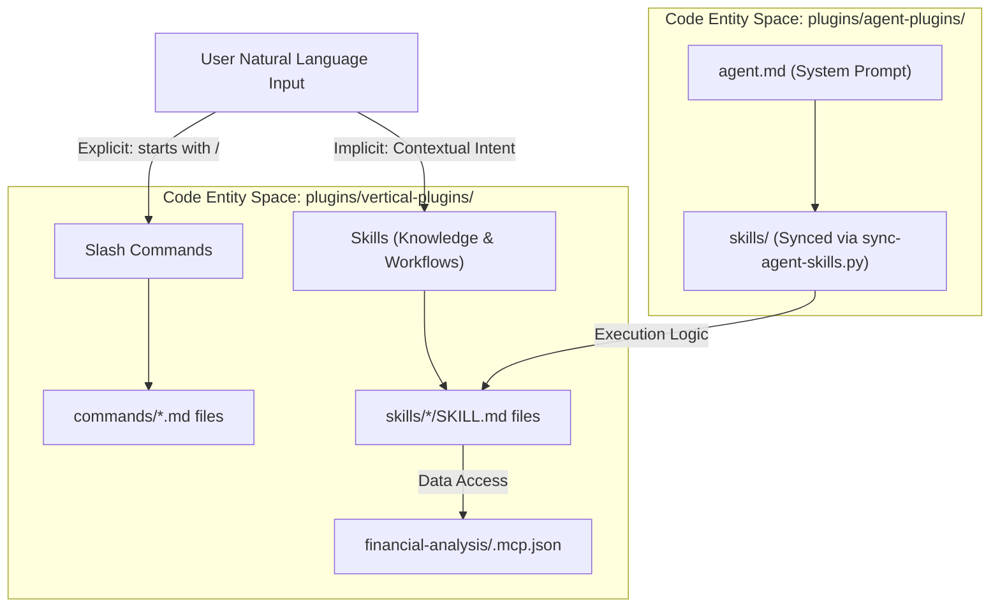
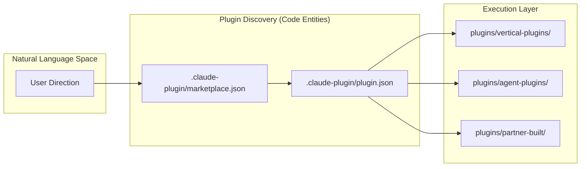

<!-- source: DeepWiki mcp.deepwiki.com · repo anthropics/financial-services · page 2 Plugin Architecture · fetched 2026-10-26 -->

# Plugin Architecture

Relevant source files

The following files were used as context for generating this wiki page:

- [.claude-plugin/marketplace.json](.claude-plugin/marketplace.json)
- [.github/workflows/plugin-validate.yml](.github/workflows/plugin-validate.yml)
- [README.md](README.md)
- [plugins/vertical-plugins/financial-analysis/.mcp.json](plugins/vertical-plugins/financial-analysis/.mcp.json)

The financial-services repository utilizes a modular plugin system designed to deliver domain-specific financial expertise across two primary surfaces: **Claude Cowork** and **Claude Managed Agents (CMA)** [README.md:3-5](). The architecture follows a "one source, two wrappers" principle, where the core logic (system prompts and skills) is authored once and packaged for different deployment contexts [README.md:5]().

## Discovery and Registration

Plugins are discovered and registered through a hierarchical manifest system that allows the Claude environment to understand the capabilities and source locations of various tools.

### Marketplace Manifest
The root `.claude-plugin/marketplace.json` serves as the central registry for the entire repository. It maps plugin names to their filesystem sources and provides high-level descriptions for the marketplace UI [marketplace.json:1-128]().

### Plugin Manifest
Each individual plugin directory contains a `.claude-plugin/plugin.json` file. This manifest defines:
*   **Metadata**: Name, version, and description [README.md:93-97]().
*   **Component Discovery**: Instructions for how Claude should find commands and skills within that specific plugin [README.md:94-95]().
*   **Validation**: Every plugin is validated via the Claude Code CLI in CI to ensure manifest integrity [github/workflows/plugin-validate.yml:43-60]().

**Sources:** [.claude-plugin/marketplace.json:1-128](), [README.md:91-99](), [.github/workflows/plugin-validate.yml:1-65]()

## Plugin Categories

The system distinguishes between three types of plugins to balance modularity with ease of use.

### 1. Vertical Plugins (FSI Domain Libraries)
Vertical plugins are the primary sources of domain expertise. They bundle specific financial commands, skills, and **Model Context Protocol (MCP)** connectors [README.md:13-14]().
*   **Purpose**: To provide a library of tools for specific financial sectors (e.g., Equity Research, Private Equity) [marketplace.json:14-48]().
*   **Key Feature**: The `financial-analysis` vertical acts as the "core" hub, housing shared modeling skills and primary data connectors like FactSet, LSEG, and PitchBook [README.md:103-107](), [plugins/vertical-plugins/financial-analysis/.mcp.json:1-51]().
*   **Details**: For a full reference of commands and MCP configurations, see **[Vertical Plugins (FSI Domain Libraries)](#2.1)**.

### 2. Agent Plugins
Agent plugins are "named" agents designed for end-to-end workflows (e.g., `pitch-agent`, `gl-reconciler`) [README.md:15-32]().
*   **Self-Contained**: Each agent plugin bundles its own system prompt and a local copy of the skills it requires to ensure it is fully functional upon installation [README.md:19]().
*   **Synchronization**: To prevent logic drift, skills are authored in `vertical-plugins/` (source) and synced to `agent-plugins/` (bundled) using `scripts/sync-agent-skills.py` [README.md:45](), [README.md:94]().
*   **Details**: For details on agent prompts and bundling, see **[Agent Plugins](#2.2)**.

### 3. Partner-Built Plugins
These are specialized plugins authored by partners (LSEG and S&P Global) that provide deep integration with proprietary financial data terminals and analytics engines [marketplace.json:110-120]().
*   **Details**: For installation and entitlement requirements, see **[Partner-Built Plugins (LSEG & S&P Global)](#2.3)**.

## Interaction Model

The following diagram illustrates how natural language intent is mapped to code entities and executed through the plugin architecture.

### Intent Execution Flow

**Sources:** [README.md:45](), [README.md:91-97](), [plugins/vertical-plugins/financial-analysis/.mcp.json:1-51]()

## Component Invocation

| Component | Invocation Method | File Location |
| :--- | :--- | :--- |
| **Commands** | Explicitly triggered by user via slash commands (e.g., `/comps`) [README.md:76](). | `plugins/vertical-plugins/<vertical>/commands/` [README.md:95]() |
| **Skills** | Automatically invoked by Claude when relevant to the conversation context [README.md:76](). | `plugins/vertical-plugins/<vertical>/skills/` [README.md:94]() |
| **MCP Connectors** | Tools called by Claude to fetch live data from 11+ external providers [README.md:96](). | `plugins/vertical-plugins/financial-analysis/.mcp.json` [README.md:96]() |

### System Architecture Overview

**Sources:** [marketplace.json:1-128](), [README.md:39-46](), [README.md:91-99]()

## Validation and Syncing

To maintain integrity across the repository, especially when skills are duplicated for agent bundling, the repository includes mandatory validation tooling.

*   **`scripts/check.py`**: Lints manifests and detects drift between vertical-plugins and agent-plugins [README.md:45]().
*   **`scripts/sync-agent-skills.py`**: The canonical script for propagating updates from the source of truth in `vertical-plugins/` to the self-contained `agent-plugins/` [README.md:45](), [README.md:94]().
*   **`scripts/deploy-managed-agent.sh`**: Resolves YAML manifests to JSON, uploads skills, and creates the managed agent via the API [README.md:85]().
*   **`scripts/orchestrate.py`**: Provides a reference event loop for routing `handoff_request` events between agents in headless deployments [README.md:85]().

**Sources:** [README.md:45](), [README.md:80-87](), [README.md:94]()

---

