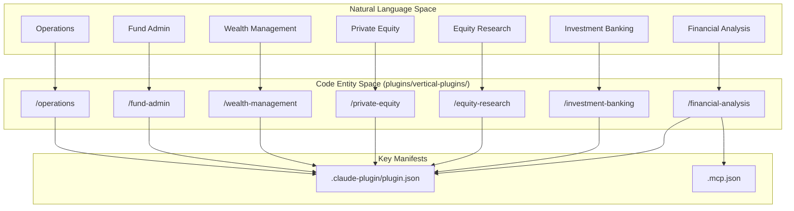
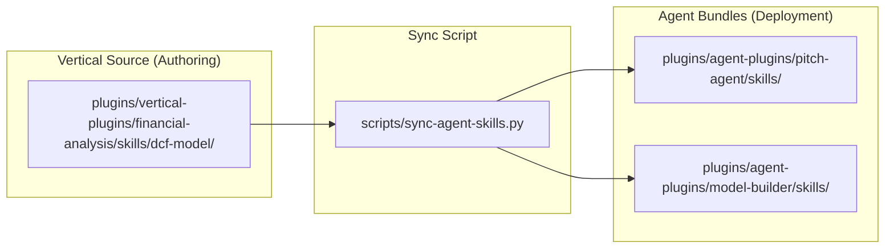

<!-- source: DeepWiki mcp.deepwiki.com · repo anthropics/financial-services · page 2.1 Vertical Plugins (FSI Domain Libraries) · fetched 2026-10-26 -->

# Vertical Plugins (FSI Domain Libraries)

Relevant source files

The following files were used as context for generating this wiki page:

- [plugins/vertical-plugins/equity-research/.claude-plugin/plugin.json](plugins/vertical-plugins/equity-research/.claude-plugin/plugin.json)
- [plugins/vertical-plugins/financial-analysis/.claude-plugin/plugin.json](plugins/vertical-plugins/financial-analysis/.claude-plugin/plugin.json)
- [plugins/vertical-plugins/financial-analysis/hooks/hooks.json](plugins/vertical-plugins/financial-analysis/hooks/hooks.json)
- [plugins/vertical-plugins/investment-banking/.claude-plugin/plugin.json](plugins/vertical-plugins/investment-banking/.claude-plugin/plugin.json)
- [plugins/vertical-plugins/private-equity/.claude-plugin/plugin.json](plugins/vertical-plugins/private-equity/.claude-plugin/plugin.json)
- [plugins/vertical-plugins/wealth-management/.claude-plugin/plugin.json](plugins/vertical-plugins/wealth-management/.claude-plugin/plugin.json)

This page provides a high-level overview of the seven vertical plugins that serve as the domain-specific libraries for the Claude for Financial Services repository. These plugins contain the foundational skills, slash commands, and Model Context Protocol (MCP) configurations that power both the standalone Cowork experience and the end-to-end [Agent Plugins](#2.2).

## Overview

Vertical plugins are organized by financial services industry (FSI) domains. They act as the "source of truth" for specialized financial workflows. Unlike [Agent Plugins](#2.2), which are self-contained bundles designed for specific roles (e.g., `pitch-agent`), vertical plugins are modular libraries intended to be mixed and matched based on an analyst's specific coverage area [README.md:13]().

### Core Architecture

The vertical plugins are located in `plugins/vertical-plugins/` [CLAUDE.md:14](). Each vertical follows a standard structure:
- **`commands/`**: Explicit slash actions invoked as `/plugin:command-name` [CLAUDE.md:17, 39]().
- **`skills/`**: Domain expertise, conventions, and step-by-step methods invoked automatically by Claude when trigger conditions match [CLAUDE.md:18, 48]().
- **`.mcp.json`**: Configuration for data connectors (Terminals, CRM, Document Stores) [CLAUDE.md:19]().
- **`.claude-plugin/plugin.json`**: Metadata defining the plugin name, version, and description [plugins/vertical-plugins/financial-analysis/.claude-plugin/plugin.json:1-8]().

### Plugin Mapping: Natural Language to Code Entities

The following diagram illustrates how natural language domain concepts map to specific code directories and manifest entries within the `vertical-plugins` directory.

**Vertical Plugin Entity Map**

**Sources:** [.claude-plugin/marketplace.json:6-41](), [CLAUDE.md:14-19](), [README.md:101-107](), [plugins/vertical-plugins/financial-analysis/.claude-plugin/plugin.json:1-8]()

---

## The Seven Vertical Plugins

### 1. Financial Analysis (Core)
The `financial-analysis` plugin is the central hub of the repository. It contains the core financial modeling and analysis tools, including DCF, comps, LBO, and 3-statement models [plugins/vertical-plugins/financial-analysis/.claude-plugin/plugin.json:4](). It also serves as the primary configuration point for all 11 MCP data connectors, including Daloopa, FactSet, LSEG, and Morningstar [.claude-plugin/marketplace.json:8-11](), [README.md:96, 103]().

For details, see [Financial Analysis (Core Vertical)](#2.1.1).

### 2. Investment Banking
Focused on advisory and capital markets productivity. It includes tools for market insights, deck creation, and transaction management, as well as specific outputs like CIMs and teasers [plugins/vertical-plugins/investment-banking/.claude-plugin/plugin.json:4]().

For details, see [Investment Banking, Equity Research & Other Verticals](#2.1.2).

### 3. Equity Research
Contains workflows for the research process, including earnings analysis, initiating coverage reports, and research note drafting [plugins/vertical-plugins/equity-research/.claude-plugin/plugin.json:4]().

For details, see [Investment Banking, Equity Research & Other Verticals](#2.1.2).

### 4. Private Equity
Tailored for the deal lifecycle, including company discovery, CRM integration for sourcing, and founder outreach workflows [plugins/vertical-plugins/private-equity/.claude-plugin/plugin.json:4]().

For details, see [Investment Banking, Equity Research & Other Verticals](#2.1.2).

### 5. Wealth Management
Provides tools for financial advisors and wealth managers, covering client reviews, financial planning, portfolio analysis, and reporting [plugins/vertical-plugins/wealth-management/.claude-plugin/plugin.json:4]().

For details, see [Investment Banking, Equity Research & Other Verticals](#2.1.2).

### 6. Fund Admin
Supports fund administration and finance operations. Key workflows include GL reconciliation, break tracing, accruals, roll-forwards, and NAV tie-outs [.claude-plugin/marketplace.json:33-36]().

For details, see [Investment Banking, Equity Research & Other Verticals](#2.1.2).

### 7. Operations
Focuses on operational workflows, specifically parsing KYC (Know Your Customer) documents and evaluating rules-grids [.claude-plugin/marketplace.json:38-41]().

For details, see [Investment Banking, Equity Research & Other Verticals](#2.1.2).

---

## Relationship to Agents

Vertical plugins provide the "source" skills that are synced into `agent-plugins`. While an analyst might install a vertical plugin to gain access to a specific command like `/comps`, the named agents (e.g., `pitch-agent`) bundle these skills to provide a guided, end-to-end experience [README.md:93-94]().

**Skill Propagation Flow**

**Sources:** [CLAUDE.md:31](), [README.md:94]()

**Sources:**
- [.claude-plugin/marketplace.json:1-108]()
- [CLAUDE.md:1-46]()
- [README.md:1-107]()
- [plugins/vertical-plugins/financial-analysis/.claude-plugin/plugin.json:1-8]()
- [plugins/vertical-plugins/investment-banking/.claude-plugin/plugin.json:1-8]()
- [plugins/vertical-plugins/equity-research/.claude-plugin/plugin.json:1-8]()
- [plugins/vertical-plugins/private-equity/.claude-plugin/plugin.json:1-8]()
- [plugins/vertical-plugins/wealth-management/.claude-plugin/plugin.json:1-8]()

---

