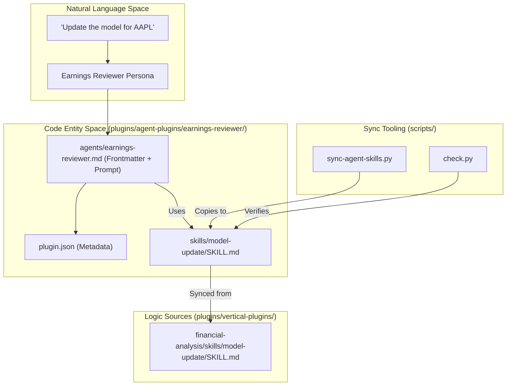
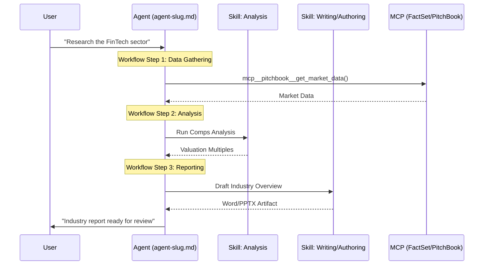

<!-- source: DeepWiki mcp.deepwiki.com · repo anthropics/financial-services · page 2.2 Agent Plugins · fetched 2026-10-26 -->

# Agent Plugins

Relevant source files

The following files were used as context for generating this wiki page:

- [plugins/agent-plugins/earnings-reviewer/.claude-plugin/plugin.json](plugins/agent-plugins/earnings-reviewer/.claude-plugin/plugin.json)
- [plugins/agent-plugins/market-researcher/.claude-plugin/plugin.json](plugins/agent-plugins/market-researcher/.claude-plugin/plugin.json)
- [plugins/agent-plugins/meeting-prep-agent/.claude-plugin/plugin.json](plugins/agent-plugins/meeting-prep-agent/.claude-plugin/plugin.json)
- [plugins/agent-plugins/pitch-agent/.claude-plugin/plugin.json](plugins/agent-plugins/pitch-agent/.claude-plugin/plugin.json)
- [plugins/agent-plugins/valuation-reviewer/.claude-plugin/plugin.json](plugins/agent-plugins/valuation-reviewer/.claude-plugin/plugin.json)

The **Agent Plugin** layer (located in `plugins/agent-plugins/`) represents the high-level "Persona" tier of the repository. While **Vertical Plugins** provide the raw tools and domain libraries (skills), Agent Plugins bundle these capabilities into cohesive, named agents designed to perform end-to-end financial workflows like earnings reviews, GL reconciliation, or pitch book generation [[CLAUDE.md:1-13]]().

Each agent plugin is a self-contained package that serves as the canonical source for two deployment surfaces: **Claude Cowork** (interactive plugins) and **Claude Managed Agents** (automated cookbooks) [[CLAUDE.md:1-5]]().

## Architectural Overview

Agent Plugins act as an orchestration layer. They do not define new skills from scratch; instead, they reference and bundle existing skills from the `vertical-plugins/` directory [[CLAUDE.md:12-14]]().

### Data Flow: Skill Propagation
The repository follows a "One Source, Two Wrappers" design principle. To maintain consistency:
1.  **Source of Truth:** All technical logic (skills and commands) is authored in `plugins/vertical-plugins/` [[CLAUDE.md:31-32]]().
2.  **Propagation:** The script `scripts/sync-agent-skills.py` is used to copy these skills into the `skills/` directory of the relevant Agent Plugin [[CLAUDE.md:28-31]]().
3.  **Validation:** The `scripts/check.py` utility verifies that the bundled skills in the agent-plugins haven't drifted from their vertical sources [[CLAUDE.md:31-32]]().

### Component Mapping: Natural Language to Code
This diagram illustrates how a natural language request to a specific agent maps to the underlying code entities and the sync mechanism.

**Agent Entity Mapping**

Sources: [[CLAUDE.md:8-19]](), [[CLAUDE.md:28-31]]()

---

## Plugin Structure

Every agent plugin directory (e.g., `plugins/agent-plugins/earnings-reviewer/`) must contain the following structure:

### 1. The Metadata Manifest (`plugin.json`)
Located at `.claude-plugin/plugin.json`, this file defines the agent's identity for the marketplace. It includes the `name`, `version`, and `description`.

| Field | Description | Example (Pitch Agent) |
| :--- | :--- | :--- |
| `name` | Unique identifier for the agent | `"pitch-agent"` |
| `version` | SemVer versioning | `"0.1.1"` |
| `description` | High-level summary of capabilities | `"Comps, precedents, LBO to a branded pitch deck"` |

Sources: [[plugins/agent-plugins/earnings-reviewer/.claude-plugin/plugin.json:1-8]](), [[plugins/agent-plugins/pitch-agent/.claude-plugin/plugin.json:1-8]]()

### 2. The Canonical Agent Definition (`agents/<slug>.md`)
This Markdown file is the most critical component. It contains:
*   **YAML Frontmatter:** Defines the agent's `name`, `description`, and the specific `tools` it is granted (e.g., `mcp__factset__*`, `Read`, `Write`).
*   **System Prompt:** The detailed instructions governing the agent's behavior, specific deliverables (e.g., "Updated coverage model"), and multi-step workflows.

### 3. Bundled Skills (`skills/`)
A subdirectory containing local copies of skills required by the agent. Each skill includes its own `SKILL.md` which defines triggers and step-by-step logic.

---

## Agent Catalog & Skill Bundling

The following table details how specific agents bundle skills from the vertical libraries to perform their roles.

| Agent Slug | Description from `plugin.json` | Core Purpose |
| :--- | :--- | :--- |
| `earnings-reviewer` | "Earnings call and filings to model update to note draft" | End-to-end processing of earnings events [[plugins/agent-plugins/earnings-reviewer/.claude-plugin/plugin.json:4-4]]() |
| `market-researcher` | "Sector or theme to industry overview, competitive landscape..." | Peer comps and ideas shortlist [[plugins/agent-plugins/market-researcher/.claude-plugin/plugin.json:4-4]]() |
| `meeting-prep-agent`| "Briefing pack before every client meeting" | Generates client briefing packs [[plugins/agent-plugins/meeting-prep-agent/.claude-plugin/plugin.json:4-4]]() |
| `pitch-agent` | "Comps, precedents, LBO to a branded pitch deck, end to end" | Generates pitch books and valuation decks [[plugins/agent-plugins/pitch-agent/.claude-plugin/plugin.json:4-4]]() |
| `valuation-reviewer`| "Ingests GP packages, runs valuation template, stages LP reporting" | Private equity fund reporting workflows [[plugins/agent-plugins/valuation-reviewer/.claude-plugin/plugin.json:4-4]]() |

---

## Implementation Details: The Agent Prompt

The agent's `agents/<slug>.md` file serves as the master configuration. It uses a structured format to ensure the LLM understands its constraints and operational workflow.

### Workflow & Guardrails
Agents are programmed with explicit workflows and guardrails. For example, a typical agent has a multi-step workflow starting with data ingestion and ending with a final deliverable.

**Agent Execution Logic**

Sources: [[CLAUDE.md:46-47]](), [[plugins/agent-plugins/pitch-agent/.claude-plugin/plugin.json:4-4]]()

### Skill Integration
Agents reference their bundled skills within the prompt to guide the LLM on when to transition from general reasoning to specific technical workflows.
*   **Headless Fallbacks:** In managed-agent (headless) modes, agents often use skills like `xlsx-author` or `pptx-author` to produce file artifacts instead of driving live desktop applications via MCP.

## Syncing and Validation

Because Agent Plugins contain redundant copies of skills (for portability as standalone plugins), the following scripts must be used during development:

1.  **`scripts/sync-agent-skills.py`**: Iterates through `plugins/agent-plugins/`, identifies required skills, and copies the latest versions from `plugins/vertical-plugins/` [[CLAUDE.md:31-31]]().
2.  **`scripts/check.py`**: A linter that ensures `plugin.json` is valid and verifies that no `skills/` within an agent plugin have drifted from their vertical source [[CLAUDE.md:31-31]]().

Sources: [[CLAUDE.md:28-32]]()

---

