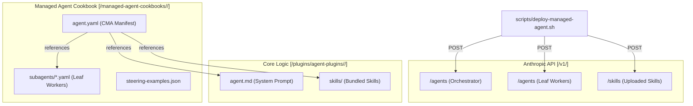
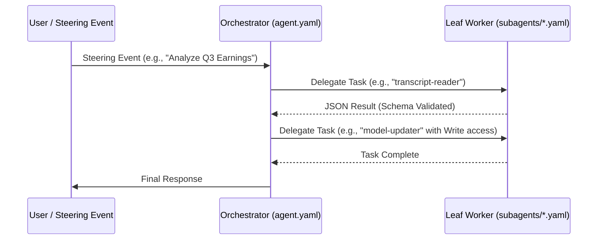

<!-- source: DeepWiki mcp.deepwiki.com · repo anthropics/financial-services · page 3 Managed Agent Cookbooks · fetched 2026-10-26 -->

# Managed Agent Cookbooks

Relevant source files

The following files were used as context for generating this wiki page:

- [README.md](README.md)
- [plugins/vertical-plugins/financial-analysis/.mcp.json](plugins/vertical-plugins/financial-analysis/.mcp.json)
- [scripts/deploy-managed-agent.sh](scripts/deploy-managed-agent.sh)

This section provides an overview of the `managed-agent-cookbooks/` directory, which contains the deployment templates for **Claude Managed Agents (CMA)**. These cookbooks allow the same financial services agents used in Claude Cowork to be deployed headlessly via the `/v1/agents` API.

## One Source, Two Surfaces

The repository follows a "one source, two wrappers" design principle. Every agent (e.g., `pitch-agent`, `gl-reconciler`) is defined once in `plugins/agent-plugins/` and then "wrapped" for different deployment surfaces [README.md:5]().

- **Cowork Surface:** Uses the `plugin.json` manifest and is installed directly into the Claude UI or via Claude Code [README.md:50-74]().
- **Managed Agent Surface:** Uses the `agent.yaml` manifest in `managed-agent-cookbooks/` for API-driven, headless deployment via the `/v1/agents` endpoint [README.md:81-85]().

### Architectural Relationship

The following diagram illustrates how the Managed Agent Cookbooks bridge the gap between the core plugin logic and the Managed Agents API.

**Managed Agent Deployment Architecture**

**Sources:** [README.md:5](), [README.md:89-97](), [scripts/deploy-managed-agent.sh:1-12]()

---

## The `agent.yaml` Manifest

The `agent.yaml` file is the primary configuration for a Managed Agent. While it mirrors the `POST /v1/agents` API structure, the deployment script `scripts/deploy-managed-agent.sh` provides several convenience resolutions at runtime [scripts/deploy-managed-agent.sh:4-10]().

| Manifest Field | Resolution Behavior |
| :--- | :--- |
| `system: {file: ...}` | Inlines the markdown content from the referenced file into a string [scripts/deploy-managed-agent.sh:5](). |
| `skills: [{from_plugin: ...}]` | Automatically uploads all skills in the referenced directory to `/v1/skills` and replaces the path with the resulting `skill_id` [scripts/deploy-managed-agent.sh:6, 99-111](). |
| `callable_agents: [{manifest: ...}]` | Recursively creates the subagents defined in the manifest first, then references them by their generated agent ID [scripts/deploy-managed-agent.sh:7, 152-160](). |

**Sources:** [scripts/deploy-managed-agent.sh:4-11](), [scripts/deploy-managed-agent.sh:99-111](), [scripts/deploy-managed-agent.sh:152-160]()

---

## The Leaf-Worker (Subagent) Pattern

Managed Agents in this repository utilize a **hub-and-spoke delegation model**. An "Orchestrator" agent (the main agent defined in `agent.yaml`) delegates specific tasks to "Leaf Workers" (defined in `subagents/*.yaml`) [scripts/deploy-managed-agent.sh:152-160]().

- **Specialization:** Each leaf worker is specialized for a specific part of the workflow. For example, a reader subagent might focus on document ingestion while a writer handles final output [scripts/deploy-managed-agent.sh:9-10]().
- **Validation Wrapper:** Reader subagents with an `output_schema` block receive a thin validation wrapper so their JSON is schema-checked before the orchestrator consumes it [scripts/deploy-managed-agent.sh:9-10]().
- **Security Tiering:** To ensure security, the system often isolates untrusted document readers (Read/Grep only) from workers that possess Write or Shell access.

**Subagent Interaction Flow**

**Sources:** [scripts/deploy-managed-agent.sh:9-10](), [scripts/deploy-managed-agent.sh:152-160]()

---

## Steering Events & Handoffs

### Steering Model
Managed Agents are triggered by **Steering Events**—structured natural language or JSON inputs that define the goal of the session. These events serve as the entry point for the orchestrator to begin delegating tasks to its leaf workers.

### Cross-Agent Handoffs
Named agents (e.g., `pitch-agent` and `model-builder`) can communicate via a `handoff_request` mechanism managed by an external controller [README.md:85-86]().

1. **Emission:** An agent emits a `handoff_request` event.
2. **Orchestration:** An external event loop, such as `scripts/orchestrate.py`, intercepts the request [README.md:85-86]().
3. **Routing:** The orchestrator validates the payload and routes it to the target agent, maintaining the workflow across different specialized agents.

For details, see [Security Model & Cross-Agent Handoffs](#3.2).

**Sources:** [README.md:85-86]()

---

## Agent Catalog

The repository includes ten reference agents, each with a specific cookbook and subagent configuration:

- **Pitch Agent:** End-to-end investment banking (Comps, Precedents, LBO, Pitch Deck) [README.md:23]().
- **Earnings Reviewer:** Equity research workflow (Transcripts, Filings, Model updates) [README.md:26]().
- **GL Reconciler:** Finance operations (Break identification, Root cause, Sign-off routing) [README.md:29]().
- **KYC Screener:** Compliance (Onboarding docs, Rules engine, Gap flagging) [README.md:32]().
- **Market Researcher:** Sector analysis and competitive landscapes [README.md:25]().
- **Meeting Prep Agent:** Briefing packs for client meetings [README.md:24]().
- **Model Builder:** Live Excel modeling (DCF, LBO, Comps) [README.md:27]().
- **Month-End Closer:** Accruals, roll-forwards, and variance commentary [README.md:30]().
- **Statement Auditor:** LP statement auditing before distribution [README.md:31]().
- **Valuation Reviewer:** GP package ingestion and LP reporting [README.md:28]().

For a full list and detailed subagent breakdowns, see [Agent Catalog & Subagent Patterns](#3.1).

**Sources:** [README.md:21-32]()

---

