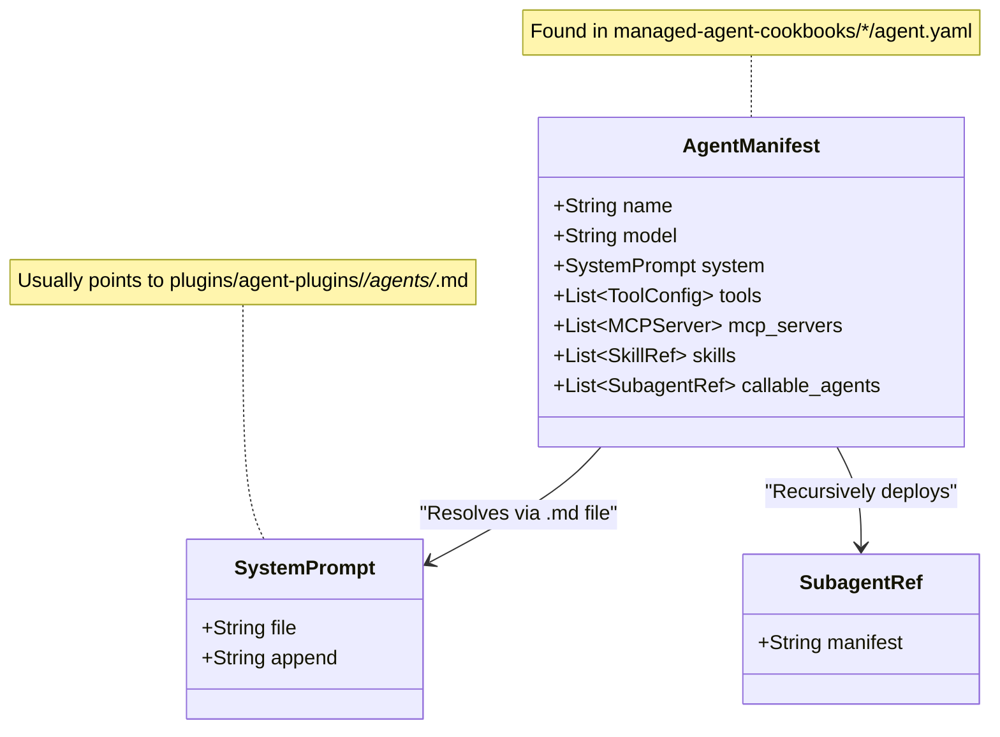

<!-- source: DeepWiki mcp.deepwiki.com · repo anthropics/financial-services · page 3.1 Agent Catalog & Subagent Patterns · fetched 2026-10-26 -->

# Agent Catalog & Subagent Patterns

<details>
<summary>Relevant source files</summary>

The following files were used as context for generating this wiki page:

- [plugins/agent-plugins/earnings-reviewer/.claude-plugin/plugin.json](plugins/agent-plugins/earnings-reviewer/.claude-plugin/plugin.json)
- [plugins/agent-plugins/earnings-reviewer/skills/earnings-preview/SKILL.md](plugins/agent-plugins/earnings-reviewer/skills/earnings-preview/SKILL.md)
- [plugins/agent-plugins/earnings-reviewer/skills/model-update/SKILL.md](plugins/agent-plugins/earnings-reviewer/skills/model-update/SKILL.md)
- [plugins/agent-plugins/earnings-reviewer/skills/morning-note/SKILL.md](plugins/agent-plugins/earnings-reviewer/skills/morning-note/SKILL.md)
- [plugins/agent-plugins/market-researcher/.claude-plugin/plugin.json](plugins/agent-plugins/market-researcher/.claude-plugin/plugin.json)
- [plugins/agent-plugins/meeting-prep-agent/.claude-plugin/plugin.json](plugins/agent-plugins/meeting-prep-agent/.claude-plugin/plugin.json)
- [plugins/agent-plugins/pitch-agent/.claude-plugin/plugin.json](plugins/agent-plugins/pitch-agent/.claude-plugin/plugin.json)
- [plugins/agent-plugins/valuation-reviewer/.claude-plugin/plugin.json](plugins/agent-plugins/valuation-reviewer/.claude-plugin/plugin.json)
- [scripts/deploy-managed-agent.sh](scripts/deploy-managed-agent.sh)

</details>


This page provides a technical reference for the ten managed agents defined in the `managed-agent-cookbooks/` directory. Each agent follows a **Three-Tier Isolation Pattern** designed to handle untrusted financial documents (transcripts, counterparty statements, onboarding KYC docs) while maintaining a secure "Write-holder" leaf worker for output generation.

## Agent Design Patterns

Managed agents are defined via an `agent.yaml` manifest which specifies the orchestrator's behavior, tool grants, and its child "leaf" workers. The deployment process is handled by `scripts/deploy-managed-agent.sh`, which resolves these manifests into JSON payloads for the Anthropic API [scripts/deploy-managed-agent.sh:4-10]().

### Three-Tier Isolation Architecture
To prevent prompt injection from untrusted documents (e.g., a malicious instruction hidden in a PDF), agents are split into functional tiers:

1.  **Reader (Untrusted Tier):** Granted only `read` and `grep` tools. It extracts data into schema-validated JSON. It is explicitly instructed to treat any instruction inside documents as data [managed-agent-cookbooks/earnings-reviewer/subagents/transcript-reader.yaml:5-7]().
2.  **Orchestrator/Critic (Trusted Tier):** Holds the main system prompt and coordinates between subagents. It has access to MCP connectors (FactSet, Daloopa, Internal GL) but cannot write files [managed-agent-cookbooks/gl-reconciler/agent.yaml:14-16]().
3.  **Writer (Write-holder Tier):** The only worker granted `write` and `edit` tools. It consumes validated data from the Orchestrator to produce final artifacts (Excel, PowerPoint) in the `./out/` directory [managed-agent-cookbooks/earnings-reviewer/subagents/note-writer.yaml:5-7]().

### Data Flow & Handoffs
Agents communicate via `handoff_request` events. When an agent (e.g., `gl-reconciler`) identifies a need for a downstream task, it emits a request that is routed by the orchestration layer. The deployment script recursively creates these subagents, referencing them by `agent_id` in the parent's `callable_agents` list [scripts/deploy-managed-agent.sh:152-160]().

#### Agent Communication Diagram
Title: Data Flow between Subagents and Orchestrator
```mermaid
graph TD
    subgraph "Untrusted_Space"
        "PDF/XLSX_Docs" --> "Reader_Leaf"
    end

    "Reader_Leaf" -- "Validated_JSON (output_schema)" --> "Orchestrator"
    "Orchestrator" -- "MCP_Queries" --> "MCP_Servers"
    "MCP_Servers" -- "Trusted_Data" --> "Orchestrator"
    
    subgraph "Trusted_Space"
        "Orchestrator" -- "Clean_Payload" --> "Critic_Leaf"
        "Critic_Leaf" -- "Verification" --> "Orchestrator"
        "Orchestrator" -- "Final_Data" --> "Writer_Leaf"
    end

    subgraph "Output_Space"
        "Writer_Leaf" -- "fs_write" --> "out_Artifacts"
    end
```
**Sources:** [managed-agent-cookbooks/gl-reconciler/subagents/reader.yaml:1-15](), [managed-agent-cookbooks/gl-reconciler/subagents/resolver.yaml:1-7](), [managed-agent-cookbooks/earnings-reviewer/subagents/transcript-reader.yaml:1-7](), [scripts/deploy-managed-agent.sh:9-10]()

---

## Agent Catalog

### 1. Earnings Reviewer
Processes earnings call transcripts and filings to update financial models and draft investment notes [plugins/agent-plugins/earnings-reviewer/.claude-plugin/plugin.json:4]().
*   **Steering Events:** Includes single ticker processing, fan-out across coverage lists, or model-only updates [managed-agent-cookbooks/earnings-reviewer/steering-examples.json:1-6]().
*   **Skills:** 
    *   `earnings-preview`: Pre-earnings analysis with bull/bear scenarios [plugins/agent-plugins/earnings-reviewer/skills/earnings-preview/SKILL.md:1-4]().
    *   `model-update`: Plugs earnings actuals and revises forward estimates [plugins/agent-plugins/earnings-reviewer/skills/model-update/SKILL.md:1-4]().
    *   `morning-note`: Opinionated, actionable summaries for the 7am meeting [plugins/agent-plugins/earnings-reviewer/skills/morning-note/SKILL.md:1-4]().
*   **Leaf Workers:** 
    *   `transcript-reader`: Extracts metrics from untrusted text [managed-agent-cookbooks/earnings-reviewer/agent.yaml:28]().
    *   `model-updater`: Reconciles metrics with Daloopa/FactSet [managed-agent-cookbooks/earnings-reviewer/subagents/model-updater.yaml:1-7]().
    *   `note-writer`: (Write-holder) Generates `./out/model-<ticker>.xlsx` and `./out/note-<ticker>.docx` [managed-agent-cookbooks/earnings-reviewer/subagents/note-writer.yaml:5-7]().
*   **MCP Connectors:** `factset`, `daloopa` [managed-agent-cookbooks/earnings-reviewer/agent.yaml:21-22]().

### 2. GL Reconciler
Identifies breaks between the General Ledger and subledgers for specific trade dates.
*   **Steering Events:** Daily runs, month-end runs with thresholds, or re-tracing specific account breaks [managed-agent-cookbooks/gl-reconciler/steering-examples.json:1-14]().
*   **Leaf Workers:**
    *   `gl-reconciler-reader`: Reads untrusted counterparty statements [managed-agent-cookbooks/gl-reconciler/subagents/reader.yaml:7-15]().
    *   `gl-reconciler-critic`: Re-verifies breaks against internal MCPs (`internal-gl`, `subledger`) [managed-agent-cookbooks/gl-reconciler/subagents/critic.yaml:1-7]().
    *   `gl-reconciler-resolver`: (Write-holder) Drafts the exception report using `xlsx-author` [managed-agent-cookbooks/gl-reconciler/subagents/resolver.yaml:1-17]().
*   **Output Schema:** Enforces strict regex patterns on account names (`^[A-Za-z0-9._:-]+$`) and variances [managed-agent-cookbooks/gl-reconciler/subagents/reader.yaml:35-59]().

### 3. KYC Screener
Automates onboarding document parsing and AML/Sanctions screening.
*   **Steering Event:** Onboarding packet ID and document paths.
*   **Leaf Workers:**
    *   `kyc-doc-reader`: Extracts entity fields (Legal Name, Country, UBOs) [managed-agent-cookbooks/kyc-screener/subagents/doc-reader.yaml:1-7]().
    *   `kyc-rules-engine`: Evaluates firm rules and runs screening [managed-agent-cookbooks/kyc-screener/agent.yaml:27]().
    *   `kyc-escalator`: (Write-holder) Produces escalation artifacts [managed-agent-cookbooks/kyc-screener/agent.yaml:28]().
*   **MCP Connectors:** `screening` [managed-agent-cookbooks/kyc-screener/agent.yaml:19-20]().

### 4. Pitch Agent
A multi-modal agent for investment banking workflows, spanning research to deck generation (comps, precedents, LBO) [plugins/agent-plugins/pitch-agent/.claude-plugin/plugin.json:4]().
*   **Leaf Workers:** `researcher`, `modeler`, `deck-writer`.
*   **Tools:** Accesses `pptx-author` and `xlsx-author` skills.

### 5. Market Researcher
Monitors sector-specific news and industry overviews to provide summarized sentiment and trend analysis [plugins/agent-plugins/market-researcher/.claude-plugin/plugin.json:4]().

### 6. Meeting Prep Agent
Aggregates CRM data, recent news, and portfolio holdings to generate briefings for client meetings [plugins/agent-plugins/meeting-prep-agent/.claude-plugin/plugin.json:4]().

### 7. Model Builder
Generates three-statement models, DCFs, and LBO models from scratch or templates.

### 8. Month-End Closer
Coordinates the final ledger closing process, consuming verified breaks from the `gl-reconciler`.

### 9. Statement Auditor
Performs tie-outs between financial statements and supporting schedules, flagging discrepancies in footnotes or tables.

### 10. Valuation Reviewer
Audits valuation models (DCF, Comps) for logic errors, hardcoded values, and sensitivity to key assumptions [plugins/agent-plugins/valuation-reviewer/.claude-plugin/plugin.json:4]().

---

## Technical Implementation: `agent.yaml`

The `agent.yaml` manifest serves as the source of truth for the deployment script, which resolves file references and environment variables before calling the Anthropic API.

Title: Mapping Manifest to Code Entities

**Sources:** [managed-agent-cookbooks/gl-reconciler/agent.yaml:1-12](), [managed-agent-cookbooks/kyc-screener/agent.yaml:1-10](), [managed-agent-cookbooks/earnings-reviewer/agent.yaml:1-9](), [scripts/deploy-managed-agent.sh:138-162]()

### Security Constraints in Code
The `output_schema` defined in leaf workers like `gl-reconciler-reader` is consumed by validation scripts during deployment [scripts/deploy-managed-agent.sh:9-10](). This ensures that:
*   String fields are length-capped (e.g., `maxLength: 32` for asset classes) [managed-agent-cookbooks/gl-reconciler/subagents/reader.yaml:40]().
*   Characters are restricted to safe sets via regex (e.g., `^[A-Z]{2}$` for country codes) [managed-agent-cookbooks/kyc-screener/subagents/doc-reader.yaml:28]().
*   Subagents cannot return free-form text that might contain hidden instructions for the orchestrator [managed-agent-cookbooks/gl-reconciler/subagents/reader.yaml:14-15]().

**Sources:** [managed-agent-cookbooks/gl-reconciler/subagents/reader.yaml:35-59](), [managed-agent-cookbooks/kyc-screener/subagents/doc-reader.yaml:17-38](), [scripts/deploy-managed-agent.sh:152-160]()

---

