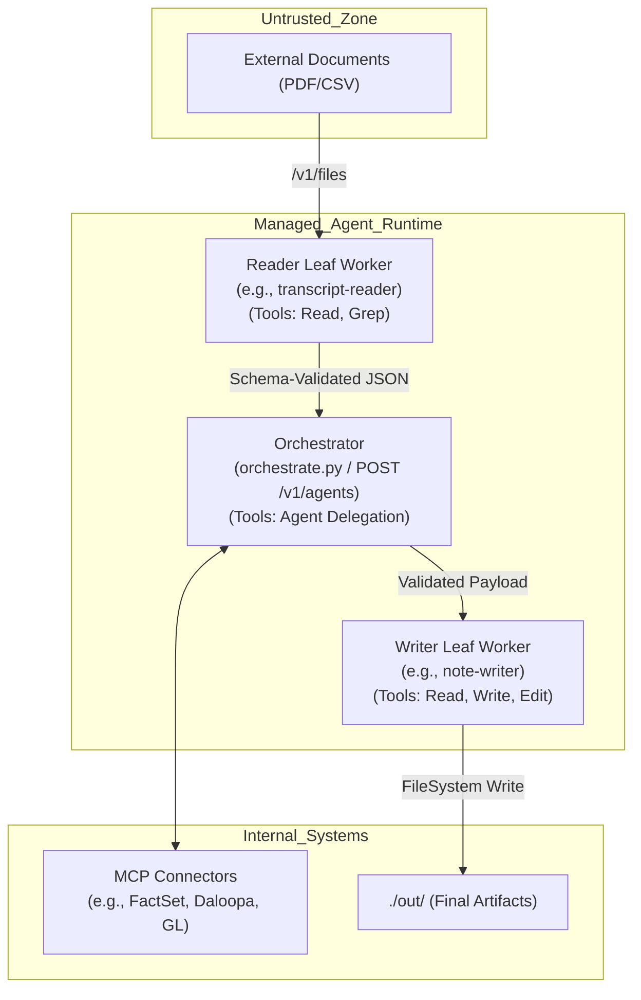
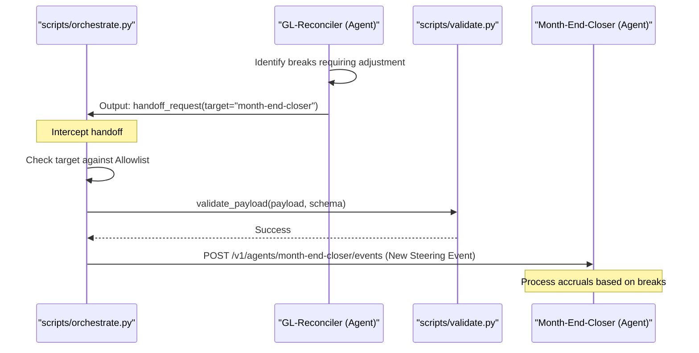

<!-- source: DeepWiki mcp.deepwiki.com · repo anthropics/financial-services · page 3.2 Security Model & Cross-Agent Handoffs · fetched 2026-10-26 -->

# Security Model & Cross-Agent Handoffs

Relevant source files

The following files were used as context for generating this wiki page:

- [README.md](README.md)
- [plugins/vertical-plugins/financial-analysis/.mcp.json](plugins/vertical-plugins/financial-analysis/.mcp.json)
- [scripts/deploy-managed-agent.sh](scripts/deploy-managed-agent.sh)

The Claude Managed Agent (CMA) architecture in this repository implements a "defense-in-depth" security model designed for the financial services industry. It specifically addresses the risks of processing untrusted third-party documents (e.g., custodian statements, counterparty PDFs, earnings transcripts) and prevents lateral movement or unauthorized data modification through a tiered isolation strategy.

## Security Tier Design

The system employs a "Least Privilege" model for subagents (leaf workers). Instead of a single monolithic agent with full filesystem and tool access, tasks are decomposed into workers with specific, restricted toolsets defined in the `agent.yaml` manifests [managed-agent-cookbooks/README.md:22-32]().

### Untrusted Document Isolation
Workers that must ingest external, potentially adversarial documents are strictly isolated. These "Readers" are granted only `Read` and `Grep` capabilities. They are explicitly denied `Write` access, shell access (`Bash`), and connectivity to internal systems of record.

*   **`transcript-reader`**: Processes earnings calls; limited to `Read` and `Grep` [managed-agent-cookbooks/earnings-reviewer/README.md:25]().
*   **`doc-reader`**: Parses onboarding packets; limited to `Read` and `Grep` [managed-agent-cookbooks/kyc-screener/README.md:25]().
*   **`reader`**: Ingests counterparty statements; limited to `Read` and `Grep` [managed-agent-cookbooks/gl-reconciler/README.md:28]().

### The Write-Holder Pattern
To prevent unauthorized modification of the filesystem or internal data, exactly one leaf worker per agent is designated as the **Write-holder** (indicated in bold in the agent catalog) [managed-agent-cookbooks/README.md:9-20](). This worker is the only entity capable of producing final artifacts (e.g., `.pptx` decks, `.xlsx` models, or `.md` reports). 

| Tier | Touches Untrusted Docs? | Tools | Role |
| :--- | :--- | :--- | :--- |
| **Reader** | **Yes** | `Read`, `Grep` | Ingests external files; outputs length-capped JSON. |
| **Orchestrator** | No | `Read`, `Grep`, `Glob`, `Agent` | Coordinates subagents; holds MCP connectors. |
| **Writer** | No | `Read`, `Write`, `Edit` | Generates final output; never opens external files. |

**Example: GL Reconciler Security Tiering**
In the `gl-reconciler` template, the `reader` parses external statements but cannot write files. The `resolver` holds the `Write` tool to create the exception report in `./out/` but never touches the external statements directly [managed-agent-cookbooks/gl-reconciler/README.md:23-32]().

**Example: KYC Screener Isolation**
The `doc-reader` extracts data from untrusted onboarding documents. The `escalator` (Write-holder) produces the final escalation report but is isolated from the raw documents to prevent prompt injection from reaching the filesystem [managed-agent-cookbooks/kyc-screener/README.md:21-29]().

### Implementation Mapping: Security Tiers to Code

The following diagram illustrates how the security tiers defined in the `agent.yaml` manifests map to the runtime execution environment and tool grants.

**Security Isolation Data Flow**

Sources: [managed-agent-cookbooks/gl-reconciler/README.md:23-34](), [managed-agent-cookbooks/earnings-reviewer/README.md:21-29](), [managed-agent-cookbooks/kyc-screener/README.md:21-29](), [managed-agent-cookbooks/README.md:9-18]()

## Cross-Agent Handoffs

Complex financial workflows often exceed the scope of a single agent. This repository implements a "Shared Nothing" architecture for cross-agent communication. Named agents never call each other directly via tools to prevent recursive complexity and privilege escalation [managed-agent-cookbooks/README.md:38-38]().

### The `handoff_request` Mechanism
When an agent determines that a task requires a different specialized agent, it emits a `handoff_request` in its final JSON output. This request is intercepted by an external event bus or the `scripts/orchestrate.py` script [managed-agent-cookbooks/README.md:38-38]().

1.  **Emission**: The source agent completes its task and includes a JSON object: `{"handoff_request": {"target": "model-builder", "payload": {...}}}`.
2.  **Interception**: `scripts/orchestrate.py` (or a production bus like Temporal) monitors the session output [managed-agent-cookbooks/README.md:38-38]().
3.  **Validation**: The script checks the target against a hardcoded **allowlist** and validates the payload against the target agent's **steering event schema** [managed-agent-cookbooks/gl-reconciler/README.md:34-34]().
4.  **Routing**: A new steering event is triggered for the target agent in a fresh session [managed-agent-cookbooks/README.md:38-38]().

### Deployment & Resolution
The `scripts/deploy-managed-agent.sh` script handles the complexity of creating these multi-agent hierarchies. It performs a recursive resolution of the `agent.yaml` manifest:
*   **Inlining System Prompts**: Converts `{file: ...}` references into strings [scripts/deploy-managed-agent.sh:5-5]().
*   **Skill Upload**: Uploads directories to `/v1/skills` and replaces local paths with `skill_id` [scripts/deploy-managed-agent.sh:6-6]().
*   **Subagent Creation**: Creates leaf workers first, then injects their generated `agent_id` into the parent's `callable_agents` list [scripts/deploy-managed-agent.sh:7-7]().

### Handoff Logic and Orchestration

Sources: [managed-agent-cookbooks/README.md:36-38](), [managed-agent-cookbooks/gl-reconciler/README.md:34-34](), [managed-agent-cookbooks/earnings-reviewer/README.md:31-31](), [scripts/deploy-managed-agent.sh:138-178]()

## Schema Validation & Payload Safety

To ensure that data passed between subagents or across handoffs is not used as an injection vector, the system enforces strict JSON schemas.

*   **Length-Capping**: Outputs from "Reader" tiers (like `transcript-reader` or `doc-reader`) are length-capped to prevent "long-context" injection attacks where an agent might be overwhelmed by adversarial text [managed-agent-cookbooks/earnings-reviewer/README.md:29](), [managed-agent-cookbooks/kyc-screener/README.md:29]().
*   **Structure Enforcement**: Subagents must return data that conforms to the expected fields. `scripts/validate.py` is used to ensure that the JSON returned by untrusted readers is safe for the orchestrator to process [managed-agent-cookbooks/gl-reconciler/README.md:32-32]().
*   **Validation Wrappers**: The deployment script `scripts/deploy-managed-agent.sh` automatically wraps reader subagents that have an `output_schema` with a validation layer [scripts/deploy-managed-agent.sh:9-10]().

## Summary of Agent Security Roles

| Agent | Write-Holder Leaf | Key Security Feature |
| :--- | :--- | :--- |
| `earnings-reviewer` | `note-writer` | `transcript-reader` is isolated from FactSet/Daloopa connectors [managed-agent-cookbooks/earnings-reviewer/README.md:23-27](). |
| `gl-reconciler` | `resolver` | `reader` has no access to GL/Subledger MCPs [managed-agent-cookbooks/gl-reconciler/README.md:28-30](). |
| `kyc-screener` | `escalator` | `doc-reader` is restricted from writing escalation files [managed-agent-cookbooks/kyc-screener/README.md:25-27](). |
| `pitch-agent` | `deck-writer` | `researcher` is read-only; `modeler` is restricted to Bash [managed-agent-cookbooks/README.md:9-9](). |

Sources: [managed-agent-cookbooks/README.md:9-20](), [managed-agent-cookbooks/gl-reconciler/README.md:23-32](), [managed-agent-cookbooks/earnings-reviewer/README.md:23-27](), [managed-agent-cookbooks/kyc-screener/README.md:23-27](), [scripts/deploy-managed-agent.sh:9-10]()

---

