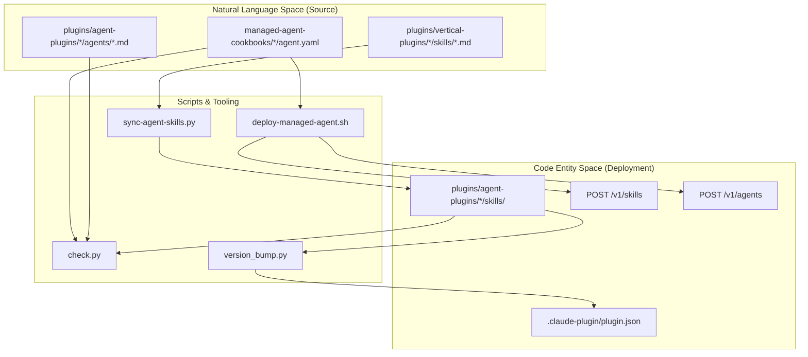

<!-- source: DeepWiki mcp.deepwiki.com · repo anthropics/financial-services · page 4 Scripts & Tooling · fetched 2026-10-26 -->

# Scripts & Tooling

Relevant source files

The following files were used as context for generating this wiki page:

- [scripts/check.py](scripts/check.py)
- [scripts/deploy-managed-agent.sh](scripts/deploy-managed-agent.sh)
- [scripts/version_bump.py](scripts/version_bump.py)

The `scripts/` directory contains the automation, validation, and orchestration logic required to maintain the "one source, two wrappers" architecture of the repository. These tools ensure that system prompts and skills remain synchronized between Claude Cowork plugins and Claude Managed Agent (CMA) templates, while providing the necessary pipeline for headless deployment and cross-agent communication [scripts/check.py:3-13]().

### Development & Deployment Lifecycle

The tooling follows the repository's design principle where development occurs in markdown and YAML files, and scripts handle the transformation into deployable artifacts. The lifecycle is centered around three main phases:

1.  **Synchronization**: Propagating skill updates from vertical sources to agent-specific bundles using `sync-agent-skills.py` [scripts/check.py:155-159]().
2.  **Validation**: Linting manifests and verifying reference integrity across the monorepo via `check.py` [scripts/check.py:5-11]().
3.  **Deployment**: Resolving YAML manifests into JSON payloads for the Anthropic API via `deploy-managed-agent.sh` [scripts/deploy-managed-agent.sh:4-10]().

#### Tooling Overview Diagram
This diagram illustrates how the scripts interact with different repository layers to move code from the "Natural Language Space" (Markdown/YAML) to the "Code Entity Space" (API/JSON).

**Sources:** [scripts/check.py:5-13](), [scripts/deploy-managed-agent.sh:4-10](), [scripts/version_bump.py:5-9]()

---

### Deployment Pipeline
The deployment pipeline automates the creation of Claude Managed Agents. The primary entry point is `deploy-managed-agent.sh`, which performs YAML-to-JSON resolution for agent manifests [scripts/deploy-managed-agent.sh:12-13]().

Key components include:
*   **Manifest Resolution**: The `resolve_manifest` function expands `from_plugin` conveniences and resolves relative paths [scripts/deploy-managed-agent.sh:94-118]().
*   **Skill Upload**: The `upload_skill` function zips local skill directories and uploads them to the `/v1/skills` endpoint [scripts/deploy-managed-agent.sh:62-92]().
*   **Subagent Creation**: The script recursively calls `create_agent` to provision `callable_agents` before the parent orchestrator is created [scripts/deploy-managed-agent.sh:152-160]().
*   **Orchestration**: `orchestrate.py` provides a reference event loop for handling cross-agent communication and payload schema validation.

For details, see [Deployment Pipeline](#4.1).

---

### Validation & Linting Tools
To maintain repository hygiene, `check.py` serves as the primary gatekeeper. It verifies the structural integrity of the plugin ecosystem and managed agent cookbooks [scripts/check.py:3-13]().

Key functions of the validation suite:
*   **Reference Resolution**: The `check_refs` function ensures that `system.file`, `skills.path`, and `callable_agents.manifest` pointers resolve to existing files [scripts/check.py:109-137]().
*   **Drift Detection**: The script uses `filecmp.dircmp` to identify discrepancies between source skills in `vertical-plugins/` and their bundled copies in `agent-plugins/` [scripts/check.py:143-160]().
*   **Schema Validation**: `validate.py` ensures JSON output from subagents adheres to defined schemas.

For details, see [Validation & Linting Tools](#4.2).

---

### CI/CD & Repository Hygiene
The repository employs a CI strategy focused on security and structural correctness, including automated versioning and hook enforcement.

Key elements:
*   **Version Management**: `version_bump.py` enforces semver increments. The `--apply` mode is used in git hooks to patch-bump modified plugins [scripts/version_bump.py:12-16](), while `--check` is used in CI as a gate [scripts/version_bump.py:18-21]().
*   **Git Hook Integration**: `check.py` includes an `ensure_hooks_installed` function that automatically configures `core.hooksPath` to `.githooks` to ensure local enforcement of versioning rules [scripts/check.py:27-47]().
*   **Secret Scanning**: Integration of `gitleaks` to monitor commits for credentials and internal Anthropic domain patterns.

For details, see [CI/CD & Repository Hygiene](#4.3).

---

### Script Summary Table

| Script | Language | Primary Purpose | Key File Interactions |
| :--- | :--- | :--- | :--- |
| `check.py` | Python | Linting and reference verification | `plugin.json`, `agent.yaml`, `agent.md` [scripts/check.py:5-11]() |
| `deploy-managed-agent.sh`| Bash | Deploying CMA templates to API | `agent.yaml`, `/v1/agents`, `/v1/skills` [scripts/deploy-managed-agent.sh:4-7]() |
| `version_bump.py` | Python | Automatic plugin versioning | `.claude-plugin/plugin.json` [scripts/version_bump.py:5-9]() |
| `sync-agent-skills.py` | Python | Propagating skills from verticals to agents | `vertical-plugins/`, `agent-plugins/` [scripts/check.py:158-159]() |
| `orchestrate.py` | Python | Cross-agent handoff event loop | Handoff events and payload validation |
| `validate.py` | Python | JSON schema validation | Subagent `output_schema` blocks [scripts/deploy-managed-agent.sh:9-10]() |

**Sources:** [scripts/check.py:1-25](), [scripts/deploy-managed-agent.sh:1-15](), [scripts/version_bump.py:1-26]()

---

