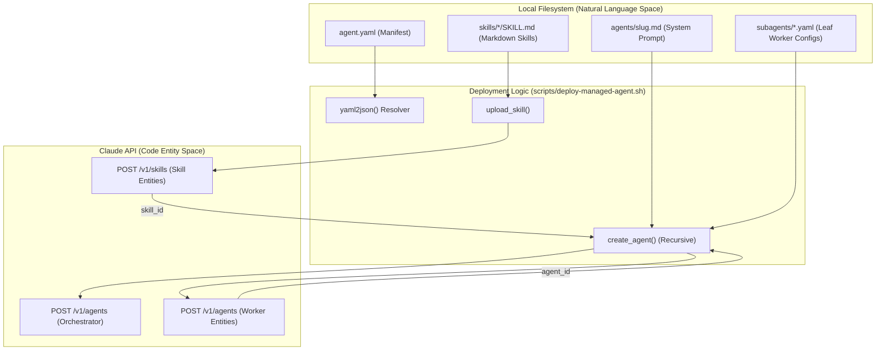
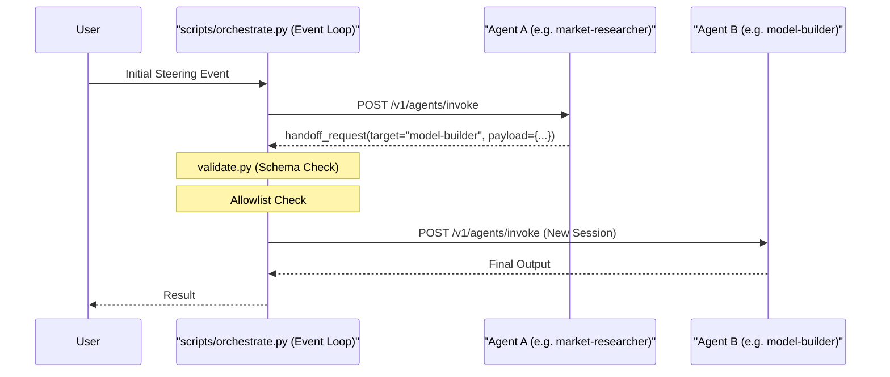

<!-- source: DeepWiki mcp.deepwiki.com · repo anthropics/financial-services · page 4.1 Deployment Pipeline · fetched 2026-10-26 -->

# Deployment Pipeline

Relevant source files

The following files were used as context for generating this wiki page:

- [README.md](README.md)
- [plugins/vertical-plugins/financial-analysis/.mcp.json](plugins/vertical-plugins/financial-analysis/.mcp.json)
- [scripts/deploy-managed-agent.sh](scripts/deploy-managed-agent.sh)

The deployment pipeline provides a unified mechanism for transforming the repository's markdown-based agents and skills into production-ready **Claude Managed Agents (CMA)**. It ensures that the "one source, two wrappers" principle is maintained by resolving local file references into API-compatible JSON manifests, managing skill uploads, and configuring multi-agent delegation.

## Core Deployment Workflow

The pipeline is centered around `scripts/deploy-managed-agent.sh`, which automates the transition from the `managed-agent-cookbooks/` directory to the Anthropic `/v1/agents` API [README.md:80-85]().

### 1. Manifest Resolution
The deployment script parses the `agent.yaml` manifest found in each cookbook. While these manifests use standard API field names, they include convenience keys that the script resolves before transmission [scripts/deploy-managed-agent.sh:4-10]():

| Manifest Key | Resolution Logic |
| :--- | :--- |
| `system.file` | Reads the canonical system prompt from a local file and inlines it as a string [scripts/deploy-managed-agent.sh:120-136](). |
| `skills.from_plugin` | Discovers all skills in the agent's plugin directory, uploads them to `/v1/skills`, and replaces the entry with `skill_id` references [scripts/deploy-managed-agent.sh:99-111](). |
| `skills.path` | Uploads a specific skill from a local path to the `/v1/skills` endpoint to generate a `skill_id` [scripts/deploy-managed-agent.sh:113-117](). |
| `callable_agents.manifest` | Recursively triggers the deployment of subagents defined in the `subagents/` directory to obtain their `agent_id` [scripts/deploy-managed-agent.sh:152-160](). |

### 2. Skill Lifecycle
Skills are authored in `plugins/vertical-plugins/` and synced to `plugins/agent-plugins/` [README.md:94-94](). During deployment:
1. The script identifies skill directories (containing `SKILL.md`) via the `upload_skill` function [scripts/deploy-managed-agent.sh:62-92]().
2. Each skill is zipped and uploaded to the `/v1/skills` endpoint using a multipart/form-data request [scripts/deploy-managed-agent.sh:72-81]().
3. The resulting `id` is cached and injected into the parent agent's configuration as a `skill_id` [scripts/deploy-managed-agent.sh:83-91]().

### 3. Subagent Creation (Leaf-Worker Pattern)
The pipeline supports a depth-1 delegation model. The orchestrator agent (defined in `agent.yaml`) is granted access to "leaf workers" (defined in `subagents/*.yaml`) [README.md:34-34]().
- **Recursion:** The `create_agent` function in `deploy-managed-agent.sh` recursively processes `callable_agents` before the main orchestrator, ensuring subagent IDs are available for the final POST [scripts/deploy-managed-agent.sh:152-160]().
- **Output Schema:** Subagents with an `output_schema` block are handled specifically to ensure JSON is schema-checked before consumption [scripts/deploy-managed-agent.sh:9-10]().

**Sources:** [README.md:34-34](), [README.md:80-85](), [scripts/deploy-managed-agent.sh:4-178]()

---

## Deployment Data Flow

The following diagram illustrates how the `deploy-managed-agent.sh` script transforms local filesystem entities into cloud-hosted API entities.

### Manifest to API Entity Mapping

**Sources:** [scripts/deploy-managed-agent.sh:42-58](), [scripts/deploy-managed-agent.sh:62-92](), [scripts/deploy-managed-agent.sh:138-178]()

---

## Orchestration and Handoffs

Managed agents in this repository utilize `scripts/orchestrate.py` as a reference event loop for handling cross-agent communication. Because named agents (e.g., `pitch-agent` and `gl-reconciler`) never call each other directly, the orchestrator manages the routing [README.md:85-86]().

### The Handoff Event Loop
1. **Handoff Request:** When an agent determines a task requires a different agent's expertise, it emits a `handoff_request` event in its output [README.md:85-86]().
2. **Validation:** `orchestrate.py` intercepts the event and performs two critical checks:
    - **Allowlist:** Verifies the target agent is permitted to be called via a hard-coded allowlist [README.md:85-86]().
    - **Schema Validation:** Uses `scripts/validate.py` to ensure the JSON payload matches the target agent's expected steering event schema [README.md:45-45]().
3. **Routing:** The script initiates a new session with the target agent using the validated payload as the new steering event [README.md:85-86]().

### Orchestration Sequence

**Sources:** [README.md:45-45](), [README.md:85-86]()

---

## Validation and Dry-Runs

Before deployment, the pipeline utilizes `test-cookbooks.sh` and `check.py` to ensure integrity.

### `test-cookbooks.sh`
This script performs dry-run validations of all cookbooks in the `managed-agent-cookbooks/` directory. It invokes `deploy-managed-agent.sh` with the `--dry-run` flag [scripts/deploy-managed-agent.sh:18-18]().
- **Dry-Run Mode:** In dry-run mode, the script does not call the API. Instead, it generates mock `skill_id` values (e.g., `DRYRUN_skillname`) and outputs the resolved JSON bodies that would be sent to `/v1/agents` [scripts/deploy-managed-agent.sh:67-71]().
- **Output:** The final resolved manifests are collected and printed as a JSON array for inspection [scripts/deploy-managed-agent.sh:183-184]().

### `check.py`
This is the primary linting tool for the repository [README.md:45-45](). It performs:
- **Manifest Linting:** Validates `plugin.json` and `agent.yaml` structures.
- **Drift Detection:** Compares skills in `agent-plugins/` against their sources in `vertical-plugins/`. It fails if `scripts/sync-agent-skills.py` has not been run to propagate changes.
- **Reference Resolution:** Ensures every `system.file`, `skills.path`, and `callable_agents.manifest` pointer is valid.

**Sources:** [README.md:45-45](), [scripts/deploy-managed-agent.sh:17-24](), [scripts/deploy-managed-agent.sh:180-187]()

---

