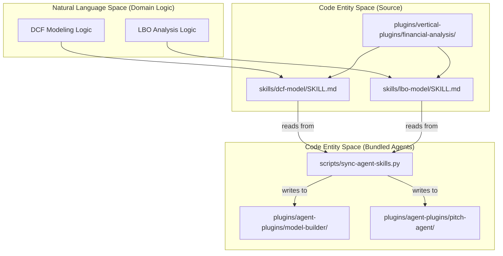
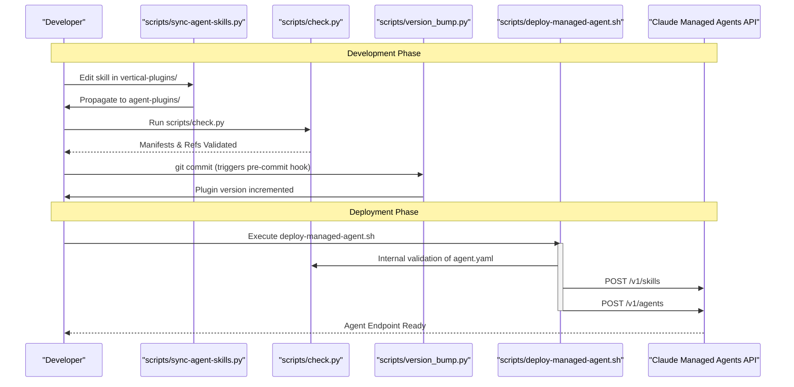

<!-- source: DeepWiki mcp.deepwiki.com · repo anthropics/financial-services · page 4.2 Validation & Linting Tools · fetched 2026-10-26 -->

# Validation & Linting Tools

Relevant source files

The following files were used as context for generating this wiki page:

- [CLAUDE.md](CLAUDE.md)
- [scripts/check.py](scripts/check.py)
- [scripts/version_bump.py](scripts/version_bump.py)

The `financial-services` repository utilizes a suite of Python-based utilities to maintain consistency across its "one source, two wrappers" architecture. These tools ensure that plugin manifests are valid, that file references in Managed Agent cookbooks resolve correctly, and that skills remain synchronized between domain-specific vertical plugins and bundled agent plugins.

## Overview of Tooling Suite

The validation logic is centralized in the `scripts/` directory and is integrated into the development workflow to prevent configuration drift and runtime errors in both Claude Cowork and Claude Managed Agents (CMA).

| Tool | Primary Responsibility | Key Files Involved |
| :--- | :--- | :--- |
| `check.py` | Manifest linting, reference resolution, and drift detection. | `plugin.json`, `agent.yaml`, `marketplace.json` |
| `sync-agent-skills.py` | Propagating skill updates from verticals to agents. | `plugins/vertical-plugins/`, `plugins/agent-plugins/` |
| `validate.py` | JSON schema validation for subagent/leaf-worker outputs. | `managed-agent-cookbooks/` |
| `version_bump.py` | Automated patch-version incrementing for plugins. | `.claude-plugin/plugin.json` |

Sources: [CLAUDE.md:28-31](), [CLAUDE.md:33-33]()

---

## check.py: The Repository Linter

`check.py` is the primary gatekeeper for repository health. It performs static analysis on the filesystem to ensure that all metadata files adhere to the expected structure and that internal links are functional.

### Implementation Details
The script iterates through the repository using specific glob patterns to locate manifests and reference files [scripts/check.py:78-82](). It uses the `yaml` and `json` libraries to verify syntax and the `filecmp` module to detect drift between source and bundled skills [scripts/check.py:54-57](), [scripts/check.py:143-143]().

### Key Validation Logic
1.  **YAML/JSON Parsing**: Every `*.yaml` in `managed-agent-cookbooks/` and every `plugin.json` / `marketplace.json` must be syntactically valid [scripts/check.py:69-89]().
2.  **Frontmatter Validation**: Every agent definition in `plugins/agent-plugins/*/agents/*.md` must contain YAML frontmatter with `name` and `description` keys [scripts/check.py:92-105]().
3.  **Reference Resolution**:
    *   `system.file` in `agent.yaml` must point to an existing file [scripts/check.py:116-120]().
    *   `skills[].path` and `skills[].from_plugin` must resolve to valid directories [scripts/check.py:122-130]().
    *   `callable_agents[].manifest` must point to an existing subagent YAML [scripts/check.py:132-136]().
4.  **Drift Detection**: The script compares `agent-plugins/<slug>/skills/` content against `vertical-plugins/*/skills/`. If the files differ, it suggests running `sync-agent-skills.py` [scripts/check.py:146-159]().
5.  **Agent Prose Linting**: Scans `agent.md` files for backticked skill references (e.g., `` `dcf-model` ``) and verifies that the referenced skill is actually bundled in that agent's local `skills/` directory [scripts/check.py:162-171]().

### Workflow Integration
Developers are required to run `python3 scripts/check.py` before committing changes [CLAUDE.md:31-31](). On first run, the function `ensure_hooks_installed()` self-installs a git `pre-commit` hook by setting `core.hooksPath` to `.githooks` [scripts/check.py:27-51]().

Sources: [scripts/check.py:1-191](), [CLAUDE.md:31-33]()

---

## sync-agent-skills.py: Skill Propagation

Because `agent-plugins` are designed to be self-contained for easy installation in Claude Cowork, they bundle local copies of skills defined in the `vertical-plugins`. `sync-agent-skills.py` automates the distribution of these skills from the vertical source of truth to the agent bundles [CLAUDE.md:13-13](), [CLAUDE.md:31-32]().

### Data Flow: Vertical to Agent
The script follows a source-of-truth model where domain logic is authored once and distributed to many agents.

1.  **Source Identification**: Scans `plugins/vertical-plugins/<vertical>/skills/` for the canonical version of a skill [CLAUDE.md:14-18]().
2.  **Target Mapping**: Identifies which agents require the skill based on their `plugin.json` or `agent.yaml` definitions.
3.  **File Synchronization**: Overwrites the content in `plugins/agent-plugins/<slug>/skills/` with the source content [CLAUDE.md:13-13]().

### Skill Propagation Diagram
The following diagram illustrates how a skill (e.g., `dcf-model`) moves from a vertical source to multiple agent bundles.

Sources: [CLAUDE.md:8-18](), [CLAUDE.md:31-32]()

---

## version_bump.py: Plugin Version Management

To ensure that already-installed users receive updates, every modification to a plugin must be accompanied by a version bump in its `.claude-plugin/plugin.json` [scripts/version_bump.py:5-9]().

### Implementation Logic
The script supports two primary modes: `--apply` for local development and `--check` for CI environments [scripts/version_bump.py:11-21]().

*   **Base Ref Resolution**: It determines the comparison point by checking `origin/main` or `main` [scripts/version_bump.py:56-60]().
*   **Change Detection**: `changed_plugins()` uses `git diff` to identify which plugin directories have modified files relative to the base ref [scripts/version_bump.py:129-145]().
*   **Version Comparison**: It parses semver strings into integer tuples to ensure the working version is strictly greater than the base version [scripts/version_bump.py:80-89](), [scripts/version_bump.py:117-127]().

### Automation Mechanics
*   **Local Hook**: The `.githooks/pre-commit` script calls `version_bump.py --apply` to patch-bump any plugin with staged changes [scripts/version_bump.py:148-164](). This ensures the version is bumped once per branch rather than per commit [CLAUDE.md:33-33]().
*   **CI Backstop**: The `version-bump` GitHub Action runs `scripts/version_bump.py --check` on every pull request to enforce this rule for contributors who bypassed local hooks [scripts/version_bump.py:167-187]().

Sources: [scripts/version_bump.py:1-190](), [CLAUDE.md:33-33]()

---

## validate.py: Subagent Output Validation

`validate.py` focuses on the Managed Agent deployment surface. In complex workflows (like the `pitch-agent`), the primary orchestrator delegates tasks to "leaf-worker" subagents [CLAUDE.md:21-24]().

### JSON Schema Enforcement
Managed Agents communicate via structured events. `validate.py` ensures that:
*   **Handoff Requests**: Any `handoff_request` generated by a subagent matches the expected schema for the target agent.
*   **Steering Examples**: The `steering-examples.json` files in `managed-agent-cookbooks/` are syntactically correct and provide valid input/output pairs for testing [CLAUDE.md:25-25]().

Sources: [CLAUDE.md:21-28]()

---

## Deployment & Validation Flow

The following diagram maps the relationship between the validation scripts and the deployment process for Managed Agents.

Sources: [CLAUDE.md:31-33](), [scripts/check.py:27-51](), [scripts/version_bump.py:11-21]()

---

