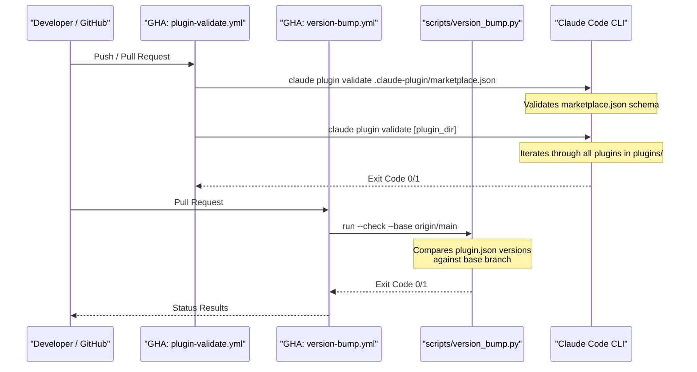
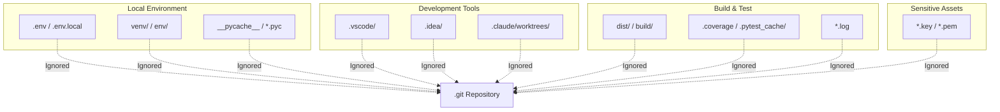

<!-- source: DeepWiki mcp.deepwiki.com · repo anthropics/financial-services · page 4.3 CI/CD & Repository Hygiene · fetched 2026-10-26 -->

# CI/CD & Repository Hygiene

Relevant source files

The following files were used as context for generating this wiki page:

- [.claude-plugin/marketplace.json](.claude-plugin/marketplace.json)
- [.githooks/pre-commit](.githooks/pre-commit)
- [.github/workflows/plugin-validate.yml](.github/workflows/plugin-validate.yml)
- [.github/workflows/version-bump.yml](.github/workflows/version-bump.yml)
- [.gitignore](.gitignore)
- [scripts/version_bump.py](scripts/version_bump.py)

This page details the automated safeguards and repository configurations that ensure the security, privacy, and integrity of the `financial-services` codebase. The repository employs a rigorous CI gate strategy focused on preventing the accidental exposure of credentials and internal-only references, while maintaining a clean development environment across the monorepo.

## CI Gate Strategy

The repository utilizes GitHub Actions to enforce security standards, manifest validity, and versioning integrity on every contribution. The primary gates are defined in the `plugin-validate`, `secret-scan`, and `version-bump` workflows.

*   **Pull Requests**: Every PR must pass the `plugin-validate` [ .github/workflows/plugin-validate.yml:8 ](), `secret-scan` (internal security), and `version-bump` check [ .github/workflows/version-bump.yml:8 ]() before it can be merged.
*   **Main Branch Pushes**: Direct pushes to the `main` branch are scanned and validated to ensure the integrity of the primary codebase [ .github/workflows/plugin-validate.yml:10 ]().

### Data Flow: Security and Validation Gates

The following diagram illustrates the sequence of checks performed when code is pushed to the repository, bridging the CI configuration to the underlying scripts.

**CI Pipeline Sequence**

Sources: [ .github/workflows/plugin-validate.yml:1-65 ](), [ .github/workflows/version-bump.yml:1-27 ](), [ scripts/version_bump.py:1-26 ]()

## Plugin Validation

The `plugin-validate` workflow ensures that all plugin manifests and the central marketplace manifest conform to the expected schema required by Claude Code. This prevents malformed plugins (e.g., incorrect `hooks.json` structure) from reaching end-users [ .github/workflows/plugin-validate.yml:3-5 ]().

*   **Environment**: Runs on `ubuntu-latest` and installs the Claude Code CLI via `curl -fsSL https://claude.ai/install.sh` [ .github/workflows/plugin-validate.yml:24-41 ]().
*   **Pinned Version**: The workflow uses `CLAUDE_VERSION: 2.1.143` to ensure reproducible builds and compatibility with the `displayName` key in `marketplace.json` [ .github/workflows/plugin-validate.yml:16-20 ]().
*   **Marketplace Check**: Validates the root-level `.claude-plugin/marketplace.json` [ .github/workflows/plugin-validate.yml:51 ]().
*   **Recursive Plugin Check**: Uses `find plugins -path '*/.claude-plugin/plugin.json'` to discover every plugin in the monorepo and runs `claude plugin validate` on each directory [ .github/workflows/plugin-validate.yml:54-59 ]().

Sources: [ .github/workflows/plugin-validate.yml:1-65 ](), [ .claude-plugin/marketplace.json:1-128 ]()

## Plugin Version Enforcement

To ensure that Claude Cowork users receive updates, every PR that modifies a plugin must increment that plugin's version in its `.claude-plugin/plugin.json` file. Claude Code only re-delivers a plugin when its version changes [ scripts/version_bump.py:5-9 ]().

### Versioning Implementation

The `scripts/version_bump.py` script serves as the single source of truth for enforcement [ scripts/version_bump.py:3 ](). It operates in two modes:

| Mode | Trigger | Action |
| :--- | :--- | :--- |
| `--apply` | `.githooks/pre-commit` | Automatically patch-bumps (`x.y.z+1`) any plugin with staged changes if it isn't already ahead of `main` [ scripts/version_bump.py:12-16 ](). |
| `--check` | `version-bump.yml` | Fails the CI build if any changed plugin has a version less than or equal to the version in the base branch [ scripts/version_bump.py:18-21 ](). |

### Automated Workflow
1.  **Local Hook**: Developers are encouraged to run `git config core.hooksPath .githooks` [ .githooks/pre-commit:5 ](). The `pre-commit` hook then runs the script to ensure the version is bumped once per branch, not once per commit [ .githooks/pre-commit:1-19 ]().
2.  **CI Backstop**: The `version-bump` GitHub Action [ .github/workflows/version-bump.yml:1 ]() performs a `git fetch` of the base ref and runs the check to catch contributors who bypassed the local hook [ .github/workflows/version-bump.yml:20-26 ]().

Sources: [ .githooks/pre-commit:1-19 ](), [ .github/workflows/version-bump.yml:1-27 ](), [ scripts/version_bump.py:1-165 ]()

## Repository Hygiene (.gitignore)

The `.gitignore` configuration is structured to prevent environment-specific files, IDE metadata, and build artifacts from entering the repository.

### Configuration Mapping

The following diagram maps the `.gitignore` categories to the specific code entities and environments they protect.

**Gitignore Entity Mapping**

### Key Exclusions
*   **Environment & Secrets**: Explicitly blocks `.env` files and cryptographic keys (`*.key`, `*.pem`) [ .gitignore:28-32 ]().
*   **Python Artifacts**: Prevents the inclusion of `__pycache__` and virtual environments (`venv/`), which are essential for scripts like `version_bump.py` to run in a clean state [ .gitignore:15-18 ]().
*   **Claude Specifics**: Specifically ignores `.claude/worktrees/`, ensuring that local agent development context does not leak into the shared repository [ .gitignore:47 ]().
*   **Personal Files**: Common personal tracking files like `TASKS.md` and `MEMORY.md` are ignored to allow developers to maintain local notes without cluttering the PR history [ .gitignore:45-46 ]().

Sources: [ .gitignore:1-48 ]()

---

