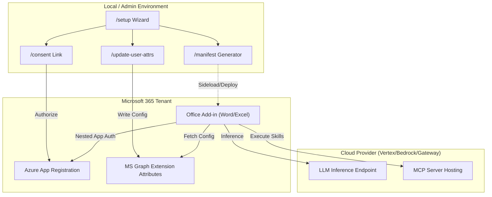
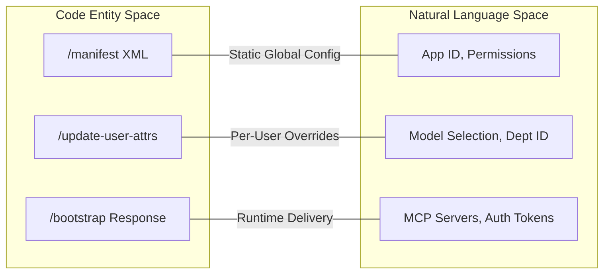

<!-- source: DeepWiki mcp.deepwiki.com · repo anthropics/financial-services · page 5 Microsoft 365 Integration · fetched 2026-10-26 -->

# Microsoft 365 Integration

Relevant source files

The following files were used as context for generating this wiki page:

- [claude-for-msft-365-install/.claude-plugin/plugin.json](claude-for-msft-365-install/.claude-plugin/plugin.json)
- [claude-for-msft-365-install/README.md](claude-for-msft-365-install/README.md)

The `claude-for-msft-365-install` subsystem provides the administrative tooling required to deploy and configure the Claude Office add-in within enterprise Microsoft 365 environments. Unlike standard consumer installations, this subsystem allows enterprises to route Claude's requests through their own private cloud infrastructure (Google Vertex AI, AWS Bedrock, or a custom LLM gateway) rather than calling Anthropic's API directly [claude-for-msft-365-install/README.md:1-4]().

It acts as the bridge between the FSI plugins defined in this repository and the Microsoft 365 ecosystem, ensuring that enterprise security, per-user configurations, and data residency requirements are met.

### System Role
The integration is defined as a specialized plugin [claude-for-msft-365-install/.claude-plugin/plugin.json:1-9]() and serves three primary functions:
1.  **Cloud Provisioning**: Configuring the target LLM provider (Vertex AI, Bedrock, or Gateway) [claude-for-msft-365-install/README.md:42-42]().
2.  **M365 Identity & Consent**: Managing Azure App Registrations and admin consent for Nested App Authentication (NAA) [claude-for-msft-365-install/README.md:44-44]().
3.  **Dynamic Configuration**: Delivering per-user MCP servers and skills via a secure bootstrap mechanism [claude-for-msft-365-install/README.md:46-46]().

### Relationship to FSI Plugins
While the `vertical-plugins` and `agent-plugins` define the financial logic and tools, the `claude-for-msft-365-install` package is the delivery vehicle for these capabilities into Word, Excel, and PowerPoint. It uses Microsoft Graph extension attributes to store configuration metadata that determines which FSI skills are available to specific users [claude-for-msft-365-install/README.md:45-45]().

---

## Command-Based Entrypoints

The subsystem is operated through six primary commands, typically initiated by a `/setup` wizard [claude-for-msft-365-install/README.md:40-48]().

| Command | Function |
| :--- | :--- |
| `/setup` | Interactive wizard that orchestrates the entire provisioning lifecycle, including cloud resource selection and manifest generation [claude-for-msft-365-install/README.md:42-42](). |
| `/manifest` | Generates the customized Office add-in XML manifest required for side-loading or centralized deployment [claude-for-msft-365-install/README.md:43-43](). |
| `/consent` | Generates the Azure admin consent URL to authorize the add-in's Service Principal for Graph API access [claude-for-msft-365-install/README.md:44-44](). |
| `/update-user-attrs` | Writes per-user configuration (such as model routing or feature flags) to Microsoft Graph extension attributes [claude-for-msft-365-install/README.md:45-45](). |
| `/bootstrap` | Configures the dynamic endpoint that provides the add-in with its runtime MCP servers and skills [claude-for-msft-365-install/README.md:46-46](). |
| `/debug` | Diagnoses deployment issues like stale configuration or missing add-in components [claude-for-msft-365-install/README.md:47-47](). |

**Sources:**
- [claude-for-msft-365-install/README.md:40-48]()
- [claude-for-msft-365-install/.claude-plugin/plugin.json:1-9]()

---

## Integration Architecture

The following diagram illustrates how the installation subsystem connects the local development environment, the Azure/M365 Tenant, and the Cloud Provider.

### Deployment & Configuration Flow

**Sources:**
- [claude-for-msft-365-install/README.md:1-4]()
- [claude-for-msft-365-install/README.md:40-48]()

---

## Configuration Management

The integration relies on a "Merge Chain" to determine the final behavior of the Claude add-in for any given user. This ensures that global enterprise policies can be overridden by specific department or user needs.

### Configuration Entity Mapping

**Sources:**
- [claude-for-msft-365-install/README.md:43-46]()

---

## Detailed Documentation

For technical implementation details, refer to the following child pages:

### [Setup, Manifest & Azure Consent](#5.1)
Covers the M365 provisioning lifecycle. This includes selecting the cloud provider (Vertex AI, Bedrock, or LLM gateway), generating the Office add-in XML manifest, and handling the Azure admin consent flow for Nested App Authentication (NAA). It also details how to use Microsoft Graph extension attributes for persistent per-user configuration via the `/update-user-attrs` command. For details, see [Setup, Manifest & Azure Consent](#5.1).

### [Bootstrap Endpoint](#5.2)
Provides a deep dive into the dynamic configuration system initiated by the `/bootstrap` command. This includes the `bootstrap_url` contract, the configuration merge chain (Manifest → Extension Attributes → Bootstrap), and the delivery of MCP servers and skills. It covers security requirements such as JWT validation (audience, issuer, and object IDs) and OTLP telemetry configuration for enterprise observability. For details, see [Bootstrap Endpoint](#5.2).

---

