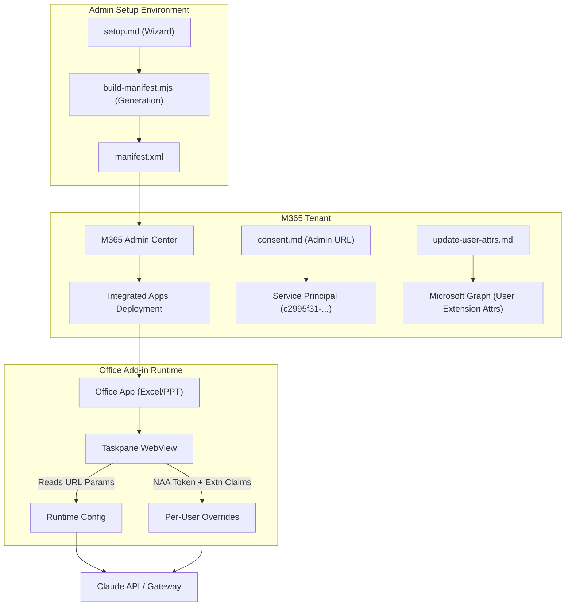

<!-- source: DeepWiki mcp.deepwiki.com · repo anthropics/financial-services · page 5.1 Setup, Manifest & Azure Consent · fetched 2026-10-26 -->

# Setup, Manifest & Azure Consent

<details>
<summary>Relevant source files</summary>

The following files were used as context for generating this wiki page:

- [claude-for-msft-365-install/commands/bootstrap.md](claude-for-msft-365-install/commands/bootstrap.md)
- [claude-for-msft-365-install/commands/consent.md](claude-for-msft-365-install/commands/consent.md)
- [claude-for-msft-365-install/commands/debug.md](claude-for-msft-365-install/commands/debug.md)
- [claude-for-msft-365-install/commands/manifest.md](claude-for-msft-365-install/commands/manifest.md)
- [claude-for-msft-365-install/commands/setup.md](claude-for-msft-365-install/commands/setup.md)
- [claude-for-msft-365-install/scripts/build-manifest.mjs](claude-for-msft-365-install/scripts/build-manifest.mjs)
- [claude-for-msft-365-install/scripts/clear-addin-cache.ps1](claude-for-msft-365-install/scripts/clear-addin-cache.ps1)
- [claude-for-msft-365-install/scripts/clear-addin-cache.sh](claude-for-msft-365-install/scripts/clear-addin-cache.sh)
- [claude-for-msft-365-install/scripts/sideload-addin.ps1](claude-for-msft-365-install/scripts/sideload-addin.ps1)
- [claude-for-msft-365-install/scripts/sideload-addin.sh](claude-for-msft-365-install/scripts/sideload-addin.sh)

</details>


This section documents the end-to-end provisioning lifecycle for the Claude Microsoft 365 Office add-in. The process transitions from initial cloud provider selection and infrastructure provisioning to manifest generation and enterprise identity integration via Entra ID (formerly Azure AD).

## Provisioning Lifecycle Overview

The deployment follows a structured flow to ensure the Office add-in can securely communicate with enterprise LLM infrastructure (Vertex AI, Bedrock, or custom Gateways) using Nested App Authentication (NAA).

### High-Level Data Flow

The following diagram illustrates how configuration moves from the administrator's setup environment into the M365 tenant.

**Diagram: Provisioning Data Flow**

**Sources:** [claude-for-msft-365-install/commands/setup.md:7-15](), [claude-for-msft-365-install/commands/manifest.md:5-9](), [claude-for-msft-365-install/commands/consent.md:5-13]()

---

## 1. Setup & Cloud Provider Selection (`/setup`)

The `/setup` phase determines the communication path between the Office add-in and the LLM. Admins must select one of four primary paths: `gateway`, `vertex`, `bedrock`, or `foundry` [claude-for-msft-365-install/commands/setup.md:28-44]().

### Cloud Path Requirements
| Path | Target | Authentication Mechanism | Key Manifest Requirements |
| :--- | :--- | :--- | :--- |
| `gateway` | Custom Proxy (LiteLLM, etc.) | Static Token or Passthrough | `gateway_url`, `gateway_token` |
| `vertex` | Google Vertex AI | Google OAuth 2.0 | `google_client_id`, `google_client_secret` |
| `bedrock` | AWS Bedrock | Entra ID + AWS IAM OIDC | `aws_role_arn`, `entra_sso=1` |
| `foundry` | Azure AI Foundry | API Key | `azure_resource_name`, `azure_api_key` |

### Bedrock OIDC Provisioning
For Bedrock deployments, the admin must establish a trust relationship between the Azure Tenant and AWS IAM using an OIDC identity provider [claude-for-msft-365-install/commands/setup.md:112-122]().
- **Issuer:** `https://login.microsoftonline.com/${TENANT_ID}/v2.0`
- **Audience:** `c2995f31-11e7-4882-b7a7-ef9def0a0266` (Anthropic Multi-tenant App ID)
- **Action:** `sts:AssumeRoleWithWebIdentity` gated by the `aud` condition [claude-for-msft-365-install/commands/setup.md:140-151](). Note that Bedrock is currently **not supported** for the Outlook host [claude-for-msft-365-install/commands/manifest.md:30-31]().

**Sources:** [claude-for-msft-365-install/commands/setup.md:39-50](), [claude-for-msft-365-install/commands/setup.md:112-169](), [claude-for-msft-365-install/commands/manifest.md:30-31]()

---

## 2. Manifest Generation (`/manifest`)

The `build-manifest.mjs` script generates the `manifest.xml` file by fetching a canonical template and injecting configuration as URL query parameters into the `SourceLocation` and `Taskpane.Url` slots [claude-for-msft-365-install/scripts/build-manifest.mjs:10-17]().

### Key Implementation Details
- **Script:** `claude-for-msft-365-install/scripts/build-manifest.mjs`
- **Function:** `main()` handles argument parsing, validation against the `KEYS` schema, and XML string replacement [claude-for-msft-365-install/scripts/build-manifest.mjs:82-141]().
- **Validation:** The script enforces dependencies, such as requiring `entra_sso=1` if `aws_role_arn`, `graph_client_id`, or `entra_scope` are present [claude-for-msft-365-install/scripts/build-manifest.mjs:116-122]().
- **Templates:** Uses `pivot.claude.ai/manifest.xml` for Office (Excel/Word/PPT) and `pivot.claude.ai/manifest-outlook-3p.xml` for Outlook [claude-for-msft-365-install/commands/manifest.md:13-17]().

### Entra SSO & Scopes
Setting `entra_sso=1` makes the add-in acquire an Entra ID token at startup [claude-for-msft-365-install/commands/manifest.md:48-52](). 
- **Custom App ID:** Use `graph_client_id` to use a single-tenant app registration instead of Anthropic's multi-tenant app [claude-for-msft-365-install/commands/manifest.md:62-68]().
- **Access Tokens:** If `entra_scope` is set (e.g., `api://<guid>/access_as_user`), the add-in requests an OAuth2 access token instead of a standard ID token [claude-for-msft-365-install/commands/manifest.md:70-83]().

**Sources:** [claude-for-msft-365-install/scripts/build-manifest.mjs:23-78](), [claude-for-msft-365-install/scripts/build-manifest.mjs:116-122](), [claude-for-msft-365-install/commands/manifest.md:13-98]()

---

## 3. Azure Admin Consent (`/consent`)

When `entra_sso=1` is enabled, the tenant must grant admin consent to the Anthropic multi-tenant application (or a custom registered app) to allow the add-in to acquire tokens for the user without interactive prompts [claude-for-msft-365-install/commands/consent.md:5-13]().

### Outlook & Graph Consent
Outlook deployments require additional Microsoft Graph permissions (`Mail.ReadWrite`, `Calendars.Read`, `People.Read`, `User.Read`) [claude-for-msft-365-install/commands/consent.md:43-49](). This is required for Outlook even if `entra_sso` is off [claude-for-msft-365-install/commands/consent.md:40-42]().

### Consent Verification
Admins can verify if the Service Principal exists in their tenant using the Azure CLI:
```bash
az ad sp show --id c2995f31-11e7-4882-b7a7-ef9def0a0266 --query appId -o tsv
```
If the command returns the GUID, consent was successfully processed [claude-for-msft-365-install/commands/consent.md:31-36]().

**Sources:** [claude-for-msft-365-install/commands/consent.md:15-28](), [claude-for-msft-365-install/commands/consent.md:31-36](), [claude-for-msft-365-install/commands/consent.md:48-60]()

---

## 4. Per-User Configuration (`/update-user-attrs`)

For deployments requiring granular control (e.g., different API keys or regions per team), the system leverages Microsoft Graph extension attributes or the **Bootstrap Endpoint**.

### Attribute Mapping
The add-in reads attributes registered on the Anthropic app ID (`c2995f31-11e7-4882-b7a7-ef9def0a0266`). The keys are prefixed as `extension_c2995f3111e74882b7a7ef9def0a0266_<key>` [claude-for-msft-365-install/commands/update-user-attrs.md:7-9]().

**Diagram: User Attribute Mapping**
```mermaid
classDiagram
    class "Microsoft_Graph_User" {
        +String upn
        +String extension_c2995f3111e74882b7a7ef9def0a0266_gateway_token
        +String extension_c2995f3111e74882b7a7ef9def0a0266_gcp_project_id
        +String extension_c2995f3111e74882b7a7ef9def0a0266_aws_role_arn
    }

    class "AddIn_Runtime_Config" {
        +String gateway_token
        +String gcp_project_id
        +String aws_role_arn
    }

    class "update-user-attrs.md" {
        +PATCH /v1.0/users/{upn}
    }

    "update-user-attrs.md" ..> "Microsoft_Graph_User" : Updates via az rest
    "Microsoft_Graph_User" --|> "AddIn_Runtime_Config" : Merged at Runtime (Wins over Manifest)
```

### Bootstrap Endpoint (`/bootstrap`)
While extension attributes handle flat strings (≤256 chars), the `bootstrap_url` handles complex JSON like `mcp_servers` and `skills` [claude-for-msft-365-install/commands/bootstrap.md:28-33]().
- **Template Interpolation:** Strings in the bootstrap response can contain `{{key}}`, which the add-in substitutes against the merged config chain (Manifest → Attrs → Bootstrap) [claude-for-msft-365-install/commands/bootstrap.md:40-46]().
- **CORS Requirements:** Every URL (bootstrap, MCP, skills) must return `Access-Control-Allow-Origin: https://pivot.claude.ai` [claude-for-msft-365-install/commands/bootstrap.md:63-71]().

**Sources:** [claude-for-msft-365-install/commands/update-user-attrs.md:15-30](), [claude-for-msft-365-install/commands/bootstrap.md:5-109]()

---

## 5. Local Development & Sideloading

To iterate on manifests without waiting for M365 Admin Center propagation (which can take up to 72 hours), developers use sideloading scripts [claude-for-msft-365-install/commands/debug.md:79-81]().

### Sideloading Scripts
| Platform | Script | Mechanism |
| :--- | :--- | :--- |
| **macOS** | `sideload-addin.sh` | Copies manifest to `~/Library/Containers/com.microsoft.[App]/Data/Documents/wef` [claude-for-msft-365-install/scripts/sideload-addin.sh:18-43]() |
| **Windows** | `sideload-addin.ps1` | Creates registry values under `HKCU:\SOFTWARE\Microsoft\Office\16.0\Wef\Developer` [claude-for-msft-365-install/scripts/sideload-addin.ps1:26-38]() |

### Cache Clearing
When configuration becomes stale, the `clear-addin-cache` scripts target specific add-in IDs to drop local registrations without affecting other installed add-ins [claude-for-msft-365-install/commands/debug.md:100-106]().
- **macOS:** `clear-addin-cache.sh` removes `<addin-id>.manifest-*.xml` from the Wef folders [claude-for-msft-365-install/scripts/clear-addin-cache.sh:56-64]().
- **Windows:** `clear-addin-cache.ps1` deletes the registry value and the associated `Developer\<Id>` settings subkey [claude-for-msft-365-install/scripts/clear-addin-cache.ps1:71-95]().

**Sources:** [claude-for-msft-365-install/commands/debug.md:72-106](), [claude-for-msft-365-install/scripts/sideload-addin.sh:1-48](), [claude-for-msft-365-install/scripts/clear-addin-cache.ps1:1-96]()

---

