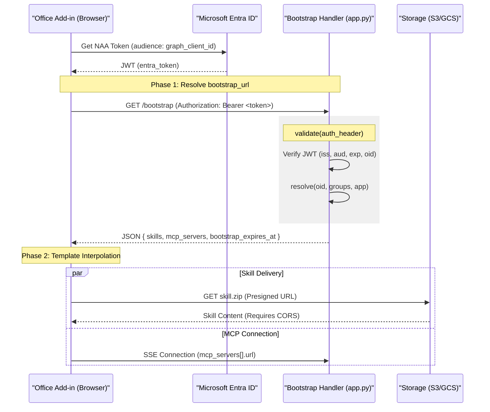
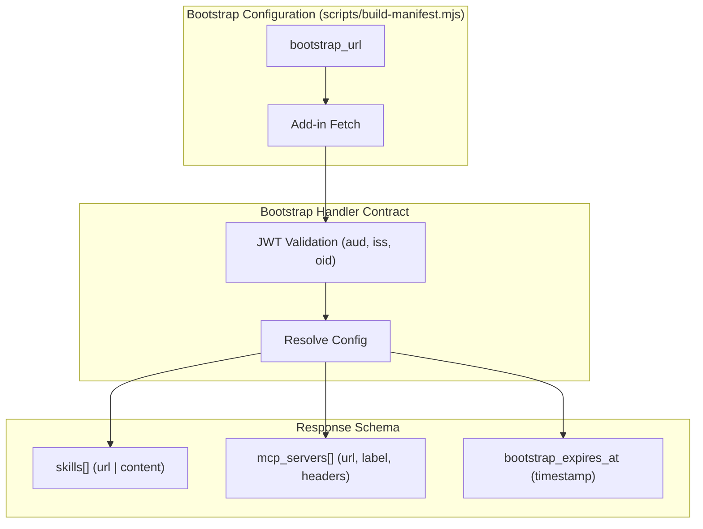

<!-- source: DeepWiki mcp.deepwiki.com · repo anthropics/financial-services · page 5.2 Bootstrap Endpoint · fetched 2026-10-26 -->

# Bootstrap Endpoint

Relevant source files

The following files were used as context for generating this wiki page:

- [claude-for-msft-365-install/.claude-plugin/plugin.json](claude-for-msft-365-install/.claude-plugin/plugin.json)
- [claude-for-msft-365-install/README.md](claude-for-msft-365-install/README.md)
- [claude-for-msft-365-install/commands/bootstrap.md](claude-for-msft-365-install/commands/bootstrap.md)
- [claude-for-msft-365-install/commands/manifest.md](claude-for-msft-365-install/commands/manifest.md)
- [claude-for-msft-365-install/scripts/build-manifest.mjs](claude-for-msft-365-install/scripts/build-manifest.mjs)

The **Bootstrap Endpoint** is a dynamic configuration system for the Claude Microsoft 365 add-in. While basic configuration can be stored in the static manifest or flat Microsoft Graph extension attributes, the bootstrap endpoint allows for delivering complex, per-user JSON structures such as Model Model Context Protocol (MCP) server lists, custom skills, and telemetry settings [claude-for-msft-365-install/commands/bootstrap.md:7-10]().

## Configuration Merge Chain

The add-in resolves its configuration through a multi-layer merge chain. Each layer overrides the previous one.

1.  **Manifest Parameters**: Hardcoded defaults in the add-in XML, generated via `build-manifest.mjs` [claude-for-msft-365-install/scripts/build-manifest.mjs:1-7](), [claude-for-msft-365-install/commands/bootstrap.md:42-43]().
2.  **Extension Attributes**: Per-user flat strings (max 256 chars) set via Microsoft Graph extension attributes [claude-for-msft-365-install/commands/bootstrap.md:28-32]().
3.  **Bootstrap Response**: Structured JSON (arrays, nested objects, base64 data) returned by the `bootstrap_url` [claude-for-msft-365-install/commands/bootstrap.md:31-32]().

### Template Interpolation
String values in any layer can contain `{{key}}` placeholders. Interpolation happens in two phases:
*   **Phase 1**: The `bootstrap_url` itself is resolved using only the manifest and extension attributes. This allows for dynamic URLs like `https://config.internal/bootstrap?project={{gcp_project_id}}` [claude-for-msft-365-install/commands/bootstrap.md:50-54]().
*   **Phase 2**: Fields within the bootstrap response are resolved against the full merged set, allowing a response to reference its own keys or keys from lower layers (e.g., `{{gateway_token}}`) [claude-for-msft-365-install/commands/bootstrap.md:55-57]().

Sources: [claude-for-msft-365-install/commands/bootstrap.md:40-62](), [claude-for-msft-365-install/scripts/build-manifest.mjs:45-58]()

## Data Flow and Implementation

The following diagram illustrates the request flow from the Office taskpane to the bootstrap handler and the subsequent resolution of MCP servers and skills.

### Bootstrap Sequence Diagram

Sources: [claude-for-msft-365-install/commands/bootstrap.md:115-130](), [claude-for-msft-365-install/commands/bootstrap.md:132-146]()

## Request and Authentication

The add-in performs an HTTPS GET request to the `bootstrap_url` with the following headers:
*   `Authorization`: `Bearer <entra_token>` (if `entra_sso=1` is enabled in the manifest) [claude-for-msft-365-install/commands/bootstrap.md:118-119]().
*   `X-Claude-User-Agent`: Identifies the host application (e.g., `claude-word/1.4.2`) [claude-for-msft-365-install/commands/bootstrap.md:120-124]().

### JWT Validation Requirements
Handlers must validate the following claims in the Entra token:

| Claim | Required Value / Check |
| :--- | :--- |
| `aud` | Must match the add-in's App ID (`c2995f31-11e7-4882-b7a7-ef9def0a0266`) or custom `graph_client_id` [claude-for-msft-365-install/commands/bootstrap.md:136](). |
| `iss` | Must match `https://login.microsoftonline.com/<TENANT_ID>/v2.0` [claude-for-msft-365-install/commands/bootstrap.md:137](). |
| `oid` | The stable unique identifier for the user [claude-for-msft-365-install/commands/bootstrap.md:139](). |
| `exp` | Token must not be expired [claude-for-msft-365-install/commands/bootstrap.md:138](). |

If `entra_scope` was specified during manifest generation, the Bearer is an **access token** and the `aud` must match the API's Application ID URI [claude-for-msft-365-install/commands/bootstrap.md:141-146]().

Sources: [claude-for-msft-365-install/commands/bootstrap.md:132-146](), [claude-for-msft-365-install/scripts/build-manifest.mjs:59-69]()

## Skill and MCP Delivery

The bootstrap response delivers two primary types of extensions:

### 1. Skills
Skills are custom capabilities that can be delivered in two ways:
*   **Inline**: Small skills provided as base64-encoded strings in the `content` field.
*   **External**: Larger skills provided via a `url`, typically a presigned S3/GCS URL [claude-for-msft-365-install/commands/bootstrap.md:77]().

### 2. MCP Servers
The `mcp_servers` array contains configurations for Model Context Protocol servers. Each entry can include:
*   `url`: The server endpoint.
*   `label`: Human-readable name.
*   `headers`: Static authentication headers (e.g., `{"Authorization": "Bearer {{gateway_token}}"}`) [claude-for-msft-365-install/commands/manifest.md:113-125]().

### Code-to-Entity Mapping: Bootstrap Resolution

Sources: [claude-for-msft-365-install/scripts/build-manifest.mjs:49-51](), [claude-for-msft-365-install/commands/bootstrap.md:100-110]()

## CORS Requirements

Because the add-in runs in a browser environment, **every URL** accessed by the add-in must support Cross-Origin Resource Sharing (CORS) for `https://pivot.claude.ai` [claude-for-msft-365-install/commands/bootstrap.md:63-68]().

| Target | Configuration Requirement |
| :--- | :--- |
| `bootstrap_url` | Handler must respond to `OPTIONS` preflight and include `Access-Control-Allow-Origin: https://pivot.claude.ai` [claude-for-msft-365-install/commands/bootstrap.md:75, 80-86](). |
| `skills[].url` | The storage bucket (S3/GCS/Azure) must have CORS rules enabled [claude-for-msft-365-install/commands/bootstrap.md:77, 94-108](). |
| `mcp_servers[].url` | The MCP server (if SSE-based) must allow the origin [claude-for-msft-365-install/commands/bootstrap.md:76](). |
| `otlp_endpoint` | The OTLP collector must allow the origin on its HTTP receiver via `cors.allowed_origins` [claude-for-msft-365-install/commands/bootstrap.md:78](). |

Sources: [claude-for-msft-365-install/commands/bootstrap.md:73-108]()

## Cache Management

The add-in caches the bootstrap response to minimize startup latency. This is controlled by the `bootstrap_expires_at` field, which should be a Unix timestamp in seconds [claude-for-msft-365-install/commands/bootstrap.md:33](). When this timestamp is reached, the add-in re-fetches the configuration on the next startup or token refresh.

## Telemetry Configuration

The bootstrap endpoint (or manifest) can configure OpenTelemetry (OTLP) tracing:
*   `otlp_endpoint`: The base HTTPS URL for the collector [claude-for-msft-365-install/commands/manifest.md:128-131]().
*   `otlp_headers`: Authentication headers for the collector [claude-for-msft-365-install/commands/manifest.md:133-135]().
*   `otlp_resource_attributes`: Key-value pairs merged into the OTEL Resource (e.g., `deployment.environment=prod`) [claude-for-msft-365-install/commands/manifest.md:137-143]().

Sources: [claude-for-msft-365-install/commands/manifest.md:126-145](), [claude-for-msft-365-install/scripts/build-manifest.mjs:52-57]()

---

