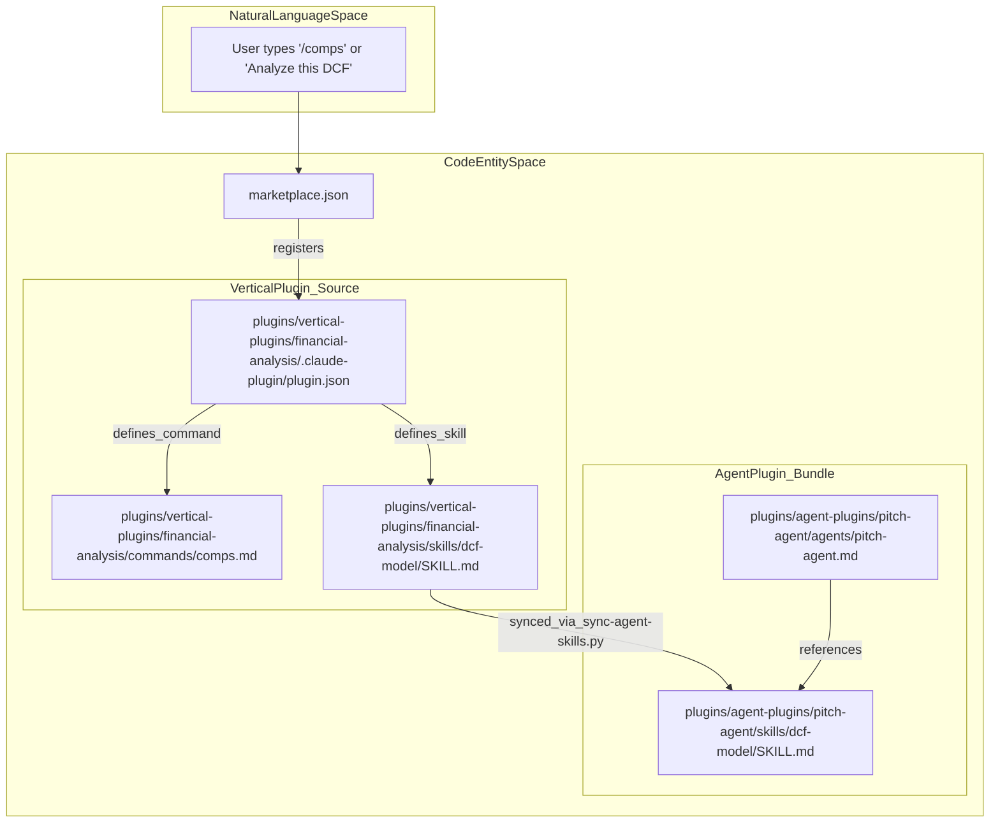
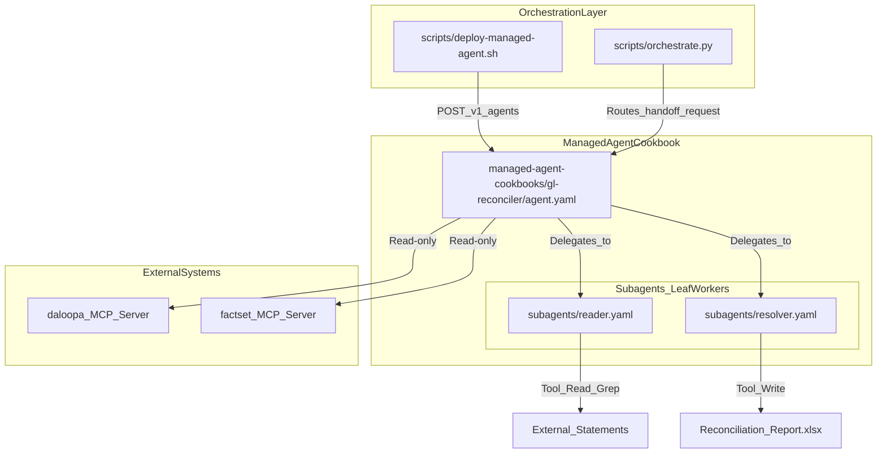

<!-- source: DeepWiki mcp.deepwiki.com · repo anthropics/financial-services · page 6 Glossary · fetched 2026-10-26 -->

# Glossary

Relevant source files

The following files were used as context for generating this wiki page:

- [.claude-plugin/marketplace.json](.claude-plugin/marketplace.json)
- [.github/workflows/plugin-validate.yml](.github/workflows/plugin-validate.yml)
- [CLAUDE.md](CLAUDE.md)
- [README.md](README.md)
- [claude-for-msft-365-install/commands/bootstrap.md](claude-for-msft-365-install/commands/bootstrap.md)
- [claude-for-msft-365-install/commands/manifest.md](claude-for-msft-365-install/commands/manifest.md)
- [claude-for-msft-365-install/scripts/build-manifest.mjs](claude-for-msft-365-install/scripts/build-manifest.mjs)
- [plugins/vertical-plugins/financial-analysis/.mcp.json](plugins/vertical-plugins/financial-analysis/.mcp.json)

This glossary provides technical definitions and code pointers for terms, architectural concepts, and domain-specific jargon used throughout the `financial-services` repository. It serves as a reference for onboarding engineers to map financial workflows to the underlying codebase entities.

## Core Architectural Terms

### 1. Vertical Plugins
A "Vertical" is a collection of domain-specific skills, slash commands, and MCP (Model Context Protocol) connectors. Verticals serve as the "source of truth" for capabilities.
*   **Implementation:** Located in `plugins/vertical-plugins/<vertical-name>/` [[.claude-plugin/marketplace.json:9-41]](), [[CLAUDE.md:14-19]]().
*   **Key Files:** Contains a `plugin.json` for metadata and `.mcp.json` for data connector definitions [[CLAUDE.md:16-19]]().
*   **Data Flow:** Skills defined here are propagated to Agent Plugins via `scripts/sync-agent-skills.py` [[CLAUDE.md:31-31]]().

### 2. Agent Plugins
Self-contained bundles that package a canonical system prompt with a specific subset of skills to automate an end-to-end workflow (e.g., `pitch-agent`).
*   **Implementation:** Located in `plugins/agent-plugins/<slug>/` [[.claude-plugin/marketplace.json:43-92]](), [[CLAUDE.md:9-13]]().
*   **Relationship:** Every agent ships "two ways from one source": as a Cowork plugin and as a Managed Agent template [[README.md:3-5]]().
*   **Key Files:** `agents/<slug>.md` contains the system prompt [[CLAUDE.md:12-12]]().

### 3. Managed Agent (CMA)
A deployment of an agent via the Claude Managed Agents API (`/v1/agents`). Unlike Cowork plugins, these are "headless" and run behind a firm's own workflow engine.
*   **Implementation:** Defined in `managed-agent-cookbooks/<slug>/` [[CLAUDE.md:21-26]]().
*   **Deployment:** The `scripts/deploy-managed-agent.sh` script resolves the `agent.yaml` manifest into a JSON payload for the Anthropic API [[README.md:80-85]]().

### 4. Skill
A markdown-based definition of a specific workflow, convention, or knowledge set that Claude invokes automatically when trigger conditions match.
*   **Implementation:** Found in `skills/*/SKILL.md` [[CLAUDE.md:40-40]]().
*   **Management:** Skills are authored in `vertical-plugins` and synced to `agent-plugins` to ensure portability [[CLAUDE.md:31-31]]().

### 5. Command
Explicit slash actions (e.g., `/comps`, `/dcf`) that a user triggers manually in the Claude interface.
*   **Implementation:** Markdown files in `plugins/vertical-plugins/<vertical>/commands/` [[CLAUDE.md:17-17]](), [[README.md:95-95]]().

**Sources:** [[README.md:3-107]](), [[CLAUDE.md:1-50]](), [[.claude-plugin/marketplace.json:1-128]]()

---

## Technical & Deployment Concepts

### Bootstrap Endpoint
An HTTPS GET handler that provides dynamic, per-user configuration (MCP servers, skills, JWT validation) to the Claude Microsoft 365 add-in.
*   **Implementation:** Part of the `claude-for-msft-365-install` package [[claude-for-msft-365-install/commands/bootstrap.md:5-10]]().
*   **Data Flow:** Allows for per-user delivery of MCP servers and skills based on identity provider attributes [[claude-for-msft-365-install/commands/bootstrap.md:31-38]]().
*   **Security:** Requires JWT validation of claims like `aud`, `iss`, and `oid` [[claude-for-msft-365-install/commands/bootstrap.md:132-140]]().

### Handoff Request
A mechanism for cross-agent communication. When an agent completes a task but needs another agent to take over, it emits a `handoff_request` event.
*   **Logic:** Managed by `scripts/orchestrate.py`, which acts as a reference event loop to route these requests [[README.md:80-85]]().

### Steering Event
The initial input or "kick-off" signal sent to a Managed Agent to start a session.
*   **Format:** Defined in `steering-examples.json` within each cookbook directory [[CLAUDE.md:25-25]]().

### Leaf Worker (Subagent)
A specialized, depth-1 subagent delegated to by an orchestrator agent to perform a specific sub-task.
*   **Implementation:** Defined in `managed-agent-cookbooks/<slug>/subagents/*.yaml` [[CLAUDE.md:24-24]]().

### Entra SSO
The integration that allows the Microsoft 365 add-in to acquire an Entra ID token at startup for authentication and per-user configuration.
*   **Configuration:** Enabled via `entra_sso=1` in the manifest generation script [[claude-for-msft-365-install/commands/manifest.md:48-52]]().
*   **Usage:** Used as the Bearer auth for the bootstrap endpoint [[claude-for-msft-365-install/commands/manifest.md:48-52]]().

**Sources:** [[claude-for-msft-365-install/commands/bootstrap.md:1-150]](), [[claude-for-msft-365-install/commands/manifest.md:1-140]](), [[README.md:80-85]]()

---

## System Architecture Diagrams

### From Natural Language to Code Entities (Plugin System)
This diagram illustrates how a user request for a financial tool maps to the specific code structures in the repository.

**Plugin Discovery and Execution Map**

**Sources:** [[.claude-plugin/marketplace.json:1-128]](), [[CLAUDE.md:5-31]](), [[README.md:89-99]]()

### Managed Agent Handoff and Security Architecture
This diagram shows the relationship between the orchestration script and the subagent "leaf" workers during a complex financial workflow.

**CMA Orchestration and Security Tiers**

**Sources:** [[README.md:80-85]](), [[CLAUDE.md:21-28]](), [[plugins/vertical-plugins/financial-analysis/.mcp.json:1-51]]()

---

## Financial Domain Terms in Code

| Term | Definition | Code Reference |
| :--- | :--- | :--- |
| **Comps** | Comparable Company Analysis; used to value a company against peers. | `plugins/vertical-plugins/financial-analysis/` [[.claude-plugin/marketplace.json:11-11]]() |
| **DCF** | Discounted Cash Flow; a valuation method based on future cash flows. | `plugins/vertical-plugins/financial-analysis/` [[.claude-plugin/marketplace.json:11-11]]() |
| **LBO** | Leveraged Buyout; modeling the acquisition of a company using significant debt. | `plugins/vertical-plugins/financial-analysis/` [[.claude-plugin/marketplace.json:11-11]]() |
| **GL Recon** | General Ledger Reconciliation; matching ledger entries against subledgers. | `plugins/agent-plugins/gl-reconciler/` [[.claude-plugin/marketplace.json:80-83]]() |
| **NAV Tie-out** | Net Asset Value verification; ensuring fund valuations match supporting documentation. | `plugins/vertical-plugins/fund-admin/` [[.claude-plugin/marketplace.json:41-41]]() |
| **KYC** | Know Your Customer; verifying client identity and assessing risks. | `plugins/agent-plugins/kyc-screener/` [[.claude-plugin/marketplace.json:86-89]]() |
| **CIM** | Confidential Information Memorandum; detailed company profile for M&A. | `plugins/vertical-plugins/investment-banking/` [[.claude-plugin/marketplace.json:17-17]]() |

**Sources:** [[.claude-plugin/marketplace.json:8-120]](), [[README.md:21-32]]()