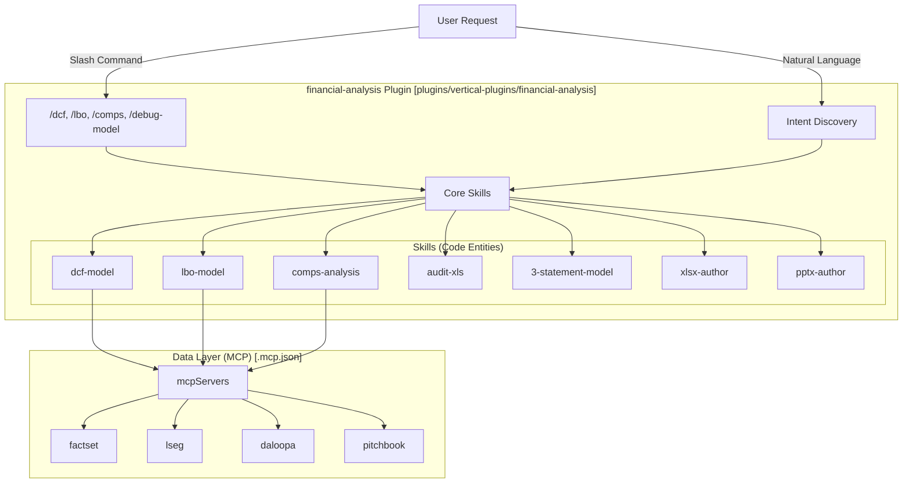
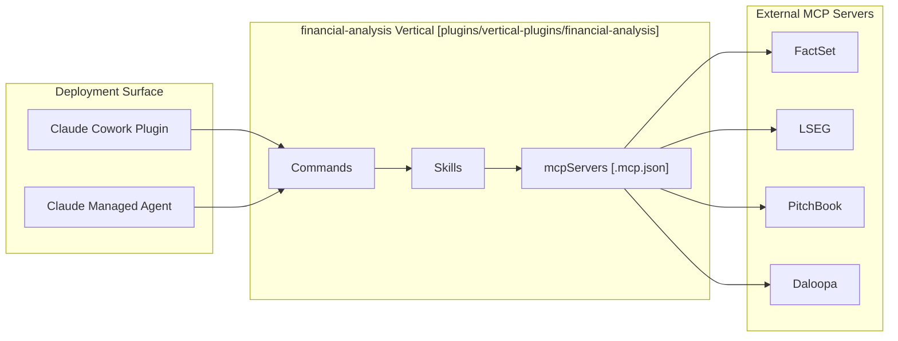

<!-- source: DeepWiki mcp.deepwiki.com · repo anthropics/financial-services · extra page Financial Analysis (Core Vertical) · fetched 2026-10-26 -->

# Financial Analysis (Core Vertical)

Relevant source files

The following files were used as context for generating this wiki page:

- [README.md](README.md)
- [plugins/vertical-plugins/financial-analysis/.claude-plugin/plugin.json](plugins/vertical-plugins/financial-analysis/.claude-plugin/plugin.json)
- [plugins/vertical-plugins/financial-analysis/.mcp.json](plugins/vertical-plugins/financial-analysis/.mcp.json)
- [plugins/vertical-plugins/financial-analysis/hooks/hooks.json](plugins/vertical-plugins/financial-analysis/hooks/hooks.json)

The `financial-analysis` vertical serves as the foundational intelligence layer of the repository. It acts as the central hub for data integration, housing the configurations for all 11 Model Context Protocol (MCP) data connectors, and provides the core computational skills required for valuation, modeling, and document authoring.

## Overview and Role

The `financial-analysis` plugin is a "Vertical Plugin" designed to provide domain-specific expertise that can be used standalone or bundled into specialized agents. It is the most critical dependency in the monorepo, as it defines the shared modeling logic and data access patterns used across Investment Banking, Equity Research, and Private Equity workflows [README.md:101-104]().

### Key Responsibilities
- **Data Orchestration**: Managing connections to premium financial data providers (FactSet, LSEG, Morningstar, etc.) via the `.mcp.json` configuration [plugins/vertical-plugins/financial-analysis/.mcp.json:1-51]().
- **Core Modeling**: Providing the logic for Discounted Cash Flow (DCF), Leveraged Buyback (LBO), and Public Comps analysis [README.md:107-108]().
- **Model Integrity**: Auditing complex Excel workbooks for structural and logical errors through the `audit-xls` skill [README.md:108-110]().
- **Artifact Generation**: Authoring professional-grade Excel models and PowerPoint decks via `xlsx-author` and `pptx-author` [README.md:108-110]().

**Sources:** [README.md:101-110](), [plugins/vertical-plugins/financial-analysis/.mcp.json:1-51]()

---

## Data Flow: Natural Language to Code Entities

The following diagram illustrates how a user's natural language request is routed through the system's commands and skills to interact with the underlying MCP data connectors defined in the vertical.

### Command and Skill Routing

**Sources:** [README.md:91-97](), [README.md:103-110](), [plugins/vertical-plugins/financial-analysis/.mcp.json:1-51]()

---

## Core Skills & Implementation

### 1. Financial Modeling Skills
These skills represent the computational core of the vertical. They are designed to operate within Excel via the `xlsx-author` skill or generate standalone reports [README.md:107-110]().

| Skill Name | Role | Key Functions / Triggers |
| :--- | :--- | :--- |
| `3-statement-model` | Builds integrated IS/BS/CF models | Triggers on "build a 3-statement", "link the financials" |
| `dcf-model` | Performs intrinsic valuation | Calculates WACC, FCF, and Terminal Value |
| `lbo-model` | Analyzes PE returns | Sources & Uses, Debt Sweeps, IRR/MOIC hurdles |
| `comps-analysis` | Relative valuation | Pulls peer multiples (P/E, EV/EBITDA) via MCP |
| `xlsx-author` | Excel Manipulation | Writes formulas, formats cells, creates charts |
| `pptx-author` | Deck Generation | Generates branded slides and charts |

### 2. Audit and Quality Control (`audit-xls`)
The `audit-xls` skill is a logic engine for validating financial models. It identifies formula errors, hardcoded values in calculation blocks, and structural integrity issues [README.md:108-110]().

**Implementation Logic:**
- **Formula Checks**: Scans for `#REF!` errors and inconsistent patterns across rows or columns.
- **Integrity Checks**: Validates if the Balance Sheet balances (`Assets = Liabilities + Equity`) and if the Cash Flow Statement ties to the Balance Sheet cash account.
- **Circular Reference Detection**: Identifies intentional loops (like Interest Expense $\leftrightarrow$ Debt Balance) and verifies iteration toggles.

**Sources:** [README.md:101-110]()

---

## MCP Connector Hub

The `financial-analysis` vertical centralizes the configuration for 11 MCP connectors. These connectors allow Claude to fetch real-time and historical data directly from financial terminals and databases [plugins/vertical-plugins/financial-analysis/.mcp.json:1-51]().

### Integrated Connectors
1.  **Daloopa**: Deep-link data into Excel models [plugins/vertical-plugins/financial-analysis/.mcp.json:3-6]().
2.  **Morningstar**: Equity research and fund data [plugins/vertical-plugins/financial-analysis/.mcp.json:7-10]().
3.  **S&P Global / Kensho**: Earnings transcripts and transaction summaries [plugins/vertical-plugins/financial-analysis/.mcp.json:11-14]().
4.  **FactSet**: Estimates, fundamentals, and ownership data [plugins/vertical-plugins/financial-analysis/.mcp.json:15-18]().
5.  **Moody's**: Credit ratings and risk metrics [plugins/vertical-plugins/financial-analysis/.mcp.json:19-22]().
6.  **MT Newswires**: Real-time financial news [plugins/vertical-plugins/financial-analysis/.mcp.json:23-26]().
7.  **Aiera**: Event monitoring and transcripts [plugins/vertical-plugins/financial-analysis/.mcp.json:27-30]().
8.  **LSEG**: Real-time pricing and fixed income analytics [plugins/vertical-plugins/financial-analysis/.mcp.json:31-34]().
9.  **PitchBook**: Private company data and VC/PE deal flow [plugins/vertical-plugins/financial-analysis/.mcp.json:35-38]().
10. **Chronograph**: Private equity portfolio monitoring [plugins/vertical-plugins/financial-analysis/.mcp.json:39-42]().
11. **Egnyte/Box**: Secure document storage and retrieval [plugins/vertical-plugins/financial-analysis/.mcp.json:43-50]().

### System Integration Diagram
This diagram shows how the `financial-analysis` vertical acts as a bridge between the User Interface (Cowork/Managed Agents) and the external data providers.

**Sources:** [README.md:91-97](), [plugins/vertical-plugins/financial-analysis/.mcp.json:1-51]()

---

## Slash Commands Reference

The following commands are explicitly registered within the `financial-analysis` vertical to provide quick access to complex workflows [README.md:76, 107-110]():

- `/comps`: Initiates a comparable company analysis for a given ticker.
- `/dcf`: Generates a Discounted Cash Flow valuation template.
- `/lbo`: Creates a 5-year Leveraged Buyout return model.
- `/debug-model`: Invokes the `audit-xls` skill to scan for errors in an active workbook.
- `/deck-refresh`: Uses `pptx-author` logic to update charts in a PowerPoint file based on new Excel data.
- `/3-statement`: Scaffolds an integrated three-statement financial model.

**Sources:** [README.md:76](), [README.md:95](), [README.md:107-110]()

---

