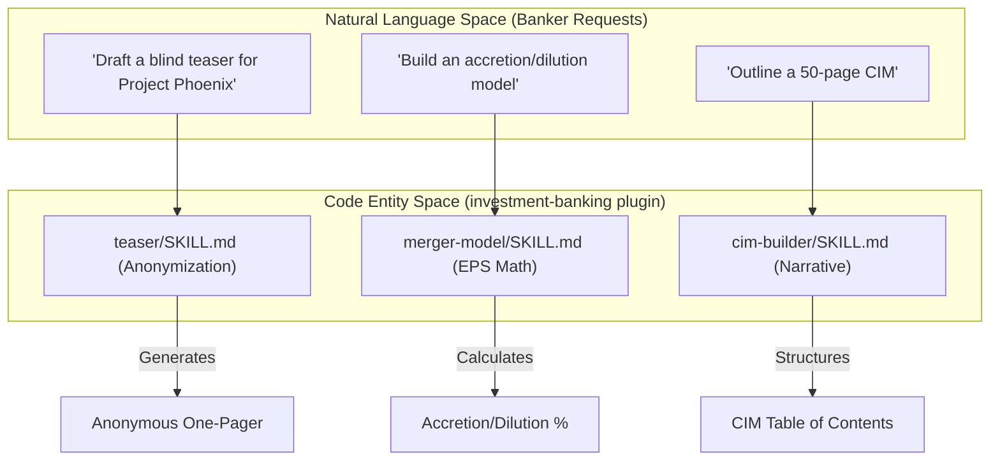
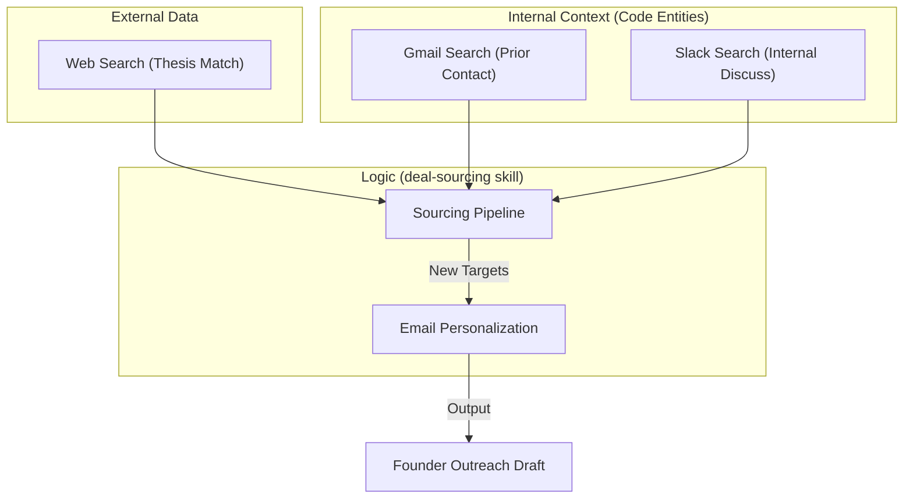

<!-- source: DeepWiki mcp.deepwiki.com · repo anthropics/financial-services · extra page Investment Banking, Equity Research & Other Verticals · fetched 2026-10-26 -->

# Investment Banking, Equity Research & Other Verticals

Relevant source files

The following files were used as context for generating this wiki page:

- [plugins/vertical-plugins/equity-research/.claude-plugin/plugin.json](plugins/vertical-plugins/equity-research/.claude-plugin/plugin.json)
- [plugins/vertical-plugins/equity-research/skills/earnings-preview/SKILL.md](plugins/vertical-plugins/equity-research/skills/earnings-preview/SKILL.md)
- [plugins/vertical-plugins/equity-research/skills/morning-note/SKILL.md](plugins/vertical-plugins/equity-research/skills/morning-note/SKILL.md)
- [plugins/vertical-plugins/investment-banking/.claude-plugin/plugin.json](plugins/vertical-plugins/investment-banking/.claude-plugin/plugin.json)
- [plugins/vertical-plugins/investment-banking/skills/cim-builder/SKILL.md](plugins/vertical-plugins/investment-banking/skills/cim-builder/SKILL.md)
- [plugins/vertical-plugins/investment-banking/skills/merger-model/SKILL.md](plugins/vertical-plugins/investment-banking/skills/merger-model/SKILL.md)
- [plugins/vertical-plugins/investment-banking/skills/teaser/SKILL.md](plugins/vertical-plugins/investment-banking/skills/teaser/SKILL.md)
- [plugins/vertical-plugins/private-equity/.claude-plugin/plugin.json](plugins/vertical-plugins/private-equity/.claude-plugin/plugin.json)
- [plugins/vertical-plugins/private-equity/skills/deal-sourcing/SKILL.md](plugins/vertical-plugins/private-equity/skills/deal-sourcing/SKILL.md)
- [plugins/vertical-plugins/private-equity/skills/ic-memo/SKILL.md](plugins/vertical-plugins/private-equity/skills/ic-memo/SKILL.md)
- [plugins/vertical-plugins/wealth-management/.claude-plugin/plugin.json](plugins/vertical-plugins/wealth-management/.claude-plugin/plugin.json)
- [plugins/vertical-plugins/wealth-management/skills/client-report/SKILL.md](plugins/vertical-plugins/wealth-management/skills/client-report/SKILL.md)
- [plugins/vertical-plugins/wealth-management/skills/portfolio-rebalance/SKILL.md](plugins/vertical-plugins/wealth-management/skills/portfolio-rebalance/SKILL.md)

This page provides a technical reference for the domain-specific vertical plugins within the `financial-services` repository. While the `financial-analysis` plugin serves as the core engine for modeling and data connectivity, these additional verticals provide specialized prompts, logic, and workflows for specific financial services sectors including Investment Banking, Equity Research, Private Equity, Wealth Management, Fund Administration, and Operations.

## Overview of Vertical Plugins

The repository organizes domain logic into "Vertical Plugins" located in `plugins/vertical-plugins/`. These plugins serve as the source of truth for specialized financial skills and are defined by a `plugin.json` manifest in their respective `.claude-plugin/` directories.

| Plugin Name | Purpose | Key Workflows |
|:---|:---|:---|
| `investment-banking` | Advisory productivity | CIMs, teasers, merger models, pitch decks |
| `equity-research` | Public markets analysis | Earnings previews, morning notes, initiating coverage |
| `private-equity` | Buy-side deal flow | Deal sourcing, IC memos, returns analysis |
| `wealth-management` | Client advisory | Portfolio rebalancing, client reporting, financial planning |
| `fund-admin` | Middle/Back office ops | GL reconciliation, NAV tie-outs, roll-forwards |
| `operations` | Compliance & KYC | KYC document parsing, rules-grid evaluation |

Sources: [plugins/vertical-plugins/investment-banking/.claude-plugin/plugin.json:1-8](), [plugins/vertical-plugins/equity-research/.claude-plugin/plugin.json:1-8](), [plugins/vertical-plugins/private-equity/.claude-plugin/plugin.json:1-8](), [plugins/vertical-plugins/wealth-management/.claude-plugin/plugin.json:1-8]()

## Investment Banking

The `investment-banking` vertical automates the creation of high-stakes transaction documents and merger analysis.

### CIM & Teaser Construction
The `cim-builder` and `teaser` skills utilize structured workflows to transform raw company data into investor-ready materials.

*   **`cim-builder`**: Organizes data into an 8-section memorandum, including Executive Summary, Industry Overview, and Financial Overview [plugins/vertical-plugins/investment-banking/skills/cim-builder/SKILL.md:24-82]().
*   **`teaser`**: Focuses on anonymization logic, ensuring no company names, specific geographies, or identifiable employee counts are disclosed while maintaining a compelling narrative [plugins/vertical-plugins/investment-banking/skills/teaser/SKILL.md:58-66]().

### Merger Modeling
The `merger-model` skill performs accretion/dilution analysis. It calculates pro forma EPS impact by adjusting for synergies, new debt interest, and foregone interest on cash [plugins/vertical-plugins/investment-banking/skills/merger-model/SKILL.md:54-69]().

**Technical Entity Mapping: Investment Banking**

Sources: [plugins/vertical-plugins/investment-banking/skills/teaser/SKILL.md:1-4](), [plugins/vertical-plugins/investment-banking/skills/merger-model/SKILL.md:1-4](), [plugins/vertical-plugins/investment-banking/skills/cim-builder/SKILL.md:1-4]()

## Equity Research (ER)

The `equity-research` vertical focuses on the high-velocity lifecycle of public company coverage, specifically pre-earnings positioning and daily market reactions.

### Earnings Preview & Morning Notes
*   **`earnings-preview`**: Builds a "what to watch" framework, ranking financial and sector-specific operational metrics (e.g., ARR for SaaS, NIM for Banks) and creating bull/base/bear scenarios [plugins/vertical-plugins/equity-research/skills/earnings-preview/SKILL.md:17-48]().
*   **`morning-note`**: Optimized for a 7:00 AM meeting format. It summarizes overnight developments and provides "Quick Takes" on earnings with a comparison of Actual vs. Consensus metrics [plugins/vertical-plugins/equity-research/skills/morning-note/SKILL.md:32-75]().

Sources: [plugins/vertical-plugins/equity-research/skills/earnings-preview/SKILL.md:1-4](), [plugins/vertical-plugins/equity-research/skills/morning-note/SKILL.md:1-4]()

## Private Equity

The `private-equity` vertical handles the "top of the funnel" sourcing and the formal Investment Committee (IC) approval process.

### Deal Sourcing & IC Memos
*   **`deal-sourcing`**: Implements a 3-step pipeline: Company Discovery (web search), CRM Check (searching Gmail/Slack for prior contact), and Founder Outreach (drafting personalized, low-pressure emails) [plugins/vertical-plugins/private-equity/skills/deal-sourcing/SKILL.md:10-50]().
*   **`ic-memo`**: Synthesizes due diligence findings into a structured recommendation, including a "Value Creation Plan" and "Returns Analysis" (IRR/MOIC) across multiple scenarios [plugins/vertical-plugins/private-equity/skills/ic-memo/SKILL.md:23-75]().

**Data Flow: PE Deal Sourcing**

Sources: [plugins/vertical-plugins/private-equity/skills/deal-sourcing/SKILL.md:12-44]()

## Wealth Management

Tailored for financial advisors managing private client portfolios and households.

### Client Reporting & Rebalancing
*   **`client-report`**: Generates multi-page performance reviews. It aggregates data by household and account (Taxable, IRA, 529), comparing returns against custom benchmarks defined in the Investment Policy Statement (IPS) [plugins/vertical-plugins/wealth-management/skills/client-report/SKILL.md:10-36]().
*   **`portfolio-rebalance`**: (Referenced) Analyzes current allocations against target models to identify necessary trades.

Sources: [plugins/vertical-plugins/wealth-management/skills/client-report/SKILL.md:1-4](), [plugins/vertical-plugins/wealth-management/skills/portfolio-rebalance/SKILL.md:1-4]()

## Fund Administration & Operations

These verticals handle the middle and back-office control functions.

### Fund Administration
Focuses on reconciliation and NAV (Net Asset Value) accuracy.
*   **GL Reconciliation**: Performs matching between General Ledger and Subledger extracts, bucketing breaks into categories like "Amount", "Quantity", or "Timing" mismatches.
*   **NAV Tie-out**: Validates the roll-forward of fund capital and expenses.

### Operations
Handles high-volume compliance and document processing.
*   **KYC Parsing**: Extraction of entities from onboarding documentation (passports, incorporation papers).
*   **Rules Evaluation**: Matching extracted data against a compliance rules-grid to flag missing documentation or regulatory gaps.

---

