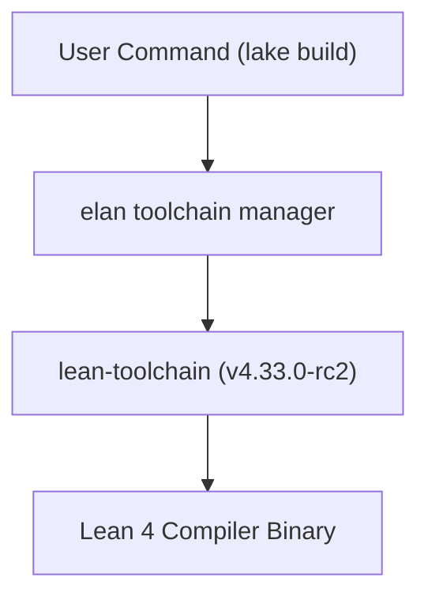
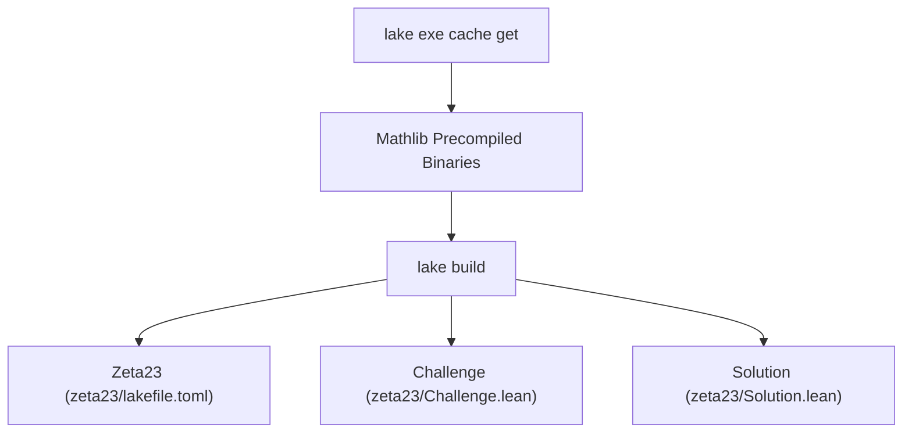
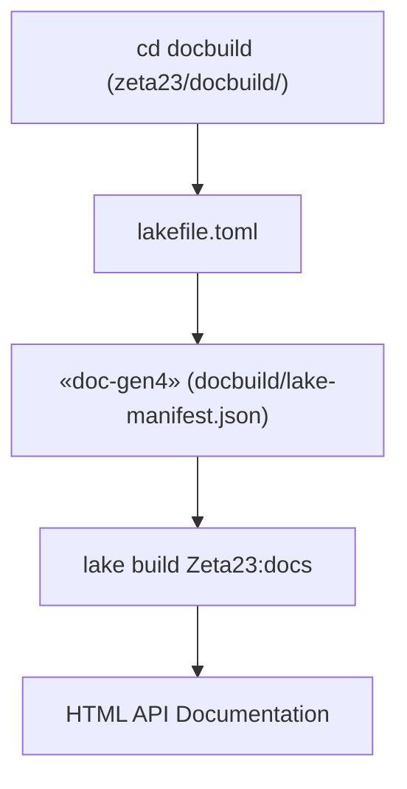

<!-- source: DeepWiki mcp.deepwiki.com · repo anthropics/formal-math · page 1.2 Getting Started: Building zeta23 Locally · fetched 2026-10-26 -->

# Getting Started: Building zeta23 Locally

<details>
<summary>Relevant source files</summary>

The following files were used as context for generating this wiki page:

- [zeta23/README.md](zeta23/README.md)
- [zeta23/docbuild/lake-manifest.json](zeta23/docbuild/lake-manifest.json)
- [zeta23/docbuild/lakefile.toml](zeta23/docbuild/lakefile.toml)
- [zeta23/docbuild/lean-toolchain](zeta23/docbuild/lean-toolchain)
- [zeta23/lakefile.toml](zeta23/lakefile.toml)

</details>


This section covers the local environment setup required to build, verify, and document the `zeta23` formalization project. It details the installation of `elan`, toolchain pinning, fetching Mathlib precompiled binaries, executing `lake` targets, and generating API documentation using `doc-gen4`.

---

## 1. Toolchain Management and elan Installation

The `zeta23` project relies on the Lean 4 version manager, `elan`, to manage toolchains automatically. The exact Lean toolchain and Mathlib dependency commit are pinned in the package files.

To set up the environment:
1. Ensure `elan` is installed on your system (following the standard Lean 4 installation instructions).
2. Navigate to the `zeta23/` subdirectory [zeta23/README.md:5]():
   ```bash
   cd zeta23
   ```
3. The repository pins Lean version `v4.33.0-rc2` and Mathlib commit `51e6992efd06126df61a496bebf8f49482a4e129` as specified in the project configuration [zeta23/README.md:20](). When you run any `lake` command, `elan` reads `lean-toolchain` and downloads the appropriate Lean binary automatically.


Sources: [zeta23/README.md:1-20]()

---

## 2. Fetching Mathlib Caches and Building Lake Targets

Because `zeta23` depends on Mathlib [zeta23/lakefile.toml:9-13](), compiling it from scratch takes considerable time. You should fetch the precompiled Mathlib build cache using Lake before initiating a full build.

```bash
lake exe cache get
```

Once the cache is restored, you can build the default targets defined in `zeta23/lakefile.toml` [zeta23/lakefile.toml:1-3](). The package defines multiple libraries: `Zeta23` (the main proof development), `ChallengeDeps` (shared definitions), `Challenge` (trusted statement surface), and `Solution` (untrusted verification wrapper) [zeta23/lakefile.toml:15-31]().

To build the default targets (`Zeta23`, `Challenge`, `Solution`) [zeta23/lakefile.toml:1-3]():
```bash
lake build
```


Sources: [zeta23/README.md:1-20](), [zeta23/lakefile.toml:1-31]()

---

## 3. Building API Documentation via docbuild

The repository includes a nested documentation project under `docbuild/` configured to use `doc-gen4` [zeta23/README.md:53](). This generates HTML API documentation for the `Zeta23` library.

To build the documentation:
1. Navigate to the `docbuild/` directory:
   ```bash
   cd docbuild
   ```
2. Run the documentation build target [zeta23/README.md:53]():
   ```bash
   lake build Zeta23:docs
   ```

The `docbuild` package is configured via `docbuild/lakefile.toml` [zeta23/docbuild/lakefile.toml:1-14](), which references `doc-gen4` at revision `v4.33.0-rc2` [zeta23/docbuild/lakefile.toml:6-11]() and links the parent `Zeta23` library locally [zeta23/docbuild/lakefile.toml:12-14]().


Sources: [zeta23/README.md:53](), [zeta23/docbuild/lake-manifest.json:1-185](), [zeta23/docbuild/lakefile.toml:1-14]()

---

