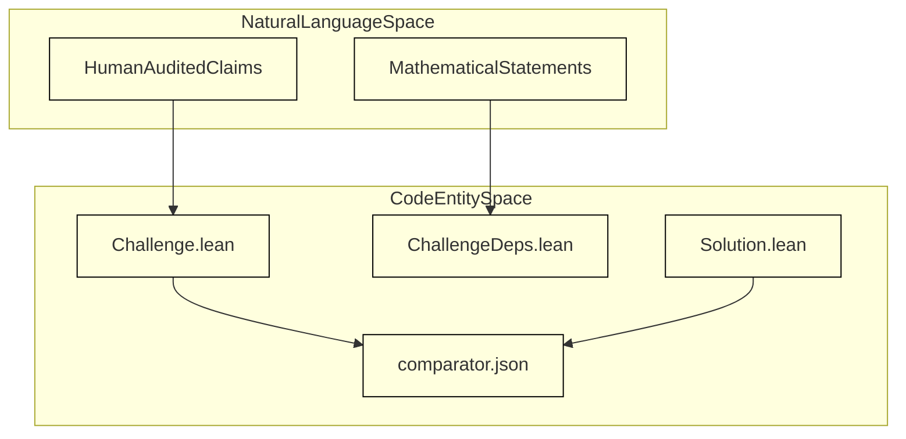
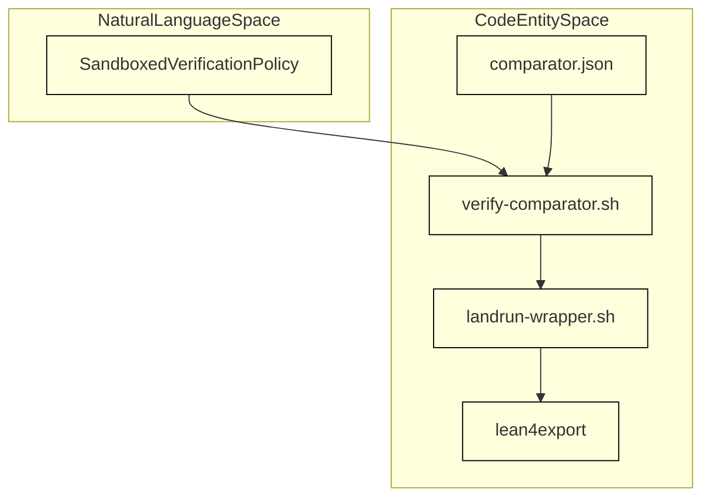

<!-- source: DeepWiki mcp.deepwiki.com · repo anthropics/formal-math · page 2 Challenge / Solution Verification Model · fetched 2026-10-26 -->

# Challenge / Solution Verification Model

Relevant source files

The following files were used as context for generating this wiki page:

- [zeta23/AUDIT.md](zeta23/AUDIT.md)
- [zeta23/README.md](zeta23/README.md)

The challenge/solution verification model establishes a rigorous separation of concerns between trusted theorem statements and untrusted proof implementations in the `zeta23` codebase [zeta23/README.md:22-26](). By adopting the Palomar submission template layout [zeta23/README.md:22-26](), the repository isolates the mathematical claims that human auditors need to verify (`Challenge.lean`) from the complex proof machinery (`Solution.lean` and the `Zeta23` proof library) [zeta23/README.md:27-38](). 

This page provides a high-level overview of this architecture, the comparator harness, and axiom hygiene. For specific implementation details, refer to the following child pages:
- [Challenge Statements and Dependency Layers](#2.1)
- [Solution Delegation Wrappers](#2.2)
- [Comparator Configuration and Sandboxed Replay](#2.3)
- [Axiom Auditing and the AUDIT Record](#2.4)

*Figure 1: Bridging human-audited expectations in Natural Language Space to the verification entrypoints (`Challenge.lean`, `Solution.lean`) in Code Entity Space.*

Sources: [zeta23/README.md:22-38](), [zeta23/AUDIT.md:1-5]()

---

## 2.1. Challenge Statements and Dependency Layers

The challenge layer defines the public theorem statements that the formalization aims to prove. `Challenge.lean` acts as a small, trusted statement surface that imports only Mathlib and defines the core theorems using placeholder proofs (`sorry`) [zeta23/README.md:27-31](). It is accompanied by `ChallengeDeps.lean`, which contains inlined helper definitions (such as zero-counting functions and the Montgomery–Taylor constant) [zeta23/README.md:32-34]().

Because `Challenge.lean` is designed for human review, the presence of `sorry` tokens is strictly expected and permitted solely within these trusted statement files [zeta23/README.md:29-31](), [zeta23/AUDIT.md:22-24](). 

For full technical details, see [Challenge Statements and Dependency Layers](#2.1).

Sources: [zeta23/README.md:27-34](), [zeta23/AUDIT.md:22-24]()

---

## 2.2. Solution Delegation Wrappers

To connect the trusted challenges to the underlying constructive proofs, `Solution.lean` re-states the theorems from `Challenge.lean` and provides complete, `sorry`-free proofs by delegating directly into the `Zeta23` proof library [zeta23/README.md:35-36](). Similarly, `Solution/XiPrime.lean` handles the auxiliary development for $\xi'$. 

These solution modules are untrusted by the verification harness; instead, their structural and type-level compliance with `Challenge.lean` is automatically enforced by external comparison tools [zeta23/README.md:35-38]().

For full technical details, see [Solution Delegation Wrappers](#2.2).

Sources: [zeta23/README.md:35-38]()

---

## 2.3. Comparator Configuration and Sandboxed Replay

The verification harness relies on the `comparator` tool and configuration files (`comparator.json` and `comparator-xiprime.json`) to verify that the types and signatures in `Solution.lean` match `Challenge.lean` without introducing unauthorized axioms [zeta23/README.md:37-41](). 

The automated script `scripts/verify-comparator.sh` coordinates this process, leveraging `lean4export`, `nanoda`, and `landrun` sandboxing to guarantee reproducible, isolated validation [zeta23/README.md:49-52]().

*Figure 2: Pipeline execution flow from policy definition to execution wrappers (`verify-comparator.sh`, `landrun-wrapper.sh`, `lean4export`) within Code Entity Space.*

For full technical details, see [Comparator Configuration and Sandboxed Replay](#2.3).

Sources: [zeta23/README.md:37-52]()

---

## 2.4. Axiom Auditing and the AUDIT Record

Axiom hygiene is strictly maintained across the repository. The build and verification pipeline ensures that no custom or project-specific axioms are declared [zeta23/README.md:17-18](). Using custom `#print axioms` scripts located under `scripts/`, the project verifies that all headline theorems depend solely on Lean's standard three axioms: `propext`, `Classical.choice`, and `Quot.sound` [zeta23/README.md:17-18](), [zeta23/AUDIT.md:25-26]().

Historical and reproducible audit data—including command outputs, axiom lists, and sorry-freeness checks—are systematically tracked in `AUDIT.md` [zeta23/README.md:46](), [zeta23/AUDIT.md:1-26]().

For full technical details, see [Axiom Auditing and the AUDIT Record](#2.4).

Sources: [zeta23/README.md:17-18](), [zeta23/AUDIT.md:1-26]()

---

