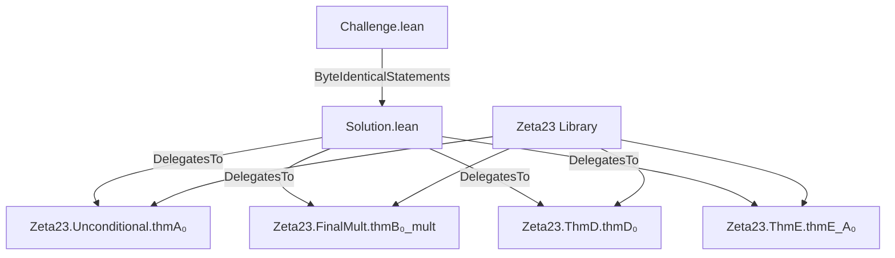
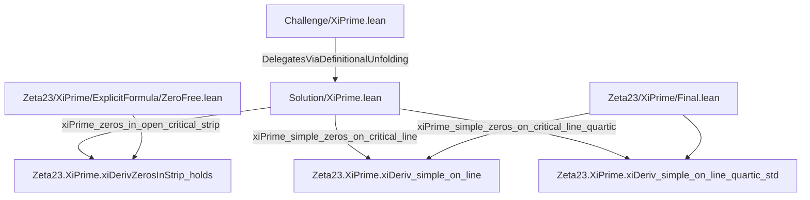

<!-- source: DeepWiki mcp.deepwiki.com · repo anthropics/formal-math · page 2.2 Solution Delegation Wrappers · fetched 2026-10-26 -->

# Solution Delegation Wrappers

<details>
<summary>Relevant source files</summary>

The following files were used as context for generating this wiki page:

- [zeta23/Solution.lean](zeta23/Solution.lean)
- [zeta23/Solution/XiPrime.lean](zeta23/Solution/XiPrime.lean)
- [zeta23/formalization.yaml](zeta23/formalization.yaml)

</details>


This page details how `Solution.lean` and `Solution/XiPrime.lean` act as untrusted solution wrappers that bridge the formal challenge statements in `Challenge.lean` and `Challenge/XiPrime.lean` to the underlying mathematical proofs developed in the `Zeta23` proof library. These files do not contain substantial mathematical proofs themselves; instead, they instantiate challenge declarations by definitional unfolding and delegation to library entrypoints, handling minor constant normalization where necessary.

---

## 1. Architecture of Delegation Wrappers and Data Flow

The repository separates trusted challenge statements from the heavy computational and analytic proofs of the `Zeta23` library. The challenge modules (`Challenge.lean` and `Challenge/XiPrime.lean`) define the exact mathematical statements required by the Palomar comparator and Remark 7.1, respectively, using shared counting functions from `ChallengeDeps` [zeta23/Solution.lean:21-23](). 

The wrapper files `Solution.lean` and `Solution/XiPrime.lean` import these challenge definitions along with the corresponding terminal theorems of the `Zeta23` library, discharging each statement via direct term assignment or simple rewriting (`simp`).


*Sources: [zeta23/Solution.lean:7-40](), [zeta23/formalization.yaml:75-126]()*

---

## 2. Zeta Zero and Dirichlet L-Function Delegation (`Solution.lean`)

`Solution.lean` covers seventeen challenge theorems corresponding to Theorems A, B, C, D, and E of the Alpöge–Furman paper, plus their cumulative variants and Dirichlet L-function generalisations [zeta23/Solution.lean:7-19](). Because the counting functions (`Ncount`, `N0star`, `N0simple`, `Ndist`) defined in `ChallengeDeps` are definitionally identical to those in `Zeta23/Statement.lean` and `Zeta23/ThmE/Statement.lean`, the Lean kernel accepts the delegation without coercions [zeta23/Solution.lean:21-23]().

| Challenge Theorem Name | Target Library Symbol | Source Module |
| :--- | :--- | :--- |
| `two_thirds_on_critical_line` | `Zeta23.thmA₀` | `Zeta23.Unconditional` [zeta23/Solution.lean:10-11,52-54]() |
| `two_thirds_simple_on_critical_line` | `Zeta23.thmB₀_mult` | `Zeta23.FinalMult` [zeta23/Solution.lean:12-13,60-62]() |
| `five_sixths_distinct` | `Zeta23.thmC₀_mult` | `Zeta23.FinalMult` [zeta23/Solution.lean:12-13,68-70]() |
| `dirichlet_two_thirds_on_critical_line` | `Zeta23.ThmE.thmE_A₀` | `Zeta23.ThmE.Final` [zeta23/Solution.lean:16,106-109]() |

*Sources: [zeta23/Solution.lean:32-41](), [zeta23/formalization.yaml:95-126]()*

---

## 3. Constant Harmonization (`cMT` vs `cStar 1`)

The challenge statement defines the Montgomery–Taylor window constant using the paper's closed-form tangent expression `cMT` [zeta23/Solution.lean:24-27]():

$$\c_1^* = \frac{\sqrt{2} \tan \vartheta}{1 + \vartheta \tan \vartheta}, \quad \text{where } \vartheta = \frac{1}{\sqrt{2}}$$

Inside the `Zeta23` library (specifically under `Zeta23/ThmD/`), the constant is represented via a division-safe sine/cosine formulation (`Zeta23.ThmD.cStar 1`) [zeta23/Solution.lean:24-27](). `Solution.lean` bridges this discrepancy by proving a local identity `cStar_one_eq_cMT` [zeta23/Solution.lean:44-50]():

```lean
theorem cStar_one_eq_cMT : Zeta23.ThmD.cStar 1 = cMT := by
  rw [Zeta23.ThmD.cStar_eq_tan_form zero_le_one le_rfl]
  unfold cMT Zeta23.ThmD.theta
  rfl
```

For Theorem D instantiations (`montgomery_taylor_on_critical_line`, `montgomery_taylor_simple_on_critical_line_mult`, etc.), the wrapper fetches the library theorem, simplifies `Zeta23.ThmD.HD` and `Zeta23.ThmD.GD` using `cStar_one_eq_cMT`, and closes the proof [zeta23/Solution.lean:76-104]().

*Sources: [zeta23/Solution.lean:24-31](), [zeta23/Solution.lean:44-50]()*

---

## 4. XiPrime Zeros Delegation (`Solution/XiPrime.lean`)

`Solution/XiPrime.lean` handles the six companion statements concerning the zeros of $\xi'(s)$ as explored in Remark 7.1 of the Alpöge–Furman paper [zeta23/Solution/XiPrime.lean:1-52](). It imports `ChallengeDeps.XiPrime` and delegates directly to the `Zeta23.XiPrime` subsystem [zeta23/Solution/XiPrime.lean:6-8]().


*Sources: [zeta23/Solution/XiPrime.lean:6-52](), [zeta23/formalization.yaml:81-85]()*

The six delegated statements verified in `Solution/XiPrime.lean` consist of:
1. `xiPrime_zeros_in_open_critical_strip`: Establishes that every zero of $\xi'$ lies in $0 < \text{Re } s < 1$ [zeta23/Solution/XiPrime.lean:12-15]().
2. `xiPrime_over_xi_re_pos`: Proves $\text{Re } (\xi'(s)/\xi(s)) > 0$ for $\text{Re } s \ge 1$ [zeta23/Solution/XiPrime.lean:17-20]().
3. `xiPrime_simple_zeros_on_critical_line` and its cumulative counterpart: Confirms $\ge 85.838\%$ simple and on the critical line, $\ge 92.919\%$ distinct [zeta23/Solution/XiPrime.lean:22-36]().
4. `xiPrime_simple_zeros_on_critical_line_quartic` and its cumulative counterpart: Confirms the near-optimal quartic window improvements ($\ge 86.864\%$ simple/on-line, $\ge 93.432\%$ distinct) [zeta23/Solution/XiPrime.lean:38-52]().

*Sources: [zeta23/Solution/XiPrime.lean:1-52]()*

---

