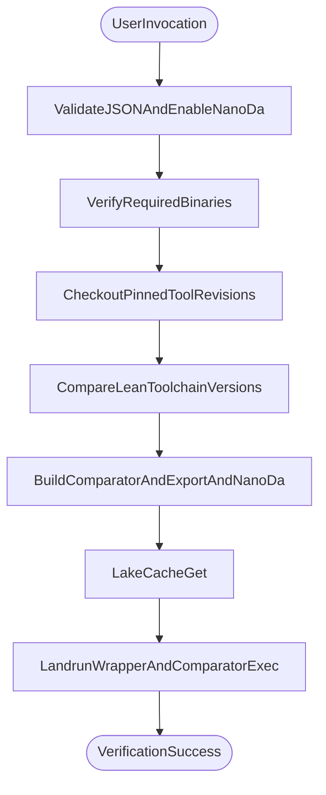
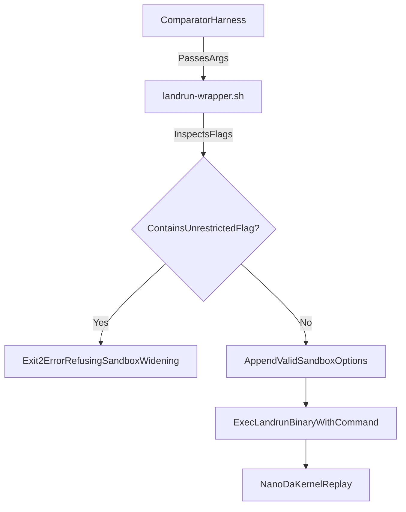

<!-- source: DeepWiki mcp.deepwiki.com · repo anthropics/formal-math · page 2.3 Comparator Configuration and Sandboxed Replay · fetched 2026-10-26 -->

# Comparator Configuration and Sandboxed Replay

<details>
<summary>Relevant source files</summary>

The following files were used as context for generating this wiki page:

- [zeta23/comparator-xiprime.json](zeta23/comparator-xiprime.json)
- [zeta23/comparator.json](zeta23/comparator.json)
- [zeta23/scripts/landrun-wrapper.sh](zeta23/scripts/landrun-wrapper.sh)
- [zeta23/scripts/verify-comparator.sh](zeta23/scripts/verify-comparator.sh)

</details>


## Purpose and Scope
This section details the verification architecture governed by `comparator.json` and `comparator-xiprime.json`, the strict security boundary enforced by permitted axioms, and the end-to-end replay pipeline defined in `verify-comparator.sh` and `landrun-wrapper.sh`. The comparator harness bridges Lean 4 compilation outputs to independent kernel typecheckers via export formats and OS-level sandboxing.

---

## Comparator Configuration Schemas

The repository maintains two primary configuration files that instruct the comparator harness on which modules and theorem statements to verify, alongside strict security policies regarding axioms and dependency replay:
- `zeta23/comparator.json` for the core Zeta23 development (18 theorems spanning Theorems A–E and Dirichlet variants) [zeta23/comparator.json:4-22]().
- `zeta23/comparator-xiprime.json` for the $\xi'$ zero-counting development (6 theorem statements) [zeta23/comparator-xiprime.json:4-11]().

### Configuration Fields
Each configuration file is a JSON object containing the following keys:
- `challenge_module`: The entry point module defining the trusted statement interface (e.g., `"Challenge"` or `"Challenge.XiPrime"`) [zeta23/comparator.json:2](), [zeta23/comparator-xiprime.json:2]().
- `solution_module`: The entry point module providing the untrusted proofs discharging the challenge (e.g., `"Solution"` or `"Solution.XiPrime"`) [zeta23/comparator.json:3](), [zeta23/comparator-xiprime.json:3]().
- `theorem_names`: An array of fully qualified theorem identifiers that must be checked for exact statement matching and sound proof derivation [zeta23/comparator.json:4-22](), [zeta23/comparator-xiprime.json:4-11]().
- `definition_names`: An array of definitions inspected or exported by the comparator [zeta23/comparator.json:23](), [zeta23/comparator-xiprime.json:12]().
- `permitted_axioms`: The explicit list of foundational axioms allowed in the proof graph [zeta23/comparator.json:24-28](), [zeta23/comparator-xiprime.json:13-17]().
- `enable_nanoda`: A boolean flag that must be set to `true` to mandate independent kernel re-verification via NanoDa [zeta23/comparator.json:29](), [zeta23/comparator-xiprime.json:18]().

### Permitted Axioms Baseline
Both configuration files restrict the axiom set to standard foundational primitives of Lean 4:
```json
"permitted_axioms": [
  "propext",
  "Quot.sound",
  "Classical.choice"
]
```
[zeta23/comparator.json:24-28](), [zeta23/comparator-xiprime.json:13-17]()

Sources: [zeta23/comparator.json:1-30](), [zeta23/comparator-xiprime.json:1-19]()

---

## The Verification Pipeline (`verify-comparator.sh`)

The script `zeta23/scripts/verify-comparator.sh` automates the complex orchestration of checking configurations, cloning pinned revisions of helper tools, building them, exporting Lean kernel expressions, and executing the independent typechecker inside a sandbox [zeta23/scripts/verify-comparator.sh:1-106]().

### Pipeline Execution Flow


*Figure 1: End-to-end data flow and execution stages within `verify-comparator.sh`.*

Sources: [zeta23/scripts/verify-comparator.sh:1-106]()

### Script Implementation Steps

1. **JSON Validation**: An inline Python snippet loads the target configuration file and asserts that `enable_nanoda` is strictly `true`, failing immediately otherwise [zeta23/scripts/verify-comparator.sh:39-58]().
2. **Prerequisite Check**: Verifies the presence of `cargo`, `git`, `go`, `lake`, and `python3` in the environment [zeta23/scripts/verify-comparator.sh:32-37]().
3. **Exact Commit Pinning**: Clones or checks out exact git commits for:
   - Comparator: `75c730e9b6ef5c2c3b334fad7c3d51fe20624c88` [zeta23/scripts/verify-comparator.sh:27]()
   - Lean4export: `9fb131bb100eb32ccf6836f14e4f8328d13b6792` [zeta23/scripts/verify-comparator.sh:28]()
   - Landrun: `811cfff51ceaf3d9843708aa6d22e9b84ccac8b4` [zeta23/scripts/verify-comparator.sh:29]()
   - NanoDa: `68d5ca9db226849b41a6fff59d796ff19d0a8840` [zeta23/scripts/verify-comparator.sh:30]()
4. **Toolchain Alignment**: Compares the project's `lean-toolchain` against `lean4export`'s toolchain string. Any mismatch causes an abort, preventing serialization format incompatibilities [zeta23/scripts/verify-comparator.sh:81-89]().
5. **Compilation & Export**: Builds `comparator` via Lake, `lean4export` via Lake, and `nanoda` via Cargo in release mode [zeta23/scripts/verify-comparator.sh:96-98]().
6. **Sandbox Execution**: Restores Mathlib build caches via `lake exe cache get` and executes the comparator binary wrapped by Landrun [zeta23/scripts/verify-comparator.sh:101-106]().

Sources: [zeta23/scripts/verify-comparator.sh:1-106]()

---

## Landrun Sandboxing and Policy Enforcement (`landrun-wrapper.sh`)

To isolate proof replay from unauthorized host interactions, `zeta23/scripts/landrun-wrapper.sh` acts as an interception proxy between the comparator harness and the Landrun sandbox binary [zeta23/scripts/landrun-wrapper.sh:1-50]().


*Figure 2: Security check flow inside `landrun-wrapper.sh` ensuring sandbox integrity.*

Sources: [zeta23/scripts/landrun-wrapper.sh:1-50]()

### Security Contract
- **Rejection of Unrestricted Flags**: The wrapper scans command-line arguments for any pattern matching `-unrestricted-*` or `--unrestricted-*` [zeta23/scripts/landrun-wrapper.sh:16-22](). If detected, it terminates with an error code, protecting against upstream dependency updates accidentally weakening the sandbox [zeta23/scripts/landrun-wrapper.sh:19-21]().
- **Permitted Sandbox Options**: Explicitly forwards safe flags such as `--best-effort`, `--ldd`, `--add-exec`, `--ro`, `--rox`, `--rw`, `--rwx`, `--unix`, `--bind-tcp`, `--connect-tcp`, `--env`, and `--log-level` [zeta23/scripts/landrun-wrapper.sh:23-34]().
- **Delimiter Injection**: Inserts the mandatory outer `--` delimiter required by Landrun's CLI parser before passing the sandboxed command (`lean4export` and `nanoda`) [zeta23/scripts/landrun-wrapper.sh:4-6](), [zeta23/scripts/landrun-wrapper.sh:50]().

Sources: [zeta23/scripts/landrun-wrapper.sh:1-50]()

---

