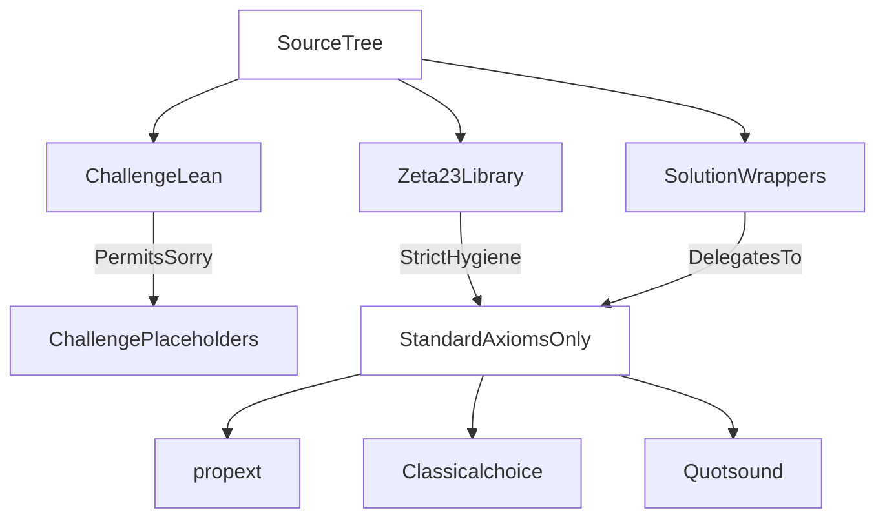
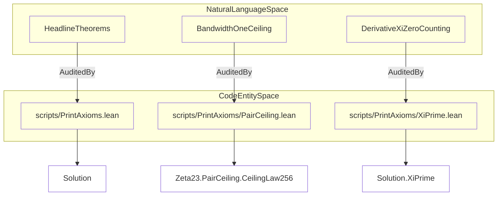
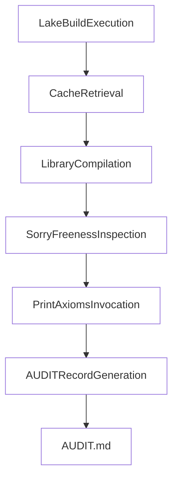

<!-- source: DeepWiki mcp.deepwiki.com · repo anthropics/formal-math · page 2.4 Axiom Auditing and the AUDIT Record · fetched 2026-10-26 -->

# Axiom Auditing and the AUDIT Record

<details>
<summary>Relevant source files</summary>

The following files were used as context for generating this wiki page:

- [zeta23/AUDIT.md](zeta23/AUDIT.md)
- [zeta23/scripts/PrintAxioms.lean](zeta23/scripts/PrintAxioms.lean)
- [zeta23/scripts/PrintAxioms/PairCeiling.lean](zeta23/scripts/PrintAxioms/PairCeiling.lean)
- [zeta23/scripts/PrintAxioms/XiPrime.lean](zeta23/scripts/PrintAxioms/XiPrime.lean)

</details>


## Purpose and Scope
This page details the axiom auditing framework, dependency hygiene enforcement, and verification provenance tracking implemented for the `zeta23` formal math project. It covers the mechanics of the Lean `PrintAxioms` scripts, the enforcement of the standard three-axiom baseline, sorry-freeness verification across library components, and how `AUDIT.md` permanently records historical verification runs, pinned toolchains, and exact Mathlib dependencies.

Sources: `zeta23/AUDIT.md:1-6`()

---

## 1. The Standard Three-Axiom Baseline and Hygiene Rules
The `zeta23` project operates under strict axiom hygiene rules. Every proved theorem in the formal library (`Zeta23/`) and the delegation wrappers (`Solution/`) must depend exclusively on Lean 4's standard foundational axiom set: `propext` (propositional extensionality), `Classical.choice` (law of excluded middle / choice), and `Quot.sound` (quotient soundness). 

The repository enforces the following invariant criteria:
* **Zero Project-Specific Axioms:** Counting explicit `axiom ...` declarations across the source tree (with comments and docstrings stripped) yields `0`.
* **No `sorryAx` in Solution Proofs:** The `sorry` token is strictly restricted to designated challenge statement placeholders inside `Challenge.lean` and `Challenge/Multiplicity.lean`. No `sorry` or `sorryAx` is permitted within any file under `Zeta23/` or any `Solution` file.
* **Standard Axiom Restriction:** The output of `#print axioms` for any headline theorem must reduce to exactly `[propext, Classical.choice, Quot.sound]`.


*Sources: `zeta23/AUDIT.md:20-25`()*

---

## 2. PrintAxioms Scripts and Execution Pipelines
To audit theorem dependencies without running the external comparator harness, the repository supplies dedicated Lean scripts under the `scripts/` directory. These scripts load specific modules and invoke Lean's builtin `#print axioms` command on headline results.

### Headline Theorem Audit
`scripts/PrintAxioms.lean` audits seventeen headline theorems (including variants on the critical line, distinct zeros, and Dirichlet L-function extensions) after building the `Solution` target [zeta23/scripts/PrintAxioms.lean:1-31]().

```lean
import Solution

#print axioms two_thirds_on_critical_line
#print axioms two_thirds_on_critical_line_cumulative
-- ...
```
*Sources: `zeta23/scripts/PrintAxioms.lean:1-32`()*

### Sub-development Audits: PairCeiling and XiPrime
Specialized modules outside the primary comparator surface are audited via targeted scripts:
* **PairCeiling Audit (`scripts/PrintAxioms/PairCeiling.lean`):** Verifies bandwidth-one ceiling stability, signed bounds, and row checks such as `Zeta23.PairCeiling.ceiling_stability`, `Zeta23.PairCeiling.LawN256_check`, and `Zeta23.PairCeiling.ceiling_law256` [zeta23/scripts/PrintAxioms/PairCeiling.lean:1-21]().
* **XiPrime Audit (`scripts/PrintAxioms/XiPrime.lean`):** Imports `Solution.XiPrime` to verify zero-counting and critical-line properties for the derivative $\xi'$, checking theorems such as `xiPrime_zeros_in_open_critical_strip` and `xiPrime_simple_zeros_on_critical_line` [zeta23/scripts/PrintAxioms/XiPrime.lean:1-13]().


*Sources: `zeta23/scripts/PrintAxioms.lean:1-32`(), `zeta23/scripts/PrintAxioms/PairCeiling.lean:1-22`(), `zeta23/scripts/PrintAxioms/XiPrime.lean:1-14`()*

---

## 3. Sorry-Freeness and Build Verification Workflow
Verifying the integrity of a build involves checking compilation outputs and scanning for unproven lemmas. The local reproduction pipeline documented in `AUDIT.md` executes the following sequence:

```bash
lake exe cache get            # optional: prebuilt Mathlib cache for the pinned commit
lake build                    # builds the Zeta23 library closure (approx. 8890 jobs)
lake build Solution && lake env lean scripts/PrintAxioms.lean
lake build Solution.XiPrime && lake env lean scripts/PrintAxioms/XiPrime.lean
lake env lean scripts/PrintAxioms/PairCeiling.lean
lake build Challenge          # builds trusted statement files; expects deliberate sorry placeholders
```
*Sources: `zeta23/AUDIT.md:7-16`()*

During `lake build`, the Lean compiler emits `declaration uses 'sorry'` warnings exclusively for the trusted challenge statement files (`Challenge.lean` and `Challenge/Multiplicity.lean`), confirming that no intermediate lemmas or solution files contain unproven obligations.

Sources: `zeta23/AUDIT.md:20-24`()

---

## 4. The `AUDIT.md` Verification History and Record
`AUDIT.md` serves as an immutable reference ledger capturing the environment specifications and verbatim output logs of audit runs.

### Toolchain and Dependency Pinning
Each audit record documents the exact toolchain release and Mathlib git commit hash in use:
* **Toolchain:** Lean `leanprover/lean4:v4.33.0-rc2`
* **Mathlib Commit:** `51e6992efd06126df61a496bebf8f49482a4e129` (pinned in `lake-manifest.json`)
* **Library Name:** `Zeta23`

Sources: `zeta23/AUDIT.md:5-6`()

### Verbatim Axiom Output Logging
`AUDIT.md` embeds the exact stdout logs generated by `#print axioms` for all 27 comparator-facing statements and their corresponding library counterparts (`Zeta23.thmA₀`, `Zeta23.ThmD.thmD₀`, etc.). Every listed declaration concludes with the identical dependency list:
```text
depends on axioms: [propext, Classical.choice, Quot.sound]
```
Sources: `zeta23/AUDIT.md:27-79`()


*Sources: `zeta23/AUDIT.md:7-79`()*

---

