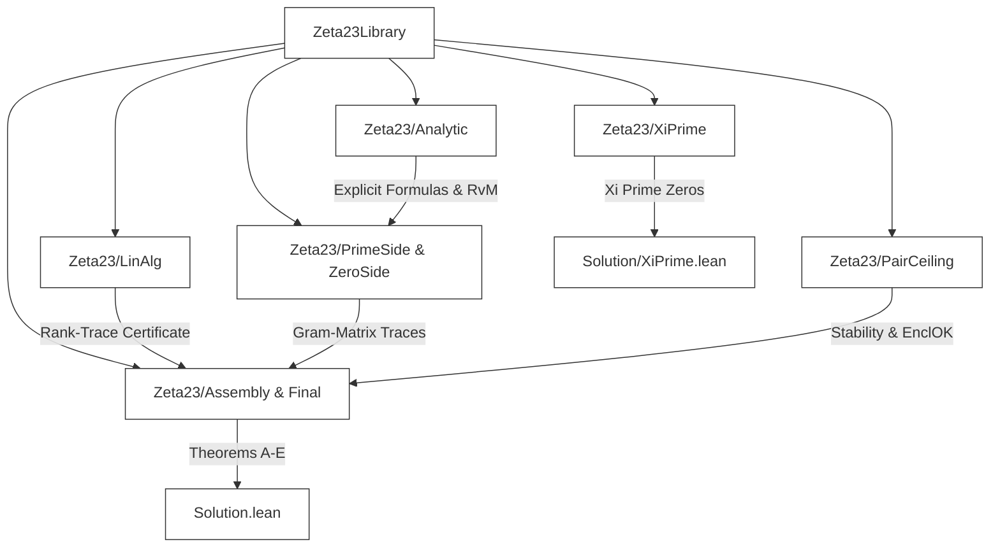
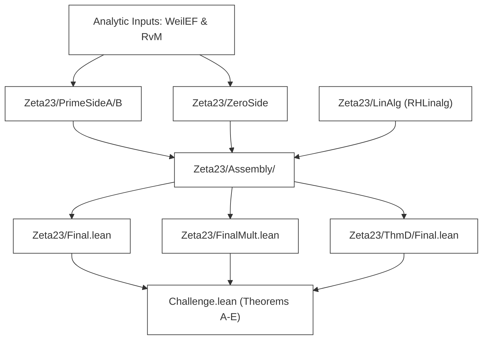

<!-- source: DeepWiki mcp.deepwiki.com · repo anthropics/formal-math · page 3 The Zeta23 Proof Library · fetched 2026-10-26 -->

# The Zeta23 Proof Library

Relevant source files

The following files were used as context for generating this wiki page:

- [zeta23/README.md](zeta23/README.md)
- [zeta23/formalization.yaml](zeta23/formalization.yaml)

The Zeta23 proof library (`zeta23/Zeta23/`) contains the complete formalization of the mathematical development underlying the Alpöge–Furman paper [zeta23/README.md:12](). The library is structured into several modular directories managing linear algebra, analytic foundations, prime and zero side estimations, final assemblies, the $\xi'$ sub-development, and the bandwidth-one ceiling. 

This page provides a high-level parent overview of these sub-developments.

*Figure 1: Zeta23 Library Architecture and Sub-developments*
Sources: [zeta23/README.md:27-53](), [zeta23/formalization.yaml:75-85]()

---

## 3.1. Linear Algebra Core (RHLinalg)

The linear algebra core (`zeta23/Zeta23/LinAlg/`) provides the matrix inequalities and spectral properties required for the rank–trace certificate [zeta23/README.md:42](). It formalizes inertia indices, positive/negative parts via spectral functional calculus, and matrix trace bounds.

For details, see [Linear Algebra Core (RHLinalg)](#3.1).

Sources: [zeta23/README.md:42]()

---

## 3.2. Analytic Foundations

The analytic foundations layer houses the deep complex analysis and number-theoretic inputs: Weil's explicit formula (`WeilEF`), Riemann–von Mangoldt zero-counting (`RvM`), Stirling-type Gamma-factor estimates (`GammaFacts`), Poisson summation, and Montgomery–Vaughan (`MV`) generalized Hilbert inequalities [zeta23/README.md:14-16](). It also incorporates adapted blocks from the `PrimeNumberTheoremAnd` project under `Zeta23/FromPNTPlus/` [zeta23/formalization.yaml:68-73]().

For details, see [Analytic Foundations](#3.2).

Sources: [zeta23/README.md:14-16](), [zeta23/formalization.yaml:68-73]()

---

## 3.3. Prime Side and Zero Side Estimates

This subsystem evaluates the analytic contributions split into prime-sum sides and zero-sum sides. It defines `PrimeSideA` and `PrimeSideB` Gram-matrix traces, structured `ZeroSide` blocks, tail bounds, and supporting definition/hypothesis modules (`Defs`, `Hypotheses`, `Prelude`, `Statement`) [zeta23/README.md:42]().

For details, see [Prime Side and Zero Side Estimates](#3.3).

Sources: [zeta23/README.md:42]()

---

## 3.4. Assembly and Headline Theorems (A–E)

The assembly layer (`zeta23/Zeta23/Assembly/`, `zeta23/Zeta23/Final.lean`, `zeta23/Zeta23/FinalMult.lean`, and `ThmD/`) integrates the linear algebra certificates and analytic estimates into the top-level statements: `two_thirds_simple_on_critical_line`, `five_sixths_distinct`, and their Dirichlet $L$-function variants [zeta23/README.md:68-77]().

*Figure 2: Logical Flow from Analytic Foundations to Headline Theorems*
Sources: [zeta23/README.md:68-77]()

For details, see [Assembly and Headline Theorems (A–E)](#3.4).

Sources: [zeta23/README.md:68-77]()

---

## 3.5. XiPrime Sub-development

The `Zeta23/XiPrime/` directory is a large, self-contained subtree (~108 files) dedicated to formalizing the properties of the zeros of $\xi'$ (Remark 7.1 of the paper) [zeta23/formalization.yaml:29-30, 81-82](). It contains separate certificates, explicit formulas, window analyses, Hardy-type arguments, and zero-counting lemmas culminating in `XiPrime/Final.lean` [zeta23/README.md:39-41]().

For details, see [XiPrime Sub-development](#3.5).

Sources: [zeta23/README.md:39-41](), [zeta23/formalization.yaml:29-30, 81-82]()

---

## 3.6. PairCeiling: Bandwidth-One Ceiling

The `Zeta23/PairCeiling/` directory formalizes the bandwidth-one ceiling stability inequality, edge bounds, `LawN256` checks, and enclosure machinery (`EnclOK`) that establish the methodological optimality limits of the approach [zeta23/formalization.yaml:83-85]().

For details, see [PairCeiling: Bandwidth-One Ceiling](#3.6).

Sources: [zeta23/formalization.yaml:83-85]()

---

