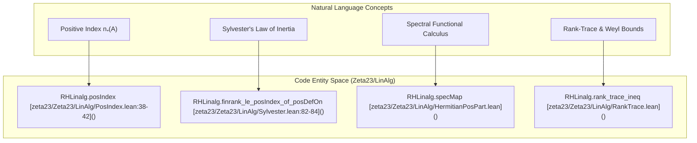
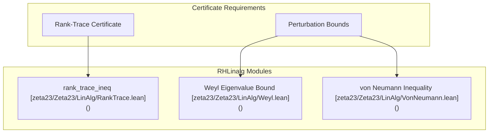

<!-- source: DeepWiki mcp.deepwiki.com · repo anthropics/formal-math · page 3.1 Linear Algebra Core (RHLinalg) · fetched 2026-10-26 -->

# Linear Algebra Core (RHLinalg)

Relevant source files

The following files were used as context for generating this wiki page:

- [zeta23/Zeta23/LinAlg/PosIndex.lean](zeta23/Zeta23/LinAlg/PosIndex.lean)
- [zeta23/Zeta23/LinAlg/Sylvester.lean](zeta23/Zeta23/LinAlg/Sylvester.lean)

## Purpose and Scope

The `Zeta23/LinAlg` sub-development (namespaced under `RHLinalg`) provides the linear algebra foundation required by §3 of the underlying research paper. Written as a self-contained module, it formalizes Hermitian matrix properties, inertia indices, spectral functional calculus, and sharp trace inequalities that underpin the rank–trace certificate and perturbation bounds.

As a parent page, this document outlines the core architecture of `RHLinalg` and its sub-components. For fine-grained mathematical proofs and detailed definitions, consult the respective child pages:
- [Inertia, Positive Index and Sylvester's Law](#3.1.1)
- [Spectral Functional Calculus: specMap and Positive/Negative Parts](#3.1.2)
- [Rank–Trace Inequality, von Neumann and Weyl Bounds](#3.1.3)

---

## Architecture of `RHLinalg`

The linear algebra core bridges high-level spectral concepts with concrete Lean definitions over matrices in `RCLike` fields (`ℝ` or `ℂ`). 

**Sources:** `[zeta23/Zeta23/LinAlg/PosIndex.lean:1-127]()`, `[zeta23/Zeta23/LinAlg/Sylvester.lean:1-161]()`

---

## 3.1.1. Inertia, Positive Index and Sylvester's Law

The positive index $n_+(A)$ measures the number of strictly positive eigenvalues of a Hermitian matrix $A$. The library defines positive, negative, and thresholded indices, alongside the real-valued trace (`rtrace`) and squared Frobenius norm (`frobSq`).

Sylvester's law of inertia is established via subspace characterizations (`PosDefOn`), proving that pulling back a Hermitian form cannot increase its positive index.

For complete definitions, lemmas, and proofs, see [Inertia, Positive Index and Sylvester's Law](#3.1.1).

**Sources:** `[zeta23/Zeta23/LinAlg/PosIndex.lean:38-74]`, `[zeta23/Zeta23/LinAlg/Sylvester.lean:42-124]()`

---

## 3.1.2. Spectral Functional Calculus: specMap and Positive/Negative Parts

To manipulate Hermitian matrices algebraically, `RHLinalg` defines a custom spectral functional calculus wrapper `specMap`, which applies real functions to the eigenvalues of a Hermitian matrix via its spectral decomposition. 

Using `specMap`, the positive and negative parts ($\mathcal{A}_+$ and $\mathcal{A}_-$) are constructed, establishing their positive semi-definiteness, rank properties, and interaction with trace and Frobenius norms.

For details on the functional calculus implementation, see [Spectral Functional Calculus: specMap and Positive/Negative Parts](#3.1.2).

**Sources:** `[zeta23/Zeta23/LinAlg/PosIndex.lean:115-127]`, `[zeta23/Zeta23/LinAlg/Sylvester.lean:123-161]()`

---

## 3.1.3. Rank–Trace Inequality, von Neumann and Weyl Bounds

The culmination of the `RHLinalg` development is a suite of trace and eigenvalue inequalities. These include von Neumann's trace inequality, Weyl's perturbation eigenvalue bounds, and the core `rank_trace_ineq` lemmas that feed directly into the rank–trace certificate used across zero-side and assembly layers.

**Sources:** `[zeta23/Zeta23/LinAlg/PosIndex.lean:1-26]()`

For full derivations of the elementary sum estimates and theorem statements, see [Rank–Trace Inequality, von Neumann and Weyl Bounds](#3.1.3).

---

