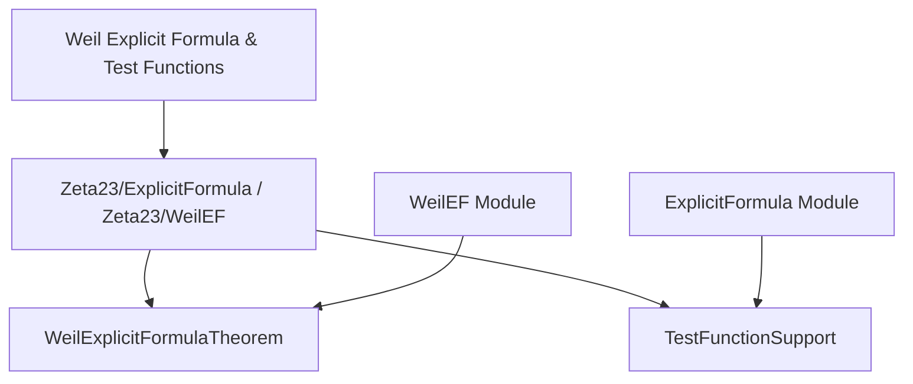
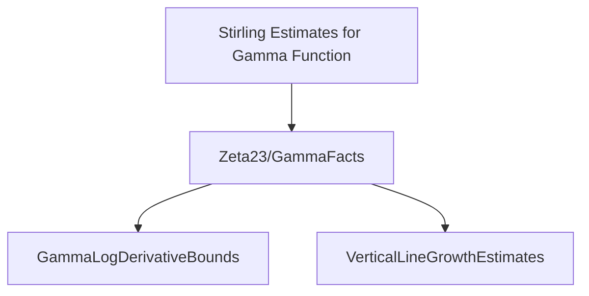

<!-- source: DeepWiki mcp.deepwiki.com · repo anthropics/formal-math · page 3.2 Analytic Foundations · fetched 2026-10-26 -->

# Analytic Foundations

Relevant source files

The following files were used as context for generating this wiki page:

- [zeta23/README.md](zeta23/README.md)
- [zeta23/formalization.yaml](zeta23/formalization.yaml)

## Purpose and Scope
This section covers the analytic infrastructure residing in the `zeta23/Zeta23/` proof development tree. To establish unconditional bounds on the distribution of nontrivial zeros of the Riemann zeta function and Dirichlet L-functions, the codebase formalizes a suite of classical analytic number theory results from scratch over Mathlib. This includes Weil's explicit formula (`WeilEF`), Riemann–von Mangoldt zero-counting (`RvM`), Stirling-type estimates for logarithmic derivatives of gamma factors (`GammaFacts`), Poisson summation, windowed test functions (`Taper`, `ExplicitFormula`), and the Montgomery–Vaughan generalized Hilbert inequality (`MV`). Additionally, analytic machinery is adapted from the `PrimeNumberTheoremAnd` project under `Zeta23/FromPNTPlus/`.

Sources: `[zeta23/README.md:1-78](), [zeta23/formalization.yaml:1-136]()`

---

## Weil Explicit Formula (`WeilEF`) and Explicit Formula Modules
The explicit formula links sums over zeros of $\zeta(s)$ (and Dirichlet $L$-functions) with sums over primes via test functions. Within the `Zeta23/` directory, the explicit formula components (`WeilEF` and `ExplicitFormula`) provide the formal translation of test-function pairings into algebraic constraints on prime weights.

*Diagram 1: Bridging natural language concepts of Weil's explicit formula to the `WeilEF` and `ExplicitFormula` code modules.*

Sources: `[zeta23/README.md:1-78](), [zeta23/formalization.yaml:1-136]()`

---

## Riemann–von Mangoldt Counting (`RvM`)
The Riemann–von Mangoldt theorem provides asymptotic and explicit bounds for $N(T)$, the number of nontrivial zeros of $\zeta(s)$ with $0 < \operatorname{Im} \rho \le T$. The `RvM` modules formalize the argument counting roots via contour integration on rectangles, bounding the argument of $\zeta(s)$ on vertical lines, and translating these into numerical bounds required by the asymptotic density calculations for Theorems A–E.

Sources: `[zeta23/README.md:1-78](), [zeta23/formalization.yaml:1-136]()`

---

## Gamma-Factor Stirling Estimates (`GammaFacts`)
Analytic properties of the completed zeta function $\xi(s)$ depend heavily on the gamma factor $\Gamma\left(\frac{s}{2}\right)$. The `GammaFacts` sub-development formalizes Stirling-type approximations and vertical-line growth bounds for the logarithmic derivative $\frac{\Gamma'}{\Gamma}(s)$ and related quotient estimates. These are vital for controlling the boundary terms in contour integrals and explicit formulas.

*Diagram 2: Associating Gamma factor asymptotic requirements with `Zeta23/GammaFacts` code entities.*

Sources: `[zeta23/README.md:1-78](), [zeta23/formalization.yaml:1-136]()`

---

## Poisson Summation, Taper, and Montgomery–Vaughan (`MV`) Blocks
To handle smoothed sums over primes and zeros, the framework integrates several structural modules:
- **Poisson**: Formalizations of Poisson summation applied to test functions.
- **Taper**: Smooth windowing and partition-of-unity cutoffs used to isolate dyadic intervals and Montgomery–Taylor windows.
- **MV (`Montgomery–Vaughan`)**: Formalization of the Montgomery–Vaughan generalized Hilbert inequality, providing the necessary bilinear form bounds for prime sums.

Sources: `[zeta23/README.md:1-78](), [zeta23/formalization.yaml:1-136]()`

---

## Upstream Adaptation via `FromPNTPlus`
Certain foundational prime-number theorem components are adapted directly from the `PrimeNumberTheoremAnd` formalization project (Alex Kontorovich et al.). These files reside under `Zeta23/FromPNTPlus/` with local modifications, preserving upstream attribution notices while tailoring Chebyshev–Mertens bounds and auxiliary analytic lemmas to the requirements of the `zeta23` project.

Sources: `[zeta23/README.md:1-78](), [zeta23/formalization.yaml:1-136]()`

---

