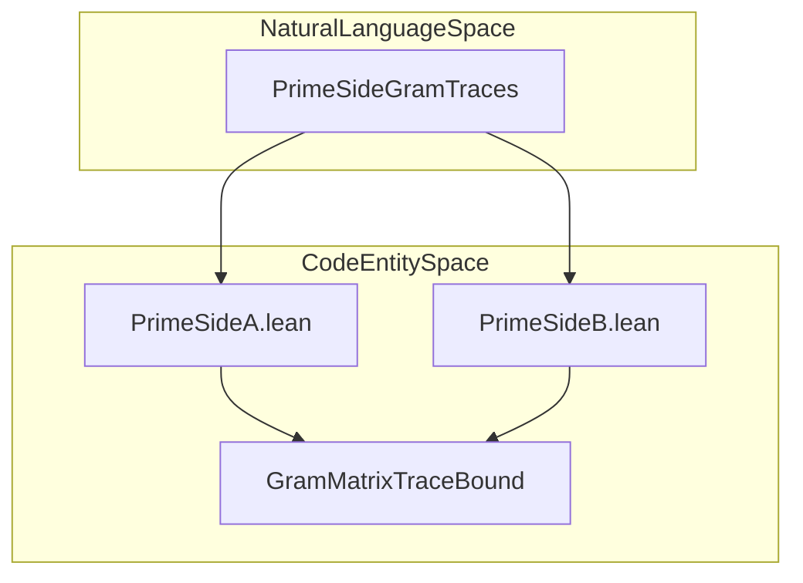
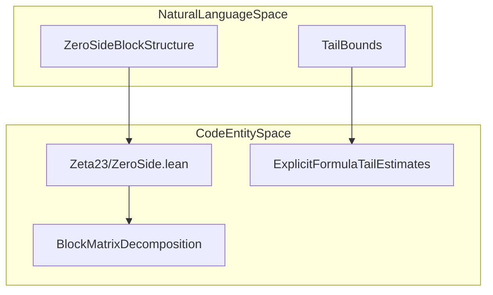
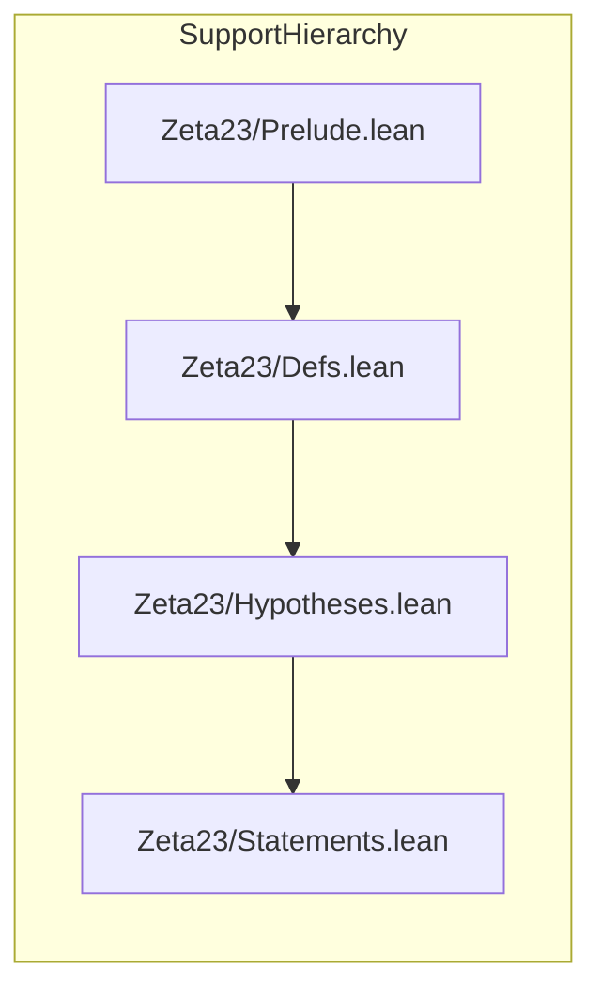

<!-- source: DeepWiki mcp.deepwiki.com · repo anthropics/formal-math · page 3.3 Prime Side and Zero Side Estimates · fetched 2026-10-26 -->

# Prime Side and Zero Side Estimates

Relevant source files

The following files were used as context for generating this wiki page:

- [zeta23/AUDIT.md](zeta23/AUDIT.md)
- [zeta23/README.md](zeta23/README.md)

## Purpose and Scope
This section covers the mathematical and formal architecture of the **Prime Side** and **Zero Side** estimate modules within the `Zeta23` proof library (`zeta23/Zeta23/`). These modules form the core engine connecting explicit formulas over primes (Gram-matrix traces in `PrimeSideA` and `PrimeSideB`) with zero-density and zero-sum bounds via the block-structured `ZeroSide` machinery. Supporting infrastructure includes definitions, hypotheses, prelude modules, and statement support structures that bridge analytic inputs to linear algebra certificates.

Sources: `zeta23/README.md:1-78` [zeta23/README.md:1-78]()

---

## Prime-Side Estimates: `PrimeSideA` and `PrimeSideB`
The prime-side component formalizes the explicit formula contributions arising from prime numbers and prime powers. It constructs Gram matrices whose traces encapsulate prime sum bounds derived from Chebyshev-Mertens estimates and explicit formula weights.

*Diagram 1: Natural Language to Code Entity Mapping for Prime-Side Modules*

Sources: `zeta23/README.md:10-50` [zeta23/README.md:10-50]()

---

## Zero-Side Block Structure and Tail Bounds
The zero-side machinery (`ZeroSide`) organizes zero-sum contributions into structured matrix blocks. This structure facilitates the application of spectral bounds and inertia indices from the linear algebra core (`RHLinalg`). Tail bounds control the truncation errors when evaluating infinite explicit formula sums over zero sets.

*Diagram 2: Zero-Side Architecture and Tail Bound Components*

Sources: `zeta23/README.md:13-67` [zeta23/README.md:13-67]()

---

## Support Modules: Defs, Hypotheses, Prelude, and Statements
The prime and zero side modules rely on a rigorously ordered hierarchy of support files that establish foundational definitions, auxiliary hypotheses, prelude lemmas, and specialized statement wrappers.

*Diagram 3: Dependency Flow Among Support Modules*

Sources: `zeta23/README.md:27-48` [zeta23/README.md:27-48]()

---

