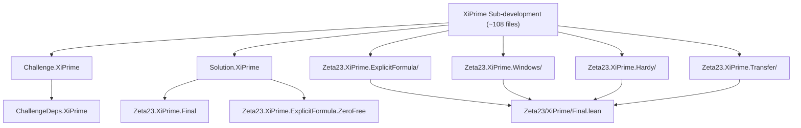
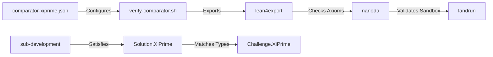

<!-- source: DeepWiki mcp.deepwiki.com · repo anthropics/formal-math · page 3.5 XiPrime Sub-development · fetched 2026-10-26 -->

# XiPrime Sub-development

Relevant source files

The following files were used as context for generating this wiki page:

- [zeta23/Challenge/XiPrime.lean](zeta23/Challenge/XiPrime.lean)
- [zeta23/Solution/XiPrime.lean](zeta23/Solution/XiPrime.lean)
- [zeta23/comparator-xiprime.json](zeta23/comparator-xiprime.json)

The purpose of this page is to document section 3.5 of the `anthropics/formal-math` codebase: the **XiPrime Sub-development** tree located under `zeta23/Zeta23/XiPrime/` [zeta23/Solution/XiPrime.lean:8](). This sub-development comprises approximately 108 files dealing with certificates, explicit formulas, window functions, Hardy functions, analytic transfers, and zero-counting for the zeros of $\xi'$, culminating in `XiPrime/Final.lean`.

---

## 1. Scope and Architecture

The `XiPrime` sub-development provides the foundational machinery required to prove properties about the zeros of $\xi'$, the derivative of Riemann's completed zeta function $\xi(s)$. It integrates analytic inputs, explicit formula bounds, window functions, and Hardy space estimates to establish that large percentages of $\xi'$ zeros are simple and lie on the critical line.

### Core Components
- **Explicit Formulas & Zero-Free Regions**: Establishing zero-free zones and explicit formula bounds for $\xi'$ [zeta23/Solution/XiPrime.lean:7]().
- **Windows & Hardy Functions**: Weight functions and localized integral estimates.
- **Transfer & Zero Counting**: Card-counting and density estimation for zeros in various domains (dyadic windows $[T, 2T]$ and cumulative windows $[0, T]$).
- **Final Assembly**: Bringing together certificates into the main theorems exported via `Solution.XiPrime` [zeta23/Solution/XiPrime.lean:1-53] and `Challenge.XiPrime` [zeta23/Challenge/XiPrime.lean:1-107].

---

## 2. Challenge and Solution Interfaces

The challenge and solution boundary for the $\xi'$ sub-development is defined by `Challenge.XiPrime` and `Solution.XiPrime`, verified against `comparator-xiprime.json`.

### Definitions Layer (`ChallengeDeps.XiPrime`)
The trusted vocabulary defines the function $\xi(s)$, its derivative $\xi'$, zero sets, and counting functions [zeta23/Challenge/XiPrime.lean:30-58]:

| Definition Name | Code Symbol | Mathematical Description |
| :--- | :--- | :--- |
| Completed Xi | `XiPrime.xi` [zeta23/Challenge/XiPrime.lean:31]() | $\xi(s) = \frac{s(s-1)}{2} \Lambda_0(s) + \frac{1}{2}$ |
| Derivative | `XiPrime.xiDeriv` [zeta23/Challenge/XiPrime.lean:34]() | $\xi'(s) = \frac{d}{ds}\xi(s)$ |
| Zero predicate | `XiPrime.IsXiDerivZero` [zeta23/Challenge/XiPrime.lean:37]() | $\xi'(\rho) = 0$ |
| Multiplicity | `XiPrime.xiDerivMult` [zeta23/Challenge/XiPrime.lean:40String]() | Analytic order of $\xi'$ at $\rho$ |
| Height window set | `XiPrime.zerosIn` [zeta23/Challenge/XiPrime.lean:46]() | $\{\rho \mid \xi'(\rho)=0 \land T_1 < \text{Im}\,\rho \le T_2\}$ |
| Multiplicity count | `XiPrime.Ncount` [zeta23/Challenge/XiPrime.lean:49]() | $N_{\xi'}(T_1, T_2) = \sum^{\operatorname{finsup}}_\rho m_\rho$ |
| Distinct count | `XiPrime.Ndist` [zeta23/Challenge/XiPrime.lean:52]() | $N_{d,\xi'}(T_1, T_2) = \#\{\text{distinct zeros}\}$ |
| Simple critical count | `XiPrime.N0simple` [zeta23/Challenge/XiPrime.lean:56]() | $N_{0,\xi'}^s(T_1, T_2) = \#\{\rho : \text{Re}\,\rho=\frac{1}{2}, m_\rho=1\}$ |

Sources: [zeta23/Challenge/XiPrime.lean:30-58]()

### Main Theorems
The verification target requires proving six headline properties regarding the zero distribution of $\xi'$ [zeta23/Challenge/XiPrime.lean:66-106, zeta23/Solution/XiPrime.lean:12-52]:
1. `xiPrime_zeros_in_open_critical_strip`: Every zero of $\xi'$ lies in $0 < \text{Re}\,s < 1$.
2. `xiPrime_over_xi_re_pos`: $\text{Re}(\xi'/\xi(s)) > 0$ for $\text{Re}\,s \ge 1$.
3. `xiPrime_simple_zeros_on_critical_line`: Standard dyadic window bounds ($\ge 85.838\%$ simple on line, $\ge 92.919\%$ distinct).
4. `xiPrime_simple_zeros_on_critical_line_cumulative`: Cumulative window versions of (3).
5. `xiPrime_simple_zeros_on_critical_line_quartic`: Quartic window bounds ($\ge 86.864\%$ simple on line, $\ge 93.432\%$ distinct).
6. `xiPrime_simple_zeros_on_critical_line_quartic_cumulative`: Cumulative quartic window bounds.

Sources: [zeta23/Challenge/XiPrime.lean:66-106](), [zeta23/Solution/XiPrime.lean:12-52](), [zeta23/comparator-xiprime.json:1-19]()

---

## 3. Code Entity Architecture

The following diagram maps the conceptual components of the $\xi'$ sub-development to their corresponding Lean files and modules in the `zeta23` repository.

Sources: [zeta23/Challenge/XiPrime.lean:1-106](), [zeta23/Solution/XiPrime.lean:1-52](), [zeta23/comparator-xiprime.json:1-19]()

---

## 4. Verification Pipeline and Comparator

The verification of `Solution.XiPrime` against `Challenge.XiPrime` is governed by `comparator-xiprime.json`. 

Sources: [zeta23/comparator-xiprime.json:1-19]()

### Permitted Axioms
Under `comparator-xiprime.json`, only standard Lean core axioms are permitted [zeta23/comparator-xiprime.json:13-17]:
- `propext`
- `Quot.sound`
- `Classical.choice`

Sources: [zeta23/comparator-xiprime.json:13-17]()

---

