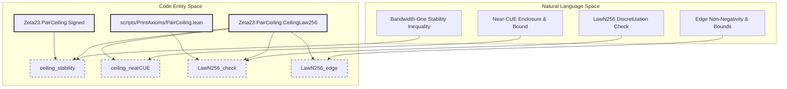
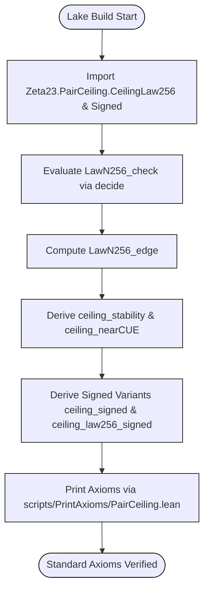

<!-- source: DeepWiki mcp.deepwiki.com · repo anthropics/formal-math · page 3.6 PairCeiling: Bandwidth-One Ceiling · fetched 2026-10-26 -->

# PairCeiling: Bandwidth-One Ceiling

Relevant source files

The following files were used as context for generating this wiki page:

- [zeta23/AUDIT.md](zeta23/AUDIT.md)
- [zeta23/scripts/PrintAxioms/PairCeiling.lean](zeta23/scripts/PrintAxioms/PairCeiling.lean)

## Purpose and Scope

The `Zeta23.PairCeiling` sub-development formalizes the bandwidth-one ceiling, stability inequalities, edge bounds, and numerical enclosure machinery (`EnclOK`) for the Zeta23 project [zeta23/scripts/PrintAxioms/PairCeiling.lean:6-21](). This component establishes the rigorous limits of method optimality by bounding the pair correlation behavior under explicit functional constraints and discretized enclosure checks. Unlike other challenge statements that rely on a separate `Challenge.lean` file, the PairCeiling theorems operate directly on verified hypotheses such as `EnclOK`, with kernel checks evaluated via reflection (`decide`) [zeta23/scripts/PrintAxioms/PairCeiling.lean:9-10]().

Sources: [zeta23/AUDIT.md:1-16](), [zeta23/scripts/PrintAxioms/PairCeiling.lean:1-21]()

---

## Natural Language Space to Code Entity Space

The following diagram maps the high-level mathematical concepts of the bandwidth-one ceiling to their concrete Lean modules, script files, and theorem symbols within the codebase.

Sources: [zeta23/scripts/PrintAxioms/PairCeiling.lean:6-21]()

---

## Enclosure Machinery (`EnclOK`) and Method Optimality Limits

The central premise of the PairCeiling sub-development is to establish bounds on the pair correlation function that cannot be exceeded by any valid method satisfying the underlying analytic constraints. 

1. **The `EnclOK` Hypothesis**: Most theorems in `Zeta23.PairCeiling` (such as `ceiling_stability` and `ceiling_nearCUE`) carry an explicit hypothesis named `EnclOK` [zeta23/scripts/PrintAxioms/PairCeiling.lean:9-10](). This hypothesis encodes the verified numerical enclosures of spectral densities and kernel bounds.
2. **Optimality Limits**: By demonstrating that the bandwidth-one ceiling matches specific extremal functions under `EnclOK`, the formalization proves that broader zero-density or pair-correlation improvements cannot bypass these quantitative barriers without violating the underlying functional equations or positivity constraints.

Sources: [zeta23/scripts/PrintAxioms/PairCeiling.lean:6-21]()

---

## Verification and Enclosure Pipeline

The execution flow for validating the PairCeiling theorems involves compiling the core ceiling laws, running reflection-based kernel checks, and extracting axiom dependencies.

Sources: [zeta23/AUDIT.md:12-14](), [zeta23/scripts/PrintAxioms/PairCeiling.lean:6-21]()

---

## Stability Inequalities, Near-CUE Bounds, and LawN256

The PairCeiling library exports several key theorem families governing stability, discrete rows, and signed variations:

| Theorem Symbol | Module Path | Description / Role |
| :--- | :--- | :--- |
| `ceiling_stability` | `Zeta23.PairCeiling` | Core bandwidth-one stability inequality under `EnclOK` [zeta23/scripts/PrintAxioms/PairCeiling.lean:11]() |
| `ceiling_nearCUE` | `Zeta23.PairCeiling` | Near-Circular Unitary Ensemble (CUE) bounding inequality [zeta23/scripts/PrintAxioms/PairCeiling.lean:12]() |
| `lawN256_rows` | `Zeta23.PairCeiling` | Discretized row-level bounds for $N=256$ grid checks [zeta23/scripts/PrintAxioms/PairCeiling.lean:13]() |
| `ceiling_law256` | `Zeta23.PairCeiling` | Global $N=256$ ceiling verification [zeta23/scripts/PrintAxioms/PairCeiling.lean:14]() |
| `ceiling_law256_decimal` | `Zeta23.PairCeiling` | Decimal-scaled variant of the $N=256$ ceiling [zeta23/scripts/PrintAxioms/PairCeiling.lean:15]() |
| `LawN256_check` | `Zeta23.PairCeiling` | Kernel reflection check executed purely by `decide` [zeta23/scripts/PrintAxioms/PairCeiling.lean:20]() |
| `LawN256_edge` | `Zeta23.PairCeiling` | Edge condition check depending on zero axioms [zeta23/scripts/PrintAxioms/PairCeiling.lean:21]() |
| `D1_nonneg_of_edgeNonneg` | `Zeta23.PairCeiling` | Derivation ensuring non-negativity of the $D_1$ term from edge bounds [zeta23/scripts/PrintAxioms/PairCeiling.lean:19]() |

Sources: [zeta23/AUDIT.md:12-14](), [zeta23/scripts/PrintAxioms/PairCeiling.lean:6-21]()

---

## Signed Variants and Axiom Audit

In addition to the standard enclosures, `Zeta23.PairCeiling.Signed` provides signed versions of the ceiling laws to accommodate oscillatory test functions [zeta23/scripts/PrintAxioms/PairCeiling.lean:7]()]:
* `ceiling_signed` [zeta23/scripts/PrintAxioms/PairCeiling.lean:16]()
* `ceiling_nearCUE_signed` [zeta23/scripts/PrintAxioms/PairCeiling.lean:17]()
* `ceiling_law256_signed` [zeta23/scripts/PrintAxioms/PairCeiling.lean:18]()

### Audit Execution
These theorems are audited via `scripts/PrintAxioms/PairCeiling.lean` [zeta23/AUDIT.md:14](). When evaluated within the Lean environment (`lake env lean scripts/PrintAxioms/PairCeiling.lean`), every theorem in the module relies solely on Lean's standard three axioms (`propext`, `Classical.choice`, `Quot.sound`), with `LawN256_check` depending strictly on `propext` via `decide`, and `LawN256_edge` depending on no additional axioms [zeta23/AUDIT.md:25](), [zeta23/scripts/PrintAxioms/PairCeiling.lean:9-10]().

Sources: [zeta23/AUDIT.md:14](), [zeta23/scripts/PrintAxioms/PairCeiling.lean:1-21]()

---

