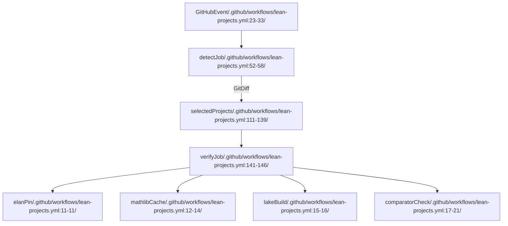
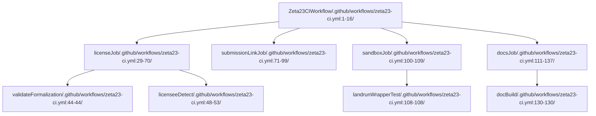

<!-- source: DeepWiki mcp.deepwiki.com · repo anthropics/formal-math · page 4 CI, Tooling and Validation Infrastructure · fetched 2026-10-26 -->

# CI, Tooling and Validation Infrastructure

Relevant source files

The following files were used as context for generating this wiki page:

- [.github/workflows/lean-projects.yml](.github/workflows/lean-projects.yml)
- [.github/workflows/zeta23-ci.yml](.github/workflows/zeta23-ci.yml)
- [README.md](README.md)

The `anthropics/formal-math` repository relies on a robust automation and validation infrastructure to ensure that machine-checked Lean 4 formalizations meet the rigorous standards of the Palomar registry [README.md:1-17](). The CI architecture is split into two complementary pipelines: a generic, multi-project Lean CI workflow (`lean-projects.yml`) that verifies any modified Lake project in the repository, and a project-specific compliance pipeline (`zeta23-ci.yml`) tailored for the `zeta23` formalization [README.md:9-12](), [.github/workflows/zeta23-ci.yml:1-16](). 

For details on how individual sub-topics operate, see the child pages below:
- [lean-projects Workflow: Change Detection and Build Verification](#4.1)
- [zeta23-ci Workflow: License, Metadata and Sandbox Checks](#4.2)
- [Formalization Metadata Validation](#4.3)
- [Landrun Sandbox Wrapper and Tests](#4.4)

---

## 4.1 lean-projects Workflow: Change Detection and Build Verification

The generic CI workflow defined in [.github/workflows/lean-projects.yml:1-146]() orchestrates per-project change detection and build verification across the repository [README.md:9-12](). When pull requests are opened or commits are pushed to `main`, a detection job inspects git diffs to identify which top-level Lake projects contain modified files [.github/workflows/lean-projects.yml:52-139](). 

For each selected project, the `verify` job resolves the project's elan toolchain pin, restores Mathlib build caches, compiles the Lake project, validates that any `sorry` usages are strictly confined to trusted challenge statement files (`Challenge.lean` and `Challenge/<Topic>.lean`), and executes the Palomar comparator acceptance harness via `.github/scripts/comparator-check.sh` [README.md:9-12](), [.github/workflows/lean-projects.yml:1-22]().

*Diagram 4.1: Mapping of the generic Lean CI workflow to verification pipeline code entities.*

For details, see [lean-projects Workflow: Change Detection and Build Verification](#4.1).

Sources: `README.md`, `.github/workflows/lean-projects.yml`

---

## 4.2 zeta23-ci Workflow: License, Metadata and Sandbox Checks

Project-specific validation for the Alpöge–Furman Riemann zeta formalization is governed by [.github/workflows/zeta23-ci.yml:1-136](). This pipeline executes four primary compliance jobs whenever files under `zeta23/` are modified:
1. **License and Metadata Check**: Validates formalization metadata using Ruby scripts and tests, rejects retained template sentinel values, and verifies via `licensee` that both the root and `zeta23/` license files are precisely identified as `Apache-2.0` [.github/workflows/zeta23-ci.yml:29-54](). It also ensures `comparator.json` and `comparator-xiprime.json` adhere to expected structural shapes and permitted axiom lists [.github/workflows/zeta23-ci.yml:55-70]().
2. **Submission Link Check**: Confirms that `README.md` and documentation files correctly direct contributors to the official Palomar submission web form rather than retired issue templates [.github/workflows/zeta23-ci.yml:71-99]().
3. **Sandbox Policy Check**: Runs test suites covering the `landrun` sandboxing wrapper script [.github/workflows/zeta23-ci.yml:100-109]().
4. **API Documentation Build**: Generates `doc-gen4` HTML documentation artifacts on manual dispatch triggers [.github/workflows/zeta23-ci.yml:111-136]().

*Diagram 4.2: Mapping of Zeta23 compliance jobs to validation and testing scripts.*

For details, see [zeta23-ci Workflow: License, Metadata and Sandbox Checks](#4.2).

Sources: [.github/workflows/zeta23-ci.yml:1-136]()

---

## 4.3 Formalization Metadata Validation

To maintain strict compliance with Palomar registry expectations, formalization metadata declarations (`formalization.yaml`) are automatically validated [README.md:1-3](), [.github/workflows/zeta23-ci.yml:41-44](). The validation framework uses a Ruby validation script (`zeta23/scripts/validate-formalization.rb`) paired with a supporting Minitest suite (`zeta23/test/validate_formalization_test.rb`) [.github/workflows/zeta23-ci.yml:41-44](). These utilities enforce schema v0.4 rules, check for the presence of mandatory metadata fields, and detect unedited template sentinel values (`TEMPLATE`) that would otherwise invalidate a formalization submission [.github/workflows/zeta23-ci.yml:43-44]().

For details, see [Formalization Metadata Validation](#4.3).

Sources: [.github/workflows/zeta23-ci.yml:41-44]()

---

## 4.4 Landrun Sandbox Wrapper and Tests

Independent verification of exported Lean proofs utilizes the `landrun` sandboxing tool to restrict system calls and resource access during kernel evaluation [README.md:11](), [.github/workflows/zeta23-ci.yml:100-109](). The repository wraps this mechanism inside policy enforcement scripts (`landrun-wrapper.sh`), which are rigorously tested via `zeta23/test/landrun_wrapper_test.sh` [.github/workflows/zeta23-ci.yml:107-108](). These tests guarantee that the sandboxing contract functions correctly across different execution environments and correctly isolates the `nanoda` kernel during comparator verification runs [README.md:11](), [.github/workflows/zeta23-ci.yml:107-108]().

For details, see [Landrun Sandbox Wrapper and Tests](#4.4).

Sources: [README.md:11](), [.github/workflows/zeta23-ci.yml:100-109]()

---

