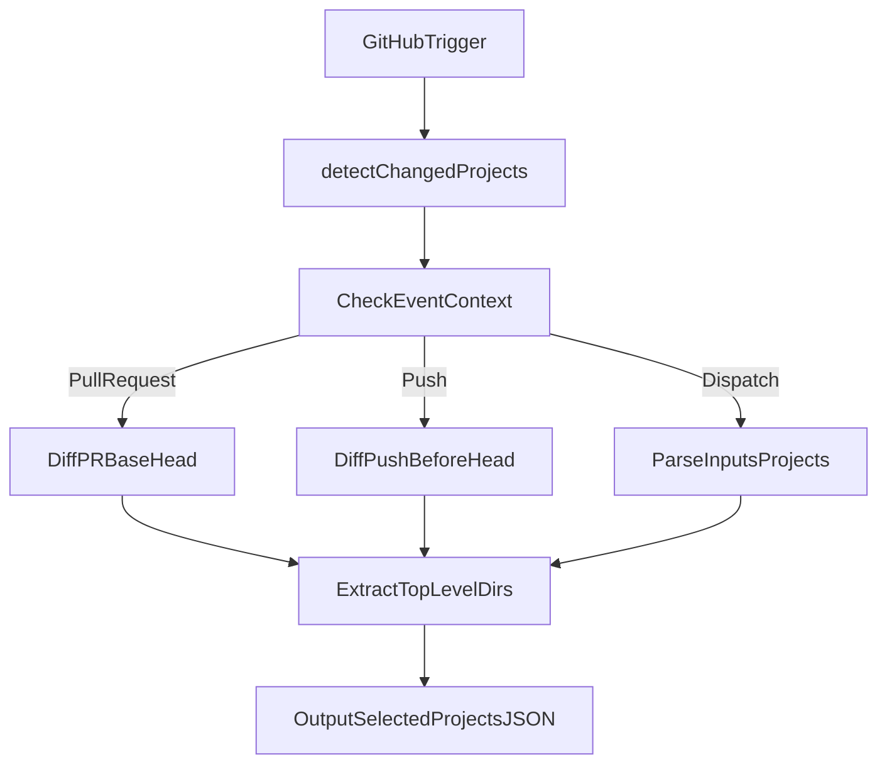
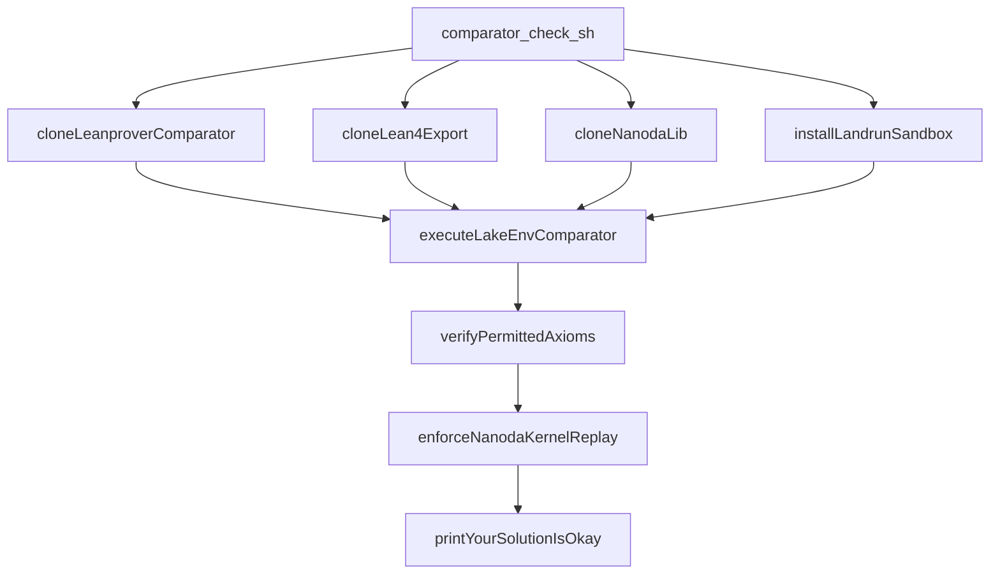

<!-- source: DeepWiki mcp.deepwiki.com · repo anthropics/formal-math · page 4.1 lean-projects Workflow: Change Detection and Build Verification · fetched 2026-10-26 -->

# lean-projects Workflow: Change Detection and Build Verification

Relevant source files

The following files were used as context for generating this wiki page:

- [.github/dependabot.yml](.github/dependabot.yml)
- [.github/scripts/comparator-check.sh](.github/scripts/comparator-check.sh)
- [.github/workflows/lean-projects.yml](.github/workflows/lean-projects.yml)
- [README.md](README.md)

## Purpose and Scope
This page documents the continuous integration (CI) workflow and validation pipeline defined in `[.github/workflows/lean-projects.yml]()` and `[.github/scripts/comparator-check.sh]()`. The system is designed to handle multi-project Lean 4 repositories where each self-contained subdirectory represents an independent Lake project following the Palomar submission standard [README.md:1-3](). The workflow provides automated change detection via git diff analysis, toolchain isolation through `elan`, Mathlib cache restoration, strict `sorry` auditing, and final cryptographic and kernel-level validation via the Palomar comparator pipeline [README.md:9-12]().

Sources: `[README.md:1-12]`, `[.github/workflows/lean-projects.yml:1-22]()`

---

## Project Change Detection via Git Diff
To avoid redundant builds in multi-project repositories, the CI pipeline runs a preliminary detection job (`detect`) that inspects git history to identify which project directories contain modifications [README.md:9-11](). 

The change detection logic evaluates three event types (`pull_request`, `push`, and `workflow_dispatch`) within the `detect` job defined in `[.github/workflows/lean-projects.yml:52-140]()`:

Sources: `[.github/workflows/lean-projects.yml:52-140]()`

1. **Pull Requests**: Computes the diff range between `PR_BASE` and `PR_HEAD` using `git diff --name-only` [[.github/workflows/lean-projects.yml:95](), [.github/workflows/lean-projects.yml:113]()].
2. **Pushes**: Compares `PUSH_BEFORE` to `PUSH_HEAD`. If `PUSH_BEFORE` is null or missing from history (e.g., shallow clones or force pushes), it falls back to diffing against `origin/main` [[.github/workflows/lean-projects.yml:96-105]()].
3. **Manual Dispatch**: Allows manual overrides via the `projects` input parameter (defaulting to `"all"`) [[.github/workflows/lean-projects.yml:28-32](), [.github/workflows/lean-projects.yml:106-108]()].

Top-level directories containing either `lakefile.toml` or `lakefile.lean` are matched against the modified file paths. Only projects with registered changes are passed downstream into the matrix verification runner [[.github/workflows/lean-projects.yml:75-79](), [.github/workflows/lean-projects.yml:116-118]()].

Sources: `[.github/workflows/lean-projects.yml:52-140]()`

---

## Toolchain Resolution and Elan Pinning
For each selected project, the `verify` job isolates the build environment by installing `elan` according to the pinned versions specified in the workflow environment block (`ELAN_VERSION`, `ELAN_SHA256`) [[.github/workflows/lean-projects.yml:41-49]()]. 

Each project defines its specific Lean and Mathlib versions inside its root `lean-toolchain` file (e.g., `leanprover/lean4:v4.33.0-rc2`) [README.md:7](). Elan automatically parses this file when executing Lake commands, ensuring that the exact compiler version required by the formalization is provisioned without global pollution.

Sources: `[README.md:7]()`, `[.github/workflows/lean-projects.yml:41-49]()`, `[.github/workflows/lean-projects.yml:11-12]()`

---

## Mathlib Cache Restoration and Incremental Builds
To accelerate build times for heavy formalizations (such as algebraic number theory or analytic libraries like `zeta23`), the workflow executes caching strategies:
* **Mathlib Caching**: Projects dependent on Mathlib restore pre-compiled binary caches using Lake's native caching utilities (e.g., `lake exe cache get`) [README.md:11]().
* **Pull Request Build Caching**: On pull requests, the workflow restores the project's previous `.lake/build` directory artifact [[.github/workflows/lean-projects.yml:12-14]()]. This allows Lake to perform incremental compilation, rebuilding only modified modules rather than recompiling the entire Mathlib dependency tree.
* **Pushes and Dispatches**: Pushes to `main` and manual workflow dispatches flush the build cache and build entirely from scratch to guarantee reproducibility [README.md:11](), [[.github/workflows/lean-projects.yml:12-14]()].

Sources: `[README.md:9-12]`, `[.github/workflows/lean-projects.yml:11-14]()`

---

## Build Verification and Sorry Checks
Once the environment is prepared, Lake compiles the project (`lake build`) [README.md:11](). Concurrently, verification scripts enforce strict proof hygiene:
* **Sorry Restrictions**: The project must build successfully with **no `sorry`** terms present anywhere in the codebase, with the strict exception of designated trusted statement files (`Challenge.lean` and `Challenge/<Topic>.lean`) [README.md:11]().
* **Axiom Budgets**: Only standard foundational axioms are permitted across the development (`propext`, `Quot.sound`, `Classical.choice`) [[.github/scripts/comparator-check.sh:106-107]()].

Sources: `[README.md:9-12]`, `[.github/scripts/comparator-check.sh:106-107]()`

---

## The Comparator Acceptance Step (`comparator-check.sh`)
The final gate for project acceptance is executed via `[.github/scripts/comparator-check.sh]()`. This script implements the Palomar registry verification pipeline [[.github/scripts/comparator-check.sh:1-12]()].

Sources: `[.github/scripts/comparator-check.sh:1-125]()`

### Pipeline Execution Steps
1. **Tool Pinning and Acquisition**: The script checks out fixed commits of independent verification tools into `~/.cache/lean-ci-tools`:
   * `leanprover/comparator` (`COMPARATOR_COMMIT`) [[.github/workflows/lean-projects.yml:47](), [.github/scripts/comparator-check.sh:22](), [.github/scripts/comparator-check.sh:62-64]()]
   * `leanprover/lean4export` (version-matched to the project's `lean-toolchain`) [[.github/scripts/comparator-check.sh:35-42](), [.github/scripts/comparator-check.sh:67-73]()]
   * `robsimmons/nanoda_lib` (`NANODA_COMMIT`) [[.github/workflows/lean-projects.yml:48](), [.github/scripts/comparator-check.sh:23](), [.github/scripts/comparator-check.sh:75-78]()]
   * `zouuup/landrun` (`LANDRUN_COMMIT`) [[.github/workflows/lean-projects.yml:49](), [.github/scripts/comparator-check.sh:24](), [.github/scripts/comparator-check.sh:80-85]()]
2. **Configuration Discovery**: Scans the project directory for configuration schemas (`comparator*.json` or `comparator/config*.json`) [[.github/scripts/comparator-check.sh:44-46]()].
3. **Axiom and Kernel Enforcement**:
   * Validates that `permitted_axioms` declared in the configuration strictly subset `propext`, `Quot.sound`, and `Classical.choice` [[.github/scripts/comparator-check.sh:106-107]()].
   * Forces `enable_nanoda = true` on a temporary configuration copy to ensure independent kernel-level verification [[.github/scripts/comparator-check.sh:108-109]()].
4. **Sandboxed Replay**: Executes the comparator binary inside the `landrun` sandbox wrapper. The sandbox restricts system call execution and file system access during Lean export and term checking [[.github/scripts/comparator-check.sh:91-98](), [.github/scripts/comparator-check.sh:113]()].
5. **Acceptance Criterion**: The script asserts that the comparator outputs `"Your solution is okay!"` for every evaluated configuration, failing the workflow otherwise [[.github/scripts/comparator-check.sh:116-124]()].

Sources: `[.github/workflows/lean-projects.yml:41-49]`, `[.github/scripts/comparator-check.sh:1-125]()`

---

