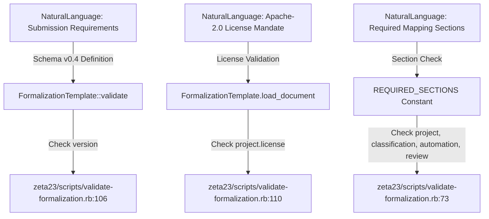
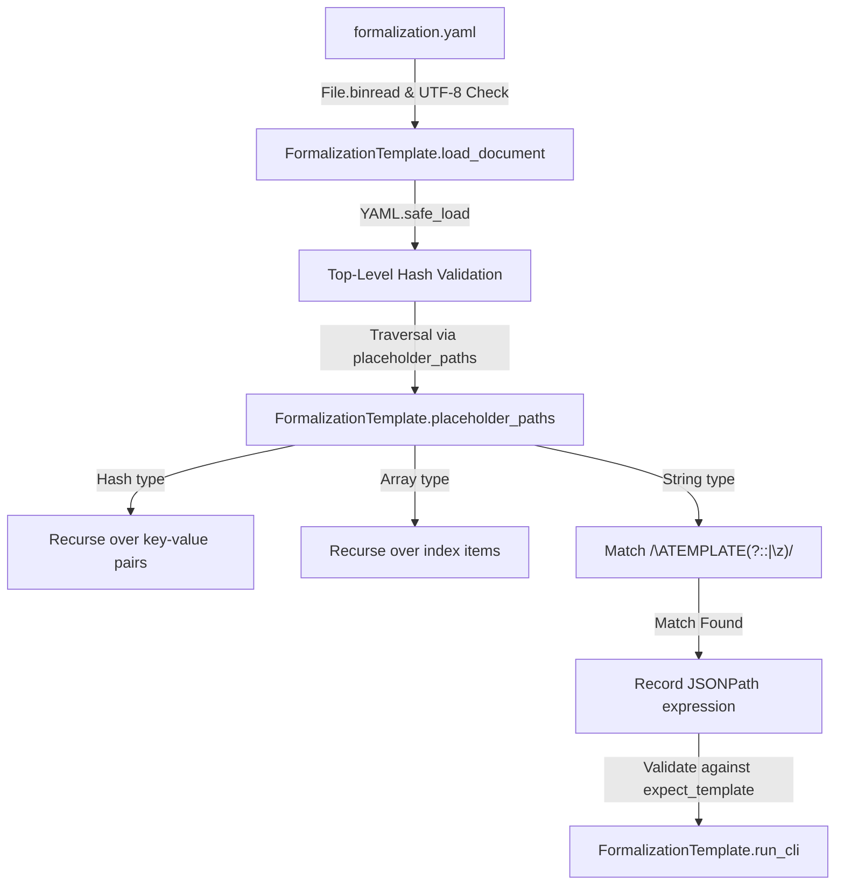

<!-- source: DeepWiki mcp.deepwiki.com · repo anthropics/formal-math · page 4.3 Formalization Metadata Validation · fetched 2026-10-26 -->

# Formalization Metadata Validation

Relevant source files

The following files were used as context for generating this wiki page:

- [zeta23/formalization.yaml](zeta23/formalization.yaml)
- [zeta23/scripts/validate-formalization.rb](zeta23/scripts/validate-formalization.rb)
- [zeta23/test/validate_formalization_test.rb](zeta23/test/validate_formalization_test.rb)

## Purpose and Scope
This page details the metadata validation infrastructure for formalization projects in the repository, centered around the Ruby script `zeta23/scripts/validate-formalization.rb` [zeta23/scripts/validate-formalization.rb:1-177] and its corresponding Minitest test suite `zeta23/test/validate_formalization_test.rb` [zeta23/test/validate_formalization_test.rb:1-202]. It covers the `FormalizationTemplate` module, schema v0.4 compliance rules, `TEMPLATE` sentinel detection mechanisms, and automated test coverage ensuring submission integrity against Palomar registry standards.

---

## 1. The `FormalizationTemplate` Module and Schema v0.4 Rules

The validation logic is encapsulated within the `FormalizationTemplate` module defined in `zeta23/scripts/validate-formalization.rb` [zeta23/scripts/validate-formalization.rb:7-174]. It enforces schema v0.4 compliance for `formalization.yaml` files [zeta23/formalization.yaml:1-7].

### Core Validation Constraints
1. **Version Requirement**: The document version must precisely match `"v0.4"` (`zeta23/scripts/validate-formalization.rb:106-109`).
2. **License Contract**: The project license must be set to `"Apache-2.0"`, matching the repository root license (`zeta23/scripts/validate-formalization.rb:9`, `zeta23/scripts/validate-formalization.rb:110-116`).
3. **Required Mapping Sections**: Top-level keys must contain mappings for `project`, `classification`, `automation`, and `review` (`zeta23/scripts/validate-formalization.rb:10`, `zeta23/scripts/validate-formalization.rb:73-77`).
4. **Description Bounds**: The public description (`project.description`) must be a non-empty string of at most 10,000 characters (`zeta23/scripts/validate-formalization.rb:117-121`).

*Diagram 1: Bridging Natural Language Submission Requirements to `FormalizationTemplate` Code Entities.*

Sources: `zeta23/scripts/validate-formalization.rb:7-121`, `zeta23/formalization.yaml:1-38`

---

## 2. TEMPLATE Sentinel Detection and Parsing Architecture

To ensure that uncustomized starter templates are rejected prior to submission, `FormalizationTemplate` implements robust sentinel scanning.

### Sentinel Regex and Traversal
- **Sentinel Pattern**: Defined as `SENTINEL = /\ATEMPLATE(?::|\z)/`, matching bare `TEMPLATE` or `TEMPLATE:` prefixes anchored at the start of string values (`zeta23/scripts/validate-formalization.rb:8`).
- **Recursive Traversal**: The `placeholder_paths` function traverses hashes, arrays, and strings recursively, accumulating JSONPath-like expressions (e.g., `$.project.name`) for every matching sentinel (`zeta23/scripts/validate-formalization.rb:87-102`).
- **Safe YAML Loading**: Files are read with UTF-8 enforcement (`zeta23/scripts/validate-formalization.rb:62-63`) and parsed using `YAML.safe_load` with aliases disabled and empty permitted classes/symbols to prevent unsafe object deserialization (`zeta23/scripts/validate-formalization.rb:65-70`).

*Diagram 2: Data Flow and Sentinel Detection Pipeline in `validate-formalization.rb`.*

Sources: `zeta23/scripts/validate-formalization.rb:61-102`, `zeta23/scripts/validate-formalization.rb:146-173`

---

## 3. Minitest Suite and Test Coverage (`ValidateFormalizationTest`)

The test suite in `zeta23/test/validate_formalization_test.rb` [zeta23/test/validate_formalization_test.rb:1-202] provides thorough coverage of validation rules, error handling, and command-line execution.

### Key Test Cases
- **`test_accepts_customized_yaml`**: Verifies that a valid, customized metadata hash passes validation with zero errors (`zeta23/test/validate_formalization_test.rb:44-48`).
- **`test_requires_v0_4`**: Confirms that non-v0.4 versions (e.g., `v0.3`) raise a `FormalizationTemplate::ValidationError` (`zeta23/test/validate_formalization_test.rb:50-57`).
- **`test_requires_the_apache_2_license_contract`**: Ensures invalid licenses (like `MIT` or `nil`) trigger license mismatch errors (`zeta23/test/validate_formalization_test.rb:59-74`).
- **`test_sentinel_is_anchored_and_accepts_bare_or_colon_forms`**: Validates that leading or embedded text does not trigger false positives while bare/colon templates are accurately located (`zeta23/test/validate_formalization_test.rb:121-134`).
- **`test_cli_rejects_a_different_or_missing_root_license`**: Exercises the CLI integration via `Open3.capture3` to verify exit codes and error outputs (`zeta23/test/validate_formalization_test.rb:85-100`).

Sources: `zeta23/test/validate_formalization_test.rb:11-202`

---

