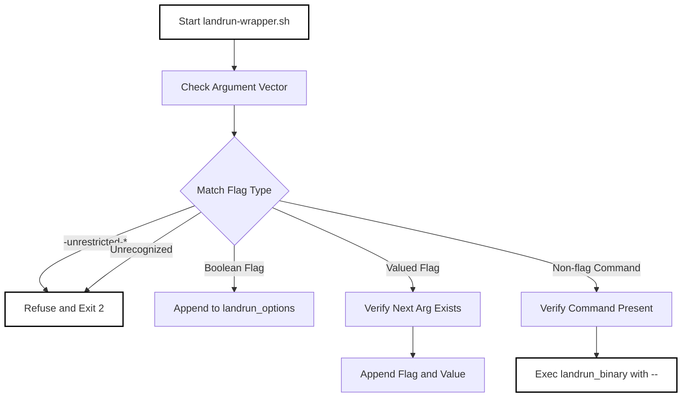
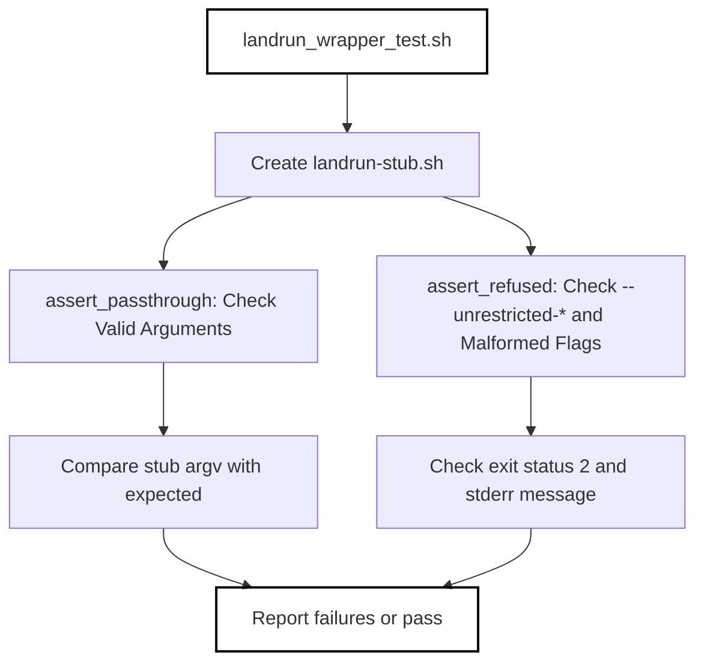

<!-- source: DeepWiki mcp.deepwiki.com · repo anthropics/formal-math · page 4.4 Landrun Sandbox Wrapper and Tests · fetched 2026-10-26 -->

# Landrun Sandbox Wrapper and Tests

Relevant source files

The following files were used as context for generating this wiki page:

- [zeta23/scripts/landrun-wrapper.sh](zeta23/scripts/landrun-wrapper.sh)
- [zeta23/test/landrun_wrapper_test.sh](zeta23/test/landrun_wrapper_test.sh)

This page covers the implementation and validation of the Landrun sandbox wrapper script (`zeta23/scripts/landrun-wrapper.sh`) and its corresponding test suite (`zeta23/test/landrun_wrapper_test.sh`). These components enforce the sandboxing contract for the Palomar comparator pipeline, ensuring that sandbox restrictions cannot be bypassed by dependency updates or misconfigured comparator profiles.

---

## 1. Landrun Wrapper Policy Enforcement

The Landrun sandbox wrapper (`zeta23/scripts/landrun-wrapper.sh`) acts as an interception layer between the Palomar comparator and the underlying Landrun binary [zeta23/scripts/landrun-wrapper.sh:4-8](). Because Landrun requires an explicit outer `--` delimiter before the sandboxed command—while the comparator constructs options without adding this delimiter—the wrapper inserts it automatically [zeta23/scripts/landrun-wrapper.sh:4-6]().

### Argument Parsing and Validation Logic

The script processes command-line arguments iteratively using a `while` loop [zeta23/scripts/landrun-wrapper.sh:16-43] and enforces security constraints:
* **Unrestricted Flag Rejection**: Any flag matching `-unrestricted-*` or `--unrestricted-*` is explicitly refused with exit code `2` [zeta23/scripts/landrun-wrapper.sh:17-22]. This prevents a dependency bump from inadvertently disabling Landlock restrictions. Both single-dash and double-dash variants are intercepted [zeta23/scripts/landrun-wrapper.sh:15-18].
* **Permitted Boolean Flags**: Flags such as `--best-effort`, `-ldd`, `--ldd`, `-add-exec`, `--add-exec`, `--ignore-missing`, `--log-disable-originating`, `--log-enable-subprocesses`, and `--log-disable-subdomains` are passed through directly [zeta23/scripts/landrun-wrapper.sh:23-26].
* **Permitted Valued Flags**: Options requiring argument values (e.g., `--log-level`, `--ro`, `--rox`, `--rw`, `--rwx`, `--unix`, `--bind-tcp`, `--connect-tcp`, `--env`) check that a subsequent argument exists before consuming two positions from the argument vector [zeta23/scripts/landrun-wrapper.sh:27-34].
* **Command Enforcement**: If no sandboxed command remains after parsing options, the script exits with an error [zeta23/scripts/landrun-wrapper.sh:45-48].

Finally, it invokes the binary specified by `$PALOMAR_LANDRUN_BIN` with the sanitized option array followed by `--` and the remaining command arguments [zeta23/scripts/landrun-wrapper.sh:7,50]().

*Sources: [zeta23/scripts/landrun-wrapper.sh:1-50]()*

---

## 2. Sandboxing Contract Test Coverage

The test suite (`zeta23/test/landrun_wrapper_test.sh`) verifies the wrapper's behavior against a stub Landrun implementation (`landrun-stub.sh`) [zeta23/test/landrun_wrapper_test.sh:4-20](). The stub records the received argument vector to `$PALOMAR_TEST_ARGV`, enabling precise assertion checks [zeta23/test/landrun_wrapper_test.sh:16-19].

### Test Framework Helpers and Assertions

* `run_wrapper()`: Executes `zeta23/scripts/landrun-wrapper.sh` with given arguments, capturing its exit status, stderr, and the stub's recorded argument vector [zeta23/test/landrun_wrapper_test.sh:32-39].
* `assert_passthrough()`: Asserts that the wrapper exits successfully (`0`) and that the stub receives the exact expected argument vector [zeta23/test/landrun_wrapper_test.sh:41-53].
* `assert_refused()`: Asserts that the wrapper rejects improper configurations with exit code `2`, outputs the expected refusal message naming the offending flag, and prevents the stub from executing [zeta23/test/landrun_wrapper_test.sh:55-67].

### Verified Scenarios

1. **Comparator Flag Passthrough**: Validates that standard comparator build flags (`--best-effort`, `--ro /`, `--rw /dev`, `-ldd`, `-add-exec`, `--env PATH`, `--ro /workspace`, `--rwx /workspace/.lake`, `--rox /toolchain`) successfully reach Landrun alongside the target command `lake build Solution` [zeta23/test/landrun_wrapper_test.sh:69-92].
2. **Executable Narrowing**: Confirms both `-add-exec` and `--add-exec` spellings are preserved because they narrow executable permissions under `--rox` rather than lift restrictions [zeta23/test/landrun_wrapper_test.sh:94-106].
3. **Unrestricted Flag Defenses**: Iterates through various spellings of `--unrestricted-filesystem`, `--unrestricted-network`, and `--unrestricted-scoped`, confirming immediate refusal [zeta23/test/landrun_wrapper_test.sh:108-112].
4. **Malformed Options**: Verifies refusal of unknown flags (`--brand-new-flag`), flags missing required values (`--ro` without a path), and missing sandboxed commands [zeta23/test/landrun_wrapper_test.sh:114-119].
5. **Command Argument Insulation**: Verifies that arguments belonging to the sandboxed command (even if they mimic wrapper flags) pass through untouched after the outer `--` delimiter [zeta23/test/landrun_wrapper_test.sh:121-128].

*Sources: [zeta23/test/landrun_wrapper_test.sh:1-135]()*

---

## 3. Summary of Files and Symbols

| File Path | Key Symbols / Functions | Role |
| :--- | :--- | :--- |
| `zeta23/scripts/landrun-wrapper.sh` | Main script logic, option parsing loop | Intercepts comparator flags, blocks unrestricted overrides, invokes `$landrun_binary` [zeta23/scripts/landrun-wrapper.sh:1-50]() |
| `zeta23/test/landrun_wrapper_test.sh` | `run_wrapper`, `assert_passthrough`, `assert_refused` | Validates wrapper contract against a recorded stub binary [zeta23/test/landrun_wrapper_test.sh:32-67]() |

*Sources: [zeta23/scripts/landrun-wrapper.sh:1-50](), [zeta23/test/landrun_wrapper_test.sh:1-136}*

---

