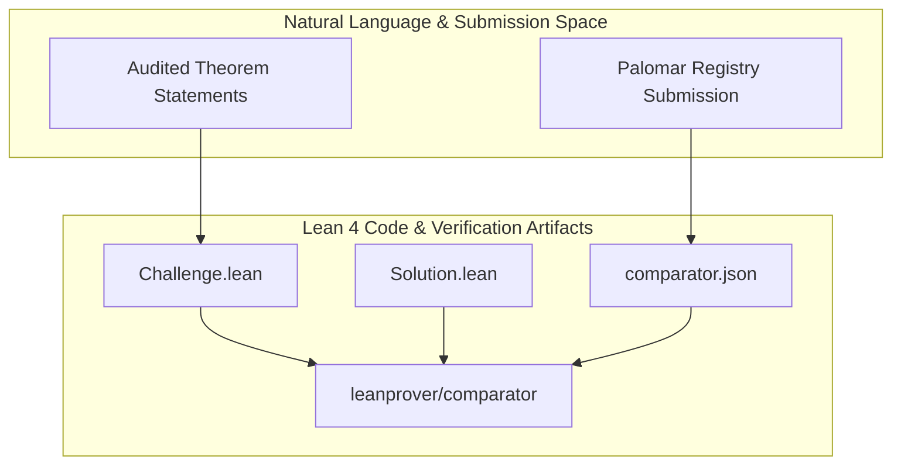
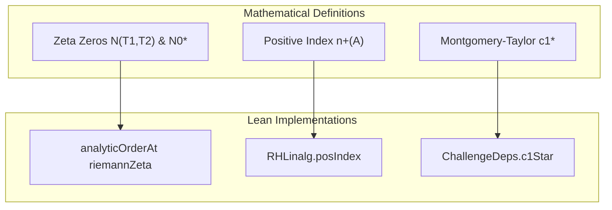

<!-- source: DeepWiki mcp.deepwiki.com · repo anthropics/formal-math · page 5 Glossary · fetched 2026-10-26 -->

# Glossary

Relevant source files

The following files were used as context for generating this wiki page:

- [.github/workflows/lean-projects.yml](.github/workflows/lean-projects.yml)
- [README.md](README.md)
- [zeta23/AUDIT.md](zeta23/AUDIT.md)
- [zeta23/README.md](zeta23/README.md)
- [zeta23/Zeta23/LinAlg/PosIndex.lean](zeta23/Zeta23/LinAlg/PosIndex.lean)

This page provides definitions of repository-specific terms, tooling jargon, and key mathematical symbols used across the `anthropics/formal-math` repository, complete with code pointers and system file locations.

## Ecosystem and Build Tooling

*   **Palomar**: A registry and submission standard for machine-checked formalizations [README.md:3](). Projects follow the Palomar submission template layout containing `Challenge.lean`, `Solution.lean`, `comparator.json`, and `formalization.yaml` at the project root [README.md:3]().
*   **Lake**: The native build system and package manager for Lean 4. Each subdirectory in the repository is a self-contained Lake project configured via `lakefile.toml` or `lakefile.lean` [README.md:3, zeta23/README.md:47]().
*   **elan**: The Lean version manager used to pin and automatically download the correct Lean toolchain version specified in each project's `lean-toolchain` file [.github/workflows/lean-projects.yml:11]().
*   **doc-gen4**: The documentation generator for Lean 4. Built inside the `docbuild/` nested project to produce HTML API documentation for the `Zeta23` library [zeta23/README.md:53]().
*   **FormalizationTemplate**: The metadata validation schema and template runner (`scripts/validate-formalization.rb`) ensuring `formalization.yaml` files conform to schema v0.4 rules [zeta23/README.md:43,51]().

Sources: [README.md:3](), [.github/workflows/lean-projects.yml:11](), [zeta23/README.md:43-53]()

## Verification and Trust Boundary

*   **Comparator**: The trusted verification harness (`leanprover/comparator`) that checks whether an untrusted `Solution.lean` matches the trusted statements in `Challenge.lean` according to the rules in `comparator.json` [README.md:11, zeta23/README.md:25]().
*   **lean4export**: A tool that exports Lean 4 kernel declarations into a flat text format suitable for consumption by independent type checkers [README.md:11]().
*   **nanoda**: An independent, third-party Lean 4 kernel implementation used in the verification pipeline to validate exported proof trees [README.md:11]().
*   **landrun**: A sandboxing utility (`scripts/landrun-wrapper.sh`) used to isolate and safely execute the verification tools during CI checks [README.md:11, zeta23/README.md:50]().
*   **sorryAx**: The internal Lean axiom representing unproved holes (`sorry`). The verification pipeline enforces that `sorryAx` is absent outside designated challenge files [README.md:11]().
*   **Standard Three Axioms**: The baseline set of axioms permitted in verified solutions: `propext`, `Classical.choice`, and `Quot.sound` [zeta23/AUDIT.md:25]().

*Figure 1: Verification architecture mapping submission specifications to concrete Lean verification artifacts.*

Sources: [README.md:11](), [zeta23/README.md:25-50](), [zeta23/AUDIT.md:25]()

## Project Layout and Modules

*   **Challenge / Solution / ChallengeDeps**: The core structural division of a project. `Challenge.lean` contains trusted statements with `sorry` placeholders [zeta23/README.md:29](). `ChallengeDeps.lean` contains the definitions required by the statements [zeta23/README.md:32](). `Solution.lean` contains the actual proofs delegating to the underlying library [zeta23/README.md:35]().
*   **XiPrime**: An independent sub-development (`Zeta23/XiPrime/`, `Challenge/XiPrime.lean`) focusing on the zeros of the derivative of completed zeta ($\xi'$) [zeta23/README.md:39]().
*   **PairCeiling**: A bandwidth-one stability inequality and enclosure machinery (`EnclOK`) located in `Zeta23/PairCeiling/` bounding method optimality limits [zeta23/README.md:47]().
*   **FromPNTPlus**: Adapted foundational analytic blocks providing Chebyshev-Mertens prime-sum estimates [zeta23/README.md:16]().

Sources: [zeta23/README.md:16-47]()

## Linear Algebra and Zeta Mathematics

*   **posIndex**: The positive index $n_+(A)$ of a Hermitian matrix $A$, defined as the number of strictly positive eigenvalues [zeta23/Zeta23/LinAlg/PosIndex.lean:41]().
*   **negIndex**: The negative index $n_-(A)$, defined as the number of strictly negative eigenvalues [zeta23/Zeta23/LinAlg/PosIndex.lean:45]().
*   **posIndexAbove**: The thresholded positive index $n_+^\theta(A)$ counting eigenvalues strictly above $\theta$ [zeta23/Zeta23/LinAlg/PosIndex.lean:48]().
*   **rtrace**: The real part of the matrix trace (`RCLike.re A.trace`), which equals the full trace for Hermitian matrices [zeta23/Zeta23/LinAlg/PosIndex.lean:70]().
*   **frobSq**: The squared Frobenius norm $\|A\|_F^2 = \text{Re}\operatorname{tr}(A^\text{H}A)$ [zeta23/Zeta23/LinAlg/PosIndex.lean:73]().
*   **specMap**: Spectral functional calculus operations defining positive and negative parts of Hermitian matrices (`RHLinalg` namespace) [zeta23/Zeta23/LinAlg/PosIndex.lean:7]().
*   **Rank–Trace Inequality**: Inequalities relating matrix rank, trace, and squared Frobenius norms used in linear algebraic certificates (`lem:ranktrace`) [zeta23/Zeta23/LinAlg/PosIndex.lean:25]().
*   **Montgomery–Taylor Constant ($c_1^*$)**: The constant $c_1^* = \sqrt{2}\tan\vartheta / (1 + \vartheta\tan\vartheta)$ where $\vartheta = 1/\sqrt{2}$, appearing in window improvement bounds [zeta23/README.md:65]().
*   **$N(T_1, T_2)$**: The number of nontrivial zeros $\rho$ of $\zeta$ with $0 < \text{Re}\rho < 1$ and $T_1 < \text{Im}\rho \le T_2$ [zeta23/README.md:59]().
*   **$N_0^*(T_1, T_2)$**: The number of *distinct* zeros on the critical line $\text{Re}\rho = 1/2$ [zeta23/README.md:60]().
*   **$N_0^s$**: The number of zeros on the critical line that are *simple* [zeta23/README.md:60]().
*   **$N_d$**: The total number of distinct zeros [zeta23/README.md:60]().
*   **Critical Line**: The line $\text{Re}\rho = 1/2$ in the complex plane where the Riemann hypothesis places nontrivial zeros [zeta23/README.md:60]().
*   **analyticOrderAt**: The order of vanishing of a function at a point, used alongside Mathlib's `riemannZeta` to define zero multiplicity [zeta23/README.md:62]().
*   **$\varepsilon$-Forms**: Asymptotic limit statements formalized as $\forall \varepsilon > 0, \exists T_0, \forall T \ge T_0, (c - \varepsilon)\cdot N(T) \le X(T)$ [zeta23/README.md:64]().
*   **EnclOK**: Enclosure verification machinery ensuring bound stability within `PairCeiling` [zeta23/README.md:47]().

*Figure 2: Mapping mathematical definitions to their concrete Lean function and constant counterparts.*

Sources: [zeta23/README.md:59-65](), [zeta23/Zeta23/LinAlg/PosIndex.lean:7-73]()