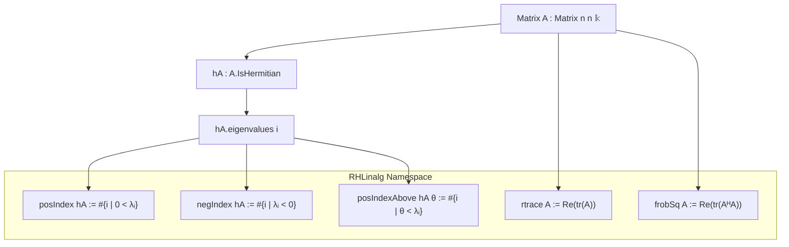
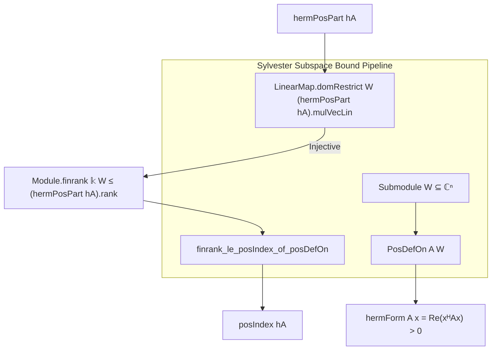

<!-- source: DeepWiki mcp.deepwiki.com · repo anthropics/formal-math · extra page Inertia, Positive Index and Sylvester's Law · fetched 2026-10-26 -->

# Inertia, Positive Index and Sylvester's Law

Relevant source files

The following files were used as context for generating this wiki page:

- [zeta23/Zeta23/LinAlg/Inertia.lean](zeta23/Zeta23/LinAlg/Inertia.lean)
- [zeta23/Zeta23/LinAlg/PosIndex.lean](zeta23/Zeta23/LinAlg/PosIndex.lean)
- [zeta23/Zeta23/LinAlg/Sylvester.lean](zeta23/Zeta23/LinAlg/Sylvester.lean)

## Purpose and Scope
This page documents the formalization of matrix inertia, positive/negative index definitions, Hermitian forms, and Sylvester's law of inertia within the `zeta23` proof library [zeta23/Zeta23/LinAlg/Inertia.lean:7](). Located under the `RHLinalg` namespace [zeta23/Zeta23/LinAlg/PosIndex.lean:33](), these modules establish the foundational linear algebra tools required for §3 of the paper [zeta23/Zeta23/LinAlg/Inertia.lean:7](), specifically underpinning the rank-trace certificate and matrix perturbation bounds.

---

## 1. Definitions: Positive Index, Negative Index, and Thresholds

The positive index $n_+(A)$ of a Hermitian matrix is defined as the cardinality of the set of its strictly positive eigenvalues [zeta23/Zeta23/LinAlg/PosIndex.lean:38](). Similarly, the negative index and thresholded positive index are defined over eigenvalue filters [zeta23/Zeta23/LinAlg/PosIndex.lean:45]().

### Core Definitions in `PosIndex.lean`
- `posIndex`: Counts eigenvalues strictly greater than $0$ [zeta23/Zeta23/LinAlg/PosIndex.lean:41]().
- `negIndex`: Counts eigenvalues strictly less than $0$ [zeta23/Zeta23/LinAlg/PosIndex.lean:45]().
- `posIndexAbove`: Counts eigenvalues strictly greater than a threshold $\theta$ [zeta23/Zeta23/LinAlg/PosIndex.lean:50]().
- `rtrace`: The real part of the matrix trace (`RCLike.re A.trace`) [zeta23/Zeta23/LinAlg/PosIndex.lean:70]().
- `frobSq`: The squared Frobenius norm expressed as `RCLike.re (Aᴴ * A).trace` [zeta23/Zeta23/LinAlg/PosIndex.lean:73]().

Reindexing utilities such as `eigEquiv` and `sum_eigenvalues_reindex` translate sums and set cardinalities over matrix index types $n$ into sums over `Fin (Fintype.card n)` using sorted/canonical eigenvalue enumerations `eigenvalues₀` [zeta23/Zeta23/LinAlg/PosIndex.lean:87]().

*Sources: [zeta23/Zeta23/LinAlg/PosIndex.lean:35-74]()*

---

## 2. Hermitian Forms and Sylvester's Law of Inertia

To connect eigenvalue counts with subspace dimensions, `Sylvester.lean` introduces the Hermitian form associated with a matrix and defines positive-definiteness on arbitrary submodules [zeta23/Zeta23/LinAlg/Sylvester.lean:42]().

### Key Structures and Theorems
- `hermForm`: Computes $\text{Re}(x^* A x)$ for vector $x$ [zeta23/Zeta23/LinAlg/Sylvester.lean:43]().
- `PosDefOn`: Predicate stating that `hermForm A x > 0` for all non-zero $x$ in a submodule $W$ [zeta23/Zeta23/LinAlg/Sylvester.lean:47]().
- `finrank_le_posIndex_of_posDefOn`: The hard direction of Sylvester's inequality. Proves that any subspace $W$ on which `hermForm A` is positive-definite has $\dim(W) \le \text{posIndex } hA$ [zeta23/Zeta23/LinAlg/Sylvester.lean:82]().
- `posDefOn_range_hermPosPart`: The easy direction, showing that the Hermitian form is positive definite on $\text{range}(A_+)$ [zeta23/Zeta23/LinAlg/Sylvester.lean:123]().

*Sources: [zeta23/Zeta23/LinAlg/Sylvester.lean:43-113]()*

---

## 3. Inertia Properties: Pullback and Additivity

Using the subspace characterization established in Sylvester's law, `Inertia.lean` derives fundamental monotonicity and subadditivity properties of the positive index [zeta23/Zeta23/LinAlg/Inertia.lean:16]().

### Theorems
- `posIndex_conj_le`: For any Hermitian matrix $Q$ and linear map matrix $B$, the pullback form $B^* Q B$ satisfies [zeta23/Zeta23/LinAlg/Inertia.lean:51]():
  $$\text{posIndex}(B^* Q B) \le \text{posIndex}(Q)$$
  *Proof sketch*: Restricts the positive-definite range of $B^* Q B$ via $B$, checks injectivity, and applies `finrank_le_posIndex_of_posDefOn` [zeta23/Zeta23/LinAlg/Inertia.lean:51-86]().
- `posIndex_add_le`: Subadditivity of the positive index for Hermitian matrices $Q_1, Q_2$ [zeta23/Zeta23/LinAlg/Inertia.lean:90]():
  $$\text{posIndex}(Q_1 + Q_2) \le \text{posIndex}(Q_1) + \text{posIndex}(Q_2)$$
  *Proof sketch*: Utilizes the sum of positive parts $P = (Q_1)_+ + (Q_2)_+$ to bound the dimension of any $(Q_1 + Q_2)$-positive definite submodule [zeta23/Zeta23/LinAlg/Inertia.lean:97-136]().

Sources: [zeta23/Zeta23/LinAlg/Inertia.lean:48-136]()

---

