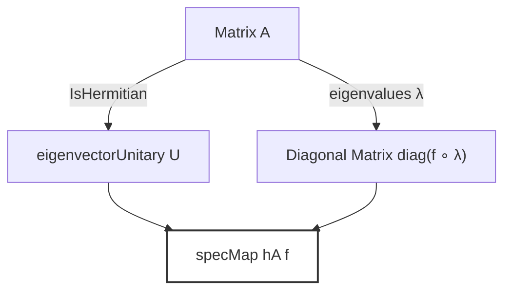
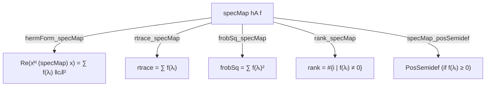
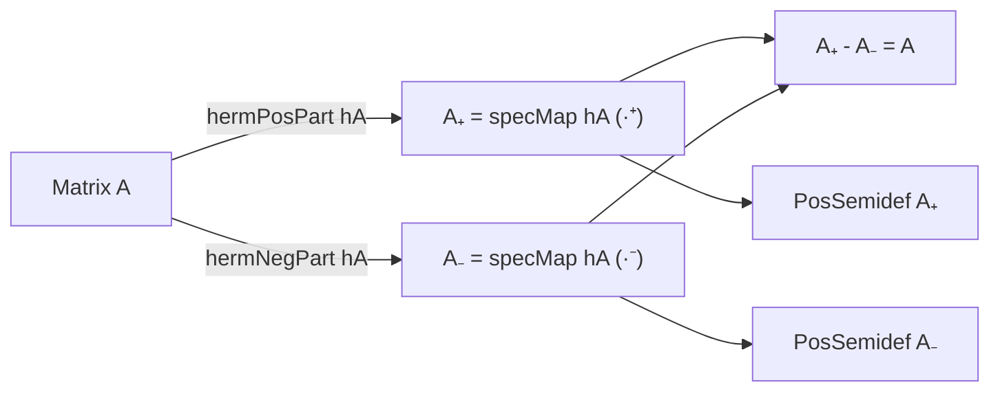

<!-- source: DeepWiki mcp.deepwiki.com · repo anthropics/formal-math · extra page Spectral Functional Calculus: specMap and Positive/Negative Parts · fetched 2026-10-26 -->

# Spectral Functional Calculus: specMap and Positive/Negative Parts

Relevant source files

The following files were used as context for generating this wiki page:

- [zeta23/Zeta23/LinAlg/HermitianPosPart.lean](zeta23/Zeta23/LinAlg/HermitianPosPart.lean)

## Purpose and Scope
This page documents section 3.1.2 of the `zeta23` proof library, focusing on the spectral functional calculus implementation (`specMap`) and the definitions and properties of Hermitian positive and negative parts (`hermPosPart` and `hermNegPart`) within the `RHLinalg` namespace [zeta23/Zeta23/LinAlg/HermitianPosPart.lean:1-34](). These constructions form the core linear algebraic machinery required for inertia indices, eigenvalue bounds, and trace inequalities.

---

## 1. Spectral Functional Calculus (`specMap`)

For a Hermitian matrix $A$ over an $\text{RCLike}$ field $\mathbb{K}$ with spectral decomposition $A = U \operatorname{diag}(\lambda) U^\$, the spectral functional calculus applies a real function $f: \mathbb{R} \to \mathbb{R}$ to the eigenvalues via conjugation by the unitary matrix of eigenvectors `hA.eigenvectorUnitary`.

### Core Operations and Definitions
* **`specMap`**: Defined as `conjStarAlgAut 𝕜 _ hA.eigenvectorUnitary (diagonal (fun i => (f (hA.eigenvalues i) : 𝕜)))` [zeta23/Zeta23/LinAlg/HermitianPosPart.lean:39-45]().
* **`specMap_isHermitian`**: Proves that applying a real function preserves Hermitian symmetry [zeta23/Zeta23/LinAlg/HermitianPosPart.lean:46-52]().
* **Algebraic Homomorphisms**:
  * Identity: `specMap hA id = A` [zeta23/Zeta23/LinAlg/HermitianPosPart.lean:53-56]()
  * Subtraction: `specMap hA (f - g) = specMap hA f - specMap hA g` [zeta23/Zeta23/LinAlg/HermitianPosPart.lean:58-64]()
  * Multiplication: `specMap hA (f * g) = specMap hA f * specMap hA g` [zeta23/Zeta23/LinAlg/HermitianPosPart.lean:65-70]()
  * Zero: `specMap hA 0 = 0` [zeta23/Zeta23/LinAlg/HermitianPosPart.lean:71-74]()

Sources: `[zeta23/Zeta23/LinAlg/HermitianPosPart.lean:39-74]()`

---

## 2. Quadratic Forms, Trace, Frobenius Norm, and Rank

To support matrix inequalities, `specMap` integrates directly with quadratic forms in eigenbasis coordinates, real traces, squared Frobenius norms, and rank functions.

### Key Lemmas
* **`hermForm_specMap`**: Expresses the real part of the quadratic form $x^H (\operatorname{specMap} hA f) x$ as $\sum_i f(\lambda_i) \|(U^H x)_i\|^2$ [zeta23/Zeta23/LinAlg/HermitianPosPart.lean:75-99]().
* **`rtrace_specMap`**: Computes the real trace: $\operatorname{rtrace}(\operatorname{specMap} hA f) = \sum_i f(\lambda_i)$ [zeta23/Zeta23/LinAlg/HermitianPosPart.lean:100-107]().
* **`frobSq_specMap`**: Computes the squared Frobenius norm: $\|\operatorname{specMap} hA f\|_F^2 = \sum_i f(\lambda_i)^2$ [zeta23/Zeta23/LinAlg/HermitianPosPart.lean:108-116]().
* **`rank_specMap`**: Relates the matrix rank to the cardinality of non-zero eigenvalue images: $\operatorname{rank} = \#\{i \mid f(\lambda_i) \neq 0\}$ [zeta23/Zeta23/LinAlg/HermitianPosPart.lean:117-132]().
* **`specMap_posSemidef`**: Establishes positive semi-definiteness when $\forall i, f(\lambda_i) \geq 0$ [zeta23/Zeta23/LinAlg/HermitianPosPart.lean:133-142]().

Sources: `[zeta23/Zeta23/LinAlg/HermitianPosPart.lean:75-142]()`

---

## 3. Positive and Negative Parts (`hermPosPart` and `hermNegPart`)

Using `specMap`, the positive and negative components of a Hermitian matrix $A$ are constructed by mapping the functions $x \mapsto x^+$ and $x \mapsto x^-$ across its spectrum.

### Definitions and Algebraic Properties
* **`hermPosPart`**: Defined as `specMap hA (·⁺)` where $x^+ = \max(x, 0)$ [zeta23/Zeta23/LinAlg/HermitianPosPart.lean:143-148]().
* **`hermNegPart`**: Defined as `specMap hA (·⁻)` where $x^- = \max(-x, 0)$ [zeta23/Zeta23/LinAlg/HermitianPosPart.lean:149-152]().
* **Decomposition (`hermPosPart_sub_hermNegPart`)**: Proves $\operatorname{hermPosPart}(hA) - \operatorname{hermNegPart}(hA) = A$ [zeta23/Zeta23/LinAlg/HermitianPosPart.lean:153-157]().
* **Semi-Definiteness**: Both parts are proven positive semi-definite via `hermPosPart_posSemidef` and `hermNegPart_posSemidef` [zeta23/Zeta23/LinAlg/HermitianPosPart.lean:158-163]().

Sources: `[zeta23/Zeta23/LinAlg/HermitianPosPart.lean:143-163]()`

---

