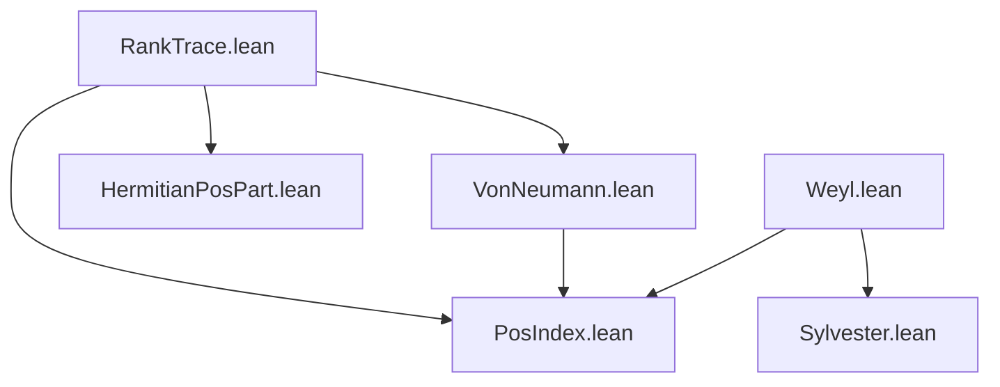
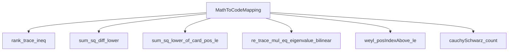

<!-- source: DeepWiki mcp.deepwiki.com · repo anthropics/formal-math · page 3.1.3 Rank–Trace Inequality, von Neumann and Weyl Bounds · patched3 2026-10-26 -->

# Rank–Trace Inequality, von Neumann and Weyl Bounds
# Rank–Trace Inequality, von Neumann and Weyl Bounds

Relevant source files

The following files were used as context for generating this wiki page:

- [zeta23/Zeta23/LinAlg/RankTrace.lean](zeta23/Zeta23/LinAlg/RankTrace.lean)
- [zeta23/Zeta23/LinAlg/VonNeumann.lean](zeta23/Zeta23/LinAlg/VonNeumann.lean)
- [zeta23/Zeta23/LinAlg/Weyl.lean](zeta23/Zeta23/LinAlg/Weyl.lean)

## Purpose and Scope
This page documents section 3.1.3 of the Zeta23 formalization project, covering the core linear algebra machinery required for the paper's §3 certificates. Specifically, it details the elementary real-sequence estimates and their combination into the **rank–trace inequality** (`rank_trace_ineq`), **von Neumann's trace inequality** (`re_trace_mul_eq_eigenvalue_bilinear` and related doubly stochastic reductions), and **Weyl's eigenvalue perturbation bound** (`weyl_posIndexAbove_le`) alongside the **thresholded Cauchy–Schwarz count** (`cauchySchwarz_count`). All implementations reside in the `RHLinalg` namespace under `zeta23/Zeta23/LinAlg/`.

Sources: `zeta23/Zeta23/LinAlg/RankTrace.lean:1-33` [zeta23/Zeta23/LinAlg/RankTrace.lean:1-33](), `zeta23/Zeta23/LinAlg/VonNeumann.lean:1-40` [zeta23/Zeta23/LinAlg/VonNeumann.lean:1-40](), `zeta23/Zeta23/LinAlg/Weyl.lean:1-24` [zeta23/Zeta23/LinAlg/Weyl.lean:1-24]()

## Elementary Sum Estimates and the Rank–Trace Inequality
The rank–trace inequality (`lem:ranktrace` in paper §3) relates the Frobenius norm squared of a sum of Hermitian matrices $P + Q$ to bounds on the positive index/rank of $P$ and the negative index of $Q$.

### Elementary Scalar and Vector Sum Estimates
The proof relies on two elementary scalar inequalities (`sq_ge_linear` and `sq_ge_linear'`) which lift to sum bounds over indexed collections:
- **Sum Estimate A** (`sum_sq_diff_lower`): For $p, m \ge 0$ with at most $r$ indices where $p$ is nonzero, and $c \ge 0$:
  $$\sum (p_i - m_i)^2 \ge c \sum p_i - \frac{c^2}{4} r - 2c \sum m_i$$
  Implemented at [zeta23/Zeta23/LinAlg/RankTrace.lean:59-84]().
- **Sum Estimate B** (`sum_sq_lower_of_card_pos_le`): For $q \ge 0$ with at most $b$ indices where $q$ is nonzero:
  $$\sum q_i^2 \ge 2c \sum q_i - c^2 b$$
  Implemented at [zeta23/Zeta23/LinAlg/RankTrace.lean:85-106]().

### Frobenius Norm Expansion and `rank_trace_ineq`
For Hermitian matrices $P, Q$, the Frobenius norm squared expands via `frobSq_add_hermitian`:
$$\|P + Q\|_F^2 = \|P\|_F^2 + 2 \operatorname{Re}\operatorname{tr}(PQ) + \|Q\|_F^2$$
Using spectral decompositions and the fact that $\operatorname{Re}\operatorname{tr}(PQ_+) \ge 0$ for positive semi-definite parts (`trace_mul_nonneg_of_posSemidef`), the cross terms and parts are lower-bounded using Sum Estimates A and B, yielding `rank_trace_ineq` [zeta23/Zeta23/LinAlg/RankTrace.lean:157-163]().

Sources: `zeta23/Zeta23/LinAlg/RankTrace.lean:45-163` [zeta23/Zeta23/LinAlg/RankTrace.lean:45-163]()

## Von Neumann's Trace Inequality
Von Neumann's trace inequality states that for Hermitian matrices $A, B$ with eigenvalues sorted in decreasing order, $\operatorname{Re}\operatorname{tr}(AB) \le \sum a_i b_i$.

### Implementation Details in `VonNeumann.lean`
1. **Entrywise Squared Matrix**: `normSqMatrix` [zeta23/Zeta23/LinAlg/VonNeumann.lean:53-55]() defines the real matrix $S_{ij} = \|W_{ij}\|^2$ for a unitary matrix $W$.
2. **Doubly Stochastic Property**: `normSqMatrix_mem_doublyStochastic_of_unitary` [zeta23/Zeta23/LinAlg/VonNeumann.lean:60-75]() proves that $S$ is doubly stochastic over $\mathbb{R}$ using unit vector row/column sums of unitary matrices.
3. **Bilinear Expansion**: `re_trace_mul_eq_eigenvalue_bilinear` [zeta23/Zeta23/LinAlg/VonNeumann.lean:78-127]() expresses $\operatorname{Re}\operatorname{tr}(AB)$ as $\sum_{k,l} \lambda_k(A) S_{kl} \lambda_l(B)$.
4. **Birkhoff–von Neumann & Rearrangement**: `bilinear_doublyStochastic_le_of_monovary` [zeta23/Zeta23/LinAlg/VonNeumann.lean:143-150]() decomposes $S$ into permutation matrices via Birkhoff's theorem and applies the rearrangement inequality for antitone eigenvalue sequences.

Sources: `zeta23/Zeta23/LinAlg/VonNeumann.lean:1-205` [zeta23/Zeta23/LinAlg/VonNeumann.lean:1-204]()

## Weyl's Eigenvalue Bound and Thresholded Cauchy–Schwarz Count
Weyl's perturbation bound and the Cauchy–Schwarz count provide thresholded eigenvalue control.

### Weyl's Perturbation Bound (`weyl_posIndexAbove_le`)
Theorem `weyl_posIndexAbove_le` [zeta23/Zeta23/LinAlg/Weyl.lean:50-78]() establishes that if $A, E$ are Hermitian and $\|E\|_{\text{op}} \le \theta$, then $n_+^\theta(A + E) \le n_+(A)$. Instead of direct Courant-Fischer max-min arguments on eigenvalues, the Lean formalization defines $W$ as the range of the spectral truncation (`specMap`), establishes that $A$ is positive definite on $W$ (`PosDefOn`), and applies Sylvester's law of inertia (`finrank_le_posIndex_of_posDefOn`).

### Thresholded Cauchy–Schwarz Count (`cauchySchwarz_count`)
Theorem `cauchySchwarz_count` [zeta23/Zeta23/LinAlg/Weyl.lean:89-135]() proves that for a Hermitian matrix $R$ with $\operatorname{tr} R > \theta d$, the number of eigenvalues above $\theta$ satisfies:
$$n_+^\theta(R) \ge \frac{(\operatorname{tr} R - \theta d)^2}{\operatorname{tr}(R^2)}$$
This is proved by applying Cauchy–Schwarz on the eigenvalues exceeding $\theta$ and bounding the remainder against the Frobenius norm squared `frobSq R`.

Sources: `zeta23/Zeta23/LinAlg/Weyl.lean:1-137` [zeta23/Zeta23/LinAlg/Weyl.lean:1-136]()

## Architectural and Code-to-Math Bridges

Below are architectural diagrams connecting the natural language mathematical concepts to their respective Lean code entities in `zeta23/Zeta23/LinAlg/`.

### Diagram 1: Linear Algebra Core File Dependencies and Modules

Sources: `zeta23/Zeta23/LinAlg/RankTrace.lean:13-15` [zeta23/Zeta23/LinAlg/RankTrace.lean:13-15](), `zeta23/Zeta23/LinAlg/VonNeumann.lean:13-15` [zeta23/Zeta23/LinAlg/VonNeumann.lean:13-15](), `zeta23/Zeta23/LinAlg/Weyl.lean:13-14` [zeta23/Zeta23/LinAlg/Weyl.lean:13-14]()

### Diagram 2: Mathematical Theorems to Lean Code Mapping

Sources: `zeta23/Zeta23/LinAlg/RankTrace.lean:59-163` [zeta23/Zeta23/LinAlg/RankTrace.lean:59-163](), `zeta23/Zeta23/LinAlg/VonNeumann.lean:78-127` [zeta23/Zeta23/LinAlg/VonNeumann.lean:78-127](), `zeta23/Zeta23/LinAlg/Weyl.lean:50-135` [zeta23/Zeta23/LinAlg/Weyl.lean:50-135]()

---

