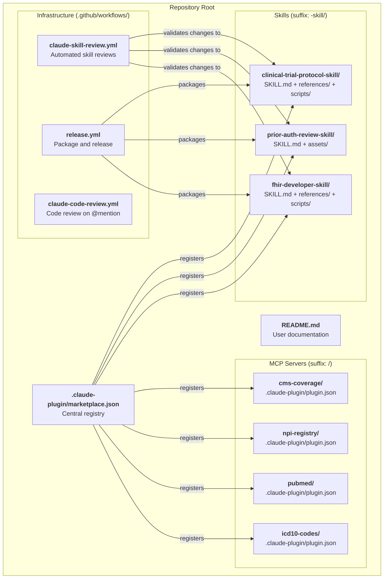
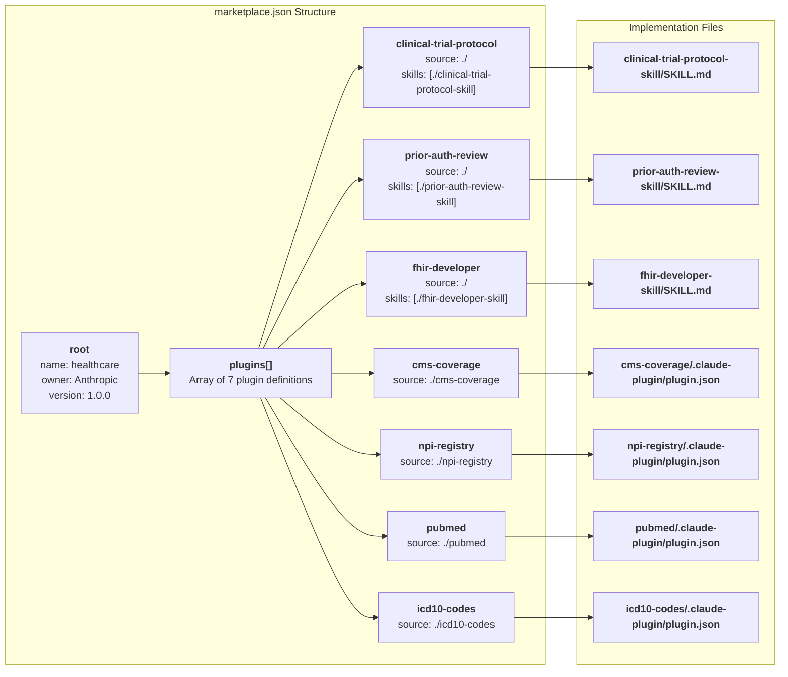
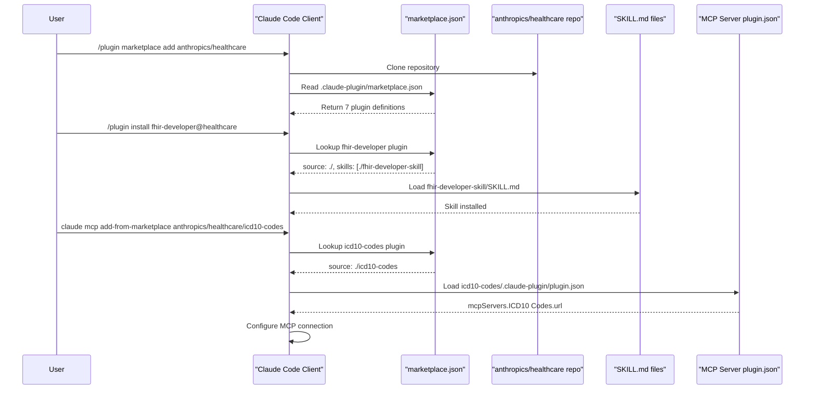
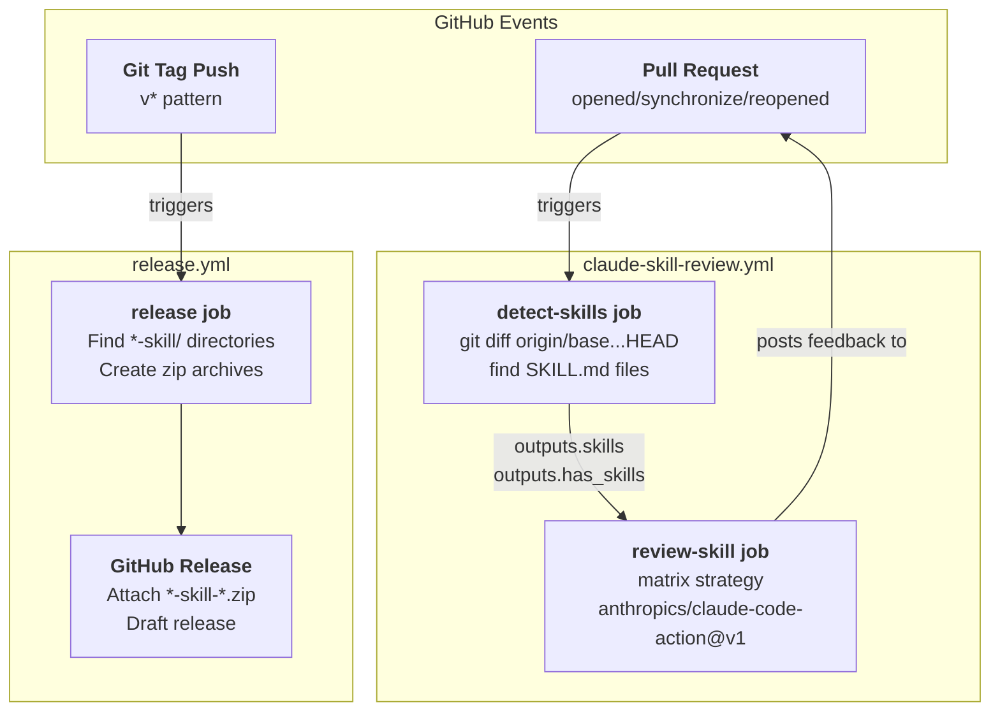

<!-- source: DeepWiki mcp.deepwiki.com · repo anthropics/healthcare · page 1 Healthcare Marketplace Overview · fetched 2026-10-26 -->

# Healthcare Marketplace Overview

<details>
<summary>Relevant source files</summary>

The following files were used as context for generating this wiki page:

- [.claude-plugin/marketplace.json](.claude-plugin/marketplace.json)
- [.github/workflows/claude-skill-review.yml](.github/workflows/claude-skill-review.yml)
- [.github/workflows/release.yml](.github/workflows/release.yml)
- [README.md](README.md)
- [icd10-codes/.claude-plugin/plugin.json](icd10-codes/.claude-plugin/plugin.json)

</details>


## Purpose and Scope

This document provides a high-level introduction to the `anthropics/healthcare` repository, which serves as a Claude Code marketplace containing healthcare-focused Skills and MCP Servers. It covers the repository's architecture, the distinction between Skills and MCP Servers, and how components are discovered and installed.

For detailed information about specific components:
- Marketplace architecture and plugin system: see [Marketplace Architecture](#2)
- Individual healthcare skills: see [Healthcare Skills](#3)
- External data sources: see [MCP Servers and External Data](#4)
- Development workflows: see [CI/CD and Automation](#5)

## What is the Healthcare Marketplace?

The Healthcare Marketplace is a curated collection of Claude Code plugins designed for healthcare workflows. It contains two types of components:

1. **Skills**: AI-powered capabilities that guide Claude through complex healthcare tasks (clinical trial protocol generation, prior authorization review, FHIR API development)
2. **MCP Servers**: External data connectors that provide access to healthcare databases and registries (CMS coverage policies, NPI provider data, PubMed literature, ICD-10 codes)

The marketplace uses a plugin-based architecture where components are registered in a central `marketplace.json` file and can be independently installed and composed to accomplish healthcare workflows.

Sources: [README.md:1-63](), [.claude-plugin/marketplace.json:1-74]()

## Repository Structure

The repository follows a standardized directory layout where each component type has a specific naming convention and structure:



**Directory Naming Conventions:**
- Skills: `*-skill/` directories containing `SKILL.md` files
- MCP Servers: subdirectories with `.claude-plugin/plugin.json` files
- CI/CD: `.github/workflows/` containing GitHub Actions definitions

Sources: [.claude-plugin/marketplace.json:11-73](), [.github/workflows/claude-skill-review.yml:29-30](), [.github/workflows/release.yml:21-29]()

## Marketplace Registry Architecture

The marketplace.json file serves as the single source of truth for all available plugins. It defines metadata and source locations for both Skills and MCP Servers:



**Key Configuration Patterns:**

| Component Type | `source` Field | Implementation | Example |
|---------------|----------------|----------------|---------|
| Skill | `./` (root) | `skills` array with paths | `"skills": ["./clinical-trial-protocol-skill"]` |
| MCP Server | `./subdirectory` | `plugin.json` in subdirectory | `"source": "./icd10-codes"` |

Skills use inline source definitions where the marketplace.json directly specifies skill paths, while MCP Servers use subdirectory sources that contain separate plugin.json files with server URLs.

Sources: [.claude-plugin/marketplace.json:11-73](), [icd10-codes/.claude-plugin/plugin.json:1-15]()

## Component Inventory

The marketplace currently provides 3 Skills and 4 MCP Servers:

### Skills

| Plugin Name | Directory | Purpose | Requirements |
|------------|-----------|---------|--------------|
| `clinical-trial-protocol` | `clinical-trial-protocol-skill/` | Generate FDA/NIH-compliant clinical trial protocols | Python with scipy, numpy |
| `prior-auth-review` | `prior-auth-review-skill/` | Automate payer review of prior authorization requests | None |
| `fhir-developer` | `fhir-developer-skill/` | FHIR R4 API development guide with SMART authorization | None |

### MCP Servers

| Plugin Name | Directory | External URL | Purpose |
|------------|-----------|--------------|---------|
| `cms-coverage` | `cms-coverage/` | `https://mcp.deepsense.ai/cms_coverage/mcp` | Access CMS Coverage Database (LCDs/NCDs) |
| `npi-registry` | `npi-registry/` | `https://mcp.deepsense.ai/npi_registry/mcp` | Access US National Provider Identifier Registry |
| `pubmed` | `pubmed/` | `https://pubmed.mcp.claude.com/mcp` | Search biomedical literature from PubMed |
| `icd10-codes` | `icd10-codes/` | `https://mcp.deepsense.ai/icd10_codes/mcp` | Access ICD-10-CM and ICD-10-PCS code sets |

**Note:** MCP Servers are hosted on external infrastructure (DeepSense.ai and Claude infrastructure) and accessed via HTTPS endpoints defined in their respective `plugin.json` files.

Sources: [.claude-plugin/marketplace.json:11-73](), [README.md:18-58](), [icd10-codes/.claude-plugin/plugin.json:9-14]()

## User Installation Workflow

Users discover and install components through Claude Code commands that interact with the marketplace registry:



**Installation Commands:**

```bash
# Add marketplace to Claude Code
/plugin marketplace add anthropics/healthcare

# Install individual skills
/plugin install clinical-trial-protocol@healthcare
/plugin install prior-auth-review@healthcare
/plugin install fhir-developer@healthcare

# Add MCP servers
claude mcp add-from-marketplace anthropics/healthcare/cms-coverage
claude mcp add-from-marketplace anthropics/healthcare/npi-registry
claude mcp add-from-marketplace anthropics/healthcare/pubmed
claude mcp add-from-marketplace anthropics/healthcare/icd10-codes
```

Sources: [README.md:6-58](), [.claude-plugin/marketplace.json:11-73](), [icd10-codes/.claude-plugin/plugin.json:9-14]()

## Quality Assurance Infrastructure

The repository includes automated CI/CD workflows that ensure skill quality and manage releases:



### Workflow Importance

| Workflow File | Importance Score | Primary Function |
|--------------|------------------|------------------|
| `claude-skill-review.yml` | 49.07 | Detects skill changes and runs Claude-powered reviews on each modified skill |
| `release.yml` | 1.08 | Packages skills into zip files and creates GitHub releases for distribution |

The `detect-skills` job uses git diff to identify changed files and locate `SKILL.md` files ([.github/workflows/claude-skill-review.yml:26-53]()), while the `review-skill` job employs a matrix strategy to parallelize reviews across multiple skills ([.github/workflows/claude-skill-review.yml:55-87]()). The release workflow scans for directories matching the `*-skill/` pattern and creates distributable packages ([.github/workflows/release.yml:18-42]()).

Sources: [.github/workflows/claude-skill-review.yml:1-88](), [.github/workflows/release.yml:1-43]()

## Plugin Categories and Tags

The marketplace organizes plugins using categories and tags for discoverability:

| Plugin | Category | Tags |
|--------|----------|------|
| `clinical-trial-protocol` | healthcare | clinical-trials, fda, protocol, regulatory |
| `prior-auth-review` | healthcare | prior-auth, insurance, medical-necessity, cms |
| `fhir-developer` | healthcare | fhir, hl7, api, interoperability, smart-on-fhir |
| `cms-coverage` | healthcare | medicare, coverage, cms, policy, ncd, lcd |
| `npi-registry` | healthcare | npi, provider, registry, hipaa |
| `pubmed` | healthcare | pubmed, literature, research, medical, pmc |
| `icd10-codes` | healthcare | icd-10, diagnosis, procedure, billing, medical-coding |

All components share the `healthcare` category, with tags providing fine-grained classification for search and filtering.

Sources: [.claude-plugin/marketplace.json:11-73]()

## Getting Started

To begin using the Healthcare Marketplace:

1. **Add the marketplace** to Claude Code to enable discovery of all 7 plugins
2. **Install skills** based on your workflow needs (clinical research, insurance, or API development)
3. **Configure MCP servers** to provide Skills with access to external healthcare data sources
4. **Invoke skills** through Claude Code to execute healthcare workflows

For detailed usage of individual components:
- Skills documentation: see [Healthcare Skills](#3)
- MCP Servers configuration: see [MCP Servers and External Data](#4)
- Contributing new components: see [Developer Guide](#6)

Sources: [README.md:1-63]()

---

