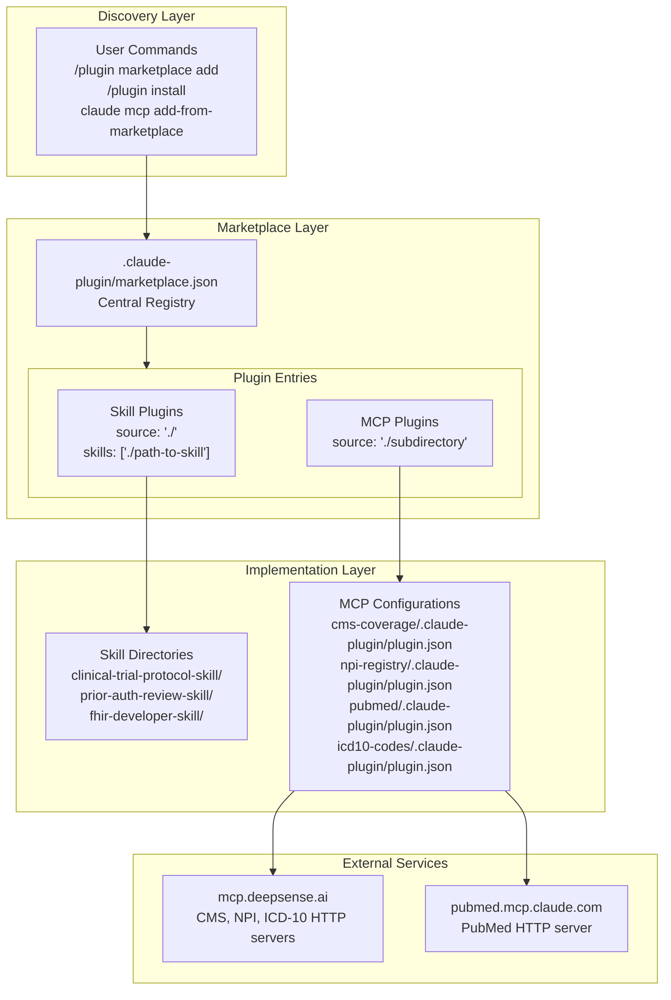
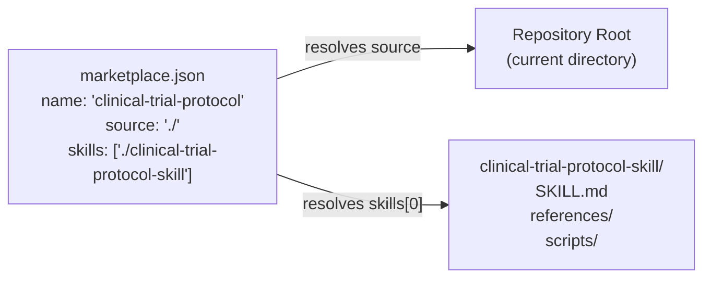
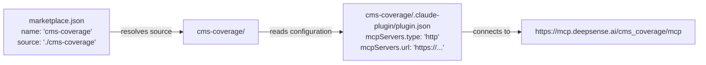
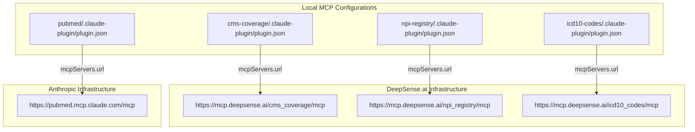
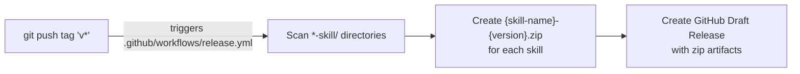

<!-- source: DeepWiki mcp.deepwiki.com · repo anthropics/healthcare · page 2 Marketplace Architecture · fetched 2026-10-26 -->

# Marketplace Architecture

<details>
<summary>Relevant source files</summary>

The following files were used as context for generating this wiki page:

- [.claude-plugin/marketplace.json](.claude-plugin/marketplace.json)
- [.github/workflows/release.yml](.github/workflows/release.yml)
- [README.md](README.md)
- [cms-coverage/.claude-plugin/plugin.json](cms-coverage/.claude-plugin/plugin.json)
- [icd10-codes/.claude-plugin/plugin.json](icd10-codes/.claude-plugin/plugin.json)
- [npi-registry/.claude-plugin/plugin.json](npi-registry/.claude-plugin/plugin.json)
- [pubmed/.claude-plugin/plugin.json](pubmed/.claude-plugin/plugin.json)

</details>


## Purpose and Scope

This document explains the plugin system architecture that enables Skills and MCP Servers to be discovered, installed, and executed within Claude Code. It covers the structure of the marketplace registry, the plugin configuration patterns, and how the system resolves sources during installation.

For details on the distinction between Skills and MCP Servers as plugin types, see [Skills vs MCP Servers](#2.1). For end-user installation commands and workflows, see [Installation and Usage](#2.2).

---

## Plugin System Overview

The Healthcare Marketplace uses a **plugin architecture** where the `.claude-plugin/marketplace.json` file serves as the central registry. This registry catalogs all available plugins (both Skills and MCP Servers) and provides metadata for discovery and installation.

The architecture follows a three-tier model:

1. **Discovery Layer**: User-facing commands (`/plugin marketplace add`, `/plugin install`, `claude mcp add-from-marketplace`)
2. **Marketplace Layer**: Central registry at [`.claude-plugin/marketplace.json:1-74`]()
3. **Implementation Layer**: Actual skill directories and MCP plugin configurations

### Architecture Model



**Sources**: [`.claude-plugin/marketplace.json:1-74`](), [`README.md:7-58`]()

---

## Marketplace Registry Structure

The marketplace registry at `.claude-plugin/marketplace.json` contains three top-level sections:

| Field | Type | Purpose |
|-------|------|---------|
| `name` | string | Marketplace identifier used in commands (e.g., `healthcare`) |
| `owner` | object | Contact information with `name` and `email` fields |
| `metadata` | object | Version and description of the marketplace |
| `plugins` | array | List of all available plugin definitions |

Each plugin entry in the `plugins` array has the following structure:

| Field | Type | Required | Description |
|-------|------|----------|-------------|
| `name` | string | Yes | Plugin identifier used in installation commands |
| `source` | string | Yes | Relative path to plugin implementation |
| `description` | string | Yes | Human-readable description |
| `category` | string | Yes | Classification (e.g., `healthcare`) |
| `tags` | string[] | Yes | Searchable keywords |
| `strict` | boolean | Skills only | Whether strict mode is enabled |
| `skills` | string[] | Skills only | Paths to skill directories |

### Plugin Entry Examples

The registry distinguishes between Skills and MCP Servers through the presence of the `skills` field:

**Skill Plugin Entry** (lines 12-22):
```json
{
  "name": "clinical-trial-protocol",
  "source": "./",
  "skills": ["./clinical-trial-protocol-skill"]
}
```

**MCP Server Plugin Entry** (lines 46-51):
```json
{
  "name": "cms-coverage",
  "source": "./cms-coverage"
}
```

Skills use `source: "./"` (repository root) and specify explicit skill paths in the `skills` array. MCP Servers use `source: "./subdirectory"` and omit the `skills` field, relying on a nested `plugin.json` file.

**Sources**: [`.claude-plugin/marketplace.json:1-74`]()

---

## Source Resolution Patterns

The marketplace implements two distinct source resolution patterns based on plugin type:

### Skill Source Resolution



When installing a skill:
1. The `source` field (typically `"./"`) is resolved relative to `marketplace.json`
2. Each entry in the `skills` array is resolved relative to the source path
3. The skill directory must contain a `SKILL.md` file defining the skill's capabilities

Example from [`.claude-plugin/marketplace.json:12-22`]():
- `name`: `"clinical-trial-protocol"`
- `source`: `"./"` → resolves to repository root
- `skills[0]`: `"./clinical-trial-protocol-skill"` → resolves to `clinical-trial-protocol-skill/` directory

### MCP Source Resolution



When installing an MCP Server:
1. The `source` field points to a subdirectory containing the MCP configuration
2. The system reads `.claude-plugin/plugin.json` within that subdirectory
3. The `plugin.json` specifies the HTTP endpoint for the external MCP server

Example from [`.claude-plugin/marketplace.json:46-51`]() and [`cms-coverage/.claude-plugin/plugin.json:1-15`]():
- Marketplace `source`: `"./cms-coverage"` → resolves to `cms-coverage/` directory
- Plugin config: `cms-coverage/.claude-plugin/plugin.json`
- MCP server URL: `"https://mcp.deepsense.ai/cms_coverage/mcp"`

**Sources**: [`.claude-plugin/marketplace.json:11-73`](), [`cms-coverage/.claude-plugin/plugin.json:1-15`](), [`npi-registry/.claude-plugin/plugin.json:1-15`](), [`pubmed/.claude-plugin/plugin.json:1-15`](), [`icd10-codes/.claude-plugin/plugin.json:1-15`]()

---

## MCP Plugin Configuration

MCP plugins use a separate `plugin.json` file within their source directory. This file follows a standard structure:

| Field | Type | Purpose |
|-------|------|---------|
| `name` | string | Plugin identifier (matches marketplace entry) |
| `version` | string | Semantic version |
| `description` | string | Detailed description of capabilities |
| `author` | object | Provider information (`name`, `url`) |
| `mcpServers` | object | Server definitions keyed by display name |

### MCP Server Definition

Each entry in the `mcpServers` object has:

| Field | Type | Value |
|-------|------|-------|
| `type` | string | Always `"http"` for remote servers |
| `url` | string | Full HTTPS endpoint for the MCP protocol |

### MCP Server Endpoints



The marketplace hosts MCP servers from two external providers:

**DeepSense.ai Servers** (lines 10-12 in respective plugin.json files):
- CMS Coverage: `mcp.deepsense.ai/cms_coverage/mcp`
- NPI Registry: `mcp.deepsense.ai/npi_registry/mcp`
- ICD-10 Codes: `mcp.deepsense.ai/icd10_codes/mcp`

**Anthropic Servers** (lines 10-12 in pubmed plugin.json):
- PubMed: `pubmed.mcp.claude.com/mcp`

**Sources**: [`cms-coverage/.claude-plugin/plugin.json:1-15`](), [`npi-registry/.claude-plugin/plugin.json:1-15`](), [`pubmed/.claude-plugin/plugin.json:1-15`](), [`icd10-codes/.claude-plugin/plugin.json:1-15`]()

---

## Plugin Distribution and Packaging

The release workflow packages skills into distributable zip files when version tags are pushed to the repository.

### Release Workflow



The workflow at [`.github/workflows/release.yml:1-43`]() performs the following steps:

1. **Skill Detection** (lines 20-29): Scans for directories matching `*-skill/` pattern
2. **Packaging** (lines 24-27): Creates zip file for each skill with format `{skill-name}-{tag}.zip`
3. **Release Creation** (lines 35-42): Attaches zip files to a draft GitHub Release

Example packaging logic from [`.github/workflows/release.yml:19-29`]():
```bash
for skill_dir in *-skill/; do
  skill_name="${skill_dir%/}"
  cd "$skill_name"
  zip -r "../${skill_name}-${GITHUB_REF_NAME}.zip" .
  cd ..
done
```

This produces artifacts like:
- `clinical-trial-protocol-skill-v1.0.0.zip`
- `prior-auth-review-skill-v1.0.0.zip`
- `fhir-developer-skill-v1.0.0.zip`

**Sources**: [`.github/workflows/release.yml:1-43`]()

---

## Marketplace Metadata

The marketplace registry includes version metadata and ownership information:

**Version Information** ([`.claude-plugin/marketplace.json:7-9`]()):
- `version`: `"1.0.0"` - Semantic version of the marketplace itself
- `description`: Brief description of the marketplace's purpose

**Owner Information** ([`.claude-plugin/marketplace.json:3-6`]()):
- `name`: `"Anthropic"` - Organization maintaining the marketplace
- `email`: `"support@anthropic.com"` - Support contact

**Marketplace Identifier** ([`.claude-plugin/marketplace.json:2`]()):
- `name`: `"healthcare"` - Used in commands like `/plugin marketplace add anthropics/healthcare`

The full marketplace reference format is `{github_org}/{marketplace_name}`, which resolves to the repository `https://github.com/anthropics/healthcare` and reads the marketplace registry from `.claude-plugin/marketplace.json`.

**Sources**: [`.claude-plugin/marketplace.json:1-10`](), [`README.md:8-9`]()

---

## Summary

The marketplace architecture implements a clear separation of concerns:

- **Marketplace Registry** (`.claude-plugin/marketplace.json`): Central catalog for discovery
- **Skill Plugins**: Self-contained in repository with inline source resolution
- **MCP Plugins**: Pointer configurations to external HTTP services
- **Release Workflow**: Automated packaging of skills into distributable artifacts

This design enables modular plugin distribution where skills are versioned and packaged locally, while MCP servers remain as lightweight configuration wrappers around external data services.

---

