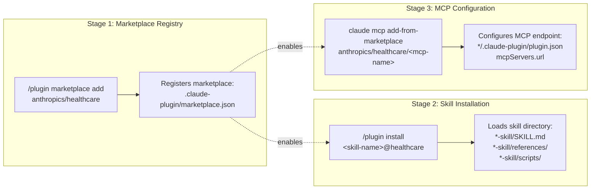
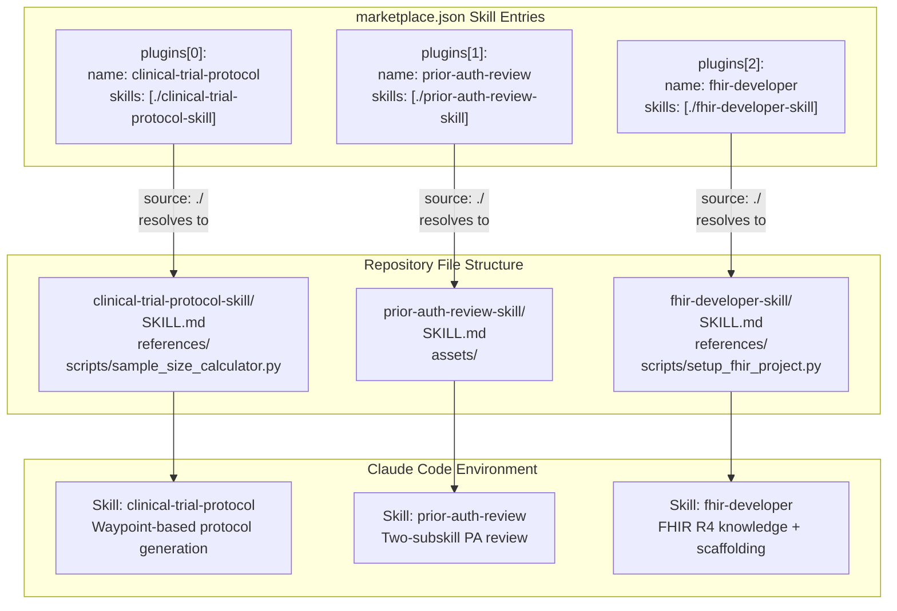
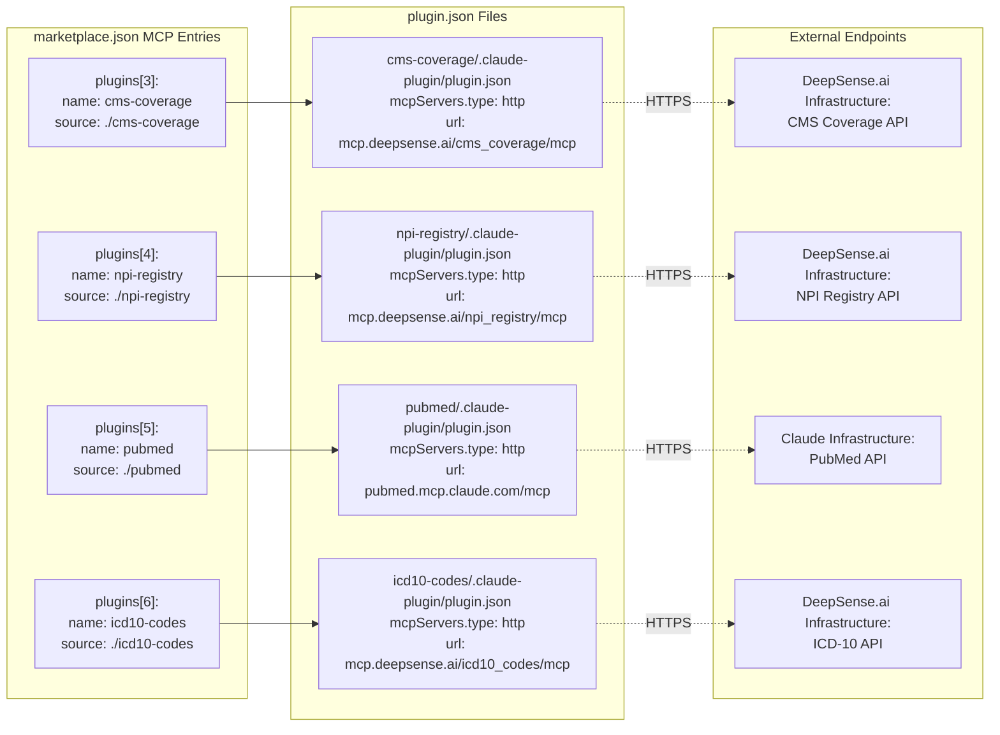

<!-- source: DeepWiki mcp.deepwiki.com · repo anthropics/healthcare · page 2.2 Installation and Usage · fetched 2026-10-26 -->

# Installation and Usage

<details>
<summary>Relevant source files</summary>

The following files were used as context for generating this wiki page:

- [.claude-plugin/marketplace.json](.claude-plugin/marketplace.json)
- [.github/workflows/release.yml](.github/workflows/release.yml)
- [README.md](README.md)
- [icd10-codes/.claude-plugin/plugin.json](icd10-codes/.claude-plugin/plugin.json)

</details>


This document explains the commands and workflows for installing and using the Healthcare Marketplace in Claude Code. It covers adding the marketplace registry, installing skills, and configuring MCP servers.

For the distinction between Skills and MCP Servers, see [Skills vs MCP Servers](#2.1). For detailed documentation of individual skills, see [Healthcare Skills](#3). For MCP server specifics, see [MCP Servers and External Data](#4).

---

## Installation Overview

The Healthcare Marketplace follows a three-stage installation pattern: (1) add the marketplace registry, (2) install skills, and (3) configure MCP servers. Each stage uses distinct commands and modifies different parts of the Claude Code environment.



**Installation Flow Stages**

Sources: [README.md:7-58](), [.claude-plugin/marketplace.json:1-74]()

---

## Adding the Marketplace

The marketplace must be registered before any skills or MCP servers can be installed. This command downloads the marketplace registry from the repository.

```bash
/plugin marketplace add anthropics/healthcare
```

This command:
- Fetches [.claude-plugin/marketplace.json:1-74]() from the `anthropics/healthcare` repository
- Registers seven plugins: three skills and four MCP servers
- Makes the `@healthcare` namespace available for plugin installation

The marketplace registry defines all available plugins with their metadata:

| Plugin Name | Type | Description | Plugin ID |
|------------|------|-------------|-----------|
| `clinical-trial-protocol` | Skill | FDA/NIH-compliant clinical trial protocols | `clinical-trial-protocol@healthcare` |
| `prior-auth-review` | Skill | Prior authorization request review | `prior-auth-review@healthcare` |
| `fhir-developer` | Skill | FHIR R4 API development guide | `fhir-developer@healthcare` |
| `cms-coverage` | MCP | CMS Coverage Database access | `anthropics/healthcare/cms-coverage` |
| `npi-registry` | MCP | National Provider Identifier lookup | `anthropics/healthcare/npi-registry` |
| `pubmed` | MCP | PubMed biomedical literature search | `anthropics/healthcare/pubmed` |
| `icd10-codes` | MCP | ICD-10-CM/PCS code lookups | `anthropics/healthcare/icd10-codes` |

Sources: [.claude-plugin/marketplace.json:11-73](), [README.md:7-9]()

---

## Installing Skills

Skills are installed individually using the `/plugin install` command with the skill's plugin ID and marketplace namespace.

### Syntax

```bash
/plugin install <skill-name>@healthcare
```

The `@healthcare` suffix references the marketplace added in the previous step. The `<skill-name>` must match one of the skill plugin names in [.claude-plugin/marketplace.json:13-43]().

### Available Skills

```bash
# Install FHIR Developer skill
/plugin install fhir-developer@healthcare

# Install Prior Authorization Review skill
/plugin install prior-auth-review@healthcare

# Install Clinical Trial Protocol Generator skill
/plugin install clinical-trial-protocol@healthcare
```

### Skill Installation Mapping



**Skill Installation File Resolution**

The `source: ./` field in [.claude-plugin/marketplace.json:14]() indicates skills are located at the repository root. The `skills` array ([.claude-plugin/marketplace.json:19-21]()) specifies the relative path to each skill directory.

Sources: [.claude-plugin/marketplace.json:11-43](), [README.md:10-15]()

---

## Configuring MCP Servers

MCP servers provide external data access and must be configured separately using the `claude mcp` command. Unlike skills, MCP servers connect to HTTP endpoints rather than loading local code.

### Syntax

```bash
claude mcp add-from-marketplace anthropics/healthcare/<mcp-name>
```

### Available MCP Servers

```bash
# CMS Coverage Database
claude mcp add-from-marketplace anthropics/healthcare/cms-coverage

# NPI Registry
claude mcp add-from-marketplace anthropics/healthcare/npi-registry

# PubMed Literature
claude mcp add-from-marketplace anthropics/healthcare/pubmed

# ICD-10 Codes
claude mcp add-from-marketplace anthropics/healthcare/icd10-codes
```

### MCP Server Configuration Structure



**MCP Server Configuration Resolution**

MCP entries in [.claude-plugin/marketplace.json:45-73]() use subdirectory sources (e.g., `./cms-coverage`). Each subdirectory contains a `plugin.json` file that specifies the HTTP endpoint. For example, [icd10-codes/.claude-plugin/plugin.json:9-14]() defines the `mcpServers` object with `type: http` and the external URL.

Sources: [.claude-plugin/marketplace.json:45-73](), [icd10-codes/.claude-plugin/plugin.json:1-15](), [README.md:52-58]()

---

## MCP Server Endpoints Reference

| MCP Name | Provider | Endpoint URL | Purpose |
|----------|----------|--------------|---------|
| `cms-coverage` | DeepSense.ai | `https://mcp.deepsense.ai/cms_coverage/mcp` | Medicare Local/National Coverage Determinations |
| `npi-registry` | DeepSense.ai | `https://mcp.deepsense.ai/npi_registry/mcp` | Healthcare provider validation |
| `pubmed` | Claude Infrastructure | `https://pubmed.mcp.claude.com/mcp` | Biomedical literature search |
| `icd10-codes` | DeepSense.ai | `https://mcp.deepsense.ai/icd10_codes/mcp` | Diagnosis/procedure code lookups |

Sources: [README.md:46-51](), [icd10-codes/.claude-plugin/plugin.json:9-14]()

---

## Skill Requirements

Some skills have external dependencies that must be installed separately:

| Skill | Requirements | Installation |
|-------|--------------|--------------|
| `fhir-developer` | None | No additional setup |
| `prior-auth-review` | None | No additional setup |
| `clinical-trial-protocol` | Python with `scipy` and `numpy` | `pip install scipy numpy` |

The Clinical Trial Protocol Generator requires Python dependencies for the sample size calculator script ([clinical-trial-protocol-skill/scripts/sample_size_calculator.py]()). See [Sample Size Calculator](#3.1.2) for details.

Sources: [README.md:19-42]()

---

## Complete Installation Example

Below is a complete workflow for installing the marketplace, all skills, and all MCP servers:

```bash
# Step 1: Add marketplace
/plugin marketplace add anthropics/healthcare

# Step 2: Install all skills
/plugin install fhir-developer@healthcare
/plugin install prior-auth-review@healthcare
/plugin install clinical-trial-protocol@healthcare

# Step 3: Configure all MCP servers
claude mcp add-from-marketplace anthropics/healthcare/cms-coverage
claude mcp add-from-marketplace anthropics/healthcare/npi-registry
claude mcp add-from-marketplace anthropics/healthcare/pubmed
claude mcp add-from-marketplace anthropics/healthcare/icd10-codes

# Step 4: Install Python dependencies for Clinical Trial Protocol
pip install scipy numpy
```

Sources: [README.md:7-58]()

---

## Verification

After installation, skills appear in Claude Code's skill menu and can be invoked during conversations. MCP servers appear in the MCP server list and are accessible via tool calls.

To verify skill installation:
- Check that skill names appear in the `/plugin list` output
- Attempt to invoke a skill during a conversation

To verify MCP configuration:
- Check that MCP servers appear in the MCP server list
- Skills that depend on MCP servers (e.g., Prior Authorization Review using `cms-coverage`) should function correctly

Sources: [README.md:7-58]()

---

## Uninstallation

Skills can be removed using:
```bash
/plugin uninstall <skill-name>@healthcare
```

MCP servers can be removed using:
```bash
claude mcp remove <mcp-name>
```

The marketplace itself can be removed using:
```bash
/plugin marketplace remove anthropics/healthcare
```

Note: Removing the marketplace does not automatically uninstall skills or MCP servers that were already installed from it.

Sources: [README.md:7-58]()

---

