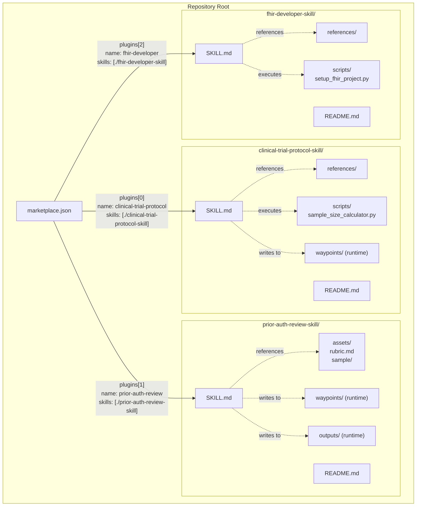
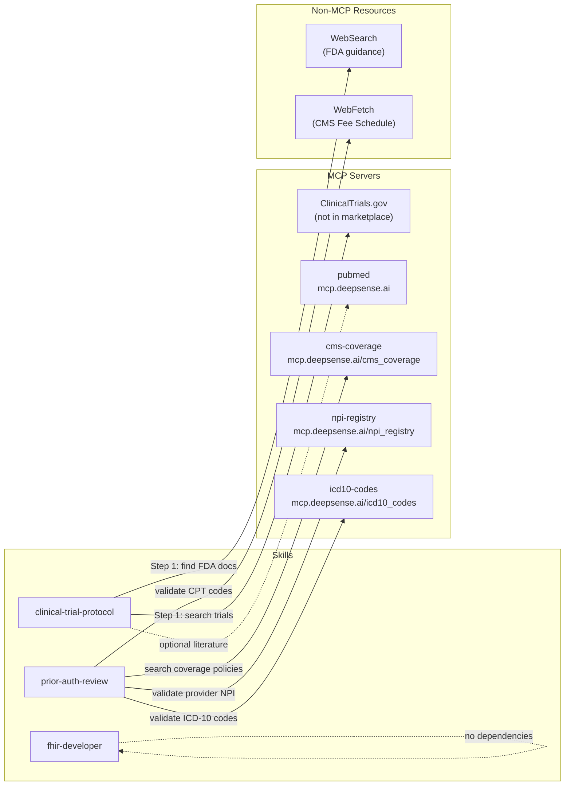

<!-- source: DeepWiki mcp.deepwiki.com · repo anthropics/healthcare · page 3 Healthcare Skills · fetched 2026-10-26 -->

# Healthcare Skills

<details>
<summary>Relevant source files</summary>

The following files were used as context for generating this wiki page:

- [.claude-plugin/marketplace.json](.claude-plugin/marketplace.json)
- [.github/workflows/release.yml](.github/workflows/release.yml)
- [README.md](README.md)
- [clinical-trial-protocol-skill/README.md](clinical-trial-protocol-skill/README.md)
- [icd10-codes/.claude-plugin/plugin.json](icd10-codes/.claude-plugin/plugin.json)
- [prior-auth-review-skill/README.md](prior-auth-review-skill/README.md)

</details>


## Purpose and Scope

This document provides an overview of the three healthcare skills available in the marketplace: Clinical Trial Protocol Generator, Prior Authorization Review, and FHIR Developer Guide. It explains their respective domains, architectural patterns, and when to use each skill.

For detailed information about the marketplace architecture and installation procedures, see [Marketplace Architecture](#2). For comprehensive documentation of each individual skill's workflow and features, see subsections [Clinical Trial Protocol Generator](#3.1), [Prior Authorization Review](#3.2), and [FHIR Developer Guide](#3.3). For information about the external data sources these skills use, see [MCP Servers and External Data](#4).

## What are Skills?

Skills are Claude AI capabilities that provide specialized domain knowledge and workflow automation. Unlike MCP Servers (which provide external data access), skills embed instructions, reference materials, and multi-step workflows directly into Claude's context. Each skill is:

- **Self-contained**: Contains all necessary instructions, templates, and reference materials in its directory
- **Declarative**: Defined by a `SKILL.md` file that Claude reads to understand capabilities
- **Composable**: Can invoke MCP servers for external data access
- **Version-controlled**: Distributed as packaged artifacts via GitHub releases

Skills are registered in [.claude-plugin/marketplace.json:11-44]() and installed using `/plugin install <skill-name>@healthcare` commands.

**Sources:** [.claude-plugin/marketplace.json:1-74](), [README.md:1-63]()

## The Three Healthcare Skills

### Clinical Trial Protocol Generator

**Plugin ID:** `clinical-trial-protocol@healthcare`

**Domain:** Clinical research and regulatory affairs

**Use Case:** Generate FDA/NIH-compliant clinical trial protocols for medical devices (IDE pathway) or drugs (IND pathway). Supports Phase 2 and Phase 3 trials with statistical power analysis and research-driven protocol development.

**Architecture:** Waypoint-based pipeline with 6 sequential steps (00-initialize through 05-generate)

**Dependencies:** Python with `scipy` and `numpy`, ClinicalTrials.gov MCP Server, WebSearch

**Sources:** [README.md:37-42](), [clinical-trial-protocol-skill/README.md:1-55](), [.claude-plugin/marketplace.json:12-22]()

### Prior Authorization Review

**Plugin ID:** `prior-auth-review@healthcare`

**Domain:** Insurance and medical billing

**Use Case:** Automate health insurance payer review of prior authorization requests. Validates medical necessity against coverage policies and generates draft authorization decisions for human review.

**Architecture:** Two-subskill pattern with mandatory human decision gates between assessment and finalization

**Dependencies:** NPI Registry MCP, ICD-10 Codes MCP, CMS Coverage MCP, WebFetch for CPT code validation

**Sources:** [README.md:28-34](), [prior-auth-review-skill/README.md:1-78](), [.claude-plugin/marketplace.json:23-33]()

### FHIR Developer Guide

**Plugin ID:** `fhir-developer@healthcare`

**Domain:** Healthcare interoperability and API development

**Use Case:** Build FHIR R4-compliant healthcare APIs with specialized knowledge of resource structures, coding systems (LOINC, SNOMED CT, RxNorm), SMART on FHIR authorization, and validation patterns.

**Architecture:** Knowledge base with reference materials and a Python scaffolding tool (`setup_fhir_project.py`)

**Dependencies:** None (self-contained knowledge base)

**Sources:** [README.md:19-25](), [.claude-plugin/marketplace.json:34-44]()

## Skill Directory Structure and Registration

The following diagram shows how skill directories map to marketplace registry entries and their key files:



Each skill directory contains:
- `SKILL.md`: Primary instruction file that Claude reads
- `README.md`: Human-readable documentation
- `references/` or `assets/`: Supporting materials (templates, guidance documents, sample data)
- `scripts/`: Python utilities for statistical calculations or code generation
- Runtime directories: `waypoints/`, `outputs/` created during skill execution

**Sources:** [.claude-plugin/marketplace.json:11-44](), [clinical-trial-protocol-skill/README.md:37-44](), [prior-auth-review-skill/README.md:27-66]()

## Skill-to-MCP Dependencies

The following diagram maps each skill to its external data dependencies via MCP servers:



**Dependency Patterns:**

| Skill | Required MCPs | Optional MCPs | Non-MCP Resources |
|-------|---------------|---------------|-------------------|
| `clinical-trial-protocol` | ClinicalTrials.gov | `pubmed` | WebSearch (FDA) |
| `prior-auth-review` | `npi-registry`, `icd10-codes`, `cms-coverage` | `pubmed` | WebFetch (CPT) |
| `fhir-developer` | None | None | None |

The Clinical Trial Protocol skill requires ClinicalTrials.gov data but this MCP server is not included in the marketplace (accessed via alternative methods). The Prior Authorization Review skill is the most MCP-dependent, requiring three separate external data sources. The FHIR Developer skill is entirely self-contained with no external dependencies.

**Sources:** [clinical-trial-protocol-skill/README.md:48-50](), [prior-auth-review-skill/README.md:33-37](), [README.md:44-58]()

## Domain-Specific Characteristics

### Clinical Research Domain

**Workflow Model:** Sequential waypoint pipeline

The Clinical Trial Protocol Generator uses a stateful, resumable workflow where each step produces a waypoint file that subsequent steps consume. This enables:
- Token efficiency by breaking large protocol generation into manageable chunks
- Resumption from any step if interrupted
- Iterative refinement of individual sections

**Key Files:**
- `waypoints/intervention_metadata.json` (Step 0 output)
- `waypoints/01_clinical_research_summary.json` (Step 1 output)
- `waypoints/02_protocol_foundation.md` through `04_protocol_operations.md` (Steps 2-4)
- `outputs/protocol_complete.md` (Step 5 final output)

**Sources:** [clinical-trial-protocol-skill/README.md:36-44]()

### Insurance/Billing Domain

**Workflow Model:** Two-phase with human oversight

The Prior Authorization Review skill separates automated assessment from final decision-making, ensuring human professionals retain control over authorization determinations:

**Subskill 1 (Intake & Assessment):**
- Automated validation and policy matching
- Generates `waypoints/assessment.json` with APPROVE or PEND recommendation
- Never recommends DENY (configurable in `assets/rubric.md`)

**Subskill 2 (Decision & Notification):**
- Loads assessment from Subskill 1
- Requires explicit human confirmation, rejection, or override
- Generates `waypoints/decision.json` and `outputs/notification_letter.txt`

**Human Decision Gates:**
1. After assessment generation (between subskills)
2. During decision finalization (within Subskill 2)

**Sources:** [prior-auth-review-skill/README.md:27-66]()

### Interoperability Domain

**Workflow Model:** Reference-based consultation

The FHIR Developer Guide skill provides on-demand expertise rather than executing a predefined workflow. It contains:
- FHIR R4 resource structure specifications
- Coding system knowledge (LOINC, SNOMED CT, RxNorm, ICD-10)
- SMART on FHIR OAuth 2.0 patterns
- RESTful API patterns and validation rules
- `scripts/setup_fhir_project.py` for FastAPI project scaffolding

Unlike the other skills, FHIR Developer does not produce waypoint files or follow a step-based process. It augments Claude's general coding capabilities with healthcare-specific API knowledge.

**Sources:** [README.md:19-25]()

## Skill Comparison Matrix

| Dimension | Clinical Trial Protocol | Prior Authorization Review | FHIR Developer Guide |
|-----------|------------------------|---------------------------|---------------------|
| **Primary Users** | Clinical researchers, regulatory affairs | Health insurance payers, medical reviewers | Software engineers, API developers |
| **Output Type** | Protocol document (Markdown) | Assessment + decision records (JSON), notification letter (text) | Code (Python/FastAPI), guidance |
| **Execution Pattern** | Sequential pipeline | Two-phase with decision gate | Interactive consultation |
| **State Management** | Waypoint files, resumable | Waypoint files, requires progression | Stateless |
| **Human Interaction** | Optional (can review at any step) | Required (mandatory decision confirmation) | Continuous (developer-guided) |
| **External Data** | ClinicalTrials.gov, FDA guidance, optional PubMed | NPI, ICD-10, CMS coverage, CPT codes | None |
| **Python Requirements** | Yes (`scipy`, `numpy`) | No | No (generates Python code) |
| **Disclaimers** | FDA/IRB approval required | Human review required, draft only | None (general development guidance) |
| **Regulatory Scope** | FDA IDE/IND pathways | Medicare LCDs/NCDs | HL7 FHIR R4 specification |

**Sources:** [clinical-trial-protocol-skill/README.md:1-55](), [prior-auth-review-skill/README.md:1-78](), [README.md:19-42]()

## Installation and Activation

All three skills are installed using the same command pattern:

```bash
# Install individual skills
/plugin install clinical-trial-protocol@healthcare
/plugin install prior-auth-review@healthcare
/plugin install fhir-developer@healthcare
```

Installation requires prior marketplace registration:

```bash
/plugin marketplace add anthropics/healthcare
```

Once installed, skills are automatically available to Claude. No explicit activation command is needed. Claude determines when to use each skill based on user requests and the skill's declared capabilities in its `SKILL.md` file.

For skills with MCP dependencies, users must separately install the required MCP servers using:

```bash
claude mcp add-from-marketplace anthropics/healthcare/<mcp-name>
```

See [Installation and Usage](#2.2) for complete installation workflows.

**Sources:** [README.md:7-15](), [README.md:52-58]()

---

