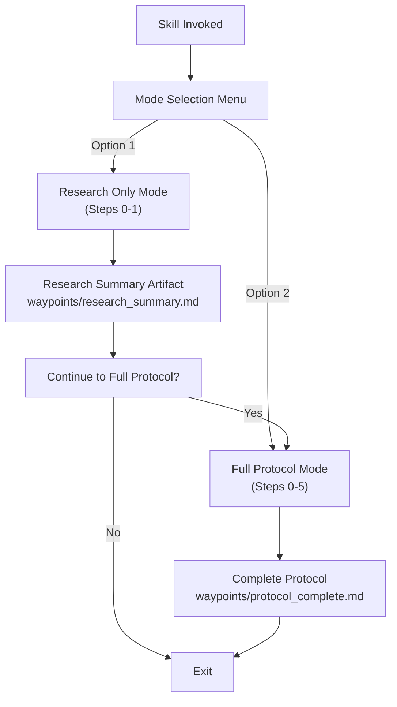
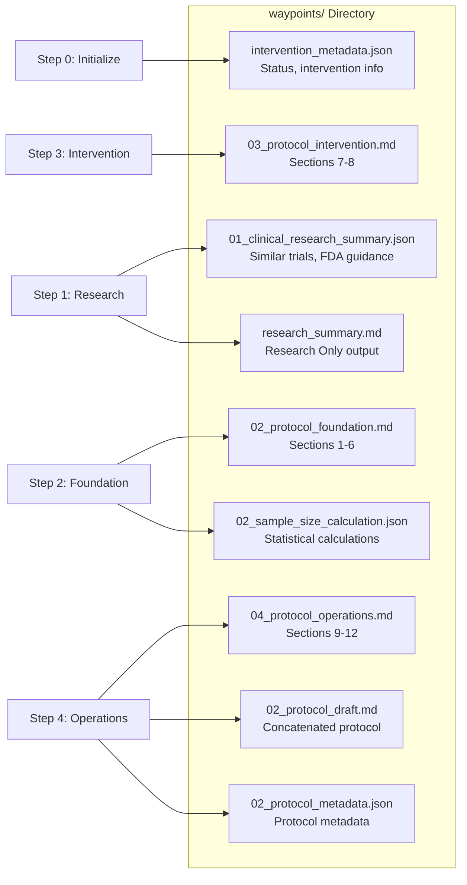
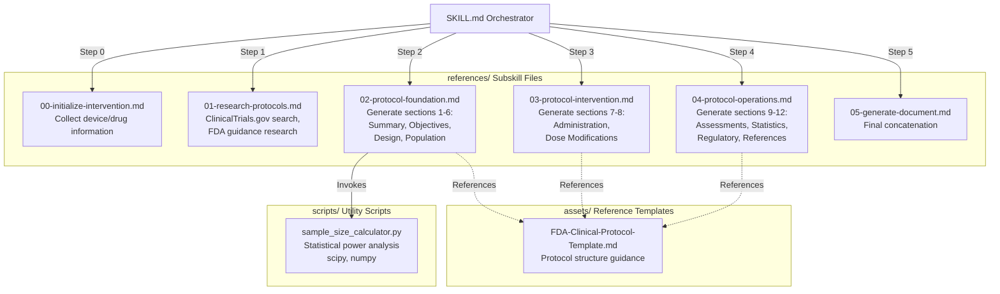
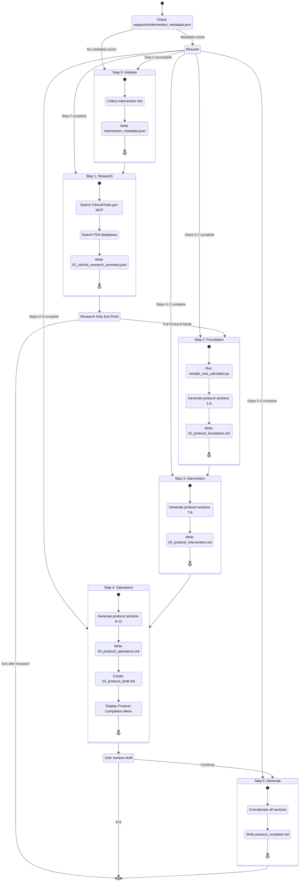
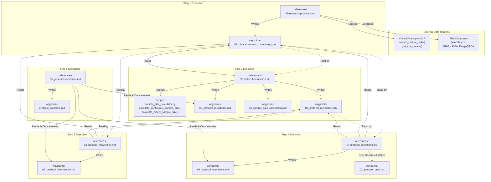
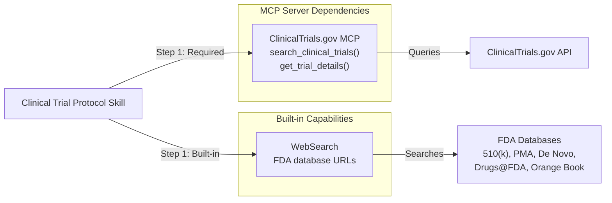
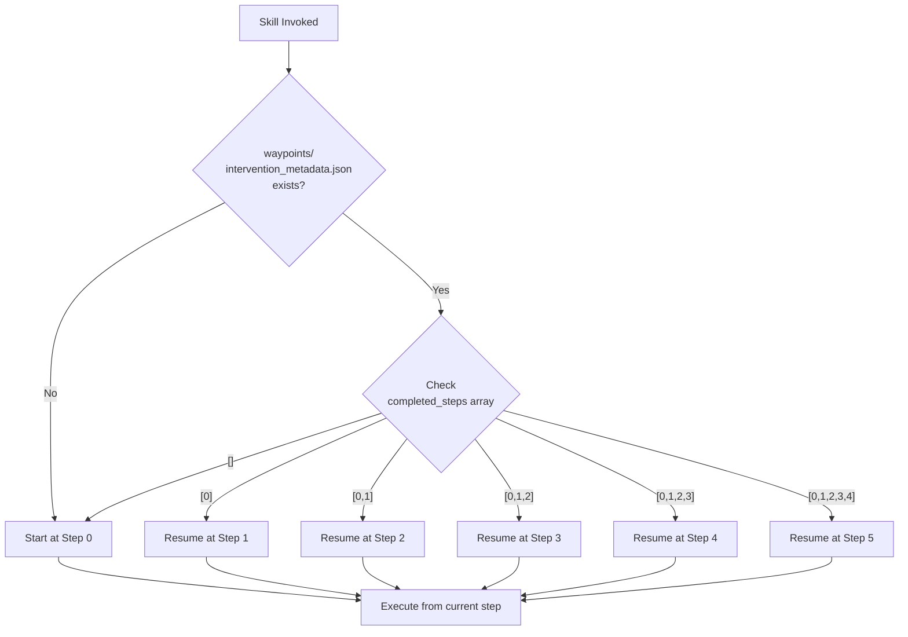
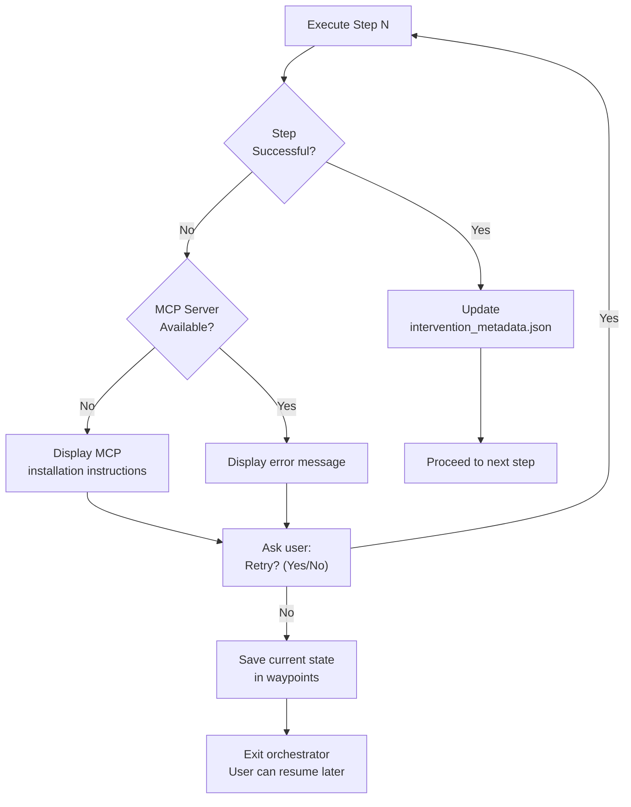

<!-- source: DeepWiki mcp.deepwiki.com · repo anthropics/healthcare · page 3.1 Clinical Trial Protocol Generator · fetched 2026-10-26 -->

# Clinical Trial Protocol Generator

<details>
<summary>Relevant source files</summary>

The following files were used as context for generating this wiki page:

- [.github/workflows/release.yml](.github/workflows/release.yml)
- [README.md](README.md)
- [clinical-trial-protocol-skill/README.md](clinical-trial-protocol-skill/README.md)
- [clinical-trial-protocol-skill/SKILL.md](clinical-trial-protocol-skill/SKILL.md)
- [clinical-trial-protocol-skill/scripts/sample_size_calculator.py](clinical-trial-protocol-skill/scripts/sample_size_calculator.py)
- [prior-auth-review-skill/README.md](prior-auth-review-skill/README.md)

</details>


## Purpose and Scope

This document describes the Clinical Trial Protocol Generator skill, a Claude Code capability that generates FDA/NIH-compliant clinical trial protocols for medical devices and drugs. The skill uses a modular, waypoint-based architecture to produce comprehensive protocol documents through six sequential steps, from intervention initialization through final protocol generation.

This page covers the skill's architecture, workflow execution, file structure, and technical implementation details. For information about how to install and use this skill, see [Installation and Usage](#2.2). For details on the automated review of this skill during development, see [Skill Review Workflow](#5.1).

**Sources:** [clinical-trial-protocol-skill/README.md:1-55](), [clinical-trial-protocol-skill/SKILL.md:1-22]()

## Overview

The Clinical Trial Protocol Generator produces preliminary clinical trial protocols based on NIH/FDA guidelines and similar trial research. It supports both medical device (IDE pathway) and drug (IND pathway) protocols with appropriate regulatory terminology.

**Target Users:** Clinical researchers, regulatory affairs professionals, protocol writers

**Key Capabilities:**
- **Device & Drug Support:** Handles both medical devices (IDE) and investigational drugs (IND)
- **Token Efficiency:** Modular protocol development to manage output limits
- **Resume from Any Step:** Interrupted workflows continue from last completed waypoint
- **Sample Size Calculation:** Statistical power analysis via Python script
- **Research-Driven:** Leverages ClinicalTrials.gov MCP and FDA guidance documents

**Important Disclaimers:** This tool generates preliminary protocols only. Professional biostatistician review, FDA Pre-Submission meetings, IRB approval, and legal review are required before proceeding with clinical studies.

**Sources:** [clinical-trial-protocol-skill/README.md:6-25](), [clinical-trial-protocol-skill/SKILL.md:22-28]()

## Architecture Overview

### Execution Modes

The skill operates in two distinct modes controlled at startup:



**Diagram: Execution Mode Decision Flow**

**Sources:** [clinical-trial-protocol-skill/SKILL.md:156-194](), [clinical-trial-protocol-skill/SKILL.md:196-300]()

### Waypoint-Based Design

All workflow state is persisted in the `waypoints/` directory as JSON and Markdown files. This enables resumability and step independence.



**Diagram: Waypoint File Creation by Step**

**Sources:** [clinical-trial-protocol-skill/SKILL.md:46-59](), [clinical-trial-protocol-skill/SKILL.md:383-397]()

## Modular Subskill Architecture

Each workflow step is implemented as an independent subskill in the `references/` directory. Subskills are loaded on-demand only when their step executes, minimizing context usage.



**Diagram: Modular Subskill Components and Dependencies**

The orchestrator in `SKILL.md` implements a lazy loading strategy where subskill files are read only when their step is ready to execute, not in advance.

**Sources:** [clinical-trial-protocol-skill/SKILL.md:64-76](), [clinical-trial-protocol-skill/SKILL.md:78-84](), [clinical-trial-protocol-skill/SKILL.md:316-324]()

## Workflow Steps

### Step Execution Pipeline



**Diagram: Complete Workflow State Machine**

**Sources:** [clinical-trial-protocol-skill/SKILL.md:303-369](), [clinical-trial-protocol-skill/README.md:36-44]()

### Step-by-Step Breakdown

| Step | Name | Description | Input Waypoints | Output Waypoints | Script Dependencies |
|------|------|-------------|-----------------|------------------|---------------------|
| 0 | Initialize | Collect device/drug information, indication, initial context | None | `intervention_metadata.json` | None |
| 1 | Research | Search similar trials, find FDA guidance | `intervention_metadata.json` | `01_clinical_research_summary.json`, `research_summary.md` (Research Only mode) | None |
| 2 | Foundation | Generate protocol sections 1-6 (Summary, Objectives, Design, Population) | `intervention_metadata.json`, `01_clinical_research_summary.json` | `02_protocol_foundation.md`, `02_sample_size_calculation.json`, `02_protocol_metadata.json` | `sample_size_calculator.py` |
| 3 | Intervention | Generate protocol sections 7-8 (Administration, Dose Modifications) | `intervention_metadata.json`, `01_clinical_research_summary.json`, `02_protocol_metadata.json` | `03_protocol_intervention.md` | None |
| 4 | Operations | Generate protocol sections 9-12 (Assessments, Statistics, Regulatory) | All previous waypoints | `04_protocol_operations.md`, `02_protocol_draft.md` (concatenated) | None |
| 5 | Generate | Create final professional protocol document | All protocol section files | `protocol_complete.md` | None |

**Sources:** [clinical-trial-protocol-skill/SKILL.md:64-76](), [clinical-trial-protocol-skill/README.md:36-44]()

## File Structure and Code Mapping

### Directory Layout

```
clinical-trial-protocol-skill/
├── SKILL.md                           # Main orchestrator (execution control)
├── README.md                          # User-facing documentation
├── requirements.txt                   # Python dependencies (scipy, numpy)
├── references/                        # Subskill implementation files
│   ├── 00-initialize-intervention.md
│   ├── 01-research-protocols.md
│   ├── 02-protocol-foundation.md
│   ├── 03-protocol-intervention.md
│   ├── 04-protocol-operations.md
│   └── 05-generate-document.md
├── scripts/                           # Utility scripts
│   └── sample_size_calculator.py      # Statistical power calculations
├── assets/                            # Reference templates
│   └── FDA-Clinical-Protocol-Template.md
└── waypoints/                         # Runtime state (user-created)
    ├── intervention_metadata.json
    ├── 01_clinical_research_summary.json
    ├── 02_protocol_foundation.md
    ├── 03_protocol_intervention.md
    ├── 04_protocol_operations.md
    ├── 02_protocol_draft.md
    ├── 02_protocol_metadata.json
    ├── 02_sample_size_calculation.json
    ├── research_summary.md
    └── protocol_complete.md
```

**Sources:** [clinical-trial-protocol-skill/SKILL.md:46-84]()

### Data Flow Between Components



**Diagram: Data Flow and Component Dependencies**

**Sources:** [clinical-trial-protocol-skill/SKILL.md:86-122](), [clinical-trial-protocol-skill/SKILL.md:316-324]()

## Statistical Sample Size Calculator

The `sample_size_calculator.py` script provides validated statistical power calculations for clinical trials.

### Supported Calculations

| Endpoint Type | Statistical Test | Functions |
|---------------|------------------|-----------|
| **Continuous** | Two-sample t-test | `calculate_continuous_sample_size()` |
| **Binary** | Two-proportion z-test | `calculate_binary_sample_size()` |

**Sources:** [clinical-trial-protocol-skill/scripts/sample_size_calculator.py:1-162]()

### Script Interface

The calculator is invoked as a Python subprocess from Step 2:

```bash
python scripts/sample_size_calculator.py \
  --type continuous \
  --effect-size 5.0 \
  --std-dev 15.0 \
  --alpha 0.05 \
  --power 0.80 \
  --dropout 0.15 \
  --allocation 1.0 \
  --design superiority \
  --output waypoints/02_sample_size_calculation.json
```

**Parameters:**
- `--type`: `continuous` or `binary`
- `--effect-size`: Expected mean difference (continuous endpoints)
- `--std-dev`: Standard deviation (continuous endpoints)
- `--p1`, `--p2`: Expected proportions (binary endpoints)
- `--alpha`: Type I error rate (default: 0.05)
- `--power`: Statistical power (default: 0.80)
- `--dropout`: Expected dropout rate (default: 0.15)
- `--allocation`: Treatment:control ratio (default: 1.0 for equal allocation)
- `--design`: `superiority` or `non-inferiority`

**Sources:** [clinical-trial-protocol-skill/scripts/sample_size_calculator.py:324-409]()

### Output Format

The script outputs structured JSON:

```json
{
  "endpoint_type": "continuous",
  "study_design": "superiority",
  "statistical_test": "Two-sample t-test (two-sided)",
  "effect_size": 5.0,
  "standard_deviation": 15.0,
  "cohens_d": 0.333,
  "alpha": 0.05,
  "power": 0.80,
  "allocation_ratio": "1:1",
  "dropout_rate": 0.15,
  "sample_size": {
    "treatment_arm": 142,
    "control_arm": 142,
    "total": 284,
    "total_with_dropout": 335,
    "treatment_with_dropout": 168,
    "control_with_dropout": 168
  },
  "sensitivity_analysis": {
    "power_90_percent": { "total": 358, "total_with_dropout": 422 },
    "effect_size_reduced_10_percent": { "total": 350, "total_with_dropout": 412 }
  },
  "assumptions": [...],
  "disclaimers": [...]
}
```

**Sources:** [clinical-trial-protocol-skill/scripts/sample_size_calculator.py:120-161](), [clinical-trial-protocol-skill/scripts/sample_size_calculator.py:280-321]()

### Statistical Methods

#### Continuous Endpoints

The continuous sample size calculation [clinical-trial-protocol-skill/scripts/sample_size_calculator.py:16-161]() uses the two-sample t-test power formula:

- **Cohen's d**: `effect_size / std_dev`
- **Equal allocation**: `n = 2 * (z_alpha + z_beta)^2 / d^2`
- **Unequal allocation**: `n = ((1 + 1/r)^2) * ((z_alpha + z_beta)^2) / d^2`

Where:
- `z_alpha`: Z-score for Type I error (two-sided: `alpha/2`, one-sided: `alpha`)
- `z_beta`: Z-score for power (`1 - beta`)
- `r`: Allocation ratio (treatment:control)

#### Binary Endpoints

The binary sample size calculation [clinical-trial-protocol-skill/scripts/sample_size_calculator.py:164-321]() uses the two-proportion z-test:

- **Pooled proportion**: `p_pooled = (p1 + r*p2) / (1 + r)`
- **Effect size**: `|p2 - p1|`
- **Sample size**: `n = [z_alpha * sqrt(p_pooled*(1-p_pooled)*(1+1/r)) + z_beta * sqrt(p1*(1-p1)/r + p2*(1-p2))]^2 / (p2-p1)^2`

**Sources:** [clinical-trial-protocol-skill/scripts/sample_size_calculator.py:16-321]()

## Dependencies and Prerequisites

### Required MCP Servers



**Diagram: External Dependencies**

**Installation:**
```bash
# Install ClinicalTrials.gov MCP via drag-and-drop of .mcpb file
# or configure manually in Claude Desktop settings
```

**Verification:** Step 1 automatically tests MCP connectivity at startup.

**Sources:** [clinical-trial-protocol-skill/SKILL.md:86-107](), [clinical-trial-protocol-skill/SKILL.md:109-115]()

### Python Dependencies

The skill requires Python with statistical computing libraries:

**Installation:**
```bash
pip install -r requirements.txt
```

**Required packages:**
- `scipy >= 1.11.0` - Statistical calculations (power analysis, t-tests, z-tests)
- `numpy >= 1.24.0` - Numerical operations

These dependencies are checked by the sample size calculator [clinical-trial-protocol-skill/scripts/sample_size_calculator.py:42-47]() and [clinical-trial-protocol-skill/scripts/sample_size_calculator.py:190-195]().

**Sources:** [clinical-trial-protocol-skill/SKILL.md:123-135](), [clinical-trial-protocol-skill/scripts/sample_size_calculator.py:42-47]()

## Orchestrator Execution Logic

The main orchestrator in `SKILL.md` implements critical execution control patterns.

### Lazy Loading Strategy

The orchestrator uses on-demand loading to minimize context usage:

```python
# INCORRECT: Pre-reading all subskills
for step in range(6):
    subskill_content = read_file(f"references/0{step}-*.md")  # DON'T DO THIS

# CORRECT: Read only when executing
if current_step == 2:
    subskill_content = read_file("references/02-protocol-foundation.md")
    execute_subskill(subskill_content)
```

**Key Principle:** Subskill files are read only at the moment their step executes, never in advance.

**Sources:** [clinical-trial-protocol-skill/SKILL.md:8-20](), [clinical-trial-protocol-skill/SKILL.md:316-324]()

### Resume Capability

The workflow automatically detects completed steps and resumes:



**Diagram: Resume Logic Based on Waypoint State**

The `intervention_metadata.json` file tracks completion status:

```json
{
  "intervention_name": "Novel Cardiac Pacemaker",
  "intervention_type": "device",
  "indication": "Bradycardia",
  "completed_steps": [0, 1, 2],
  "current_step": 3,
  "initial_context": "..."
}
```

**Sources:** [clinical-trial-protocol-skill/SKILL.md:305-307](), [clinical-trial-protocol-skill/SKILL.md:431-435]()

### Error Handling Patterns



**Diagram: Error Handling Flow**

**Sources:** [clinical-trial-protocol-skill/SKILL.md:417-435]()

## Waypoint File Formats

### JSON Waypoints (Steps 0-1)

JSON waypoints store structured data for programmatic access:

**`intervention_metadata.json`** [clinical-trial-protocol-skill/SKILL.md:51]():
```json
{
  "intervention_name": "string",
  "intervention_type": "device|drug",
  "indication": "string",
  "completed_steps": [0, 1, 2],
  "current_step": 3,
  "initial_context": "Detailed technical specifications...",
  "timestamp": "ISO 8601 datetime"
}
```

**`01_clinical_research_summary.json`** [clinical-trial-protocol-skill/SKILL.md:52]():
```json
{
  "similar_trials": [
    {
      "nct_id": "NCT12345678",
      "title": "string",
      "phase": "string",
      "status": "string",
      "key_findings": "string"
    }
  ],
  "fda_pathway": {
    "recommended_pathway": "510(k)|PMA|IND|NDA",
    "regulatory_basis": "string",
    "guidance_documents": []
  },
  "study_design_recommendations": {
    "suggested_study_type": "RCT|single-arm",
    "phase_recommendation": "1|2|3",
    "primary_endpoint_suggestions": []
  }
}
```

**`02_sample_size_calculation.json`** [clinical-trial-protocol-skill/SKILL.md:58]():
- Output from `sample_size_calculator.py`
- Contains sample size calculations, sensitivity analyses, assumptions, disclaimers

**Sources:** [clinical-trial-protocol-skill/SKILL.md:383-388]()

### Markdown Waypoints (Steps 2-5)

Markdown waypoints store human-readable protocol sections:

**`02_protocol_foundation.md`** [clinical-trial-protocol-skill/SKILL.md:53]():
- Protocol Sections 1-6
- Summary, Objectives, Study Design, Study Population, Inclusion/Exclusion Criteria

**`03_protocol_intervention.md`** [clinical-trial-protocol-skill/SKILL.md:54]():
- Protocol Sections 7-8
- Intervention/Treatment Administration, Dose Modifications, Prohibited Medications

**`04_protocol_operations.md`** [clinical-trial-protocol-skill/SKILL.md:55]():
- Protocol Sections 9-12
- Study Assessments, Statistical Analysis, Regulatory/Ethical Considerations, References

**`02_protocol_draft.md`** [clinical-trial-protocol-skill/SKILL.md:56]():
- Complete concatenated protocol from Steps 2-4
- Generated by Step 4 for user review before final generation

**`protocol_complete.md`** (Step 5 output):
- Final professional protocol document
- Generated by Step 5 with proper formatting and section numbering

**Sources:** [clinical-trial-protocol-skill/SKILL.md:389-397]()

## Data Minimization Strategy

To manage token limits, each step implements aggressive summarization:

**Keep:**
- Top-N results only (5-10 maximum)
- Key facts and identifiers (NCT numbers, endpoint types)
- Concise rationale (2-3 sentences per item)

**Discard:**
- Raw MCP query results (not needed after analysis)
- Full FDA guidance text (only excerpts/citations retained)
- Lower-ranked search results
- Verbose descriptions beyond summary level

**Step Independence:**
Each subskill is designed to:
- Read only from waypoint files, not conversation history
- Produce complete output in single execution
- Not depend on conversation context from previous steps
- Be runnable standalone with appropriate waypoint inputs

**Sources:** [clinical-trial-protocol-skill/SKILL.md:399-408](), [clinical-trial-protocol-skill/SKILL.md:410-415]()

## Protocol Completion Menu

After Step 4 completes, the workflow pauses to allow user review before final generation:

```
✅ PROTOCOL COMPLETE: Protocol Draft Generated

Protocol Details:
  • Study Design: [Design from metadata]
  • Sample Size: [N subjects from metadata]
  • Primary Endpoint: [Endpoint from metadata]
  • Study Duration: [Duration from metadata]

Protocol file: waypoints/02_protocol_draft.md
File size: [Size in KB]

📋 WHAT WOULD YOU LIKE TO DO NEXT?

1. 📄 Review Protocol in Artifact - click on the .md file above

2. 📄 Concatenate Final Protocol (Step 5)

3. ⏸️  Exit and Review Later
```

**User Options:**
1. **Review in Artifact:** Pause and inspect the draft protocol sections
2. **Concatenate Protocol:** Execute Step 5 to generate final document
3. **Exit and Review Later:** Save state and exit (can resume with Step 5 anytime)

**Sources:** [clinical-trial-protocol-skill/SKILL.md:332-369]()

## FDA Protocol Template

The skill references FDA protocol templates stored in `assets/`:

**Template Purpose:**
- Provides protocol structure and content guidance
- Defines required sections for FDA submissions
- System automatically detects available `.md` templates in `assets/` directory

**Referenced by Steps:**
- Step 2 (Foundation): Sections 1-6 structure
- Step 3 (Intervention): Sections 7-8 structure
- Step 4 (Operations): Sections 9-12 structure

**Sources:** [clinical-trial-protocol-skill/SKILL.md:117-122]()

## Integration with Marketplace

The Clinical Trial Protocol Generator is registered in the marketplace registry:

**Marketplace Entry:**
```json
{
  "name": "clinical-trial-protocol",
  "source": "./",
  "skills": ["./clinical-trial-protocol-skill"],
  "description": "Generate FDA/NIH-compliant clinical trial protocols",
  "requirements": "Python with scipy and numpy"
}
```

**Installation Command:**
```bash
/plugin install clinical-trial-protocol@healthcare
```

**Sources:** [README.md:7-15](), [README.md:37-42]()

---

