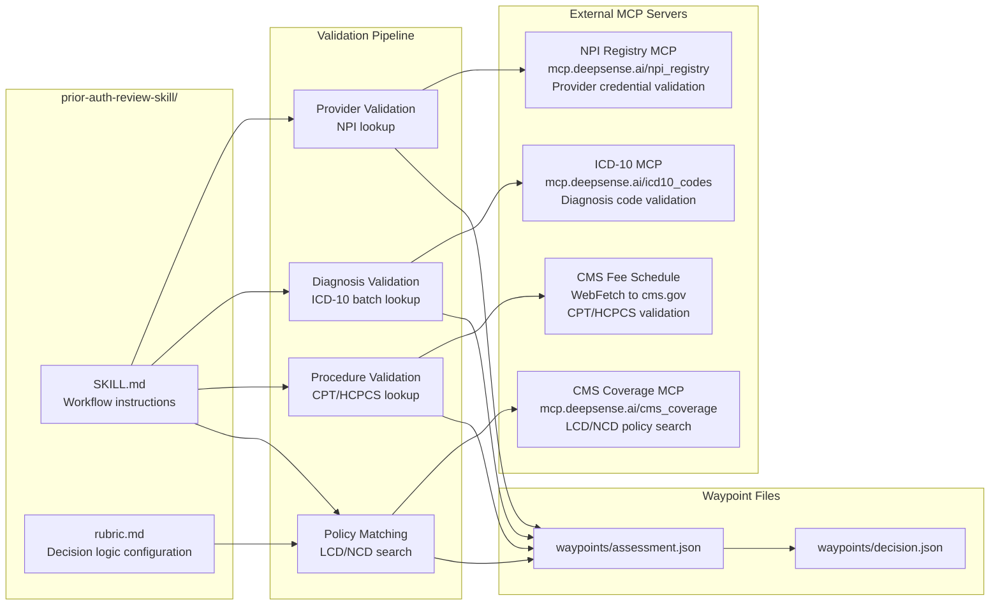
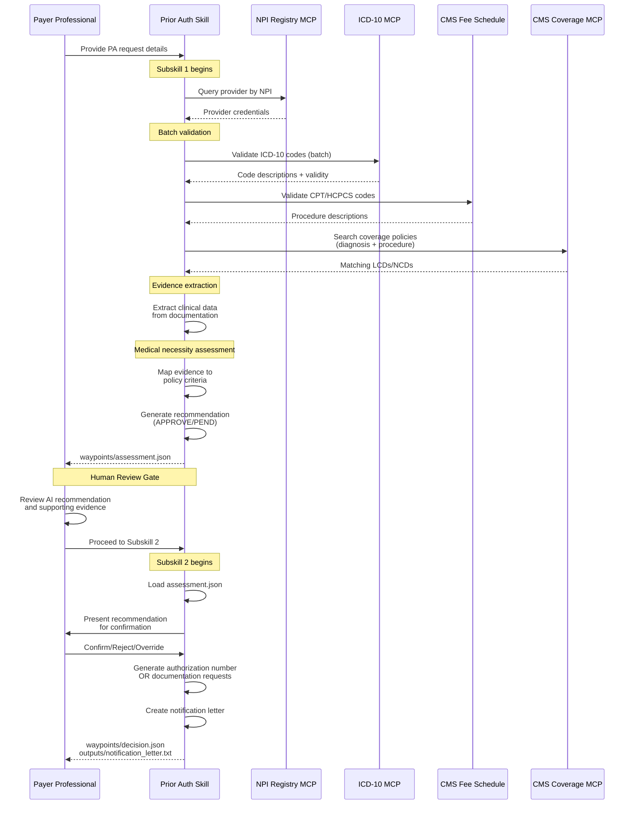
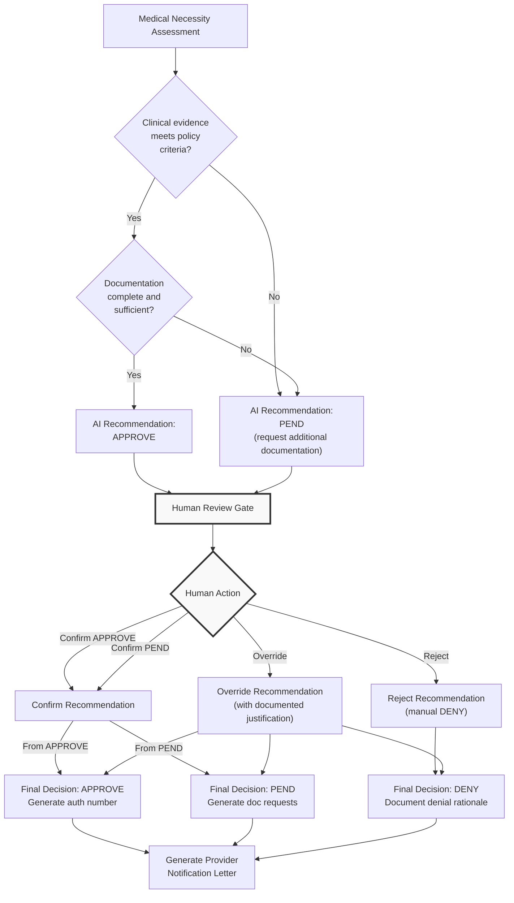
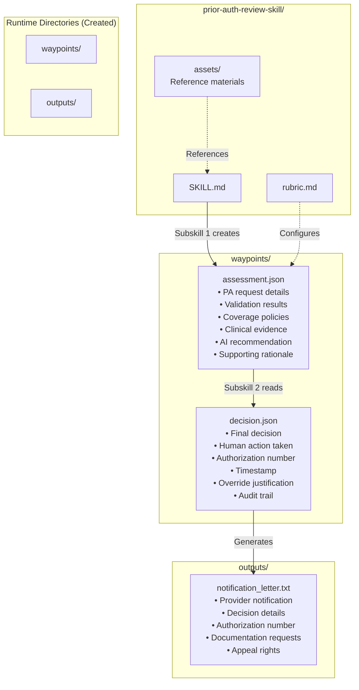

<!-- source: DeepWiki mcp.deepwiki.com · repo anthropics/healthcare · page 3.2 Prior Authorization Review · fetched 2026-10-26 -->

# Prior Authorization Review

<details>
<summary>Relevant source files</summary>

The following files were used as context for generating this wiki page:

- [.github/workflows/release.yml](.github/workflows/release.yml)
- [README.md](README.md)
- [clinical-trial-protocol-skill/README.md](clinical-trial-protocol-skill/README.md)
- [prior-auth-review-skill/README.md](prior-auth-review-skill/README.md)

</details>


## Purpose and Scope

This document covers the **Prior Authorization Review** skill, which automates health insurance payer review of prior authorization (PA) requests using AI-powered clinical reasoning and coverage policy matching. The skill implements a two-subskill architecture with mandatory human decision gates to generate draft authorization recommendations for payer organizations.

**Target Users:** Health insurance payer professionals (Medicare Advantage, Commercial, Medicaid MCO staff) performing clinical review and authorization decisions.

For information about the other healthcare skills, see [Clinical Trial Protocol Generator](#3.1) and [FHIR Developer Guide](#3.3). For details on the specific MCP servers this skill depends on, see [CMS Coverage Database](#4.1), [NPI Registry](#4.2), and [ICD-10 Codes](#4.4).

For detailed documentation of each subskill:
- [Intake & Assessment Subskill](#3.2.1) - Request validation and medical necessity assessment
- [Decision & Notification Subskill](#3.2.2) - Human oversight and final authorization

**Sources:** [README.md:1-63](), [prior-auth-review-skill/README.md:1-78]()

---

## Skill Architecture Overview

The Prior Authorization Review skill is structured as two sequential subskills that enforce separation between automated assessment and human decision-making. This architecture ensures that AI recommendations never become final decisions without explicit human confirmation.

### Installation

```bash
# Add the marketplace
/plugin marketplace add anthropics/healthcare

# Install the skill
/plugin install prior-auth-review@healthcare
```

### Key Characteristics

| Characteristic | Description |
|---------------|-------------|
| **Plugin ID** | `prior-auth-review@healthcare` |
| **Target Domain** | Insurance/Billing - Payer Prior Authorization |
| **Architecture** | Two-subskill sequential workflow |
| **Decision Model** | AI recommends APPROVE/PEND only (configurable) |
| **Human Oversight** | Required at decision finalization gate |
| **Primary Outputs** | `assessment.json`, `decision.json`, `notification_letter.txt` |
| **MCP Dependencies** | NPI Registry, ICD-10 Codes, CMS Coverage Database |

**Sources:** [README.md:28-33](), [prior-auth-review-skill/README.md:1-26]()

---

## Two-Subskill Workflow Architecture

The skill implements a checkpoint-based workflow where each subskill produces waypoint files that subsequent stages consume. This enables resumption from any point and creates a complete audit trail.

### Complete Workflow Diagram

```mermaid
graph TD
    subgraph Input["Input Data"]
        PA_REQUEST["PA Request<br/>(member, provider,<br/>service, clinical docs)"]
    end
    
    subgraph Subskill1["Subskill 1: Intake & Assessment"]
        COLLECT["Collect PA Request Info"]
        NPI_VAL["Validate Provider<br/>via NPI MCP"]
        ICD_VAL["Validate ICD-10 Codes<br/>via ICD-10 MCP"]
        CPT_VAL["Validate CPT/HCPCS<br/>via WebFetch CMS Fee Schedule"]
        POLICY["Search Coverage Policies<br/>via CMS Coverage MCP"]
        EXTRACT["Extract Clinical Evidence<br/>from Documentation"]
        MAP["Map Evidence to<br/>Policy Criteria"]
        ASSESS["Perform Medical<br/>Necessity Assessment"]
        RECOMMEND["Generate Recommendation<br/>(APPROVE/PEND)"]
        
        COLLECT --> NPI_VAL
        NPI_VAL --> ICD_VAL
        ICD_VAL --> CPT_VAL
        CPT_VAL --> POLICY
        POLICY --> EXTRACT
        EXTRACT --> MAP
        MAP --> ASSESS
        ASSESS --> RECOMMEND
    end
    
    subgraph Waypoint1["Waypoint Output"]
        ASSESSMENT_JSON["waypoints/assessment.json<br/>Consolidated assessment<br/>+ AI recommendation"]
    end
    
    subgraph Gate1["Human Review Gate"]
        HUMAN_REVIEW["Professional reviews<br/>AI recommendation<br/>and supporting evidence"]
    end
    
    subgraph Subskill2["Subskill 2: Decision & Notification"]
        LOAD["Load assessment.json"]
        PRESENT["Present Recommendation<br/>for Human Review"]
        HUMAN_ACTION["Human Action:<br/>Confirm/Reject/Override"]
        GEN_AUTH["Generate Authorization Number<br/>(if approved)"]
        GEN_DOC_REQ["Generate Documentation Requests<br/>(if pended)"]
        LETTER["Create Provider<br/>Notification Letter"]
        AUDIT["Document Complete<br/>Audit Trail"]
        
        LOAD --> PRESENT
        PRESENT --> HUMAN_ACTION
        HUMAN_ACTION -->|Approved| GEN_AUTH
        HUMAN_ACTION -->|Pended| GEN_DOC_REQ
        GEN_AUTH --> LETTER
        GEN_DOC_REQ --> LETTER
        LETTER --> AUDIT
    end
    
    subgraph Waypoint2["Final Outputs"]
        DECISION_JSON["waypoints/decision.json<br/>Final decision record"]
        NOTIFICATION["outputs/notification_letter.txt<br/>Provider notification"]
    end
    
    PA_REQUEST --> COLLECT
    RECOMMEND --> ASSESSMENT_JSON
    ASSESSMENT_JSON --> HUMAN_REVIEW
    HUMAN_REVIEW --> LOAD
    AUDIT --> DECISION_JSON
    AUDIT --> NOTIFICATION
    
    style HUMAN_REVIEW fill:#f9f9f9,stroke:#333,stroke-width:3px
    style HUMAN_ACTION fill:#f9f9f9,stroke:#333,stroke-width:3px
    style ASSESSMENT_JSON fill:#e8e8e8,stroke:#333
    style DECISION_JSON fill:#e8e8e8,stroke:#333
    style NOTIFICATION fill:#e8e8e8,stroke:#333
```



**Sources:** [prior-auth-review-skill/README.md:27-66]()

---

## MCP Server Dependencies and Data Flow

The skill integrates four external data sources to perform comprehensive validation and policy matching. Each MCP server is called at a specific point in the workflow.

### MCP Integration Architecture



### MCP Server Usage Table

| MCP Server | Purpose | Called During | Data Retrieved |
|-----------|---------|---------------|----------------|
| **NPI Registry** | Validate provider credentials | Subskill 1 - Initial validation | Provider name, specialty, credentials, practice location |
| **ICD-10 Codes** | Validate diagnosis codes | Subskill 1 - Batch validation | ICD-10 code descriptions, validity status |
| **CMS Coverage** | Retrieve coverage policies | Subskill 1 - Policy search | Medicare LCDs/NCDs, coverage criteria |
| **CMS Fee Schedule** | Validate CPT/HCPCS codes | Subskill 1 - Code validation | Procedure descriptions, pricing information |

**Note:** The CMS Fee Schedule is accessed via WebFetch rather than a dedicated MCP server, as shown in the diagram.

**Sources:** [prior-auth-review-skill/README.md:33-41](), [README.md:44-58]()

---

## Data Validation Pipeline

Each validation step produces structured data that feeds into the medical necessity assessment. The pipeline executes sequentially to build a complete evidence profile.

### Validation Sequence Diagram



### Batch Validation Strategy

The ICD-10 validation uses batch processing to minimize MCP calls. All diagnosis codes from the PA request are validated in a single batch operation, as referenced in [prior-auth-review-skill/README.md:35]().

**Sources:** [prior-auth-review-skill/README.md:33-44]()

---

## Human Decision Points and AI Behavior

The skill enforces two explicit human decision points to ensure appropriate oversight and prevent automated decision-making without review.

### Decision Gate Architecture

| Decision Point | Location | Purpose | Human Actions Available |
|---------------|----------|---------|------------------------|
| **Post-Assessment Review** | Between Subskills 1 and 2 | Review AI recommendation and supporting evidence before finalizing | Proceed to decision, request additional review, abandon workflow |
| **Final Decision Confirmation** | Within Subskill 2 | Explicitly confirm, reject, or override AI recommendation | Confirm (accept), Reject (deny), Override (modify with justification) |

### AI Recommendation Behavior

**Default Decision Logic:**
- AI recommends **APPROVE** when clinical evidence meets policy criteria
- AI recommends **PEND** when documentation is insufficient
- AI **NEVER** recommends DENY by default (configurable in `rubric.md`)

**Rationale:** This conservative approach ensures that denial decisions always involve explicit human judgment, reducing risk of inappropriate automated denials.

### Decision Logic Diagram



**Configuration:** The decision logic is defined in `rubric.md` within the skill directory and can be customized to match specific payer policies.

**Sources:** [prior-auth-review-skill/README.md:17-26](), [prior-auth-review-skill/README.md:45-66]()

---

## Outputs and Artifacts

The skill generates three primary artifacts that document the complete review process and support audit requirements.

### Output Files Structure



### File Descriptions

#### `waypoints/assessment.json`

**Generated By:** Subskill 1 (Intake & Assessment)  
**Purpose:** Complete assessment record with AI recommendation  
**Consumed By:** Subskill 2 (Decision & Notification)

**Key Fields:**
- `pa_request` - Member info, requested service, provider details
- `validation_results` - NPI, ICD-10, CPT/HCPCS validation outcomes
- `coverage_policies` - Matching LCDs/NCDs with criteria
- `clinical_evidence` - Structured clinical data from documentation
- `medical_necessity_assessment` - Evidence mapping to policy criteria
- `recommendation` - AI recommendation (APPROVE/PEND)
- `rationale` - Detailed explanation of recommendation

#### `waypoints/decision.json`

**Generated By:** Subskill 2 (Decision & Notification)  
**Purpose:** Final decision record with complete audit trail  
**Used For:** Regulatory compliance, appeals, audit defense

**Key Fields:**
- `ai_recommendation` - Original AI recommendation from assessment
- `human_action` - Confirm/Reject/Override
- `final_decision` - APPROVE/PEND/DENY
- `authorization_number` - Generated if approved
- `documentation_requests` - Specific items needed if pended
- `denial_rationale` - Explanation if denied
- `override_justification` - Required if human overrode AI
- `timestamp` - Decision finalization time
- `reviewer_identifier` - Human reviewer (if captured)

#### `outputs/notification_letter.txt`

**Generated By:** Subskill 2 (Decision & Notification)  
**Purpose:** Provider communication of authorization decision  
**Delivered To:** Healthcare provider who submitted PA request

**Contents:**
- Decision outcome (approved/pended/denied)
- Authorization number and validity period (if approved)
- Specific documentation requests (if pended)
- Denial explanation and policy citation (if denied)
- Appeal rights and process information

**Sources:** [prior-auth-review-skill/README.md:42-66]()

---

## Demo Mode and Sample Data

The skill includes sample case files for demonstration and testing purposes. Demo mode allows users to understand the workflow without requiring live MCP connections for all services.

### Sample Data Location

Sample case files are located in `assets/sample/` within the skill directory, as referenced in [prior-auth-review-skill/README.md:72]().

### Demo Mode Behavior

| Component | Live Mode | Demo Mode |
|-----------|-----------|-----------|
| **NPI Registry Lookup** | MCP call to NPI Registry | Skipped for sample provider |
| **ICD-10 Validation** | MCP call to ICD-10 server | Executes normally |
| **CMS Coverage Search** | MCP call to CMS Coverage | Executes normally |
| **CPT/HCPCS Validation** | WebFetch to CMS Fee Schedule | Executes normally |

**Demo Case:** The sample data includes a pre-configured lung biopsy case that demonstrates:
- Complete PA request structure
- Clinical documentation format
- Coverage policy matching
- Medical necessity assessment
- Recommendation generation

**Purpose:** Allows payer organizations to evaluate the skill's capabilities before integrating with production systems.

**Sources:** [prior-auth-review-skill/README.md:72-78]()

---

## Important Disclaimers and Limitations

### Coverage Policy Source

The skill uses **Medicare LCDs/NCDs** via the CMS Coverage MCP Connector. For commercial or Medicare Advantage plans, payer-specific policies may differ and are not automatically applied. Payer organizations must:
- Configure custom policy sources if needed
- Validate that Medicare policies align with their coverage determinations
- Override AI recommendations when payer-specific policies differ

### Responsibility and Liability

As stated in [prior-auth-review-skill/README.md:19-26]():

> **DRAFT RECOMMENDATIONS ONLY:** This skill generates draft recommendations only. The payer organization remains fully responsible for all final authorization decisions.

> **HUMAN REVIEW REQUIRED:** All AI-generated recommendations require review and confirmation by appropriate professionals before becoming final decisions. Users may accept, reject, or override any recommendation with documented justification.

> **AI DECISION BEHAVIOR:** In default mode, AI recommends APPROVE or PEND only - never recommends DENY. Decision logic is configurable in the skill's rubric.md file.

### Professional Standards

Payer organizations using this skill must ensure:
- Human reviewers have appropriate clinical credentials and training
- Decision workflows comply with state and federal regulations
- Audit trails meet regulatory documentation requirements
- Appeal processes are properly implemented
- Override justifications are appropriately documented

**Sources:** [prior-auth-review-skill/README.md:17-26]()

---

## Skill Files and Directory Structure

The skill directory contains all configuration, instructions, and reference materials needed for operation.

### Directory Layout

```
prior-auth-review-skill/
├── SKILL.md                    # Main skill instructions (workflow)
├── README.md                   # Skill overview and documentation
├── rubric.md                   # Decision logic configuration
├── assets/                     # Reference materials
│   ├── sample/                 # Sample case files for demo mode
│   └── [other references]      # Coverage policy templates, etc.
├── waypoints/                  # Runtime directory (created during execution)
│   ├── assessment.json         # Subskill 1 output
│   └── decision.json           # Subskill 2 output
└── outputs/                    # Runtime directory (created during execution)
    └── notification_letter.txt # Provider notification
```

**Key Configuration Files:**
- **SKILL.md** - Contains the complete workflow instructions for both subskills
- **rubric.md** - Defines the medical necessity assessment criteria and decision logic
- **assets/** - Houses reference materials and sample data for demonstrations

**Sources:** [prior-auth-review-skill/README.md:1-78]()

---

## Related Documentation

For detailed information on each subskill's implementation:
- **[Intake & Assessment Subskill](#3.2.1)** - Validation pipeline, MCP integration, and recommendation generation
- **[Decision & Notification Subskill](#3.2.2)** - Human oversight process, decision finalization, and notification generation

For information on the external data sources:
- **[CMS Coverage Database](#4.1)** - Medicare LCD/NCD policy retrieval
- **[NPI Registry](#4.2)** - Provider credential validation
- **[ICD-10 Codes](#4.4)** - Diagnosis code validation

For marketplace and installation details:
- **[Marketplace Architecture](#2)** - Plugin system overview
- **[Installation and Usage](#2.2)** - Command reference

**Sources:** [README.md:1-63](), [prior-auth-review-skill/README.md:1-78]()

---

