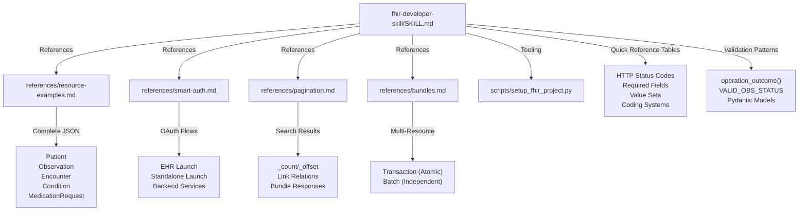
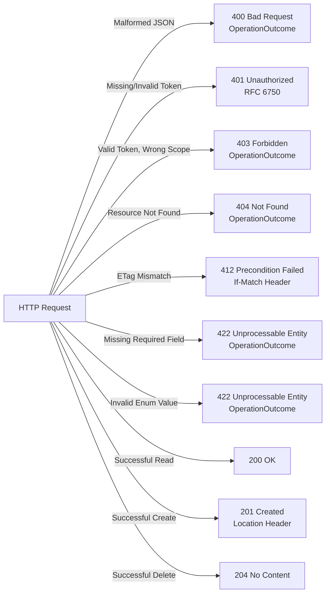
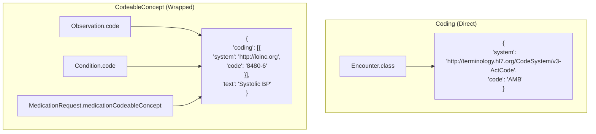
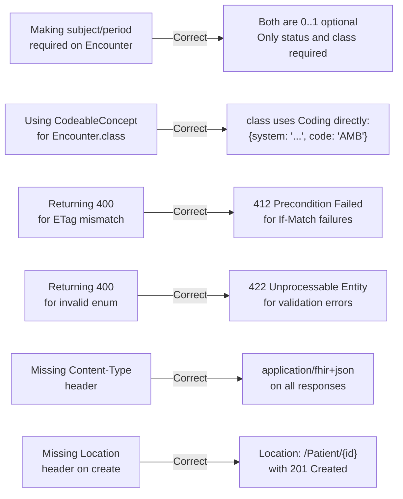
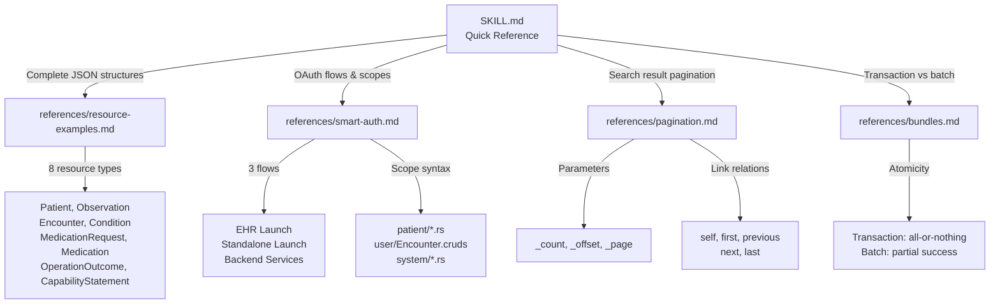

<!-- source: DeepWiki mcp.deepwiki.com · repo anthropics/healthcare · page 3.3 FHIR Developer Guide · fetched 2026-10-26 -->

# FHIR Developer Guide

<details>
<summary>Relevant source files</summary>

The following files were used as context for generating this wiki page:

- [.github/workflows/release.yml](.github/workflows/release.yml)
- [README.md](README.md)
- [fhir-developer-skill/SKILL.md](fhir-developer-skill/SKILL.md)
- [fhir-developer-skill/references/bundles.md](fhir-developer-skill/references/bundles.md)
- [fhir-developer-skill/references/pagination.md](fhir-developer-skill/references/pagination.md)
- [fhir-developer-skill/references/resource-examples.md](fhir-developer-skill/references/resource-examples.md)
- [fhir-developer-skill/references/smart-auth.md](fhir-developer-skill/references/smart-auth.md)

</details>


## Purpose and Scope

This document provides an overview of the FHIR Developer skill, a specialized knowledge base and tooling for building HL7 FHIR R4-compliant healthcare APIs. The skill enables rapid development of FHIR REST endpoints, including resource validation, error handling, authorization, and API operations.

For detailed information on specific topics, see:
- FHIR R4 resource structures, required fields, and value sets: [FHIR R4 Resource Structures](#3.3.1)
- RESTful endpoint patterns, HTTP status codes, and Bundle operations: [FHIR API Patterns](#3.3.2)
- OAuth 2.0 flows and scope enforcement: [SMART on FHIR Authorization](#3.3.3)
- FastAPI project scaffolding: [FHIR Project Scaffolding Tool](#3.3.4)

**Sources:** [fhir-developer-skill/SKILL.md:1-11](), [README.md:19-25]()

## Skill Overview

The FHIR Developer skill provides specialized knowledge for building healthcare interoperability endpoints compliant with the HL7 FHIR R4 specification. Unlike the Clinical Trial Protocol Generator ([3.1](#3.1)) which focuses on research protocols, or Prior Authorization Review ([3.2](#3.2)) which handles insurance workflows, this skill is targeted at software engineers building healthcare data exchange systems.

The skill operates as a comprehensive reference guide with no external MCP server dependencies. All knowledge is embedded in the skill's reference documentation and can be used immediately after installation via:

```bash
/plugin install fhir-developer@healthcare
```

**Sources:** [README.md:19-25](), [fhir-developer-skill/SKILL.md:1-11]()

## Skill Architecture

### File Structure



**Sources:** [fhir-developer-skill/SKILL.md:1-295](), [fhir-developer-skill/references/resource-examples.md:1-197](), [fhir-developer-skill/references/smart-auth.md:1-204](), [fhir-developer-skill/references/pagination.md:1-106](), [fhir-developer-skill/references/bundles.md:1-161]()

## Knowledge Domains

The skill provides expert guidance across four primary domains:

### 1. Resource Structures and Validation

Covers the seven core FHIR resources used in most healthcare APIs:

| Resource | Required Fields | Cardinality Source |
|----------|----------------|-------------------|
| `Patient` | None | All fields 0..1 or 0..* |
| `Observation` | `status`, `code` | [SKILL.md:30-38]() |
| `Encounter` | `status`, `class` | [SKILL.md:30-38]() |
| `Condition` | `subject` | [SKILL.md:30-38]() |
| `MedicationRequest` | `status`, `intent`, `medication[x]`, `subject` | [SKILL.md:30-38]() |
| `Medication` | None | All fields optional |
| `Bundle` | `type` | [SKILL.md:30-38]() |

The skill emphasizes the critical distinction between cardinality `0..1` (optional) and `1..1` (required), as documented in [fhir-developer-skill/SKILL.md:43-53](). A common error is treating `subject` or `period` on `Encounter` as required when they are actually optional (0..1 cardinality).

**Sources:** [fhir-developer-skill/SKILL.md:30-53](), [fhir-developer-skill/references/resource-examples.md:1-197]()

### 2. HTTP Status Codes and Error Handling

The skill provides definitive mappings for FHIR-specific status codes:



The `operation_outcome()` helper function pattern is standardized in [fhir-developer-skill/SKILL.md:103-107]() for Python/FastAPI implementations.

**Sources:** [fhir-developer-skill/SKILL.md:17-28](), [fhir-developer-skill/references/resource-examples.md:130-160]()

### 3. Value Sets and Coding Systems

The skill includes comprehensive enum definitions for status codes and coding system URLs:

**Status Value Sets:**
- `Observation.status`: `registered | preliminary | final | amended | corrected | cancelled | entered-in-error | unknown` ([SKILL.md:63-64]())
- `Encounter.status`: `planned | arrived | triaged | in-progress | onleave | finished | cancelled | entered-in-error | unknown` ([SKILL.md:66-67]())
- `MedicationRequest.intent`: `proposal | plan | order | original-order | reflex-order | filler-order | instance-order | option` ([SKILL.md:86-87]())

**Coding System URLs:**
| System | URL |
|--------|-----|
| LOINC | `http://loinc.org` |
| SNOMED CT | `http://snomed.info/sct` |
| RxNorm | `http://www.nlm.nih.gov/research/umls/rxnorm` |
| ICD-10 | `http://hl7.org/fhir/sid/icd-10` |

Invalid enum values must return `422 Unprocessable Entity` with an `OperationOutcome` resource, as specified in [fhir-developer-skill/SKILL.md:58]().

**Sources:** [fhir-developer-skill/SKILL.md:56-91](), [fhir-developer-skill/SKILL.md:157-168]()

### 4. Data Type Patterns

The skill distinguishes between `Coding` (direct) and `CodeableConcept` (wrapped) types, a common source of implementation errors:



**Sources:** [fhir-developer-skill/SKILL.md:183-198]()

## Validation Implementation Patterns

The skill provides production-ready validation code in both Python/FastAPI and TypeScript/Express:

### Python FastAPI Pattern

The canonical validation pattern uses the `operation_outcome()` helper and explicit status code constants:

```python
# Defined in SKILL.md:103-107
def operation_outcome(severity: str, code: str, diagnostics: str)

# Validation set defined in SKILL.md:109-110
VALID_OBS_STATUS = {"registered", "preliminary", "final", "amended",
                    "corrected", "cancelled", "entered-in-error", "unknown"}

# Endpoint implementation pattern in SKILL.md:112-124
@app.post("/Observation", status_code=201)
async def create_observation(data: dict):
    # Returns JSONResponse with status_code=422 and OperationOutcome
```

### Pydantic v2 Models

The skill specifies the correct Pydantic v2 pattern using `Literal` (not the deprecated `const=True`):

```python
# From SKILL.md:144-153
from typing import Literal
from pydantic import BaseModel

class Patient(BaseModel):
    resourceType: Literal["Patient"] = "Patient"
    gender: Literal["male", "female", "other", "unknown"] | None = None
```

**Sources:** [fhir-developer-skill/SKILL.md:94-153]()

## Tooling: Project Scaffolding

The skill includes a project generation script that creates a complete FastAPI FHIR server:

```bash
python scripts/setup_fhir_project.py my_fhir_api
```

This script generates:
- Correct Pydantic v2 models with `Literal` types
- `OperationOutcome` helper functions
- Patient CRUD endpoints
- Proper `Content-Type: application/fhir+json` headers
- `Location` and `ETag` header handling

**Sources:** [fhir-developer-skill/SKILL.md:286-294]()

## When to Use This Skill

The skill is designed for four primary use cases, as documented in [fhir-developer-skill/SKILL.md:4-11]():

1. **Creating FHIR REST endpoints** for `Patient`, `Observation`, `Encounter`, `Condition`, `MedicationRequest`
2. **Validating FHIR resources** and returning proper HTTP status codes and error responses
3. **Implementing SMART on FHIR authorization** and OAuth scopes
4. **Working with Bundles**, transactions, batch operations, or search pagination

The skill does not use external MCP servers (unlike Prior Authorization Review which uses NPI Registry, ICD-10, and CMS Coverage MCPs). All knowledge is self-contained.

**Sources:** [fhir-developer-skill/SKILL.md:1-11](), [README.md:19-25]()

## Common Implementation Pitfalls

The skill explicitly documents frequent errors in FHIR API development:



**Sources:** [fhir-developer-skill/SKILL.md:207-216]()

## Implementation Checklist

The skill provides an 8-point checklist for FHIR API compliance:

1. Set `Content-Type: application/fhir+json` on all responses
2. Return `meta.versionId` and `meta.lastUpdated` on resources
3. Return `Location` header on create: `/Patient/{id}`
4. Return `ETag` header: `W/"{versionId}"`
5. Use OperationOutcome for all error responses
6. Validate required fields → 422 for missing
7. Validate enum values → 422 for invalid
8. Search returns Bundle with `type: "searchset"`

**Sources:** [fhir-developer-skill/SKILL.md:273-283]()

## RESTful Endpoint Patterns

Standard FHIR endpoint structure:

| Method | Path | Purpose | Status Code |
|--------|------|---------|-------------|
| POST | `/[ResourceType]` | Create | 201 + Location |
| GET | `/[ResourceType]/[id]` | Read | 200 |
| PUT | `/[ResourceType]/[id]` | Update | 200 |
| DELETE | `/[ResourceType]/[id]` | Delete | 204 |
| GET | `/[ResourceType]?param=value` | Search | 200 + Bundle |
| GET | `/metadata` | CapabilityStatement | 200 |
| POST | `/` | Bundle transaction/batch | 200/400 |

**Sources:** [fhir-developer-skill/SKILL.md:235-245]()

## Reference Documentation Structure

The skill organizes detailed implementation guidance in four reference files:



**Sources:** [fhir-developer-skill/SKILL.md:262-270](), [fhir-developer-skill/references/resource-examples.md:1-6](), [fhir-developer-skill/references/smart-auth.md:1-11](), [fhir-developer-skill/references/pagination.md:1-10](), [fhir-developer-skill/references/bundles.md:1-8]()

## Integration with Marketplace

The skill is registered in the marketplace as a standalone capability with no dependencies:

```json
{
  "name": "fhir-developer",
  "source": "./",
  "skills": ["./fhir-developer-skill"]
}
```

Installation command: `/plugin install fhir-developer@healthcare`

Unlike other skills in the marketplace, FHIR Developer does not require Python dependencies (Clinical Trial Protocol) or MCP servers (Prior Authorization Review). It is a pure knowledge skill.

**Sources:** [README.md:19-25]()

---

