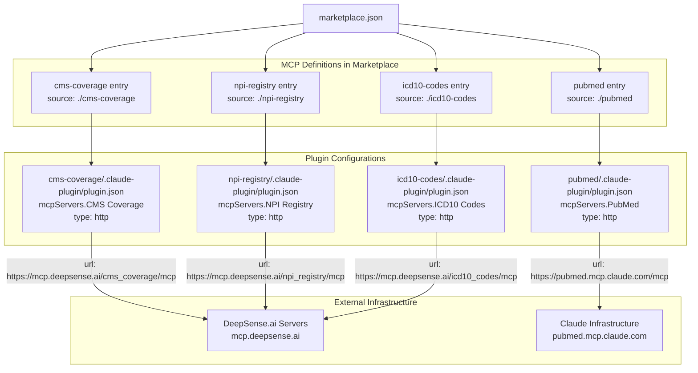
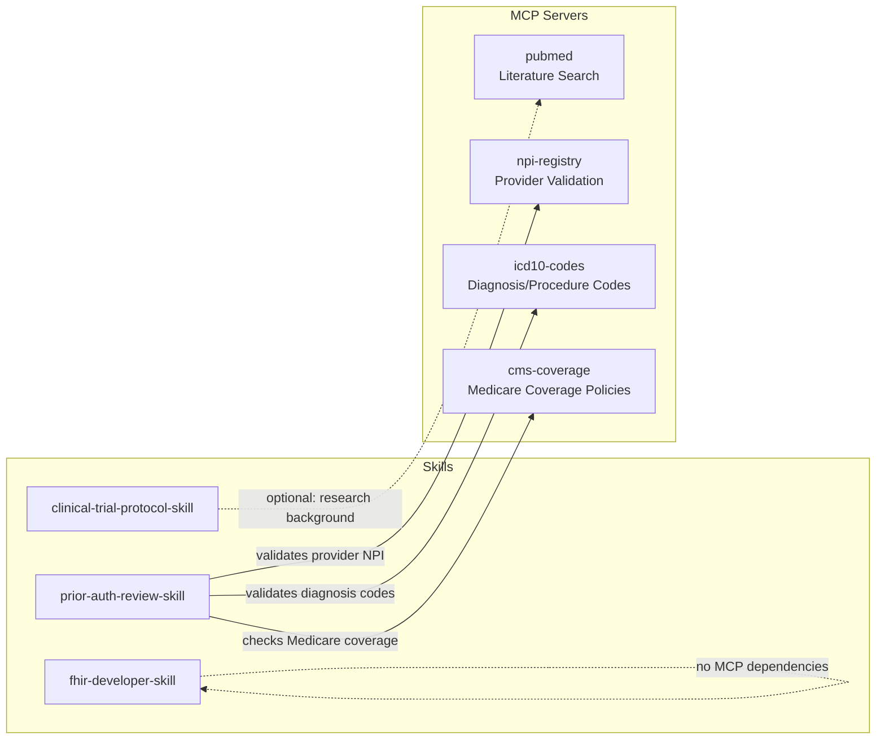

<!-- source: DeepWiki mcp.deepwiki.com · repo anthropics/healthcare · page 4 MCP Servers and External Data · fetched 2026-10-26 -->

# MCP Servers and External Data

<details>
<summary>Relevant source files</summary>

The following files were used as context for generating this wiki page:

- [.claude-plugin/marketplace.json](.claude-plugin/marketplace.json)
- [.github/workflows/release.yml](.github/workflows/release.yml)
- [README.md](README.md)
- [cms-coverage/.claude-plugin/plugin.json](cms-coverage/.claude-plugin/plugin.json)
- [icd10-codes/.claude-plugin/plugin.json](icd10-codes/.claude-plugin/plugin.json)
- [npi-registry/.claude-plugin/plugin.json](npi-registry/.claude-plugin/plugin.json)
- [pubmed/.claude-plugin/plugin.json](pubmed/.claude-plugin/plugin.json)

</details>


This document provides an overview of the four Model Context Protocol (MCP) servers available in the healthcare marketplace. These servers provide Claude with access to specialized healthcare data sources including Medicare coverage policies, provider registries, biomedical literature, and diagnostic codes. Each MCP server is hosted on external infrastructure and accessed via HTTP, enabling skills to leverage authoritative healthcare data without embedding it in the repository.

For information about how Skills use these MCP servers, see [Healthcare Skills](#3). For details on the marketplace architecture and plugin configuration, see [Marketplace Architecture](#2).

## Overview

The healthcare marketplace provides four MCP servers that enable access to external healthcare data sources:

| MCP Server | Purpose | Data Source | Hosting |
|------------|---------|-------------|---------|
| **CMS Coverage** | Medicare coverage policies | National and Local Coverage Determinations | DeepSense.ai |
| **NPI Registry** | Healthcare provider validation | US National Provider Identifier database | DeepSense.ai |
| **PubMed** | Biomedical literature search | PubMed citations and PMC full-text | Claude Infrastructure |
| **ICD-10 Codes** | Diagnosis and procedure codes | ICD-10-CM and ICD-10-PCS code sets | DeepSense.ai |

These MCP servers are consumed by skills to perform domain-specific healthcare workflows. The Prior Authorization Review skill uses three MCPs (CMS Coverage, NPI Registry, ICD-10 Codes) for validation and policy lookups, while the Clinical Trial Protocol Generator optionally uses PubMed for literature research.

**Sources:** [README.md:44-58](), [.claude-plugin/marketplace.json:45-73]()

## MCP Server Architecture

MCP servers follow a distinct configuration pattern from skills. Each MCP server is defined in two locations:

1. **Marketplace Registry Entry**: In [.claude-plugin/marketplace.json]() with `source` pointing to a subdirectory
2. **MCP Plugin Configuration**: In `<mcp-name>/.claude-plugin/plugin.json` specifying the HTTP endpoint



**Diagram: MCP Server Configuration and Hosting Architecture**

This architecture decouples marketplace discovery metadata from runtime configuration. The marketplace registry provides human-readable descriptions and tags, while the `plugin.json` files specify the technical details for HTTP communication.

**Sources:** [.claude-plugin/marketplace.json:45-73](), [cms-coverage/.claude-plugin/plugin.json:1-15](), [npi-registry/.claude-plugin/plugin.json:1-15](), [pubmed/.claude-plugin/plugin.json:1-15](), [icd10-codes/.claude-plugin/plugin.json:1-15]()

## MCP Server Catalog

The following table summarizes the configuration details for each MCP server:

| MCP Server | Directory | plugin.json mcpServers Key | HTTP Endpoint |
|------------|-----------|---------------------------|---------------|
| CMS Coverage | `cms-coverage/` | `"CMS Coverage"` | `https://mcp.deepsense.ai/cms_coverage/mcp` |
| NPI Registry | `npi-registry/` | `"NPI Registry"` | `https://mcp.deepsense.ai/npi_registry/mcp` |
| PubMed | `pubmed/` | `"PubMed"` | `https://pubmed.mcp.claude.com/mcp` |
| ICD-10 Codes | `icd10-codes/` | `"ICD10 Codes"` | `https://mcp.deepsense.ai/icd10_codes/mcp` |

Each `plugin.json` follows this structure:

```json
{
  "name": "mcp-name",
  "version": "1.0.0",
  "description": "Description of data source",
  "author": {
    "name": "Organization",
    "url": "https://example.com"
  },
  "mcpServers": {
    "Display Name": {
      "type": "http",
      "url": "https://hostname/path/mcp"
    }
  }
}
```

**Sources:** [cms-coverage/.claude-plugin/plugin.json:1-15](), [npi-registry/.claude-plugin/plugin.json:1-15](), [pubmed/.claude-plugin/plugin.json:1-15](), [icd10-codes/.claude-plugin/plugin.json:1-15]()

## Skill Dependencies on MCP Servers

Skills declare MCP server usage through documentation and workflow design, but not through explicit dependency configuration. The following diagram shows which skills integrate with which MCP servers:



**Diagram: Skill-to-MCP Server Dependencies**

The Prior Authorization Review skill has mandatory dependencies on three MCP servers (NPI Registry, ICD-10 Codes, CMS Coverage) for its validation workflow. The Clinical Trial Protocol Generator optionally uses PubMed for literature research in Step 1. The FHIR Developer skill is self-contained and does not require external data sources.

**Sources:** [.claude-plugin/marketplace.json:11-73](), [README.md:27-42]()

## Installation and Usage

### Adding MCP Servers from the Marketplace

MCP servers are installed using the `claude mcp add-from-marketplace` command with the marketplace owner and MCP name:

```bash
# Add individual MCP servers
claude mcp add-from-marketplace anthropics/healthcare/cms-coverage
claude mcp add-from-marketplace anthropics/healthcare/npi-registry
claude mcp add-from-marketplace anthropics/healthcare/pubmed
claude mcp add-from-marketplace anthropics/healthcare/icd10-codes
```

The marketplace must be added first using `/plugin marketplace add anthropics/healthcare` before MCP servers can be installed.

**Sources:** [README.md:52-58]()

### MCP Server Naming Convention

MCP servers in the marketplace use a hyphenated naming convention:
- Marketplace name in [marketplace.json:45-73](): `"cms-coverage"`, `"npi-registry"`, `"pubmed"`, `"icd10-codes"`
- Directory name: `cms-coverage/`, `npi-registry/`, `pubmed/`, `icd10-codes/`
- Command syntax: `anthropics/healthcare/cms-coverage`

This differs from skill naming which uses `@` for marketplace scoping (e.g., `prior-auth-review@healthcare`).

**Sources:** [README.md:44-58](), [.claude-plugin/marketplace.json:45-73]()

## MCP Server Providers

### DeepSense.ai Infrastructure

Three MCP servers are hosted on DeepSense.ai infrastructure at `mcp.deepsense.ai`:

- **CMS Coverage**: `https://mcp.deepsense.ai/cms_coverage/mcp`
- **NPI Registry**: `https://mcp.deepsense.ai/npi_registry/mcp`
- **ICD-10 Codes**: `https://mcp.deepsense.ai/icd10_codes/mcp`

These servers provide access to publicly available US healthcare datasets including Medicare policies, provider registries, and medical coding systems.

**Sources:** [cms-coverage/.claude-plugin/plugin.json:12](), [npi-registry/.claude-plugin/plugin.json:12](), [icd10-codes/.claude-plugin/plugin.json:12]()

### Claude Infrastructure

The PubMed MCP server is hosted on Claude infrastructure:

- **PubMed**: `https://pubmed.mcp.claude.com/mcp`

This server provides access to PubMed's biomedical citations and PubMed Central's full-text archive.

**Sources:** [pubmed/.claude-plugin/plugin.json:12]()

## Detailed MCP Server Documentation

For comprehensive documentation on each MCP server's capabilities, data models, and usage patterns, see the following pages:

- [CMS Coverage Database](#4.1) - Medicare LCDs/NCDs and coverage policy lookup
- [NPI Registry](#4.2) - Healthcare provider validation and lookup
- [PubMed Literature Search](#4.3) - Biomedical citation search and full-text access
- [ICD-10 Codes](#4.4) - Diagnosis and procedure code validation

Each page provides detailed information on the data available, query patterns, and integration examples with skills.

**Sources:** [.claude-plugin/marketplace.json:45-73]()

---

