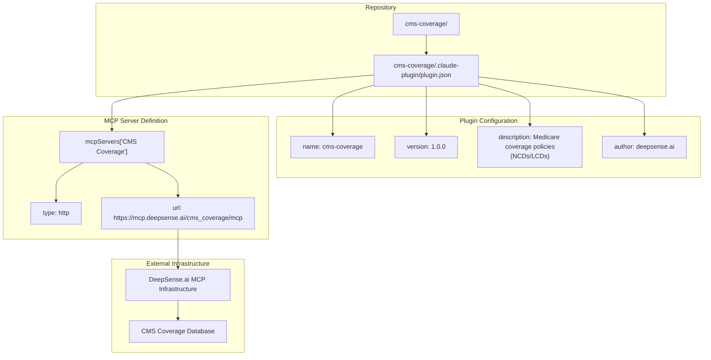
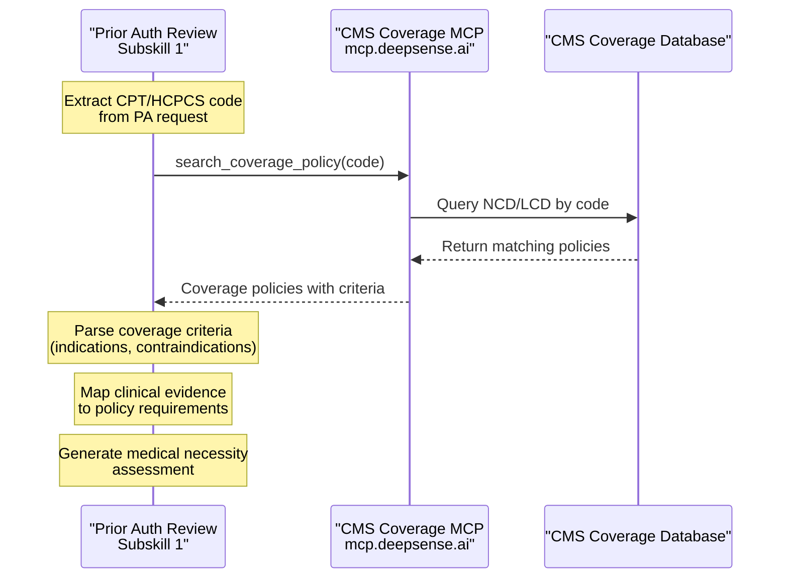
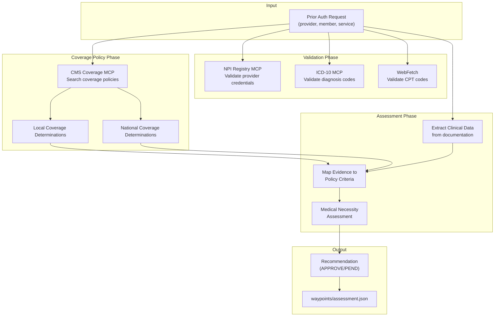

<!-- source: DeepWiki mcp.deepwiki.com · repo anthropics/healthcare · page 4.1 CMS Coverage Database · fetched 2026-10-26 -->

# CMS Coverage Database

<details>
<summary>Relevant source files</summary>

The following files were used as context for generating this wiki page:

- [.github/workflows/release.yml](.github/workflows/release.yml)
- [README.md](README.md)
- [clinical-trial-protocol-skill/README.md](clinical-trial-protocol-skill/README.md)
- [cms-coverage/.claude-plugin/plugin.json](cms-coverage/.claude-plugin/plugin.json)
- [npi-registry/.claude-plugin/plugin.json](npi-registry/.claude-plugin/plugin.json)
- [prior-auth-review-skill/README.md](prior-auth-review-skill/README.md)
- [pubmed/.claude-plugin/plugin.json](pubmed/.claude-plugin/plugin.json)

</details>


This page documents the CMS Coverage MCP server, which provides programmatic access to Medicare Part B coverage policies including National Coverage Determinations (NCDs) and Local Coverage Determinations (LCDs). This MCP server enables skills to query coverage criteria, eligibility requirements, and medical necessity guidelines from the Centers for Medicare & Medicaid Services (CMS) database.

For information about how the Prior Authorization Review skill uses this MCP server, see [Prior Authorization Review](#3.2). For information about other MCP servers in the marketplace, see [MCP Servers and External Data](#4).

**Sources:** [cms-coverage/.claude-plugin/plugin.json:1-15](), [README.md:44-58]()

## Overview

The CMS Coverage MCP server is a remote HTTP-based Model Context Protocol server that connects Claude Code to the CMS Coverage Database. It is hosted and maintained by DeepSense.ai at `https://mcp.deepsense.ai/cms_coverage/mcp` and provides read-only access to Medicare coverage policies.

The server enables skills to programmatically:
- Search for coverage policies by procedure code (CPT/HCPCS)
- Retrieve National Coverage Determinations (NCDs)
- Retrieve Local Coverage Determinations (LCDs)
- Query coverage criteria and medical necessity requirements
- Access billing and coding guidelines

This MCP server is critical for healthcare workflows that require coverage verification, particularly prior authorization review processes where determining whether Medicare will cover a service is essential.

**Sources:** [cms-coverage/.claude-plugin/plugin.json:1-15](), [README.md:46-48]()

## Medicare Coverage Policies

### National Coverage Determinations (NCDs)

NCDs are nationwide Medicare coverage policies created by CMS that apply uniformly across all Medicare contractors and states. They establish whether Medicare will cover specific medical services, procedures, or technologies based on medical evidence and regulatory standards.

**Characteristics:**
- **Scope**: National (applies to all Medicare beneficiaries)
- **Authority**: CMS headquarters
- **Precedence**: Override conflicting LCDs
- **Use Cases**: Novel technologies, controversial procedures, high-cost items

### Local Coverage Determinations (LCDs)

LCDs are regional coverage policies created by Medicare Administrative Contractors (MACs) that apply within specific geographic jurisdictions. They provide more granular coverage criteria for services not addressed by NCDs.

**Characteristics:**
- **Scope**: Regional (specific MAC jurisdiction)
- **Authority**: Medicare Administrative Contractors
- **Precedence**: Cannot conflict with NCDs
- **Use Cases**: Common procedures, local medical practice variations

**Sources:** [cms-coverage/.claude-plugin/plugin.json:3-4](), [prior-auth-review-skill/README.md:25-26]()

## MCP Server Architecture

### Configuration Structure

The CMS Coverage MCP server follows the standard MCP plugin configuration pattern used across all remote MCP servers in the healthcare marketplace.

**MCP Server Configuration**


**Sources:** [cms-coverage/.claude-plugin/plugin.json:1-15]()

### Plugin Metadata

| Field | Value | Purpose |
|-------|-------|---------|
| `name` | `"cms-coverage"` | Unique identifier for marketplace registration |
| `version` | `"1.0.0"` | Semantic version number |
| `description` | Medicare Part B coverage policies | Human-readable description |
| `author.name` | `"deepsense.ai"` | Hosting organization |
| `author.url` | `"https://deepsense.ai"` | Organization website |
| `mcpServers["CMS Coverage"].type` | `"http"` | MCP transport protocol |
| `mcpServers["CMS Coverage"].url` | `"https://mcp.deepsense.ai/cms_coverage/mcp"` | MCP endpoint |

**Sources:** [cms-coverage/.claude-plugin/plugin.json:1-15]()

## Integration with Prior Authorization Review

The Prior Authorization Review skill uses the CMS Coverage MCP server as a primary data source during the Intake & Assessment phase (Subskill 1). The integration enables automated lookup of coverage policies based on the requested procedure codes.

### Coverage Policy Search Workflow



**Sources:** [prior-auth-review-skill/README.md:28-42]()

### Data Flow in Prior Auth Assessment

The following diagram shows how the CMS Coverage MCP integrates with other data sources during prior authorization assessment:



**Sources:** [prior-auth-review-skill/README.md:32-42]()

### Code References

The Prior Authorization Review skill's interaction with the CMS Coverage MCP occurs during Subskill 1 (Intake & Assessment). While the exact MCP tool invocation code is generated at runtime by Claude, the skill's documentation specifies the integration point:

- **Skill Definition**: [prior-auth-review-skill/SKILL.md]() (referenced but not provided in files)
- **Documentation**: [prior-auth-review-skill/README.md:38]() - "Searches coverage policies via CMS Coverage MCP Connector"
- **Output**: Results stored in `waypoints/assessment.json` alongside other validation data

**Sources:** [prior-auth-review-skill/README.md:28-46]()

## Installation and Usage

### Adding to Claude Code

The CMS Coverage MCP server is installed using the marketplace command:

```bash
claude mcp add-from-marketplace anthropics/healthcare/cms-coverage
```

This command:
1. Retrieves the plugin configuration from [cms-coverage/.claude-plugin/plugin.json:1-15]()
2. Registers the HTTP MCP server with Claude Code
3. Makes CMS Coverage tools available to all skills

**Sources:** [README.md:52-58]()

### Marketplace Registration

The CMS Coverage MCP is registered in the central marketplace registry at [.claude-plugin/marketplace.json]() (not provided in files) with the following entry structure:

```json
{
  "name": "cms-coverage",
  "source": "./cms-coverage",
  "description": "Access the CMS Coverage Database"
}
```

The `source` field points to the `cms-coverage/` directory, which contains the `plugin.json` configuration that specifies the actual MCP server endpoint.

**Sources:** [README.md:44-58](), [cms-coverage/.claude-plugin/plugin.json:1-15]()

## Limitations and Considerations

### Coverage Policy Scope

The CMS Coverage MCP server provides access to **Medicare Part B coverage policies only**. Important limitations include:

| Limitation | Implication |
|------------|-------------|
| Medicare-specific | Policies do not apply to commercial insurers or Medicare Advantage plans |
| Part B focus | Part A (hospital) and Part D (prescription drug) coverage not included |
| Point-in-time data | Coverage policies change; real-time updates depend on data refresh frequency |
| Regional variation | LCDs vary by MAC jurisdiction; correct jurisdiction must be identified |

**Sources:** [prior-auth-review-skill/README.md:25-26]()

### Prior Authorization Disclaimer

The Prior Authorization Review skill includes an explicit disclaimer about the limitations of using CMS coverage policies:

> **COVERAGE POLICY LIMITATIONS:** Coverage policies are sourced from Medicare LCDs/NCDs via CMS Coverage MCP Connector. If this review is for a commercial or Medicare Advantage plan, payer-specific policies may differ and were not applied.

This means organizations using the Prior Auth Review skill for non-Medicare cases must:
1. Recognize that CMS policies may not match their plan's policies
2. Supplement or override CMS policies with payer-specific coverage criteria
3. Validate recommendations against their own coverage determinations

**Sources:** [prior-auth-review-skill/README.md:25-26]()

### External Dependency

The CMS Coverage MCP server is **externally hosted infrastructure** maintained by DeepSense.ai. This creates operational dependencies:

- **Availability**: Skills relying on CMS Coverage will fail if the MCP endpoint is unavailable
- **Data freshness**: Coverage policy updates depend on DeepSense.ai's data refresh schedule
- **API stability**: Changes to the MCP server interface could break skill integrations
- **Authentication**: The endpoint is currently publicly accessible; future versions may require authentication

**Sources:** [cms-coverage/.claude-plugin/plugin.json:6-8](), [cms-coverage/.claude-plugin/plugin.json:10-12]()

## Related MCP Servers

The CMS Coverage MCP server is one of four MCP servers in the healthcare marketplace. Other related servers include:

- **[NPI Registry](#4.2)**: Validates healthcare provider credentials
- **[ICD-10 Codes](#4.4)**: Validates diagnosis and procedure codes
- **[PubMed](#4.3)**: Searches biomedical literature

The Prior Authorization Review skill uses all four MCP servers together to perform comprehensive validation and assessment.

**Sources:** [README.md:44-58]()

---

