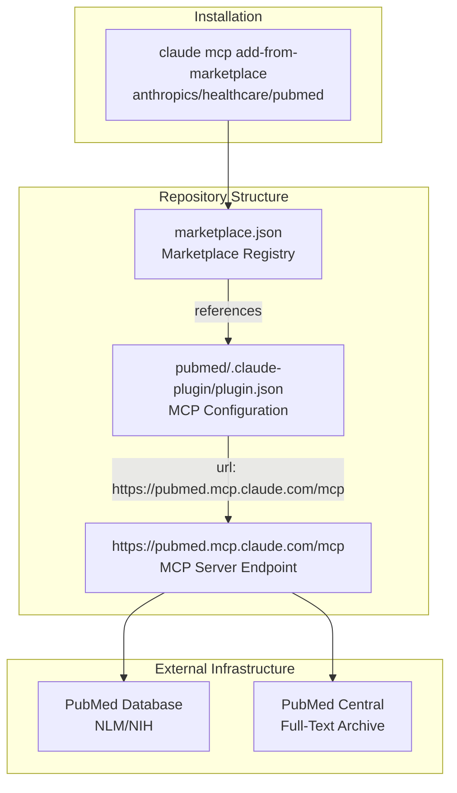
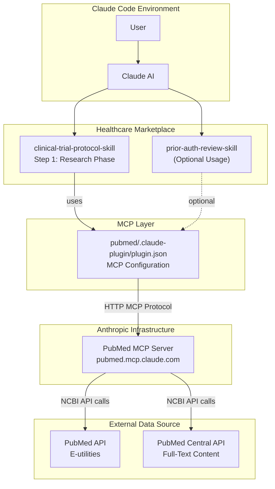
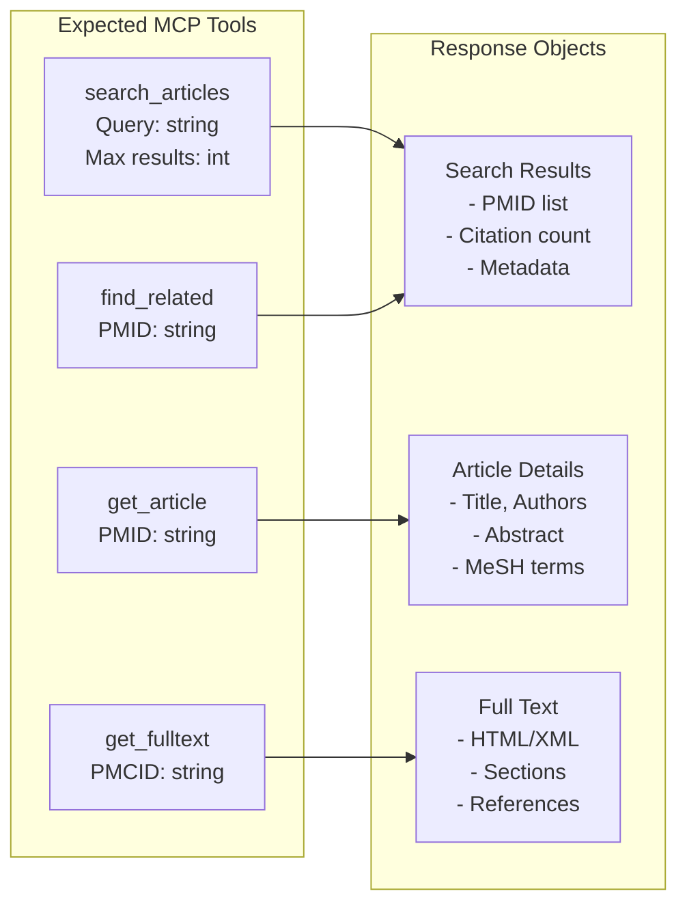
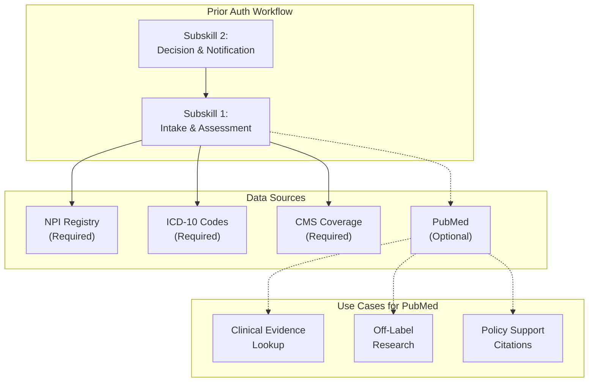
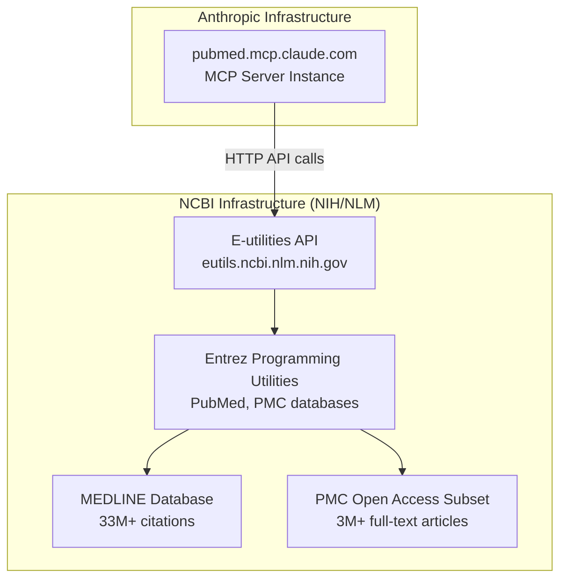
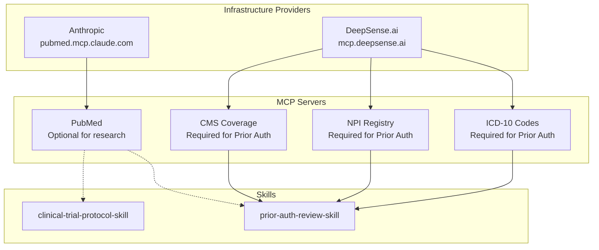

<!-- source: DeepWiki mcp.deepwiki.com · repo anthropics/healthcare · page 4.3 PubMed Literature Search · fetched 2026-10-26 -->

# PubMed Literature Search

<details>
<summary>Relevant source files</summary>

The following files were used as context for generating this wiki page:

- [.github/workflows/release.yml](.github/workflows/release.yml)
- [README.md](README.md)
- [clinical-trial-protocol-skill/README.md](clinical-trial-protocol-skill/README.md)
- [cms-coverage/.claude-plugin/plugin.json](cms-coverage/.claude-plugin/plugin.json)
- [npi-registry/.claude-plugin/plugin.json](npi-registry/.claude-plugin/plugin.json)
- [prior-auth-review-skill/README.md](prior-auth-review-skill/README.md)
- [pubmed/.claude-plugin/plugin.json](pubmed/.claude-plugin/plugin.json)

</details>


## Purpose and Scope

This document describes the PubMed MCP Server, which provides access to the National Library of Medicine's biomedical literature database. The server enables Claude to search PubMed citations, retrieve article metadata and abstracts, and access full-text content from PubMed Central (PMC) when available.

For information about other MCP servers in the marketplace, see:
- CMS Coverage Database ([4.1](#4.1))
- NPI Registry ([4.2](#4.2))
- ICD-10 Codes ([4.4](#4.4))

For skills that use this MCP server, see:
- Clinical Trial Protocol Generator ([3.1](#3.1))

**Sources:** [pubmed/.claude-plugin/plugin.json:1-15](), [README.md:44-58]()

---

## MCP Server Configuration

The PubMed MCP Server is a remote HTTP-based service hosted by Anthropic. Unlike the healthcare-domain-specific MCP servers (CMS Coverage, NPI Registry, ICD-10), PubMed is maintained directly by Anthropic infrastructure.

### Plugin Metadata

| Property | Value |
|----------|-------|
| **Name** | `pubmed` |
| **Version** | 1.0.0 |
| **Type** | HTTP MCP Server |
| **Endpoint** | `https://pubmed.mcp.claude.com/mcp` |
| **Author** | Anthropic |
| **Marketplace ID** | `anthropics/healthcare/pubmed` |

**Sources:** [pubmed/.claude-plugin/plugin.json:1-15]()

### Configuration Structure



**Sources:** [pubmed/.claude-plugin/plugin.json:1-15](), [README.md:55-58]()

---

## MCP Server Architecture

The PubMed MCP Server follows the standard HTTP-based MCP pattern used throughout the healthcare marketplace. It exposes tools and resources via the Model Context Protocol, allowing Claude to interact with PubMed's APIs programmatically.

### System Integration Diagram



**Sources:** [pubmed/.claude-plugin/plugin.json:1-15](), [README.md:44-58](), [clinical-trial-protocol-skill/README.md:48-50]()

---

## Available Capabilities

The PubMed MCP Server provides access to the complete biomedical literature indexed in PubMed and archived in PubMed Central. The server description indicates the following capabilities:

### Core Features

| Feature | Description | Use Case |
|---------|-------------|----------|
| **Article Search** | Query PubMed database using keywords, MeSH terms, author names, journals | Finding relevant clinical studies, review articles, case reports |
| **Metadata Retrieval** | Access citation information (title, authors, journal, publication date, DOI) | Building reference lists, tracking publications |
| **Abstract Access** | Retrieve structured abstracts for indexed articles | Quick review of study methods and findings |
| **Full-Text Content** | Access complete article text when available in PMC Open Access subset | Deep analysis of study protocols, results, discussion |
| **Related Research** | Find similar articles using PubMed's "Similar Articles" algorithm | Literature review, finding comparable studies |

**Sources:** [pubmed/.claude-plugin/plugin.json:4]()

### MCP Tools Pattern

While the specific tool names are not documented in the repository, HTTP-based MCP servers typically expose tools following this pattern:



**Sources:** [pubmed/.claude-plugin/plugin.json:4]()

---

## Integration with Healthcare Skills

The PubMed MCP Server is designed as shared infrastructure across multiple healthcare skills. Its primary documented integration is with the Clinical Trial Protocol Generator skill.

### Clinical Trial Protocol Generator Usage

The PubMed server supports the research phase (Step 1) of protocol generation, though the workflow notes indicate primary research happens via ClinicalTrials.gov MCP:

**Workflow Context:**

| Workflow Step | Description | PubMed Role |
|---------------|-------------|-------------|
| **Step 0: Initialize** | Collect intervention metadata | Not used |
| **Step 1: Research** | Search ClinicalTrials.gov, find FDA guidance | Optional literature review |
| **Step 2-5: Generation** | Build protocol sections | Not used |

The clinical trial protocol skill lists these research requirements:
- ClinicalTrials.gov MCP Server (primary research source)
- WebSearch for FDA guidance documents
- PubMed (available but not explicitly required)

**Sources:** [clinical-trial-protocol-skill/README.md:37-50]()

### Prior Authorization Review Usage

The PubMed server is available to the Prior Authorization Review skill for optional use cases:



**Sources:** [prior-auth-review-skill/README.md:27-66]()

---

## Installation and Configuration

### Adding to Claude Code

Install the PubMed MCP Server using the marketplace command:

```bash
claude mcp add-from-marketplace anthropics/healthcare/pubmed
```

This command:
1. Queries the marketplace registry at `.claude-plugin/marketplace.json`
2. Locates the `pubmed` MCP definition
3. Reads the configuration from `pubmed/.claude-plugin/plugin.json`
4. Registers the HTTP endpoint `https://pubmed.mcp.claude.com/mcp` with Claude

**Sources:** [README.md:52-58]()

### Verification

After installation, verify the MCP server is available by checking that Claude can access biomedical literature search capabilities. The server requires no authentication or local configuration—it's a public service hosted by Anthropic.

**Plugin Configuration Details:**

[pubmed/.claude-plugin/plugin.json:1-15]() contains the complete MCP server definition:

```json
{
  "name": "pubmed",
  "version": "1.0.0",
  "description": "Provides access to PubMed's biomedical citations...",
  "author": {
    "name": "Anthropic",
    "url": "https://www.anthropic.com/"
  },
  "mcpServers": {
    "PubMed": {
      "type": "http",
      "url": "https://pubmed.mcp.claude.com/mcp"
    }
  }
}
```

**Sources:** [pubmed/.claude-plugin/plugin.json:1-15]()

---

## Data Sources and Infrastructure

### Backend Architecture



### Data Coverage

| Database | Content | Scale | Access |
|----------|---------|-------|--------|
| **PubMed** | Biomedical citations and abstracts | 33+ million records | Complete via MCP |
| **PubMed Central** | Full-text journal articles | 3+ million articles | Open Access subset only |
| **MEDLINE** | Curated subset with MeSH indexing | 27+ million records | Via PubMed queries |

**Sources:** [pubmed/.claude-plugin/plugin.json:4]()

### Hosting and Maintenance

Unlike the healthcare-specific MCP servers (CMS Coverage, NPI Registry, ICD-10) which are hosted by DeepSense.ai, the PubMed MCP server is maintained directly by Anthropic:

| Aspect | Detail |
|--------|--------|
| **Hosting** | Anthropic infrastructure (`pubmed.mcp.claude.com`) |
| **Maintenance** | Anthropic |
| **Endpoint Type** | HTTP MCP Server |
| **Authentication** | None required (public service) |
| **Rate Limiting** | Managed by Anthropic MCP infrastructure |

**Sources:** [pubmed/.claude-plugin/plugin.json:6-8](), [README.md:50]()

---

## Comparison with Other MCP Servers

### MCP Server Comparison Matrix

| MCP Server | Host | Domain | Required For |
|------------|------|--------|--------------|
| **PubMed** | Anthropic | Biomedical literature | None (optional) |
| **CMS Coverage** | DeepSense.ai | Medicare policies | Prior Auth Review |
| **NPI Registry** | DeepSense.ai | Provider credentials | Prior Auth Review |
| **ICD-10 Codes** | DeepSense.ai | Diagnosis codes | Prior Auth Review |



**Sources:** [README.md:44-58](), [cms-coverage/.claude-plugin/plugin.json:1-15](), [npi-registry/.claude-plugin/plugin.json:1-15](), [pubmed/.claude-plugin/plugin.json:1-15]()

---

