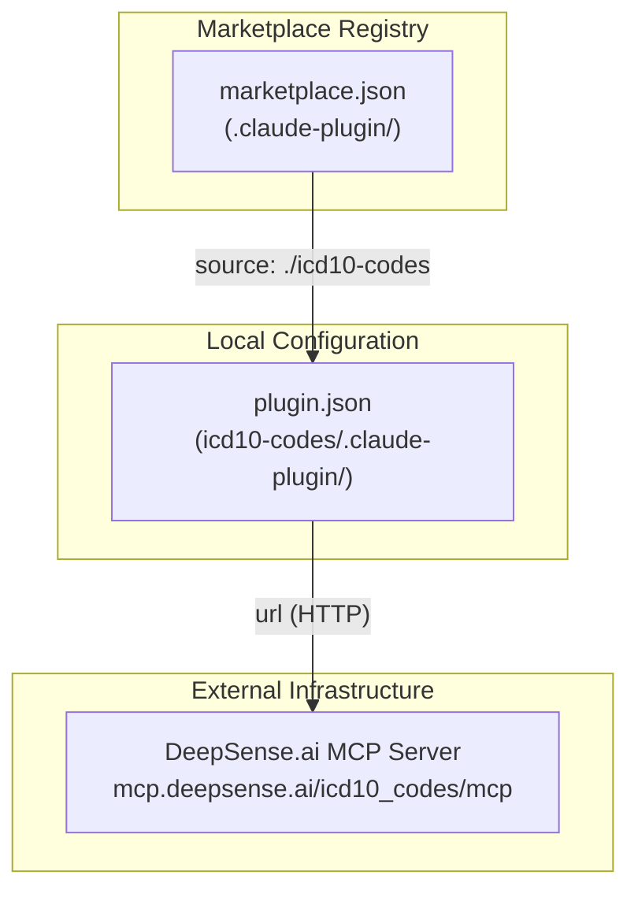
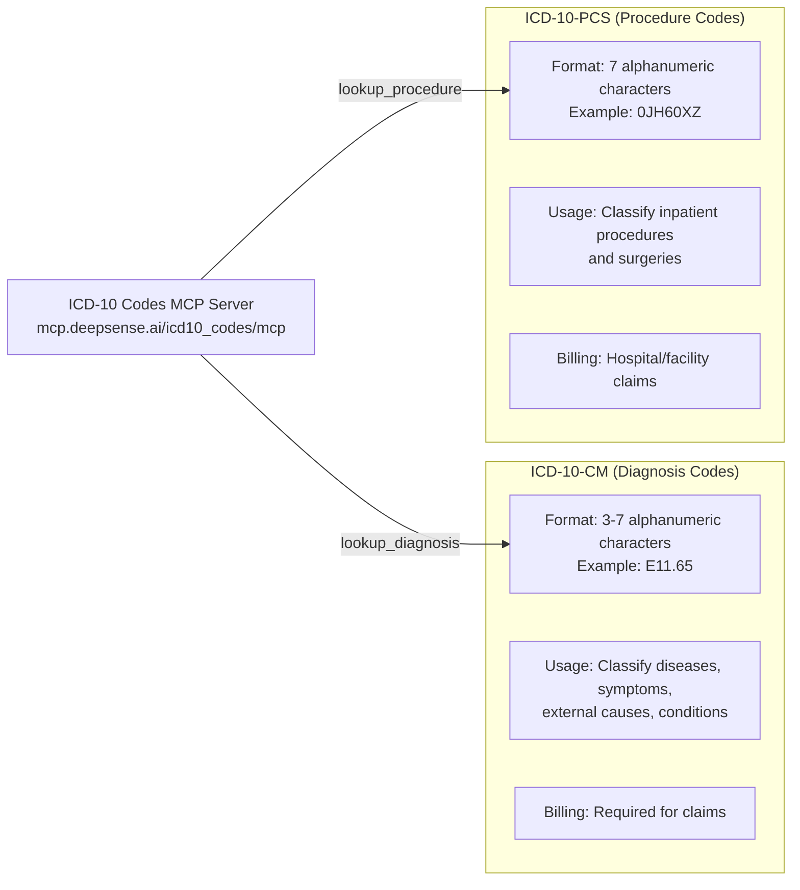
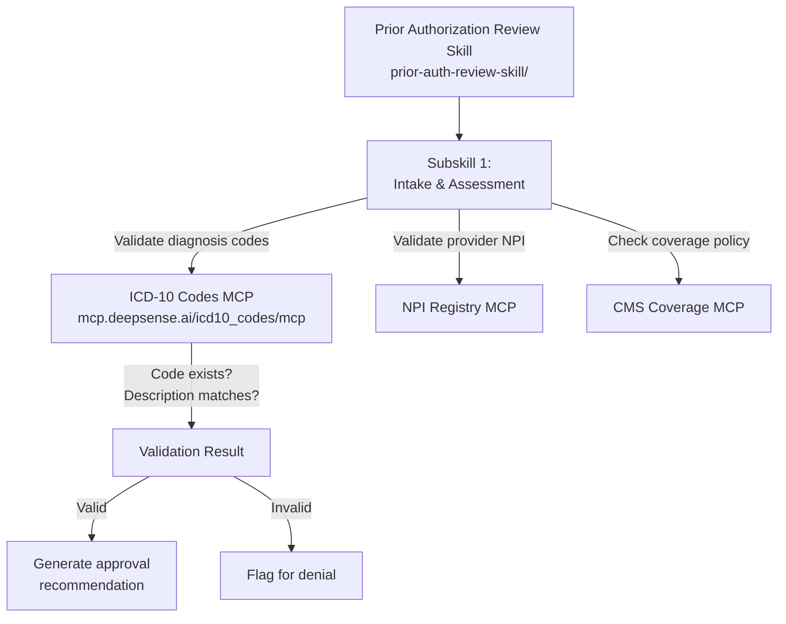
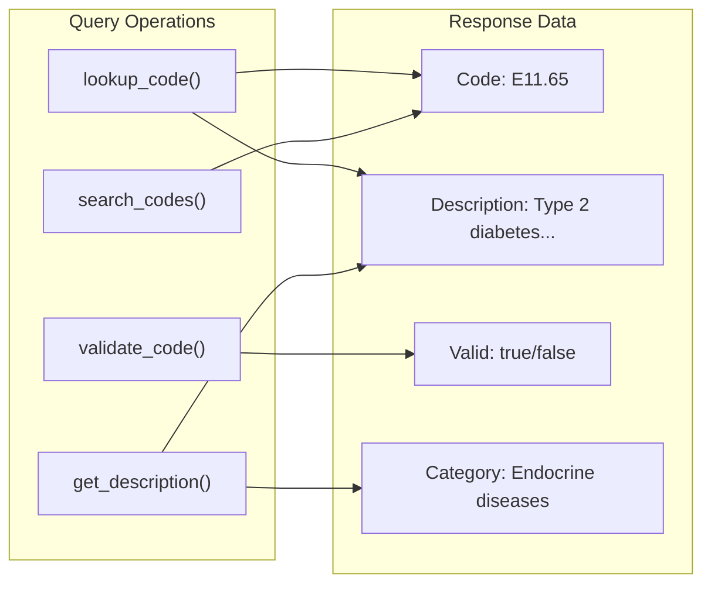
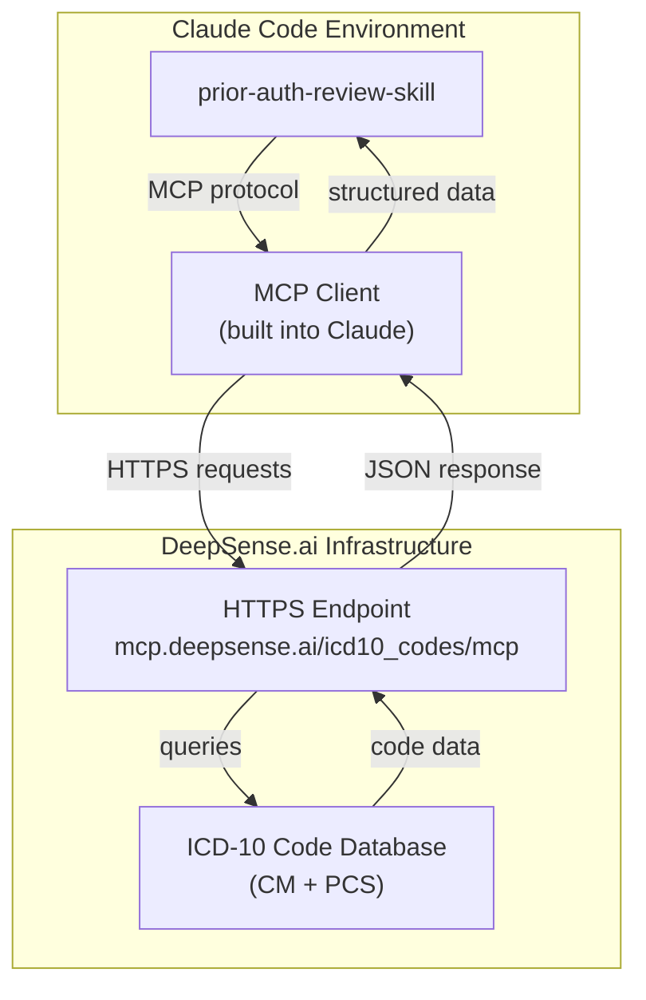

<!-- source: DeepWiki mcp.deepwiki.com · repo anthropics/healthcare · page 4.4 ICD-10 Codes · fetched 2026-10-26 -->

# ICD-10 Codes

<details>
<summary>Relevant source files</summary>

The following files were used as context for generating this wiki page:

- [.claude-plugin/marketplace.json](.claude-plugin/marketplace.json)
- [.github/workflows/release.yml](.github/workflows/release.yml)
- [README.md](README.md)
- [cms-coverage/.claude-plugin/plugin.json](cms-coverage/.claude-plugin/plugin.json)
- [icd10-codes/.claude-plugin/plugin.json](icd10-codes/.claude-plugin/plugin.json)
- [npi-registry/.claude-plugin/plugin.json](npi-registry/.claude-plugin/plugin.json)
- [pubmed/.claude-plugin/plugin.json](pubmed/.claude-plugin/plugin.json)

</details>


## Purpose and Scope

This document describes the **ICD-10 Codes MCP Server**, an external data connector that provides Claude with access to the International Classification of Diseases, 10th Revision (ICD-10) code sets. The server exposes both ICD-10-CM (Clinical Modification) diagnosis codes and ICD-10-PCS (Procedure Coding System) procedure codes for medical classification and billing purposes.

For information about other healthcare data sources, see [CMS Coverage Database](#4.1), [NPI Registry](#4.2), and [PubMed Literature Search](#4.3). For information about how skills use this MCP server, see [Prior Authorization Review](#3.2) and specifically [Intake & Assessment Subskill](#3.2.1).

## Overview

The ICD-10 Codes MCP server is a remote HTTP-based connector hosted by deepsense.ai that provides programmatic access to standardized medical classification codes. Unlike inline skills which run within Claude's environment, this MCP server operates as an external service, allowing Claude to query diagnosis and procedure codes without embedding the entire code set locally.

**Key Characteristics:**

| Aspect | Details |
|--------|---------|
| **Plugin Name** | `icd10-codes` |
| **Plugin Type** | MCP Server (external data connector) |
| **Hosting** | DeepSense.ai infrastructure |
| **Protocol** | HTTP/HTTPS |
| **Code Sets** | ICD-10-CM (diagnosis), ICD-10-PCS (procedure) |
| **Primary Use Case** | Prior authorization code validation |

Sources: [.claude-plugin/marketplace.json:66-72](), [icd10-codes/.claude-plugin/plugin.json:1-16]()

## MCP Server Architecture

### Plugin Configuration Structure

The ICD-10 Codes connector follows the standard MCP server configuration pattern used throughout the healthcare marketplace:



**Diagram: ICD-10 MCP Server Configuration Chain**

Sources: [.claude-plugin/marketplace.json:66-72](), [icd10-codes/.claude-plugin/plugin.json:1-16]()

### Configuration Files

#### Marketplace Registration

The marketplace entry defines the plugin metadata and discovery information:

[.claude-plugin/marketplace.json:66-72]()

```json
{
  "name": "icd10-codes",
  "source": "./icd10-codes",
  "description": "Access ICD-10-CM and ICD-10-PCS code sets",
  "category": "healthcare",
  "tags": ["icd-10", "diagnosis", "procedure", "billing", "medical-coding"]
}
```

#### Plugin Specification

The plugin configuration specifies the HTTP endpoint and server details:

[icd10-codes/.claude-plugin/plugin.json:1-16]()

| Field | Value | Purpose |
|-------|-------|---------|
| `name` | `"icd10-codes"` | Plugin identifier |
| `version` | `"1.0.0"` | Plugin version |
| `author.name` | `"deepsense.ai"` | Service provider |
| `mcpServers.type` | `"http"` | Connection protocol |
| `mcpServers.url` | `"https://mcp.deepsense.ai/icd10_codes/mcp"` | API endpoint |

Sources: [icd10-codes/.claude-plugin/plugin.json:1-16]()

## ICD-10 Code Sets

The ICD-10 system consists of two distinct but complementary code sets, both accessible through this MCP server:



**Diagram: ICD-10 Code Set Structure**

### ICD-10-CM (Clinical Modification)

ICD-10-CM codes are used to classify diagnoses, symptoms, and conditions in all healthcare settings (inpatient, outpatient, emergency, physician offices).

**Characteristics:**
- **Format**: 3-7 alphanumeric characters (e.g., `E11.65` for Type 2 diabetes with hyperglycemia)
- **Structure**: Category (first 3 chars) + subcategories + extensions
- **Use Cases**: 
  - Diagnosis documentation
  - Medical billing and claims
  - Prior authorization justification
  - Epidemiological tracking
  
**Example Codes:**
| Code | Description |
|------|-------------|
| `E11.65` | Type 2 diabetes mellitus with hyperglycemia |
| `I10` | Essential (primary) hypertension |
| `J44.0` | Chronic obstructive pulmonary disease with acute lower respiratory infection |

### ICD-10-PCS (Procedure Coding System)

ICD-10-PCS codes classify inpatient procedures performed in hospital settings.

**Characteristics:**
- **Format**: Exactly 7 alphanumeric characters (e.g., `0JH60XZ`)
- **Structure**: Each position has specific meaning (body system, root operation, body part, approach, device, qualifier)
- **Use Cases**:
  - Hospital inpatient procedure coding
  - Surgical procedure classification
  - Prior authorization for procedures

Sources: [icd10-codes/.claude-plugin/plugin.json:4]()

## Integration with Prior Authorization Review

The ICD-10 Codes MCP server is a critical dependency for the Prior Authorization Review skill, specifically used in the intake and assessment phase to validate diagnosis codes submitted with authorization requests.



**Diagram: ICD-10 MCP Integration in Prior Authorization Workflow**

### Validation Workflow

During prior authorization review, the ICD-10 Codes MCP server is queried to:

1. **Verify Code Existence**: Confirm the submitted ICD-10 code exists in the official code set
2. **Validate Description**: Ensure the diagnosis description matches the code
3. **Check Code Currency**: Verify the code is current (not deprecated or outdated)
4. **Assess Medical Necessity**: Support evaluation of whether the diagnosis justifies the requested service

**Example Query Pattern:**

When a prior authorization request includes diagnosis code `E11.65`, the skill queries the ICD-10 MCP to:
- Confirm `E11.65` is a valid ICD-10-CM code
- Retrieve the official description ("Type 2 diabetes mellitus with hyperglycemia")
- Determine if the diagnosis supports the requested treatment or procedure

Sources: [README.md:28-32](), [.claude-plugin/marketplace.json:23-32]()

## Installation and Usage

### Adding the MCP Server

The ICD-10 Codes MCP server is installed separately from skills using the MCP marketplace command:

```bash
claude mcp add-from-marketplace anthropics/healthcare/icd10-codes
```

This command:
1. Reads the marketplace registry at [.claude-plugin/marketplace.json:66-72]()
2. Locates the plugin source at `./icd10-codes`
3. Loads the plugin configuration from [icd10-codes/.claude-plugin/plugin.json:1-16]()
4. Registers the HTTP endpoint `https://mcp.deepsense.ai/icd10_codes/mcp` with Claude

**Note**: Unlike the CMS Coverage, NPI Registry, and PubMed servers, the ICD-10 Codes server is **not** listed in the README's MCP installation instructions [README.md:44-58](). However, it is registered in the marketplace and available for installation.

### Prerequisites

| Requirement | Details |
|-------------|---------|
| **Network Access** | HTTPS connectivity to `mcp.deepsense.ai` |
| **Authentication** | Managed by Claude Code environment |
| **Dependencies** | None - external HTTP service |

Sources: [README.md:52-58](), [icd10-codes/.claude-plugin/plugin.json:9-14]()

## Query Patterns and Use Cases

### Common Query Types



**Diagram: ICD-10 MCP Server Query Operations**

### Use Case 1: Prior Authorization Code Validation

**Scenario**: A prior authorization request includes diagnosis code `E11.65` for a glucose monitoring device.

**Workflow**:
1. Skill queries ICD-10 MCP: `lookup_code("E11.65", type="diagnosis")`
2. Server returns: `{"code": "E11.65", "description": "Type 2 diabetes mellitus with hyperglycemia", "valid": true}`
3. Skill validates the code exists and description matches the request
4. Code validation informs the medical necessity assessment

### Use Case 2: Diagnosis Code Search

**Scenario**: Searching for diabetes-related diagnosis codes.

**Workflow**:
1. Skill queries: `search_codes("diabetes mellitus type 2", type="diagnosis")`
2. Server returns multiple matching codes:
   - `E11` (Type 2 diabetes mellitus without complications)
   - `E11.65` (Type 2 diabetes mellitus with hyperglycemia)
   - `E11.9` (Type 2 diabetes mellitus without complications)
3. User selects appropriate code based on patient condition

### Use Case 3: Procedure Code Lookup

**Scenario**: Validating a procedure code for prior authorization of a surgical intervention.

**Workflow**:
1. Skill queries: `lookup_code("0JH60XZ", type="procedure")`
2. Server returns ICD-10-PCS code details
3. Skill confirms procedure classification matches authorization request

Sources: [.claude-plugin/marketplace.json:66-72](), [icd10-codes/.claude-plugin/plugin.json:1-16]()

## Technical Architecture

### Service Infrastructure



**Diagram: ICD-10 MCP Server Request Flow**

### Configuration Mapping

The following table maps configuration fields to their roles in the system:

| Configuration Path | Field | Value | System Role |
|-------------------|-------|-------|-------------|
| `marketplace.json` | `plugins[6].name` | `"icd10-codes"` | Marketplace identifier |
| `marketplace.json` | `plugins[6].source` | `"./icd10-codes"` | Local config directory |
| `plugin.json` | `name` | `"icd10-codes"` | Plugin name (matches marketplace) |
| `plugin.json` | `mcpServers.type` | `"http"` | Connection protocol |
| `plugin.json` | `mcpServers.url` | `"https://mcp.deepsense.ai/icd10_codes/mcp"` | API endpoint URL |
| `plugin.json` | `author.name` | `"deepsense.ai"` | Service provider |

Sources: [.claude-plugin/marketplace.json:66-72](), [icd10-codes/.claude-plugin/plugin.json:1-16]()

## Comparison with Other MCP Servers

The ICD-10 Codes MCP server is one of four healthcare data connectors in the marketplace:

| MCP Server | Purpose | Provider | Code Sets |
|------------|---------|----------|-----------|
| **ICD-10 Codes** | Diagnosis/procedure codes | deepsense.ai | ICD-10-CM, ICD-10-PCS |
| CMS Coverage | Medicare coverage policies | deepsense.ai | NCDs, LCDs |
| NPI Registry | Provider identification | deepsense.ai | NPI database |
| PubMed | Biomedical literature | Anthropic | PubMed, PMC |

**Shared Infrastructure Pattern**: The ICD-10, CMS Coverage, and NPI Registry servers all:
- Use the same hosting provider (deepsense.ai)
- Share the same URL pattern (`mcp.deepsense.ai/<service>/mcp`)
- Follow identical plugin configuration structures
- Support the Prior Authorization Review skill

**Unique Characteristics**: The ICD-10 server is distinct in providing:
- Two separate code sets (CM and PCS) within a single endpoint
- Standardized medical classification codes used across all healthcare settings
- Alphanumeric code validation beyond simple lookups

Sources: [.claude-plugin/marketplace.json:45-72](), [cms-coverage/.claude-plugin/plugin.json:1-15](), [npi-registry/.claude-plugin/plugin.json:1-15](), [pubmed/.claude-plugin/plugin.json:1-15]()

## Release and Versioning

The ICD-10 Codes MCP server follows the standard marketplace release workflow:

### Version Information

| Aspect | Details |
|--------|---------|
| Current Version | `1.0.0` [icd10-codes/.claude-plugin/plugin.json:3]() |
| Marketplace Version | `1.0.0` [.claude-plugin/marketplace.json:8]() |
| Release Workflow | Not packaged (external service) |

### Update Process

Unlike skills which are packaged into zip files during releases [.github/workflows/release.yml:18-42](), MCP server configurations are not included in the release artifacts. Updates to the ICD-10 MCP server involve:

1. **Configuration Updates**: Changes to [icd10-codes/.claude-plugin/plugin.json:1-16]()
2. **Marketplace Updates**: Version bumps in [.claude-plugin/marketplace.json:66-72]()
3. **External Service Updates**: Backend changes managed by deepsense.ai (transparent to users)

The external service at `https://mcp.deepsense.ai/icd10_codes/mcp` can be updated independently of the plugin configuration, allowing code set updates without requiring marketplace version changes.

Sources: [icd10-codes/.claude-plugin/plugin.json:3](), [.github/workflows/release.yml:1-43]()

---

