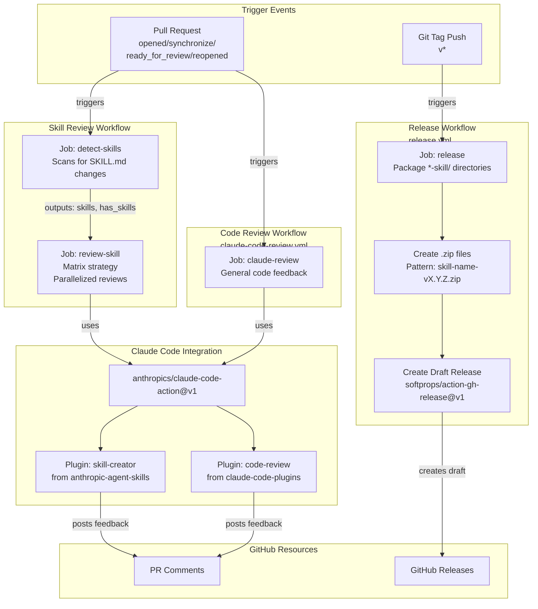
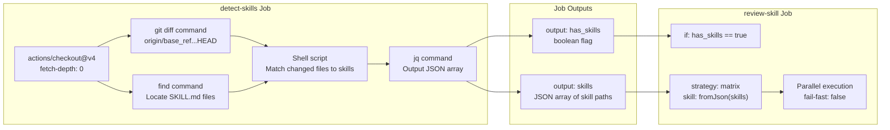

<!-- source: DeepWiki mcp.deepwiki.com · repo anthropics/healthcare · page 5 CI/CD and Automation · fetched 2026-10-26 -->

# CI/CD and Automation

<details>
<summary>Relevant source files</summary>

The following files were used as context for generating this wiki page:

- [.github/workflows/claude-code-review.yml](.github/workflows/claude-code-review.yml)
- [.github/workflows/claude-skill-review.yml](.github/workflows/claude-skill-review.yml)
- [.github/workflows/release.yml](.github/workflows/release.yml)
- [README.md](README.md)

</details>


## Purpose and Scope

This section documents the continuous integration and continuous deployment (CI/CD) infrastructure that ensures quality and automates release management for the healthcare marketplace. The system consists of three GitHub Actions workflows that provide automated skill reviews, code reviews, and release packaging.

For detailed documentation of specific workflows, see:
- Skill Review Workflow: [#5.1](#5.1)
- Code Review Workflow: [#5.2](#5.2)
- Release Workflow: [#5.3](#5.3)

---

## Architecture Overview

The healthcare marketplace employs three distinct automated workflows that operate at different stages of the development lifecycle. Each workflow serves a specific quality assurance or deployment purpose:

| Workflow | File | Trigger | Primary Purpose | Importance Score |
|----------|------|---------|----------------|------------------|
| Skill Review | `claude-skill-review.yml` | PR events (opened, synchronize, ready_for_review, reopened) | Automated review of skill changes using Claude | 49.07 |
| Code Review | `claude-code-review.yml` | PR events (opened, synchronize, ready_for_review, reopened) | General code review capabilities | 1.62 |
| Release | `release.yml` | Version tags (`v*`) | Package skills into distributable artifacts | 1.08 |

The skill review workflow dominates the CI/CD infrastructure in terms of importance, serving as the primary quality gate for all skill modifications.

**Sources:** [.github/workflows/claude-skill-review.yml:1-88](), [.github/workflows/claude-code-review.yml:1-45](), [.github/workflows/release.yml:1-43]()

---

## Workflow Architecture

### CI/CD Pipeline Flow



**Sources:** [.github/workflows/claude-skill-review.yml:3-10](), [.github/workflows/claude-code-review.yml:3-11](), [.github/workflows/release.yml:3-6]()

---

## Workflow Trigger Patterns

### Pull Request Triggers

Both the skill review and code review workflows use identical trigger configurations:

```yaml
on:
  pull_request:
    types: [opened, synchronize, ready_for_review, reopened]
```

These events ensure that automation runs:
- **opened**: When a new PR is created
- **synchronize**: When new commits are pushed to the PR branch
- **ready_for_review**: When a draft PR is marked ready
- **reopened**: When a closed PR is reopened

The workflows also support `workflow_call` to enable reusable workflow patterns from other repositories.

**Sources:** [.github/workflows/claude-skill-review.yml:3-10](), [.github/workflows/claude-code-review.yml:3-11]()

### Release Triggers

The release workflow uses tag-based triggers:

```yaml
on:
  push:
    tags:
      - 'v*'
```

Any tag matching the pattern `v*` (e.g., `v1.0.0`, `v2.1.3`) triggers the release process. This follows semantic versioning conventions and allows manual control over when releases are published.

**Sources:** [.github/workflows/release.yml:3-6]()

---

## Claude Code Action Integration

All three workflows leverage the `anthropics/claude-code-action@v1` GitHub Action to invoke Claude-powered automation. The action requires specific configuration parameters:

### Configuration Parameters

| Parameter | Purpose | Example Value |
|-----------|---------|---------------|
| `claude_code_oauth_token` | Authentication for Claude API | `${{ secrets.CLAUDE_CODE_OAUTH_TOKEN }}` |
| `plugin_marketplaces` | Marketplace URLs to load plugins from | `https://github.com/anthropics/skills.git` |
| `plugins` | Specific plugins to install | `example-skills@anthropic-agent-skills` |
| `claude_args` | Command-line arguments for Claude | `--allowedTools "Bash,Read,Glob"` |
| `prompt` | Task description for Claude | Text describing the review task |

### Secret Management

The workflows require the `CLAUDE_CODE_OAUTH_TOKEN` secret, which must be configured at the repository level. The skill review workflow accepts this as a workflow input for reusability:

```yaml
workflow_call:
  secrets:
    CLAUDE_CODE_OAUTH_TOKEN:
      required: true
```

**Sources:** [.github/workflows/claude-skill-review.yml:6-9](), [.github/workflows/claude-skill-review.yml:76-84](), [.github/workflows/claude-code-review.yml:34-44]()

---

## Job Architecture and Dependencies

### Skill Review Job Dependencies



The `detect-skills` job produces structured outputs that control the `review-skill` job:
- **needs**: `review-skill` depends on `detect-skills` completing first
- **conditional execution**: Only runs if `has_skills == 'true'`
- **matrix strategy**: Parallelizes reviews across all detected skills

**Sources:** [.github/workflows/claude-skill-review.yml:12-53](), [.github/workflows/claude-skill-review.yml:55-67]()

---

## Permission Model

GitHub Actions workflows require explicit permissions to interact with repository resources. The healthcare marketplace workflows use a least-privilege model:

### Skill Review Permissions

```yaml
permissions:
  contents: read       # Read repository files
  pull-requests: write # Post PR comments
  issues: write        # Write to issue tracker
  id-token: write      # OIDC token for authentication
```

### Code Review Permissions

```yaml
permissions:
  contents: read       # Read repository files
  pull-requests: read  # Read PR metadata
  issues: read         # Read issue metadata
  id-token: write      # OIDC token for authentication
```

### Release Permissions

```yaml
permissions:
  contents: write      # Create releases and upload assets
```

The skill review workflow requires write access to post feedback comments, while the code review workflow uses read-only access. The release workflow needs write access to create GitHub releases.

**Sources:** [.github/workflows/claude-skill-review.yml:63-67](), [.github/workflows/claude-code-review.yml:22-26](), [.github/workflows/release.yml:8-9]()

---

## Development Lifecycle Integration

### Quality Gates in the Pull Request Flow

```mermaid
stateDiagram-v2
    [*] --> PR_Created
    
    state PR_Created {
        [*] --> Skill_Review_Triggered
        [*] --> Code_Review_Available
    }
    
    Skill_Review_Triggered --> detect_skills_job
    
    state detect_skills_job {
        [*] --> Git_Diff_Analysis
        Git_Diff_Analysis --> SKILL_MD_Discovery
        SKILL_MD_Discovery --> Match_Changed_Files
        Match_Changed_Files --> Output_Skills_JSON
    }
    
    Output_Skills_JSON --> Conditional_Check
    
    state Conditional_Check <<choice>>
    Conditional_Check --> review_skill_job: has_skills == true
    Conditional_Check --> Skip_Review: has_skills == false
    
    state review_skill_job {
        [*] --> Matrix_Setup
        Matrix_Setup --> Parallel_Reviews
        
        state Parallel_Reviews {
            Skill_A: Review skill A
            Skill_B: Review skill B
            Skill_C: Review skill C
            --
            [*] --> Skill_A
            [*] --> Skill_B
            [*] --> Skill_C
        }
        
        Parallel_Reviews --> Post_Feedback
    }
    
    Code_Review_Available --> Manual_Trigger: @claude mention
    Manual_Trigger --> claude_review_job
    
    review_skill_job --> Human_Review
    claude_review_job --> Human_Review
    Skip_Review --> Human_Review
    
    Human_Review --> Approval
    Human_Review --> Request_Changes
    Request_Changes --> PR_Updated
    PR_Updated --> Skill_Review_Triggered
    
    Approval --> [*]
```

**Sources:** [.github/workflows/claude-skill-review.yml:1-88](), [.github/workflows/claude-code-review.yml:1-45]()

---

## Release Process

The release workflow automates skill packaging when version tags are pushed:

### Release Job Steps

1. **Checkout**: Retrieve repository code at the tagged commit
2. **Package Skills**: Scan for directories matching `*-skill/` pattern
3. **Create Archives**: Generate zip files with naming pattern `{skill-name}-{tag}.zip`
4. **Draft Release**: Create GitHub release with auto-generated notes

### Packaging Logic

The workflow uses shell scripting to locate and package skills:

```bash
for skill_dir in *-skill/; do
  if [ -d "$skill_dir" ]; then
    skill_name="${skill_dir%/}"
    cd "$skill_name"
    zip -r "../${skill_name}-${GITHUB_REF_NAME}.zip" .
    cd ..
  fi
done
```

This pattern ensures that any directory ending in `-skill/` is automatically packaged without manual configuration. The `GITHUB_REF_NAME` variable contains the tag name (e.g., `v1.2.0`).

**Sources:** [.github/workflows/release.yml:18-33]()

---

## Workflow Execution Context

### Environment Variables

The workflows rely on GitHub-provided context variables:

| Variable | Description | Usage |
|----------|-------------|-------|
| `github.base_ref` | Base branch name (target of PR) | Git diff comparison: `origin/${{ github.base_ref }}` |
| `github.event.pull_request.number` | PR number | Included in Claude prompts for context |
| `github.repository` | Repository full name | Passed to code review plugin |
| `GITHUB_REF_NAME` | Tag or branch name | Used in release artifact naming |

### Matrix Strategy Configuration

The `review-skill` job uses GitHub's matrix strategy for parallelization:

```yaml
strategy:
  matrix:
    skill: ${{ fromJson(needs.detect-skills.outputs.skills) }}
  fail-fast: false
```

Key characteristics:
- **Dynamic matrix**: Populated from the `detect-skills` job output
- **fail-fast: false**: All skill reviews complete even if one fails
- **Parallel execution**: GitHub Actions runs multiple jobs concurrently

**Sources:** [.github/workflows/claude-skill-review.yml:59-62](), [.github/workflows/claude-skill-review.yml:83-87]()

---

## Integration with Claude Skills

### Skill Review Plugin Integration

The skill review workflow uses the `skill-creator` plugin from the `anthropic-agent-skills` marketplace:

```yaml
plugin_marketplaces: 'https://github.com/anthropics/skills.git'
plugins: 'example-skills@anthropic-agent-skills'
```

The prompt instructs Claude to:
1. Use the `skill-creator` skill to perform the review
2. Analyze changes with `git diff origin/${{ github.base_ref }} -- ${{ matrix.skill }}/`
3. Provide full reviews for new skills, or focused reviews for modifications
4. Post feedback using `gh pr comment` command

### Allowed Tools Configuration

The workflows restrict Claude's tool access for security:

```yaml
claude_args: '--allowedTools "Bash(gh pr comment:*),Bash(git:*),Read,Glob,Grep,Skill"'
```

Permitted operations:
- **Bash(gh pr comment:\*)**: Post PR comments via GitHub CLI
- **Bash(git:\*)**: Execute git commands for diff analysis
- **Read, Glob, Grep**: File system operations for code inspection
- **Skill**: Invoke other Claude skills

**Sources:** [.github/workflows/claude-skill-review.yml:76-87](), [.github/workflows/claude-code-review.yml:37-41]()

---

## Workflow Outputs and Artifacts

### Skill Review Outputs

The `detect-skills` job produces outputs consumed by downstream jobs:

```yaml
outputs:
  skills: ${{ steps.detect.outputs.skills }}
  has_skills: ${{ steps.detect.outputs.has_skills }}
```

Example output format:
```json
{
  "skills": ["clinical-trial-protocol-skill", "prior-auth-review-skill"],
  "has_skills": "true"
}
```

### Release Artifacts

The release workflow creates distributable packages:
- **Format**: ZIP archives
- **Naming**: `{skill-name}-{tag}.zip` (e.g., `fhir-developer-skill-v1.0.0.zip`)
- **Contents**: Complete skill directory including `SKILL.md`, `references/`, `scripts/`, and `assets/`
- **Attachment**: Uploaded to GitHub release as downloadable assets

**Sources:** [.github/workflows/claude-skill-review.yml:14-16](), [.github/workflows/claude-skill-review.yml:46-52](), [.github/workflows/release.yml:18-42]()

---

## Error Handling and Robustness

### Fail-Fast Strategy

The skill review workflow disables fail-fast behavior to ensure comprehensive feedback:

```yaml
fail-fast: false
```

This configuration ensures that if one skill fails review, other skills continue to be reviewed. Developers receive feedback on all modified skills rather than stopping at the first failure.

### Conditional Execution

The `review-skill` job includes a conditional guard:

```yaml
if: needs.detect-skills.outputs.has_skills == 'true'
```

This prevents unnecessary job execution when no skills are modified in a PR, conserving CI resources and reducing noise in the Actions log.

### Draft Release Strategy

The release workflow creates draft releases rather than immediately publishing:

```yaml
draft: true
prerelease: false
```

This allows manual verification of release artifacts before making them publicly available.

**Sources:** [.github/workflows/claude-skill-review.yml:57](), [.github/workflows/claude-skill-review.yml:62](), [.github/workflows/release.yml:41-42]()

---

## Summary

The healthcare marketplace CI/CD infrastructure provides three automated workflows that ensure quality and streamline releases:

1. **Skill Review**: Automated Claude-powered reviews of skill changes with intelligent change detection and parallel execution
2. **Code Review**: General-purpose code feedback triggered by PR events
3. **Release**: Automated packaging and distribution of skills via version tags

The skill review workflow serves as the primary quality gate with the highest importance score (49.07), implementing sophisticated detection logic, matrix-based parallelization, and integration with the `skill-creator` plugin. All workflows leverage the `anthropics/claude-code-action` for consistent Claude integration patterns.

**Sources:** [.github/workflows/claude-skill-review.yml:1-88](), [.github/workflows/claude-code-review.yml:1-45](), [.github/workflows/release.yml:1-43]()

---

