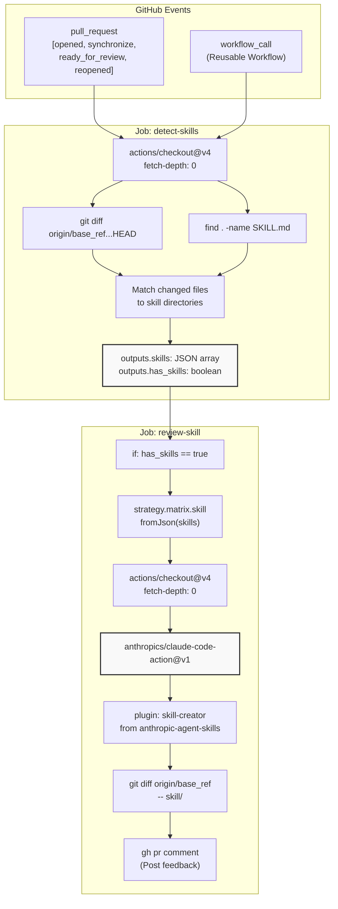
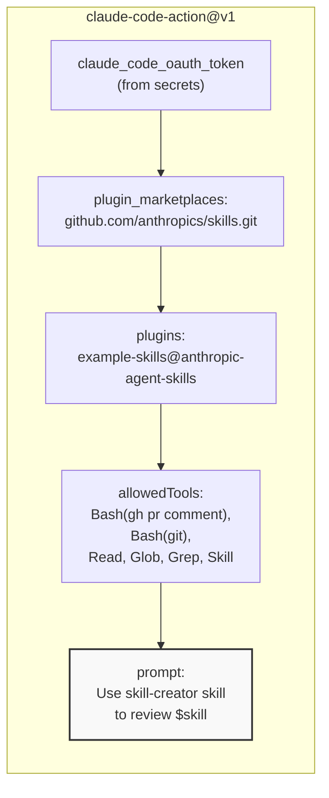
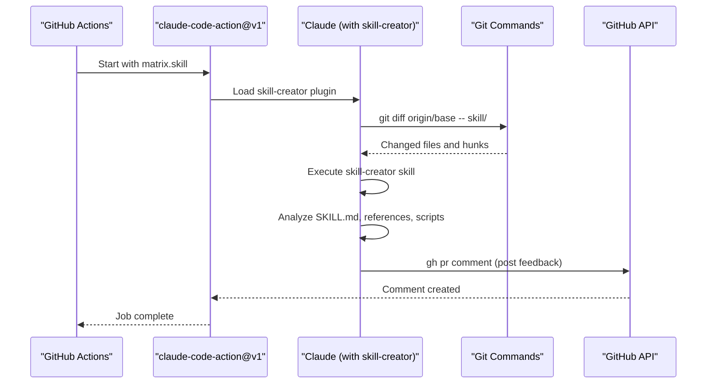
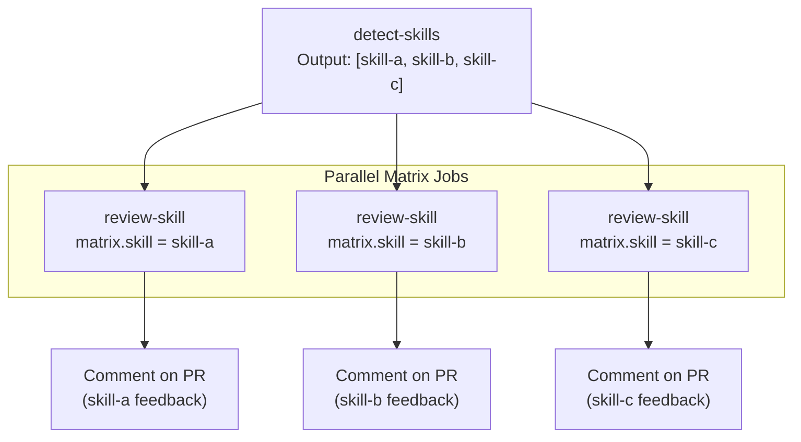
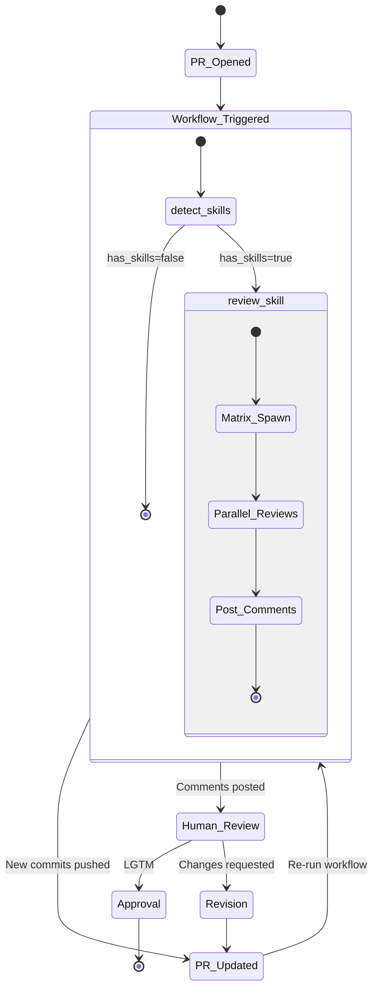

<!-- source: DeepWiki mcp.deepwiki.com · repo anthropics/healthcare · page 5.1 Skill Review Workflow · fetched 2026-10-26 -->

# Skill Review Workflow

<details>
<summary>Relevant source files</summary>

The following files were used as context for generating this wiki page:

- [.github/workflows/claude-skill-review.yml](.github/workflows/claude-skill-review.yml)

</details>


## Purpose and Scope

This document provides comprehensive documentation of the automated skill review system implemented in [.github/workflows/claude-skill-review.yml](). The skill review workflow is the primary quality assurance mechanism for healthcare skills in this repository, using Claude itself to review skill changes before they are merged.

This page covers the overall workflow architecture, job orchestration, and integration patterns. For detailed information about the skill detection algorithm, see [5.1.1](#5.1.1). For information about the matrix review strategy and parallel execution, see [5.1.2](#5.1.2). For general code review capabilities triggered by `@claude` mentions, see [5.2](#5.2).

**Sources:** [.github/workflows/claude-skill-review.yml:1-88]()

## Workflow Overview

The skill review workflow is the most critical component of the CI/CD infrastructure (importance: 49.07). It implements an AI-powered quality gate that automatically reviews every skill change in pull requests, ensuring healthcare skills meet quality standards before merging.

The workflow operates as a two-stage pipeline:

1. **Detection Stage** - Identifies which skills have been modified in a pull request
2. **Review Stage** - Executes parallel Claude-powered reviews for each affected skill

This architecture enables efficient, targeted reviews that scale across multiple skills without requiring manual expert review on every change.

**Sources:** [.github/workflows/claude-skill-review.yml:1-88]()

## Workflow Triggers

The workflow is triggered by GitHub pull request events and supports both automatic and reusable execution patterns.

### Trigger Events

| Event Type | Description | Configuration |
|------------|-------------|---------------|
| `pull_request.opened` | New PR created | Runs immediately on PR creation |
| `pull_request.synchronize` | New commits pushed to PR | Re-runs on each push |
| `pull_request.ready_for_review` | Draft PR marked ready | Runs when draft status removed |
| `pull_request.reopened` | Closed PR reopened | Runs on PR reopen |
| `workflow_call` | Called from another workflow | Requires `CLAUDE_CODE_OAUTH_TOKEN` secret |

The workflow does **not** trigger on draft pull requests until they are marked ready for review, preventing unnecessary reviews during active development.

**Sources:** [.github/workflows/claude-skill-review.yml:3-9]()

## Architecture Diagram



**Workflow Execution Flow**

This diagram shows the complete execution path from trigger events through skill detection and parallel review jobs. The `detect-skills` job produces JSON outputs that drive the `review-skill` job's matrix strategy.

**Sources:** [.github/workflows/claude-skill-review.yml:1-88]()

## Job: detect-skills

The `detect-skills` job is responsible for identifying which skills have been modified in a pull request. It runs on `ubuntu-latest` and produces outputs consumed by the `review-skill` job.

### Outputs

| Output Key | Type | Description |
|------------|------|-------------|
| `skills` | JSON array | List of skill directory paths that have changes |
| `has_skills` | boolean | `"true"` if any skills changed, `"false"` otherwise |

### Execution Steps

1. **Repository Checkout** - Uses `actions/checkout@v4` with `fetch-depth: 0` to access full git history for diff operations
2. **Change Detection** - Runs bash script to identify changed skill directories
3. **Output Generation** - Produces JSON array of affected skills or empty array if none

The detection algorithm uses git diff to compare the PR branch against the base branch, then cross-references changed file paths with directories containing `SKILL.md` files. This ensures only skills with actual modifications are reviewed.

For detailed implementation of the detection algorithm, see [5.1.1](#5.1.1).

**Sources:** [.github/workflows/claude-skill-review.yml:12-53]()

## Job: review-skill

The `review-skill` job executes Claude-powered reviews for each detected skill using a matrix strategy for parallel execution. It only runs when `needs.detect-skills.outputs.has_skills == 'true'`.

### Matrix Strategy Configuration

```yaml
strategy:
  matrix:
    skill: ${{ fromJson(needs.detect-skills.outputs.skills) }}
  fail-fast: false
```

The matrix dynamically expands based on the JSON array from `detect-skills`, creating one parallel job per skill. The `fail-fast: false` setting ensures that if one skill review fails, others continue to completion.

### Required Permissions

| Permission | Scope | Purpose |
|------------|-------|---------|
| `contents` | read | Access repository files and git history |
| `pull-requests` | write | Post review comments on pull requests |
| `issues` | write | Comment on related issues |
| `id-token` | write | OIDC token for authentication |

**Sources:** [.github/workflows/claude-skill-review.yml:55-67]()

## Claude Code Integration

The workflow integrates with Claude through the `anthropics/claude-code-action@v1` GitHub Action, configured with specific plugins and tools for skill review.

### Action Configuration Diagram



**Claude Code Action Configuration Components**

**Sources:** [.github/workflows/claude-skill-review.yml:75-87]()

### Configuration Parameters

| Parameter | Value | Purpose |
|-----------|-------|---------|
| `claude_code_oauth_token` | `${{ secrets.CLAUDE_CODE_OAUTH_TOKEN }}` | OAuth authentication for Claude Code service |
| `plugin_marketplaces` | `https://github.com/anthropics/skills.git` | Plugin source repository |
| `plugins` | `example-skills@anthropic-agent-skills` | Specific skill-creator plugin to load |
| `claude_args` | Tool allowlist | Restricts Claude to specific tool usage |
| `prompt` | Multi-line template | Instructions for reviewing the skill |

**Sources:** [.github/workflows/claude-skill-review.yml:77-87]()

## Allowed Tools

The workflow restricts Claude to a specific set of tools to ensure reviews are safe and focused:

| Tool Category | Specific Tool | Purpose |
|---------------|---------------|---------|
| Bash (restricted) | `gh pr comment:*` | Post review feedback as PR comments |
| Bash (restricted) | `git:*` | Execute git commands for diff inspection |
| File Operations | `Read` | Read skill files |
| File Operations | `Glob` | Pattern-based file discovery |
| File Operations | `Grep` | Search file contents |
| Skill Execution | `Skill` | Execute the skill-creator skill |

The bash tool is restricted to only `gh` and `git` commands, preventing arbitrary command execution. This security model ensures the review process cannot modify repository state or execute untrusted code.

**Sources:** [.github/workflows/claude-skill-review.yml:81]()

## Review Process

The review process follows a structured prompt that guides Claude through skill evaluation:

### Review Instructions

The prompt template instantiated for each skill:

```
Use the skill-creator skill to review the **{skill_name}** skill in PR #{pr_number}.

Use `git diff origin/{base_ref} -- {skill_path}/` to see what changed. 
If this is a new skill, provide a full review. 
If it's changes to an existing skill, focus on the changes.

Post your feedback as a comment using `gh pr comment`. Use the skill title in the header.
```

### Execution Flow



**Skill Review Sequence**

This sequence diagram shows the interaction between GitHub Actions, the Claude Code action, and external tools during skill review.

**Sources:** [.github/workflows/claude-skill-review.yml:82-87]()

## Skill-Creator Plugin

The workflow loads the `skill-creator` skill from the `example-skills@anthropic-agent-skills` marketplace. This skill specializes in:

- **SKILL.md Validation** - Checking format, completeness, and clarity of skill documentation
- **Reference Material Review** - Evaluating supporting documentation in the `references/` directory
- **Script Analysis** - Reviewing Python scripts or other executable components
- **Waypoint Structure** - Validating multi-step workflow architectures (for skills like Clinical Trial Protocol)
- **Dependency Verification** - Ensuring MCP server references are valid and properly configured
- **Best Practice Compliance** - Comparing against established patterns from other skills

The plugin provides domain-specific expertise beyond general code review, focusing on healthcare skill quality criteria.

**Sources:** [.github/workflows/claude-skill-review.yml:79-80]()

## New vs. Modified Skills

The review process adapts based on whether a skill is new or being modified:

### New Skill Review

For skills where `SKILL.md` did not exist in the base branch:
- **Full Documentation Review** - Complete evaluation of SKILL.md structure and content
- **Reference Completeness** - Verification that all necessary reference materials are included
- **Example Validation** - Ensuring examples are correct and useful
- **Marketplace Integration** - Checking that marketplace.json registration is correct

### Modified Skill Review

For existing skills with changes:
- **Diff-Focused Analysis** - Reviewing only the changed sections and their implications
- **Backward Compatibility** - Ensuring changes don't break existing workflows
- **Documentation Sync** - Verifying that code changes are reflected in documentation
- **Regression Prevention** - Identifying potential issues introduced by modifications

The prompt explicitly instructs Claude to "focus on the changes" for existing skills, ensuring efficient reviews that don't redundantly check unchanged portions.

**Sources:** [.github/workflows/claude-skill-review.yml:85-86]()

## Feedback Delivery

Review feedback is delivered as GitHub pull request comments using the `gh pr comment` command.

### Comment Format

Comments follow a structured format:
- **Header** - Includes the skill title for easy identification
- **Summary** - High-level assessment of the skill quality
- **Detailed Feedback** - Specific issues, suggestions, and recommendations
- **Action Items** - Clear next steps for the PR author

### Example Comment Structure

```
## Review: clinical-trial-protocol-skill

**Summary**: The skill follows the waypoint architecture correctly, but needs 
improvements in error handling and documentation clarity.

**Detailed Feedback**:
- ✅ SKILL.md structure is complete
- ⚠️ Step 3 waypoint missing error handling for invalid ClinicalTrials.gov IDs
- ⚠️ sample_size_calculator.py lacks input validation
- ✅ Reference materials are comprehensive

**Recommendations**:
1. Add try-catch blocks in Step 3 for API failures
2. Validate calculator inputs (alpha, power, effect_size ranges)
3. Update SKILL.md to document error scenarios
```

**Sources:** [.github/workflows/claude-skill-review.yml:87]()

## Parallelization and Performance

The matrix strategy enables efficient parallel execution when multiple skills are modified:

### Parallelization Diagram



**Matrix Strategy Parallelization**

When a pull request modifies multiple skills, GitHub Actions spawns concurrent jobs, each reviewing a single skill. This approach:

- **Reduces Latency** - Total review time is dominated by the slowest skill review, not the sum of all reviews
- **Isolates Failures** - `fail-fast: false` ensures one failing review doesn't block others
- **Scales Linearly** - Adding more skills to a PR doesn't proportionally increase review time

For a detailed explanation of the matrix strategy implementation, see [5.1.2](#5.1.2).

**Sources:** [.github/workflows/claude-skill-review.yml:59-62]()

## Workflow Dependencies

The `review-skill` job explicitly depends on `detect-skills` using the `needs` keyword:

```yaml
review-skill:
  needs: detect-skills
  if: needs.detect-skills.outputs.has_skills == 'true'
```

This dependency ensures:
1. **Sequential Execution** - `detect-skills` completes before any `review-skill` jobs start
2. **Conditional Execution** - Review jobs only run when skills are detected
3. **Data Flow** - Outputs from `detect-skills` are available to `review-skill`

If no skills are detected (`has_skills == 'false'`), the entire `review-skill` job is skipped, preventing unnecessary resource consumption.

**Sources:** [.github/workflows/claude-skill-review.yml:56-57]()

## Reusable Workflow Pattern

The workflow supports the `workflow_call` trigger, enabling it to be called from other workflows:

```yaml
on:
  workflow_call:
    secrets:
      CLAUDE_CODE_OAUTH_TOKEN:
        required: true
```

This allows other CI/CD workflows to programmatically trigger skill reviews as part of larger automation pipelines. The calling workflow must provide the `CLAUDE_CODE_OAUTH_TOKEN` secret.

**Example usage in calling workflow:**

```yaml
jobs:
  run-skill-review:
    uses: ./.github/workflows/claude-skill-review.yml
    secrets:
      CLAUDE_CODE_OAUTH_TOKEN: ${{ secrets.CLAUDE_CODE_OAUTH_TOKEN }}
```

**Sources:** [.github/workflows/claude-skill-review.yml:6-9]()

## Error Handling

The workflow implements several error handling strategies:

| Scenario | Handling Strategy |
|----------|-------------------|
| No skills detected | Skip `review-skill` job entirely (conditional execution) |
| Git diff fails | Job fails, PR shows failed check |
| Claude Code API unavailable | Job fails, can be manually rerun |
| Single skill review fails | Other skills continue due to `fail-fast: false` |
| Comment posting fails | Job fails, but review analysis completes |

The workflow does not include explicit retry logic; failures are surfaced to developers through GitHub's standard check status UI.

**Sources:** [.github/workflows/claude-skill-review.yml:55-88]()

## Integration with Development Lifecycle

The skill review workflow integrates into the pull request lifecycle as shown:



**Skill Review in PR Lifecycle**

The workflow creates a feedback loop between automated AI review and human judgment, ensuring skill quality before merge.

**Sources:** [.github/workflows/claude-skill-review.yml:1-88]()

## Summary

The skill review workflow provides automated quality assurance for healthcare skills through:

- **Two-stage pipeline** - Detection followed by targeted review
- **Parallel execution** - Matrix strategy for multiple skills
- **AI-powered analysis** - Claude with skill-creator plugin
- **Structured feedback** - GitHub PR comments with actionable recommendations
- **Security controls** - Restricted tool access and permission scoping
- **Efficient triggering** - Only runs on relevant PR events

This workflow is the primary quality gate preventing defective skills from reaching production, with an importance score of 49.07 reflecting its critical role in the healthcare marketplace ecosystem.

**Sources:** [.github/workflows/claude-skill-review.yml:1-88]()

---

