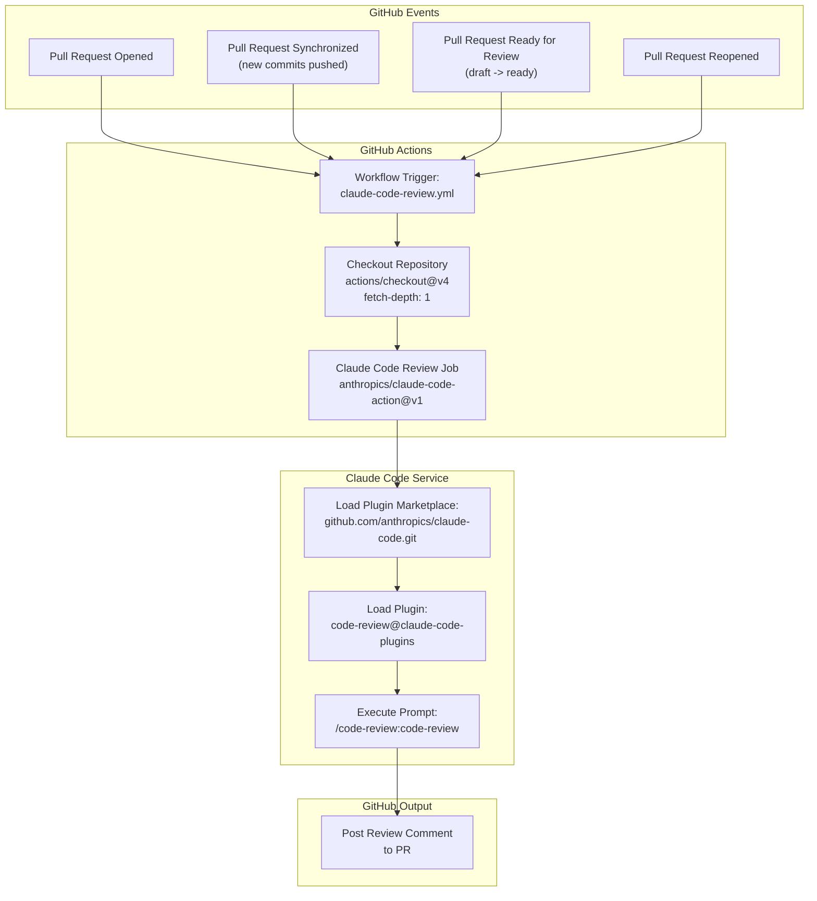
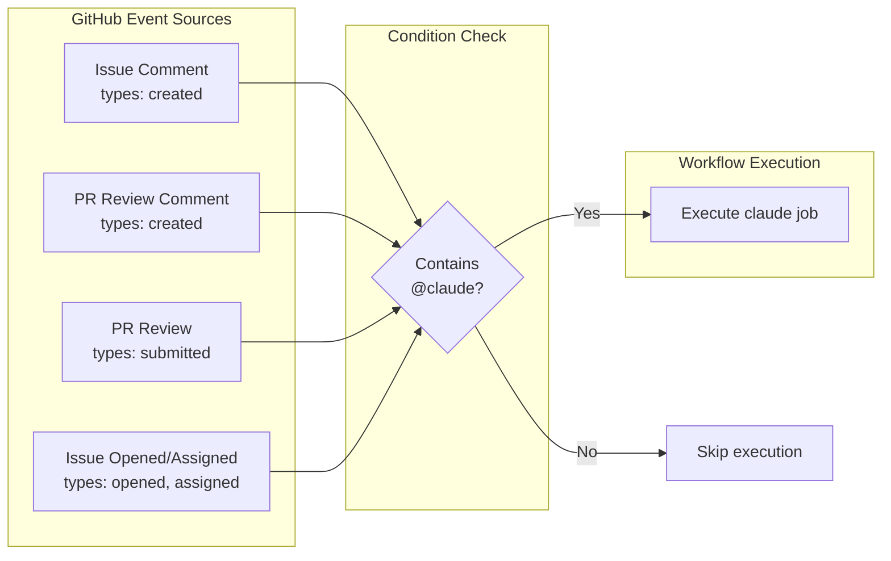
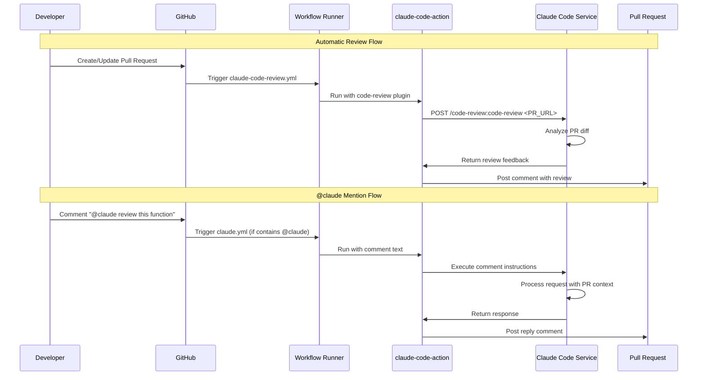

<!-- source: DeepWiki mcp.deepwiki.com · repo anthropics/healthcare · page 5.2 Code Review Workflow · fetched 2026-10-26 -->

# Code Review Workflow

<details>
<summary>Relevant source files</summary>

The following files were used as context for generating this wiki page:

- [.github/workflows/claude-code-review.yml](.github/workflows/claude-code-review.yml)
- [.github/workflows/claude.yml](.github/workflows/claude.yml)

</details>


## Purpose and Scope

This document describes the code review automation system implemented via GitHub Actions workflows. The system provides two complementary approaches to Claude-powered code reviews:

1. **Automatic reviews** triggered by pull request events
2. **On-demand reviews** triggered by `@claude` mentions in comments

For skill-specific reviews that validate healthcare skill changes, see [Skill Review Workflow](#5.1). For packaging and releasing skills, see [Release Workflow](#5.3).

**Sources:** [.github/workflows/claude-code-review.yml:1-45](), [.github/workflows/claude.yml:1-51]()

---

## Workflow Architecture

The code review system consists of two independent GitHub Actions workflows that both leverage the `anthropics/claude-code-action` but serve different purposes and have different triggers.

### Code Review Workflow Comparison

| Aspect | `claude-code-review.yml` | `claude.yml` |
|--------|-------------------------|--------------|
| **Trigger** | PR lifecycle events (opened, synchronized, reopened, ready_for_review) | `@claude` mentions in comments/reviews |
| **Scope** | Automatic code review for all PRs | General-purpose Claude assistant |
| **Plugin** | `code-review@claude-code-plugins` | None (uses comment instructions) |
| **Prompt** | Fixed: `/code-review:code-review` | Dynamic: extracted from comment |
| **Primary Use** | Automated quality assurance | Ad-hoc developer assistance |
| **Importance** | 1.62 | 1.56 |

**Sources:** [.github/workflows/claude-code-review.yml:3-12](), [.github/workflows/claude.yml:3-19]()

---

## Automatic Code Review Workflow

The `claude-code-review.yml` workflow provides automated code review on every pull request update.

### Workflow Trigger Diagram



**Sources:** [.github/workflows/claude-code-review.yml:3-12](), [.github/workflows/claude-code-review.yml:28-43]()

### Job Configuration

The `claude-review` job runs on `ubuntu-latest` with specific permissions required for accessing repository contents and posting comments.

#### Required Permissions

```yaml
permissions:
  contents: read        # Read repository files
  pull-requests: read   # Read PR metadata
  issues: read          # Read issue metadata (PRs are issues)
  id-token: write       # OIDC authentication with Claude Code
```

**Sources:** [.github/workflows/claude-code-review.yml:21-26]()

#### Step Breakdown

| Step | Action | Configuration | Purpose |
|------|--------|---------------|---------|
| `Checkout repository` | `actions/checkout@v4` | `fetch-depth: 1` | Shallow clone for performance |
| `Run Claude Code Review` | `anthropics/claude-code-action@v1` | Multiple parameters | Execute code review |

**Sources:** [.github/workflows/claude-code-review.yml:28-43]()

### Claude Code Action Parameters

The workflow configures the `claude-code-action` with the following parameters:

```yaml
claude_code_oauth_token: ${{ secrets.CLAUDE_CODE_OAUTH_TOKEN }}
plugin_marketplaces: 'https://github.com/anthropics/claude-code.git'
plugins: 'code-review@claude-code-plugins'
prompt: '/code-review:code-review ${{ github.repository }}/pull/${{ github.event.pull_request.number }}'
```

| Parameter | Value | Description |
|-----------|-------|-------------|
| `claude_code_oauth_token` | Secret: `CLAUDE_CODE_OAUTH_TOKEN` | Authentication token for Claude Code service |
| `plugin_marketplaces` | `anthropics/claude-code.git` | Repository containing the code-review plugin |
| `plugins` | `code-review@claude-code-plugins` | Specific plugin identifier to load |
| `prompt` | `/code-review:code-review <PR_URL>` | Command to execute with PR context |

**Sources:** [.github/workflows/claude-code-review.yml:37-43]()

### Optional Filtering Configurations

The workflow includes commented-out configurations for optional filtering:

#### File Path Filtering

```yaml
# Optional: Only run on specific file changes
# paths:
#   - "src/**/*.ts"
#   - "src/**/*.tsx"
#   - "src/**/*.js"
#   - "src/**/*.jsx"
```

When enabled, the workflow only runs if files matching these patterns are changed.

**Sources:** [.github/workflows/claude-code-review.yml:6-11]()

#### PR Author Filtering

```yaml
# Optional: Filter by PR author
# if: |
#   github.event.pull_request.user.login == 'external-contributor' ||
#   github.event.pull_request.user.login == 'new-developer' ||
#   github.event.pull_request.author_association == 'FIRST_TIME_CONTRIBUTOR'
```

When enabled, the workflow only runs for specific authors or first-time contributors.

**Sources:** [.github/workflows/claude-code-review.yml:15-19]()

---

## On-Demand @claude Workflow

The `claude.yml` workflow provides general-purpose Claude assistance triggered by mentioning `@claude` in various GitHub contexts.

### Trigger Event Diagram



**Sources:** [.github/workflows/claude.yml:3-19]()

### Event Types and Trigger Conditions

The workflow responds to four different GitHub event types, each with specific trigger conditions:

| Event Type | Types | Trigger Condition | Context |
|------------|-------|-------------------|---------|
| `issue_comment` | `created` | Comment body contains `@claude` | Regular issue or PR comments |
| `pull_request_review_comment` | `created` | Comment body contains `@claude` | PR line-specific comments |
| `pull_request_review` | `submitted` | Review body contains `@claude` | Full PR review submission |
| `issues` | `opened`, `assigned` | Issue body/title contains `@claude` | New issues |

**Sources:** [.github/workflows/claude.yml:4-19]()

### Conditional Execution Logic

The `claude` job only executes when the triggering event contains an `@claude` mention:

```yaml
if: |
  (github.event_name == 'issue_comment' && contains(github.event.comment.body, '@claude')) ||
  (github.event_name == 'pull_request_review_comment' && contains(github.event.comment.body, '@claude')) ||
  (github.event_name == 'pull_request_review' && contains(github.event.review.body, '@claude')) ||
  (github.event_name == 'issues' && (contains(github.event.issue.body, '@claude') || contains(github.event.issue.title, '@claude')))
```

This multi-condition check ensures the workflow only runs when explicitly invoked by users.

**Sources:** [.github/workflows/claude.yml:15-19]()

### Job Configuration

#### Permissions

The `@claude` workflow requires an additional permission compared to the automatic review workflow:

```yaml
permissions:
  contents: read
  pull-requests: read
  issues: read
  id-token: write
  actions: read    # Required for Claude to read CI results on PRs
```

The `actions: read` permission allows Claude to access CI/CD workflow results, enabling it to provide context-aware assistance based on test failures or build errors.

**Sources:** [.github/workflows/claude.yml:21-26]()

### Claude Code Action Configuration

The `@claude` workflow uses a simpler configuration than the automatic review workflow:

```yaml
claude_code_oauth_token: ${{ secrets.CLAUDE_CODE_OAUTH_TOKEN }}
additional_permissions: |
  actions: read
```

| Parameter | Value | Description |
|-----------|-------|-------------|
| `claude_code_oauth_token` | Secret: `CLAUDE_CODE_OAUTH_TOKEN` | Authentication token |
| `additional_permissions` | `actions: read` | Grants CI result access |
| `prompt` | (not specified) | Claude uses the comment text as instructions |

The absence of a hardcoded `prompt` parameter allows Claude to dynamically interpret the user's request from the comment body.

**Sources:** [.github/workflows/claude.yml:33-41]()

### Optional Customization

The workflow includes commented examples for custom behavior:

```yaml
# Optional: Give a custom prompt to Claude. If this is not specified, 
# Claude will perform the instructions specified in the comment that tagged it.
# prompt: 'Update the pull request description to include a summary of changes.'

# Optional: Add claude_args to customize behavior and configuration
# claude_args: '--allowed-tools Bash(gh pr:*)'
```

These allow repositories to:
- Override the default comment-based prompt
- Restrict or configure available tools (e.g., limit to specific `gh` commands)

**Sources:** [.github/workflows/claude.yml:43-49]()

---

## Workflow Execution Flow

The following diagram shows the end-to-end execution flow for both workflows:



**Sources:** [.github/workflows/claude-code-review.yml:1-45](), [.github/workflows/claude.yml:1-51]()

---

## Integration with Claude Code Action

Both workflows use the `anthropics/claude-code-action@v1` action, which provides the integration layer between GitHub Actions and the Claude Code service.

### Action Version and Repository

```yaml
uses: anthropics/claude-code-action@v1
```

The action is maintained at `https://github.com/anthropics/claude-code-action` and provides:
- Authentication with Claude Code service via OAuth tokens
- Plugin marketplace loading and management
- Prompt execution and response handling
- GitHub comment posting

**Sources:** [.github/workflows/claude-code-review.yml:36](), [.github/workflows/claude.yml:35]()

### Required Secret Configuration

Both workflows require the `CLAUDE_CODE_OAUTH_TOKEN` secret to be configured in the repository settings:

| Secret Name | Purpose | Where to Obtain |
|-------------|---------|-----------------|
| `CLAUDE_CODE_OAUTH_TOKEN` | Authentication token for Claude Code API | Generated from Claude Code dashboard |

This secret must be added via **Settings > Secrets and variables > Actions > Repository secrets**.

**Sources:** [.github/workflows/claude-code-review.yml:38](), [.github/workflows/claude.yml:37]()

---

## Usage Patterns

### When to Use Automatic Reviews

The `claude-code-review.yml` workflow is most effective for:

- **Consistent quality checks**: Every PR receives the same level of automated review
- **Early feedback**: Developers get feedback immediately upon pushing changes
- **Reduced review burden**: Human reviewers can focus on higher-level concerns
- **Onboarding**: New contributors receive automated guidance

### When to Use @claude Mentions

The `claude.yml` workflow is most effective for:

- **Specific questions**: "Explain the logic in this function"
- **Targeted improvements**: "Suggest performance optimizations for this code"
- **Documentation**: "Write a docstring for this class"
- **Context-aware debugging**: Claude can read CI failures with `actions: read` permission
- **One-off tasks**: "Update the PR description with a summary"

### Combining Both Workflows

The workflows are designed to work together:

1. Automatic review (`claude-code-review.yml`) provides baseline quality checks
2. Developer reviews feedback and makes changes
3. Developer can use `@claude` mentions for specific clarifications or improvements
4. Final human review confirms all concerns are addressed

**Sources:** [.github/workflows/claude-code-review.yml:1-45](), [.github/workflows/claude.yml:1-51]()

---

## Relationship to Skill Review Workflow

While the Code Review Workflow provides general code review capabilities, the [Skill Review Workflow](#5.1) (importance: 49.07) is specifically designed for healthcare skill validation:

| Aspect | Code Review Workflow | Skill Review Workflow |
|--------|---------------------|----------------------|
| **Target** | General code changes | Healthcare skill changes (SKILL.md files) |
| **Detection** | All PR events | Git diff analysis to detect changed skills |
| **Plugin** | `code-review` | `skill-creator` |
| **Execution** | Single job | Matrix strategy (parallel per skill) |
| **Validation** | Code quality | Skill-specific healthcare domain validation |
| **Importance** | 1.62 | 49.07 |

For healthcare-specific skill changes, the Skill Review Workflow provides deeper domain validation. The Code Review Workflow serves as a general-purpose supplement for non-skill code changes or ad-hoc developer assistance.

**Sources:** [.github/workflows/claude-code-review.yml:1-45]()

---

## File Structure Summary

```
.github/workflows/
├── claude-code-review.yml    # Automatic PR reviews with code-review plugin
├── claude.yml                 # @claude mention-triggered assistance
└── claude-skill-review.yml    # Healthcare skill-specific reviews (see 5.1)
```

**Sources:** [.github/workflows/claude-code-review.yml:1](), [.github/workflows/claude.yml:1]()

---

