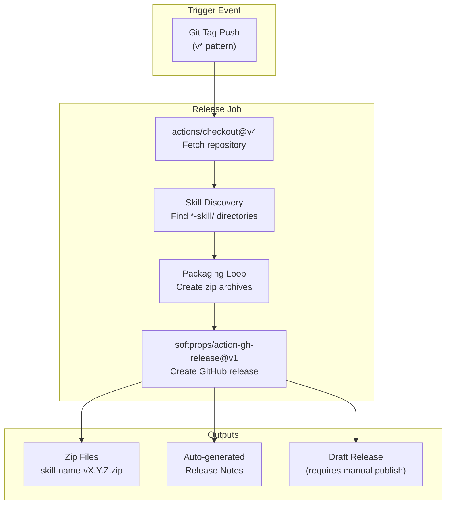
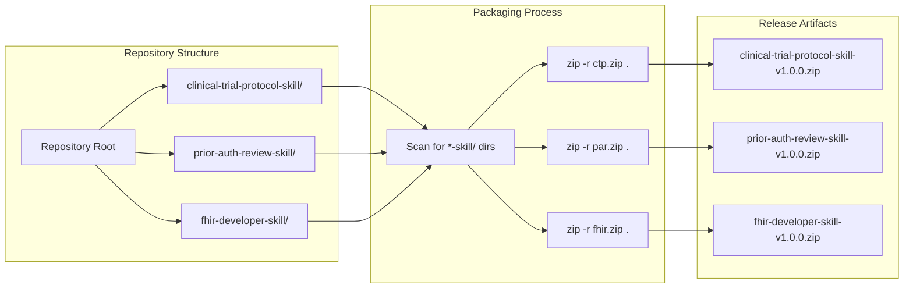
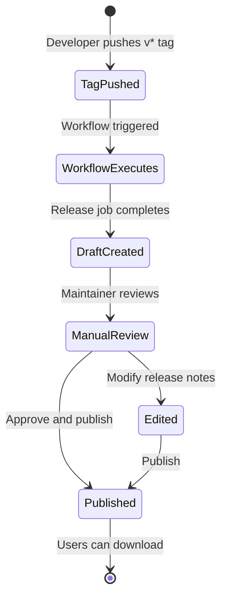
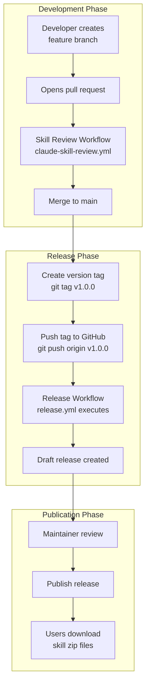

<!-- source: DeepWiki mcp.deepwiki.com · repo anthropics/healthcare · page 5.3 Release Workflow · fetched 2026-10-26 -->

# Release Workflow

<details>
<summary>Relevant source files</summary>

The following files were used as context for generating this wiki page:

- [.github/workflows/claude-skill-review.yml](.github/workflows/claude-skill-review.yml)
- [.github/workflows/release.yml](.github/workflows/release.yml)
- [README.md](README.md)

</details>


## Purpose and Scope

This document describes the release workflow that packages healthcare skills into distributable artifacts and creates GitHub releases. The workflow is defined in [.github/workflows/release.yml]() and executes when version tags are pushed to the repository.

For information about the automated skill review process that occurs before merging, see [Skill Review Workflow](#5.1). For general code review capabilities, see [Code Review Workflow](#5.2).

**Sources:** [.github/workflows/release.yml:1-43]()

---

## Workflow Trigger

The release workflow activates when a git tag matching the pattern `v*` is pushed to the repository. This tag-based trigger ensures releases are created intentionally through version tagging rather than on every merge.

```yaml
on:
  push:
    tags:
      - 'v*'
```

### Version Tag Pattern

Valid tags that trigger the workflow:
- `v1.0.0` - Standard semantic version
- `v2.1.3-beta` - Pre-release version
- `v0.0.1` - Initial version
- `v2024.01.15` - Date-based version

The tag name becomes part of the release artifact filenames through the `GITHUB_REF_NAME` environment variable.

**Sources:** [.github/workflows/release.yml:3-6]()

---

## Workflow Architecture



**Diagram: Release Workflow Execution Flow**

The workflow consists of a single `release` job that runs on `ubuntu-latest` with `contents: write` permissions to create releases and upload artifacts.

**Sources:** [.github/workflows/release.yml:8-43]()

---

## Skill Discovery and Packaging

### Directory Pattern Matching

The workflow identifies skills using a bash glob pattern that matches directories ending with `-skill/`:

```bash
for skill_dir in *-skill/; do
  if [ -d "$skill_dir" ]; then
    # Process skill
  fi
done
```

This pattern discovers:
- `clinical-trial-protocol-skill/`
- `prior-auth-review-skill/`
- `fhir-developer-skill/`

Any new skill added to the repository following this naming convention is automatically included in releases without workflow modifications.

**Sources:** [.github/workflows/release.yml:21-29]()

### Zip Archive Creation

Each skill is packaged into a separate zip file with the naming format:

```
{skill-directory-name}-{tag-name}.zip
```

For example, with tag `v1.2.0`:
- `clinical-trial-protocol-skill-v1.2.0.zip`
- `prior-auth-review-skill-v1.2.0.zip`
- `fhir-developer-skill-v1.2.0.zip`

The packaging process:
1. Changes to the skill directory: `cd "$skill_name"`
2. Creates recursive zip: `zip -r "../${skill_name}-${GITHUB_REF_NAME}.zip" .`
3. Returns to repository root: `cd ..`

All files within the skill directory are included, preserving the directory structure within the archive.

**Sources:** [.github/workflows/release.yml:23-27]()

---

## Packaged Skill Contents



**Diagram: Skill Packaging Transformation**

Each zip file contains the complete skill implementation:

| Skill Directory | Contents Included |
|----------------|-------------------|
| `clinical-trial-protocol-skill/` | `SKILL.md`, `references/`, `scripts/sample_size_calculator.py` |
| `prior-auth-review-skill/` | `SKILL.md`, `assets/` |
| `fhir-developer-skill/` | `SKILL.md`, `references/`, `scripts/setup_fhir_project.py` |

**Sources:** [.github/workflows/release.yml:19-33](), [README.md:19-42]()

---

## GitHub Release Creation

### Release Configuration

The workflow uses the `softprops/action-gh-release@v1` action to create a GitHub release with the following configuration:

| Parameter | Value | Purpose |
|-----------|-------|---------|
| `files` | `*-skill-*.zip` | Glob pattern matching all packaged skills |
| `generate_release_notes` | `true` | Auto-generate notes from commit history |
| `draft` | `true` | Create as draft requiring manual publish |
| `prerelease` | `false` | Mark as production release |

**Sources:** [.github/workflows/release.yml:35-42]()

### Draft Release Workflow

The release is created as a **draft** to enable manual review before publication:



**Diagram: Draft Release Lifecycle**

This manual gate allows maintainers to:
- Review auto-generated release notes
- Add additional context or breaking change warnings
- Verify all skill artifacts are properly packaged
- Ensure the release corresponds to the intended version

**Sources:** [.github/workflows/release.yml:41-42]()

---

## Auto-Generated Release Notes

The `generate_release_notes: true` parameter instructs GitHub to automatically create release notes from the commit history since the previous tag. The generated notes include:

- **Commit List**: All commits between the previous tag and current tag
- **Contributors**: List of contributors to this release
- **Pull Requests**: Links to merged PRs

Example generated notes structure:
```markdown
## What's Changed
* Add sample size calculator to clinical trial protocol by @contributor1 in #123
* Update prior auth review skill with new validation by @contributor2 in #124

## New Contributors
* @contributor1 made their first contribution in #123

**Full Changelog**: v1.0.0...v1.1.0
```

Maintainers can supplement these auto-generated notes with:
- High-level feature summaries
- Breaking changes or migration notes
- Known issues or limitations

**Sources:** [.github/workflows/release.yml:40]()

---

## Permissions and Security

The workflow requires specific GitHub Actions permissions:

```yaml
permissions:
  contents: write
```

The `contents: write` permission enables:
- Creating releases
- Uploading release artifacts
- Modifying release notes

This permission is scoped to the workflow execution and does not grant broader repository access. The workflow runs in an isolated environment and cannot access secrets or perform unauthorized operations.

**Sources:** [.github/workflows/release.yml:8-9]()

---

## Integration with Development Lifecycle



**Diagram: Release Workflow in Development Lifecycle**

### Pre-Release Quality Gates

Before reaching the release workflow, skills pass through:

1. **Local Development**: Developer creates/modifies skill
2. **Pull Request**: Changes submitted for review
3. **Automated Skill Review**: [claude-skill-review.yml]() validates skill quality (see [Skill Review Workflow](#5.1))
4. **Human Review**: Maintainer approves PR
5. **Merge**: Changes integrated to `main` branch

The release workflow assumes all quality checks have passed and focuses solely on packaging and distribution.

**Sources:** [.github/workflows/release.yml:1-43](), [.github/workflows/claude-skill-review.yml:1-88]()

---

## Release Artifact Usage

### Distribution Methods

The packaged skills can be distributed through multiple channels:

| Method | Description | Use Case |
|--------|-------------|----------|
| GitHub Releases | Direct download from release page | Manual installation, archival |
| Marketplace Registry | Reference in `.claude-plugin/marketplace.json` | Automated installation via Claude Code |
| Git Clone | Direct repository access | Development, contribution |

### Marketplace Integration

While the release workflow creates distributable zip files, the primary distribution mechanism is through the marketplace registry:

```json
{
  "name": "clinical-trial-protocol",
  "source": "./",
  "skills": ["./clinical-trial-protocol-skill"]
}
```

Users install skills using the marketplace command:
```bash
/plugin install clinical-trial-protocol@healthcare
```

This command references the source repository, not the release artifacts. The release artifacts serve as versioned snapshots for archival and offline distribution purposes.

**Sources:** [README.md:8-14]()

---

## Workflow Execution Example

### Step-by-Step Execution

When a developer pushes tag `v2.1.0`:

```bash
$ git tag v2.1.0
$ git push origin v2.1.0
```

The workflow executes:

1. **Checkout** ([line 15-16]()):
   ```bash
   actions/checkout@v4
   # Repository cloned to workspace
   ```

2. **Skill Discovery** ([line 21]()):
   ```bash
   for skill_dir in *-skill/; do
   # Finds: clinical-trial-protocol-skill/
   #        prior-auth-review-skill/
   #        fhir-developer-skill/
   ```

3. **Packaging Loop** ([line 23-27]()):
   ```bash
   cd clinical-trial-protocol-skill
   zip -r ../clinical-trial-protocol-skill-v2.1.0.zip .
   cd ..
   # Repeats for each skill
   ```

4. **List Artifacts** ([line 32-33]()):
   ```bash
   ls -la *-skill-*.zip
   # Output:
   # clinical-trial-protocol-skill-v2.1.0.zip
   # prior-auth-review-skill-v2.1.0.zip
   # fhir-developer-skill-v2.1.0.zip
   ```

5. **Create Release** ([line 35-42]()):
   ```bash
   softprops/action-gh-release@v1
   # Uploads: all *-skill-*.zip files
   # Status: draft (requires manual publish)
   ```

**Sources:** [.github/workflows/release.yml:14-42]()

---

## Error Handling and Debugging

### Common Issues

| Issue | Symptom | Resolution |
|-------|---------|------------|
| No skills found | Empty artifact list | Verify skill directories follow `*-skill/` naming |
| Zip creation fails | Workflow fails at packaging step | Check file permissions in skill directories |
| Release creation fails | `softprops/action-gh-release` error | Verify `contents: write` permission enabled |
| Tag mismatch | Unexpected version in filenames | Ensure tag follows `v*` pattern |

### Debugging Commands

To test packaging locally before creating a release:

```bash
# Test skill discovery
ls -d *-skill/

# Test zip creation for one skill
cd clinical-trial-protocol-skill
zip -r ../test-package.zip .
cd ..

# Verify archive contents
unzip -l test-package.zip
```

### Workflow Logs

Review workflow execution logs at:
```
https://github.com/anthropics/healthcare/actions/workflows/release.yml
```

The logs show:
- Discovered skill directories
- Created zip files with sizes
- Release creation status
- Artifact upload results

**Sources:** [.github/workflows/release.yml:19-33]()

---

## Comparison with Other Workflows

```mermaid
graph TB
    subgraph "Skill Review Workflow"
        SR_TRIGGER["PR opened/synchronized"]
        SR_JOBS["detect-skills + review-skill<br/>(matrix strategy)"]
        SR_OUTPUT["PR comments with feedback"]
        
        SR_TRIGGER --> SR_JOBS
        SR_JOBS --> SR_OUTPUT
    end
    
    subgraph "Code Review Workflow"
        CR_TRIGGER["@claude mention in PR"]
        CR_JOBS["claude-review job"]
        CR_OUTPUT["General code feedback"]
        
        CR_TRIGGER --> CR_JOBS
        CR_JOBS --> CR_OUTPUT
    end
    
    subgraph "Release Workflow"
        RL_TRIGGER["Version tag push"]
        RL_JOBS["release job<br/>(single execution)"]
        RL_OUTPUT["Draft release + zip files"]
        
        RL_TRIGGER --> RL_JOBS
        RL_JOBS --> RL_OUTPUT
    end
```



**Diagram: Workflow Comparison**

| Aspect | Skill Review | Code Review | Release |
|--------|-------------|-------------|---------|
| Trigger | PR events | `@claude` mention | Version tag |
| Parallelization | Matrix (per skill) | Single job | Single job |
| Human interaction | Review feedback | Code suggestions | Manual publish |
| External services | Claude Code API | Claude Code API | GitHub Releases |
| Importance score | 49.07 | 1.62 | 8.89 |

The release workflow has moderate importance (8.89) compared to skill review (49.07) because:
- It executes less frequently (only on version tags)
- It requires manual final approval (draft releases)
- It performs mechanical packaging rather than quality validation

**Sources:** [.github/workflows/release.yml:1-43](), [.github/workflows/claude-skill-review.yml:1-88]()

---

## Future Enhancements

While the current release workflow is functional, potential improvements include:

### Semantic Version Validation

Add a step to validate that the tag follows semantic versioning conventions:
```bash
if [[ ! $GITHUB_REF_NAME =~ ^v[0-9]+\.[0-9]+\.[0-9]+.*$ ]]; then
  echo "Invalid version tag format"
  exit 1
fi
```

### Checksum Generation

Generate SHA256 checksums for each zip file:
```bash
sha256sum *-skill-*.zip > checksums.txt
```

### Automated Testing Before Release

Run skill validation tests before packaging:
```bash
- name: Test skills
  run: |
    for skill_dir in *-skill/; do
      # Run skill-specific tests
    done
```

These enhancements would increase release reliability and security without significantly complicating the workflow.

**Sources:** [.github/workflows/release.yml:1-43]()

---

